> Копия публичной страницы Т-Инвестиций для внутреннего анализа. Источник: https://www.tbank.ru/invest/research/strategy/2026-autumn-update/alternative/ · снято 2026-11-09
> Разделы: [Главная: макро, портфели, сценарии](main.md) · [Рынок облигаций](bonds.md) · [Рынок акций](stocks.md) · **Альтернативные инвестиции**

## Чем еще дополнить портфель

Больше возможностей для инвестиций

Золото: ставки диктуют свои условия

ФРС задала направление. За последние пару месяцев появилось существенно больше ясности относительно дальнейшей траектории денежно-кредитной политики США — одного из ключевых факторов для золота. На сентябрьском заседании ФРС подкрепила жесткий сигнал повышением ставки. Рынки начали закладывать в ожидания цикл ужесточения, хотя и весьма ограниченный по масштабу. Впрочем, ситуация на Ближнем Востоке и цены на энергоносители по-прежнему создают значительную неопределенность.

Высокие ставки давят на золото. Доходности казначейских облигаций США и динамика доллара остаются ключевыми факторами для среднесрочного прогноза по золоту. С начала ближневосточного конфликта чувствительность драгметалла к ним заметно выросла и остается высокой. С учетом уже высоких доходностей долгосрочных облигаций их дальнейший рост не гарантирован даже при ужесточении политики ФРС. Тем не менее условия для золота в ближайшие месяцы, вероятнее всего, останутся сложными.

Инвестиционный спрос может ослабнуть. После сокращения спекулятивных позиций в первой половине года инвестиционный спрос на золото остается устойчивым: третий квартал стал рекордным по притоку средств в золотые ETF. Драгметалл привлекает инвесторов как перспективами долгосрочной доходности, так и возможностью диверсифицировать портфель. Этому способствует высокая концентрация капитала в активах, связанных с ИИ, сохраняющиеся геополитические риски и растущие опасения по поводу долговой нагрузки развитых стран. Однако высокие ставки повышают вероятность ослабления инвестиционного спроса в среднесрочной перспективе.

Долгосрочные перспективы золота остаются благоприятными. Покупки центральных банков сохраняются на высоком уровне и продолжат поддерживать золото на долгосрочном горизонте. По мере ослабления давления со стороны ставок ожидаем восстановления инвестиционного спроса. В этих условиях вероятность дальнейшего роста цен высока, а текущие уровни выглядят привлекательными для формирования долгосрочных позиций.

Наш прогноз

#### Конец 2026 года

$3 900—4 100 за унцию

#### Следующие 12 месяцев

$4 500—4 800 за унцию

Текущий год, вероятно, станет одним из самых турбулентных для рынка золота за последние десятилетия. Сейчас драгметалл торгуется примерно на 30% ниже январского рекорда, а волатильность котировок с начала года в среднем в 1,7 раза превышает уровни 2024–2025 годов.

**Динамика золота с 2023 года**

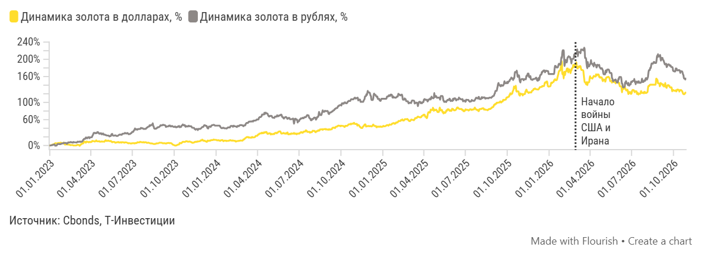

*График 30694991 — «Динамика золота с 2023 года». Интерактив: https://flo.uri.sh/visualisation/30694991/embed. Данные: [CSV](../charts/30694991.csv), [JSON](../charts/30694991.json)*

Подписи и настройки графика: axes_highlights.x_lines: Начало войны США и Ирана :: 28.02.2026; layout.source_name: Cbonds, Т-Инвестиции

| Дата | Динамика золота в долларах, % | Динамика золота в рублях, % |
|---|---|---|
| 2026-10-29 | 120.5 | 157.2 |
| 2026-10-28 | 123 | 154 |
| 2026-10-27 | 122.6 | 153.2 |
| 2026-10-26 | 120.3 | 155.6 |
| 2026-10-25 | 119.1 | 155.6 |
| 2026-10-24 | 119.1 | 155.6 |
| 2026-10-23 | 119.1 | 162.5 |
| 2026-10-22 | 120.7 | 165 |
| 2026-10-20 | 126.2 | 172.1 |
| 2026-10-19 | 127 | 172.2 |
| 2026-10-18 | 128.4 | 172.2 |
| 2026-10-17 | 128.4 | 172.2 |
| 2026-10-16 | 128.4 | 168.5 |
| 2026-10-15 | 128.7 | 174.4 |
| 2026-10-14 | 125.1 | 174.3 |
| 2026-10-13 | 128.1 | 175.4 |
| 2026-10-12 | 128.7 | 174.5 |
| 2026-10-11 | 130 | 174.5 |
| 2026-10-10 | 130 | 174.5 |
| 2026-10-09 | 130 | 174.2 |
| 2026-10-08 | 126.7 | 178.5 |
| 2026-10-07 | 125.4 | 178.3 |
| 2026-10-06 | 128.3 | 178.9 |
| 2026-10-05 | 127 | 171.7 |
| 2026-10-04 | 127 | 171.7 |
| 2026-10-03 | 127 | 171.7 |
| 2026-10-02 | 127 | 172.5 |
| 2026-10-01 | 129 | 172.7 |
| 2026-09-30 | 127.9 | 174.3 |
| 2026-09-29 | 129.3 | 181.9 |
| … | … | … |
| 2023-01-24 | 6.3 | 3.6 |
| 2023-01-23 | 5.9 | 3.3 |
| 2023-01-21 | 5.6 | 3.3 |
| 2023-01-20 | 5.7 | 3.7 |
| 2023-01-19 | 6 | 3.3 |
| 2023-01-18 | 4.4 | 3.2 |
| 2023-01-17 | 4.7 | 2.1 |
| 2023-01-16 | 5 | -0.3 |
| 2023-01-14 | 5.3 | -0.3 |
| 2023-01-13 | 5.3 | -0.5 |
| 2023-01-12 | 4.1 | 1.6 |
| 2023-01-11 | 2.9 | 2.5 |
| 2023-01-10 | 3 | 2.1 |
| 2023-01-02 | 0 | 0 |
| 2022-12-31 | 0 | 0 |

*Показано 45 из 1337 строк, полный ряд: [CSV](../charts/30694991.csv), [JSON](../charts/30694991.json)*

Однако прошедшие месяцы запомнились не только высокой волатильностью: фундаментальная картина изменилась, а среднесрочные риски возросли. Конфликт на Ближнем Востоке развернул ожидания по долларовым ставкам. Еще в начале года перспективы их снижения поддерживали инвестиционный спрос на золото. Теперь рынок переоценивает инфляционные риски, а долларовые доходности растут.

Ставки остаются ключевым фактором для инвесторов в золото. Чувствительность драгметалла к доходностям и курсу доллара заметно выросла с начала конфликта, вернувшись к долгосрочной исторической норме. При этом колебания на долговом рынке в текущем году исключительно масштабны, и ближайшие месяцы также не обещают быть спокойными. Поэтому именно ставки, на наш взгляд, будут определять динамику золота в среднесрочной перспективе.

Долгосрочная динамика остается впечатляющей

Поворотным для рынка стал 2022 год: геополитический шок, макроэкономические риски и заморозка валютных резервов России побудили центробанки диверсифицировать международные резервы и резко нарастить покупки золота. Со второй половины 2024 года дополнительную поддержку обеспечил растущий инвестиционный спрос на фоне начала цикла снижения ставок в США.

Даже с учетом текущей коррекции долларовая цена золота с начала 2023 года выросла на 120%, что соответствует среднегодовой доходности около 23%.

Высокие ставки усиливают давление на золото

Разгоревшийся в марте конфликт на Ближнем Востоке развернул ожидания по долларовым ставкам. Еще в начале года перспективы их снижения поддерживали инвестиционный спрос на золото. Однако резкое подорожание нефти привело к переоценке инфляционных рисков и росту долларовых доходностей.

Риски, связанные с Ближним Востоком и рынком энергоносителей, остаются высокими, а перспективы скорого урегулирования кризиса — неясными. Несмотря на оценки, указывающие на восстановление объемов транзита через регион, в том числе по обходным маршрутам, цены на нефть и СПГ пока не снижаются. Этому способствует угроза новых перебоев и истощенные запасы. Покупатели нефти конкурируют за доступные объемы, а потребители СПГ пополняют хранилища перед зимой.

На этом фоне мировая инфляция продолжает расти. Риск переноса подорожания энергоносителей в цены других товаров и услуг дополнительно усиливает ожидания повышения долларовых ставок.

**Динамика нефти, реальных доходностей и золота**

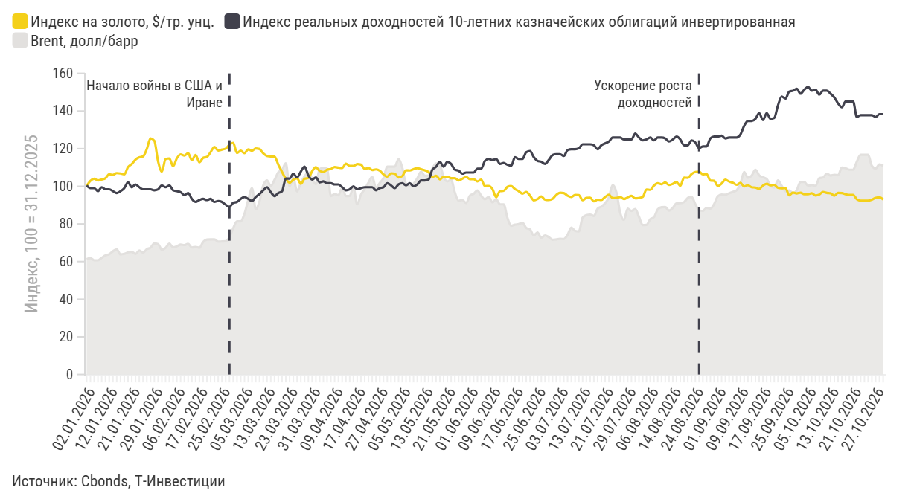

*График 30695091 — «Динамика нефти, реальных доходностей и золота». Интерактив: https://flo.uri.sh/visualisation/30695091/embed. Данные: [CSV](../charts/30695091.csv), [JSON](../charts/30695091.json)*

Подписи и настройки графика: axes_highlights.x_lines: Начало войны в США и Иране::27.02.2026 Ускорение роста доходностей::25.08.2026; axes_highlights.y_lines: ::0; layout.source_name: Cbonds, Т-Инвестиции; y.title: Индекс, 100 = 31.12.2025; chart_type: area_stacked_line

| Дата | Индекс на золото, $/тр. унц. | Индекс реальных доходностей 10-летних казначейских облигаций инвертированная | Brent, долл/барр |
|---|---|---|---|
| 02.01.2026 | 100,2 | 100,5 | 61,3 |
| 05.01.2026 | 102,9 | 99,0 | 61,8 |
| 06.01.2026 | 104,0 | 99,0 | 60,7 |
| 07.01.2026 | 103,1 | 97,4 | 60,7 |
| 08.01.2026 | 103,6 | 99,5 | 62,0 |
| 09.01.2026 | 104,3 | 98,4 | 63,3 |
| 12.01.2026 | 106,4 | 98,4 | 63,9 |
| 13.01.2026 | 106,1 | 97,4 | 65,5 |
| 14.01.2026 | 107,0 | 96,4 | 66,5 |
| 15.01.2026 | 106,8 | 97,4 | 63,8 |
| 16.01.2026 | 106,3 | 99,0 | 64,1 |
| 20.01.2026 | 110,2 | 102,1 | 64,9 |
| 21.01.2026 | 111,8 | 99,5 | 65,2 |
| 22.01.2026 | 114,2 | 101,0 | 64,1 |
| 23.01.2026 | 115,4 | 99,5 | 65,9 |
| 26.01.2026 | 115,9 | 98,4 | 64,8 |
| 27.01.2026 | 119,8 | 98,4 | 66,6 |
| 28.01.2026 | 125,4 | 98,4 | 67,4 |
| 29.01.2026 | 124,2 | 97,9 | 69,6 |
| 30.01.2026 | 113,3 | 98,4 | 69,3 |
| 02.02.2026 | 107,8 | 100,5 | 66,3 |
| 03.02.2026 | 114,4 | 99,5 | 67,3 |
| 04.02.2026 | 114,8 | 100,5 | 69,5 |
| 05.02.2026 | 110,6 | 97,9 | 67,6 |
| 06.02.2026 | 114,9 | 97,4 | 68,1 |
| 09.02.2026 | 117,0 | 96,9 | 69,0 |
| 10.02.2026 | 116,3 | 95,3 | 68,8 |
| 11.02.2026 | 117,6 | 96,4 | 69,4 |
| 12.02.2026 | 113,9 | 93,3 | 67,5 |
| 13.02.2026 | 116,7 | 91,7 | 67,8 |
| … | … | … | … |
| 13.10.2026 | 96,3 | 149,2 | 105,7 |
| 14.10.2026 | 95,0 | 147,2 | 106,1 |
| 15.10.2026 | 96,5 | 144,0 | 105,9 |
| 16.10.2026 | 96,4 | 142,0 | 109,9 |
| 19.10.2026 | 95,8 | 145,1 | 109,6 |
| 20.10.2026 | 95,4 | 145,1 | 108,8 |
| 21.10.2026 | 95,4 | 145,1 | 108,8 |
| 22.10.2026 | 93,1 | 136,8 | 113,17 |
| 23.10.2026 | 92,4 | 137,8 | 116,72 |
| 24.10.2026 | 92,4 | 137,8 | 116,72 |
| 25.10.2026 | 92,4 | 137,8 | 116,72 |
| 26.10.2026 | 92,9 | 137,8 | 110,74 |
| 27.10.2026 | 93,9 | 136,8 | 109,41 |
| 28.10.2026 | 94,1 | 138,3 | 111,64 |
| 29.10.2026 | 93,0 | 138,3 | 110,8 |

*Показано 45 из 213 строк, полный ряд: [CSV](../charts/30695091.csv), [JSON](../charts/30695091.json)*

В этих условиях ФРС в сентябре перешла к повышению ставки. Это сняло часть неопределенности относительно дальнейшей траектории денежно-кредитной политики США и показало готовность регулятора под руководством нового председателя Кевина Уорша следовать привычной логике центральных банков. Сейчас рынок закладывает еще два-три повышения ставки в ближайшие 12 месяцев — суммарно до 75 б. п. Реализация такого сценария не ломает долгосрочный инвестиционный кейс золота, хотя и может усилить волатильность котировок.

Важна и динамика доходностей долгосрочных долларовых облигаций. С начала марта по первые числа октября они выросли примерно с 4 до 5,3%, ненадолго превысив максимумы 2007 года. Особенно стремительным рост был с 25 августа по конец сентября: чуть более чем за месяц доходности поднялись на 66 б. п., став основным фактором давления на золото.

Ожидания по ставке ФРС объясняют лишь часть этого движения. На долгосрочные казначейские облигации США также давят:

- конкуренция за капитал;
- ожидания ускорения экономического роста на фоне мощного инвестиционного цикла в стране;
- опасения по поводу бюджетной дисциплины и госдолга развитых стран;
- геополитическая неопределенность.

Даже после некоторого снижения в октябре долгосрочные доходности остаются привлекательными для инвесторов, что повышает риск перетока капитала из золота на долговой рынок.

Несмотря на сложные условия, инвестиционный спрос на золото в третьем квартале оставался устойчивым. Приток средств в золотые ETF составил почти $31 млрд — рекорд в денежном выражении. В натуральном выражении результат скромнее, но тоже значителен: запасы золота в фондах выросли за квартал на 211 тонн и превысили 4 250 тонн.

**Динамика активов в золотых ETF, тонн**

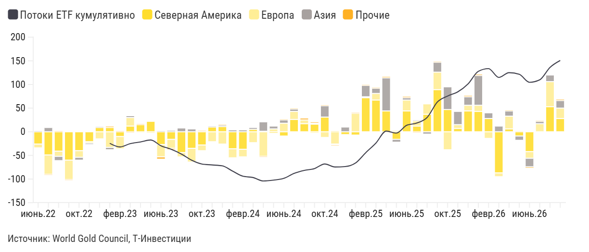

*График 30695302 — «Динамика активов в золотых ETF, тонн». Интерактив: https://flo.uri.sh/visualisation/30695302/embed. Данные: [CSV](../charts/30695302.csv), [JSON](../charts/30695302.json)*

Подписи и настройки графика: axes_highlights.y_lines: Среднее за период 2012—2021 :: 512; layout.source_name: World Gold Council, Т-Инвестиции; chart_type: column_stacked_line

| Date | Потоки ETF кумулятивно | Северная Америка | Европа | Азия | Прочие |
|---|---|---|---|---|---|
| июнь.22 |  | -                       26 | -                         7 | 1 | 0 |
| июль.22 |  | -                       49 | -                       41 | 8 | -                         1 |
| авг.22 |  | -                       41 | -                       11 | -                         8 | 1 |
| сент.22 |  | -                       60 | -                       41 | 0 | -                         1 |
| окт.22 |  | -                       40 | -                       14 | -                         5 | 0 |
| нояб.22 |  | -                       21 | -                         3 | -                         2 | -                         0 |
| дек.22 |  | 9 | -                       14 | 1 | -                         0 |
| янв.23 | -                       26 | 9 | -                       33 | -                         4 | 2 |
| февр.23 | -                       61 | -                       10 | -                       25 | -                         0 | 1 |
| март.23 | -                       29 | 12 | 18 | 3 | -                         1 |
| апр.23 | -                       13 | 15 | -                         1 | 0 | 1 |
| май.23 | 6 | 21 | -                         2 | 0 | 0 |
| июнь.23 | -                       50 | -                       27 | -                       26 | 1 | -                         4 |
| июль.23 | -                       84 | -                       16 | -                       19 | 2 | -                         2 |
| авг.23 | -                    130 | -                       44 | -                         8 | 7 | 0 |
| сент.23 | -                    189 | -                       35 | -                       28 | 5 | -                         0 |
| окт.23 | -                    226 | -                       28 | -                       11 | 1 | 1 |
| нояб.23 | -                    235 | 10 | -                       20 | 1 | -                         0 |
| дек.23 | -                    244 | 11 | -                       25 | 3 | 1 |
| янв.24 | -                    295 | -                       36 | -                       18 | 3 | -                         0 |
| февр.24 | -                    344 | -                       37 | -                       15 | 3 | -                         0 |
| март.24 | -                    357 | 5 | -                       22 | 3 | 0 |
| апр.24 | -                    390 | 1 | -                       52 | 19 | -                         1 |
| май.24 | -                    382 | -                         2 | 6 | 5 | -                         0 |
| июнь.24 | -                    365 | -                         8 | 18 | 7 | 1 |
| июль.24 | -                    317 | 26 | 17 | 5 | 1 |
| авг.24 | -                    288 | 17 | 8 | 0 | 3 |
| сент.24 | -                    270 | 16 | -                         2 | 2 | 2 |
| окт.24 | -                    226 | 31 | -                       11 | 24 | 1 |
| нояб.24 | -                    255 | 1 | -                       26 | -                         2 | -                         1 |
| дек.24 | -                    251 | -                         5 | -                         0 | 9 | -                         0 |
| янв.25 | -                    217 | -                         6 | 39 | 0 | 1 |
| февр.25 | -                    117 | 72 | 2 | 24 | 1 |
| март.25 | -                       23 | 67 | 14 | 11 | 1 |
| апр.25 | 92 | 44 | -                         1 | 70 | 2 |
| май.25 | 73 | -                       16 | 2 | -                         5 | -                         0 |
| июнь.25 | 148 | 44 | 23 | 5 | 2 |
| июль.25 | 170 | 12 | 11 | 1 | -                         1 |
| авг.25 | 224 | 37 | 21 | -                         4 | -                         0 |
| сент.25 | 373 | 89 | 37 | 21 | 1 |
| окт.25 | 431 | 47 | -                       37 | 47 | 0 |
| нояб.25 | 472 | 7 | 8 | 27 | -                         0 |
| дек.25 | 549 | 44 | 12 | 18 | 2 |
| янв.26 | 670 | 43 | 13 | 63 | 2 |
| февр.26 | 696 | 28 | -                       13 | 11 | 0 |
| март.26 | 611 | -                       87 | -                         7 | 11 | -                         0 |
| апр.26 | 657 | 6 | 27 | 11 | 1 |
| май.26 | 641 | -                         9 | 1 | -                         8 | -                         0 |
| июнь.26 | 564 | -                       42 | -                       14 | -                       18 | -                         2 |
| июль.26 | 588 | 0 | 17 | 5 | 1 |
| авг.26 | 708 | 53 | 53 | 13 | 0 |
| сент.26 | 775 | 28 | 22 | 16 | 2 |

Тем не менее в ближайшие несколько месяцев условия для рынка золота останутся неблагоприятными, что может ослабить инвестиционный спрос. Снижение давления со стороны ставок мы ждем в первом полугодии 2027-го, хотя многое будет зависеть от ситуации на Ближнем Востоке и цен на энергоносители.

Мнение аналитика Т-Инвестиций

«Перспектива дальнейшего повышения ставки ФРС, высокие долгосрочные доходности и риск укрепления доллара создают неблагоприятный фон для золота. Эти факторы могут ослабить инвестиционный спрос, который в последние годы был одним из ключевых драйверов роста котировок драгметалла».

Александр Потехин, ведущий аналитик Т-Инвестиций

Центробанки продолжают покупать золото и поддерживать котировки

Несмотря на низкие объемы чистых покупок в первом квартале, во многом связанные с геополитической и рыночной турбулентностью, во втором квартале центробанки вновь продемонстрировали уверенный спрос. По оценке Всемирного совета по золоту (World Gold Council), они приобрели 289 тонн золота — рекордный объем для второго квартала. В целом спрос со стороны центральных банков остается устойчивым.

World Gold Council пересмотрел оценку чистых покупок центробанков за первый квартал с 244 до 57 тонн. По уточненным данным, 187 тонн разницы пришлось на покупки других участников внебиржевого рынка, поэтому оценка совокупного спроса на золото не изменилась. Кроме того, объем чистых покупок центробанков в первом квартале сдерживали активные продажи золота Турцией в марте. Они носили преимущественно тактический характер и были связаны с ближневосточным шоком

**Динамика чистых покупок золота центральными банками, тонн**

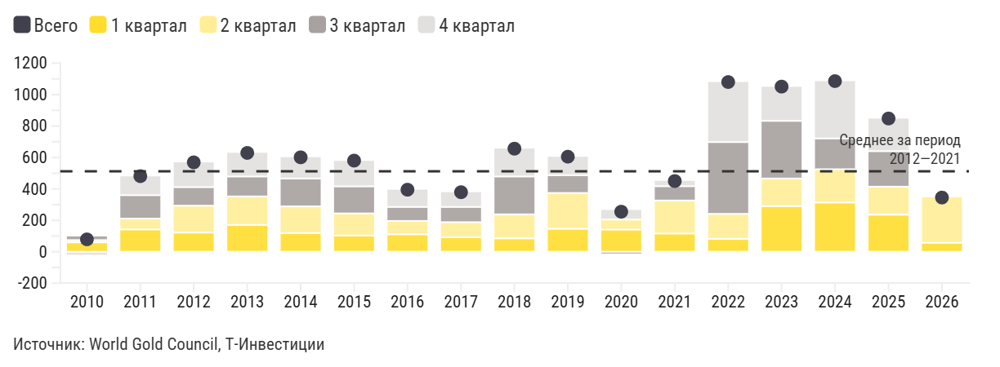

*График 30695372 — «Динамика чистых покупок золота центральными банками, тонн». Интерактив: https://flo.uri.sh/visualisation/30695372/embed. Данные: [CSV](../charts/30695372.csv), [JSON](../charts/30695372.json)*

Подписи и настройки графика: axes_highlights.y_lines: Среднее за период 2012—2021 :: 512; layout.source_name: World Gold Council, Т-Инвестиции; chart_type: column_stacked_line

| label | Всего | 1 квартал | 2 квартал | 3 квартал | 4 квартал |
|---|---|---|---|---|---|
| 2010 | 79 | 60 | 14 | 24 | -                       19 |
| 2011 | 481 | 142 | 69 | 149 | 120 |
| 2012 | 569 | 122 | 171 | 118 | 158 |
| 2013 | 629 | 171 | 181 | 127 | 151 |
| 2014 | 601 | 119 | 170 | 177 | 136 |
| 2015 | 580 | 103 | 141 | 172 | 163 |
| 2016 | 395 | 111 | 85 | 89 | 110 |
| 2017 | 379 | 92 | 96 | 97 | 94 |
| 2018 | 656 | 85 | 153 | 241 | 178 |
| 2019 | 605 | 146 | 228 | 113 | 118 |
| 2020 | 255 | 141 | 64 | -                       11 | 61 |
| 2021 | 450 | 116 | 210 | 91 | 34 |
| 2022 | 1 080 | 82 | 159 | 457 | 382 |
| 2023 | 1 051 | 290 | 176 | 367 | 217 |
| 2024 | 1 086 | 313 | 212 | 196 | 365 |
| 2025 | 848 | 236 | 178 | 226 | 208 |
| 2026 | 345 | 57 | 289 | - | - |

Одним из крупнейших покупателей золота остается Народный банк Китая. По официальным данным, с марта регулятор последовательно увеличивает ежемесячные покупки: с 5 тонн в марте до 23 тонн в сентябре. Всего с начала года он приобрел более 100 тонн

У Китая сохраняется значительный потенциал для наращивания доли золота в резервах. Сейчас она составляет около 8,5% — заметно ниже среднемирового уровня, равного примерно 20%.

**Официальные покупки золота Народным банком Китая**

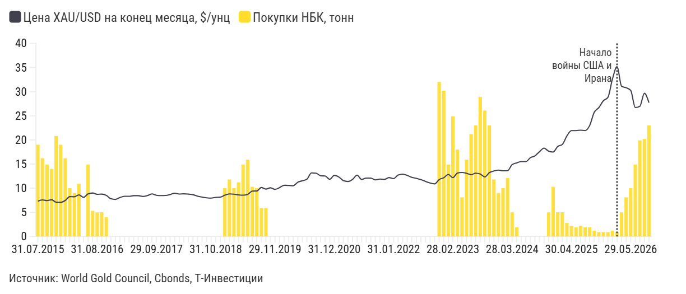

*График 30695430 — «Официальные покупки золота Народным банком Китая». Интерактив: https://flo.uri.sh/visualisation/30695430/embed. Данные: [CSV](../charts/30695430.csv), [JSON](../charts/30695430.json)*

Подписи и настройки графика: axes_highlights.x_lines: Начало войны США и Ирана::27.02.2026; axes_highlights.y_lines: Среднее за период 2012—2021 :: 512; layout.source_name: World Gold Council, Cbonds, Т-Инвестиции; chart_type: column_stacked_line

| Дата (посл. торговый день месяца) | Цена XAU/USD на конец месяца, $/унц | Покупки НБК, тонн |
|---|---|---|
| 31.07.2015 | 1095,6 | 19 |
| 31.08.2015 | 1134,9 | 16,2 |
| 30.09.2015 | 1114,9 | 14,9 |
| 30.10.2015 | 1142,2 | 14 |
| 30.11.2015 | 1065,0 | 20,8 |
| 31.12.2015 | 1060,9 | 19 |
| 29.01.2016 | 1118,1 | 16,2 |
| 29.02.2016 | 1238,6 | 10 |
| 31.03.2016 | 1232,9 | 9 |
| 29.04.2016 | 1293,4 | 10,9 |
| 31.05.2016 | 1215,3 |  |
| 30.06.2016 | 1322,0 | 14,9 |
| 29.07.2016 | 1351,2 | 5,3 |
| 31.08.2016 | 1309,0 | 5 |
| 30.09.2016 | 1316,1 | 5 |
| 31.10.2016 | 1276,9 | 4 |
| 30.11.2016 | 1173,3 |  |
| 30.12.2016 | 1151,6 |  |
| 31.01.2017 | 1210,6 |  |
| 28.02.2017 | 1248,3 |  |
| 31.03.2017 | 1249,1 |  |
| 28.04.2017 | 1268,2 |  |
| 31.05.2017 | 1268,8 |  |
| 30.06.2017 | 1242,1 |  |
| 31.07.2017 | 1269,5 |  |
| 31.08.2017 | 1321,4 |  |
| 29.09.2017 | 1280,1 |  |
| 31.10.2017 | 1271,2 |  |
| 30.11.2017 | 1275,0 |  |
| 29.12.2017 | 1303,2 |  |
| … | … | … |
| 31.07.2025 | 3290,1 | 1,9 |
| 29.08.2025 | 3447,4 | 1,9 |
| 30.09.2025 | 3858,5 | 1,2 |
| 31.10.2025 | 4002,8 | 0,9 |
| 28.11.2025 | 4215,8 | 0,9 |
| 31.12.2025 | 4322,6 | 0,9 |
| 30.01.2026 | 4895,4 | 1,2 |
| 27.02.2026 | 5278,5 | 0,9 |
| 31.03.2026 | 4667,9 | 5 |
| 30.04.2026 | 4622,1 | 8,1 |
| 29.05.2026 | 4540,5 | 10 |
| 30.06.2026 | 4007,5 | 14,9 |
| 31.07.2026 | 4045,2 | 19,9 |
| 31.08.2026 | 4449,2 | 20,2 |
| 30.09.2026 | 4157,1 | 23 |

*Показано 45 из 135 строк, полный ряд: [CSV](../charts/30695430.csv), [JSON](../charts/30695430.json)*

Официальная статистика, вероятно, недооценивает фактический объем покупок Китая: аналитики неоднократно оценивали реальный спрос со стороны центрального банка страны в несколько раз выше заявленных значений.

О сохранении высокого спроса говорят и результаты опроса центробанков, проведенного World Gold Council в феврале — мае этого года. Рекордные 45% регуляторов ожидают увеличения собственных золотых резервов в ближайшие 12 месяцев против 43% годом ранее. Лишь 1% допускает их сокращение. При этом 89% респондентов прогнозируют дальнейший рост совокупных золотых резервов мировых центробанков.

**Как, по ожиданиям центральных банков изменятся их золотые резервы в ближайшие 12 месяцев**

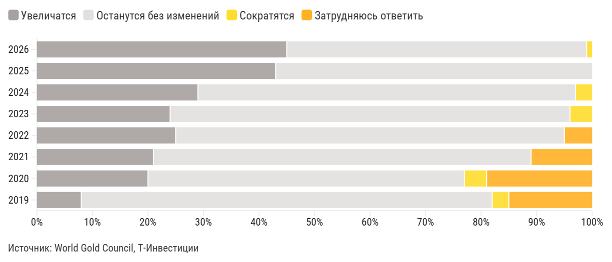

*График 30695677 — «Как, по ожиданиям центральных банков изменятся их золотые резервы в ближайшие 12 месяцев». Интерактив: https://flo.uri.sh/visualisation/30695677/embed. Данные: [CSV](../charts/30695677.csv), [JSON](../charts/30695677.json)*

Подписи и настройки графика: axes_highlights.y_lines: Среднее за период 2012—2021 :: 512; layout.source_name: World Gold Council, Т-Инвестиции; chart_type: bar_stacked

| Год | Увеличатся | Останутся без изменений | Сократятся | Затрудняюсь ответить |
|---|---|---|---|---|
| 2026 | 45% | 54% | 1% |  |
| 2025 | 43% | 57% |  |  |
| 2024 | 29% | 68% | 3% |  |
| 2023 | 24% | 72% | 4% |  |
| 2022 | 25% | 70% |  | 5% |
| 2021 | 21% | 68% |  | 11% |
| 2020 | 20% | 57% | 4% | 20% |
| 2019 | 8% | 74% | 3% | 15% |

В опросе присутствует и осторожная нотка. После значительного роста цен на золото в последние годы регуляторы стали внимательнее относиться к рискам таких вложений: доля центробанков, называющих риск-менеджмент одной из причин активного управления золотыми резервами, за год почти удвоилась — с 22 до 42%.

Спрос центробанков на золото остается устойчивым. Нарастающая разобщенность мировой политики и экономики, а также регулярные геополитические потрясения побуждают регуляторов диверсифицировать международные резервы. Ожидаем, что в ближайшие 12 месяцев их покупки останутся значимым фактором поддержки котировок золота

Наш взгляд на золото

Риски, которые мы отмечали в июльской стратегии, продолжают реализовываться. Ситуация на Ближнем Востоке далека от нормализации, высокие цены на энергоносители подстегивают мировую инфляцию, ФРС перешла к повышению ставки, а долгосрочные доходности достигли многолетних максимумов.

На этом фоне инвестиционный спрос на золото может оставаться под давлением, пока влияние высоких ставок не начнет ослабевать. Мы ожидаем этого в первом полугодии 2027 года. До тех пор главной опорой для золота будут покупки центробанков, которые обычно менее чувствительны к динамике ставок.

В долгосрочной перспективе позиции золота все еще выглядят сильно. Спрос будут поддерживать геополитическая нестабильность, уязвимое положение мировой экономики в совокупности с рисками накопления дисбалансов на фоне масштабных инвестиций в ИИ.

Мнение аналитика Т-Инвестиций

«Сохраняем позитивный долгосрочный взгляд на золото: на горизонте 12 месяцев ожидаем восстановления котировок до $4 500–4 800 за унцию по мере нормализации макроэкономического фона.

Быстрого улучшения в базовом сценарии не ждем, поэтому смещаем прогноз на конец 2026 года до $3900–4100. В среднесрочной перспективе динамику определят конфликт на Ближнем Востоке, цены на нефть и их влияние на инфляцию и ожидания по ставкам. Уход ниже $4000 может усилить сокращение длинных позиций из-за чего растут риски волатильности».

Александр Потехин, ведущий аналитик Т-Инвестиций

Вероятность более благоприятных сценариев, предполагающих возобновление роста уже в 2026 году, снизилась. В ближайшие месяцы ожидаем сохранения высокой волатильности котировок.

**Волатильность золота: 30-дневная реализованная и вмененная**

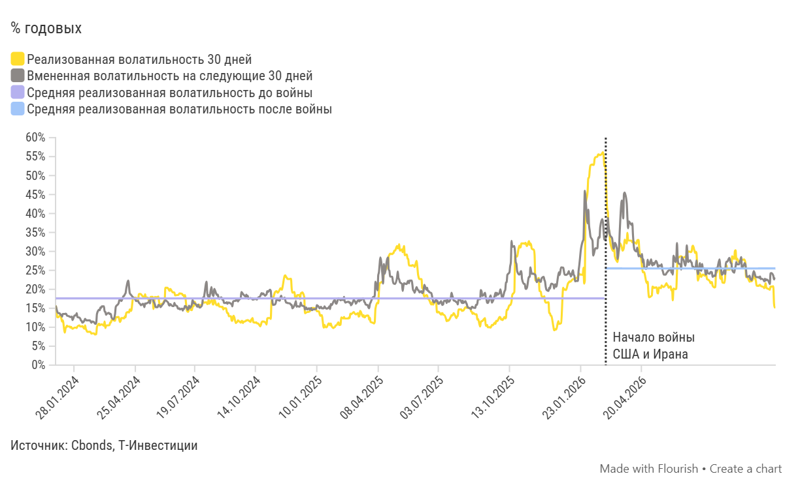

*График 30764527 — «v2 Волатильность золота: 30-дневная реализованная и вменённая ». Интерактив: https://flo.uri.sh/visualisation/30764527/embed. Данные: [CSV](../charts/30764527.csv), [JSON](../charts/30764527.json)*

Подписи и настройки графика: axes_highlights.x_lines: Начало войны США и Ирана :: 28.02.2026; axes_highlights.y_lines: Средняя до войны :: 17.6 :: #41414d Средняя после войны :: 25.5 :: #41414d; layout.source_name: Cbonds, Т-Инвестиции; chart_type: line

| Дата | Реализованная волатильность 30 дней | Вмененная волатильность на следующие 30 дней | Средняя реализованная волатильность до войны | Средняя реализованная волатильность после войны |
|---|---|---|---|---|
| 2024-01-02 | 15.7 | 15.7 | 17.6 |  |
| 2024-01-03 | 14.7 | 14.9 | 17.6 |  |
| 2024-01-04 | 12.7 | 14.2 | 17.6 |  |
| 2024-01-05 | 12.6 | 13.8 | 17.6 |  |
| 2024-01-08 | 13 | 13.6 | 17.6 |  |
| 2024-01-09 | 12.9 | 13.2 | 17.6 |  |
| 2024-01-10 | 12.3 | 13.3 | 17.6 |  |
| 2024-01-11 | 11.5 | 12.8 | 17.6 |  |
| 2024-01-12 | 11.8 | 13.5 | 17.6 |  |
| 2024-01-15 | 8.6 | 13.5 | 17.6 |  |
| 2024-01-16 | 9.7 | 13.6 | 17.6 |  |
| 2024-01-17 | 10 | 13.5 | 17.6 |  |
| 2024-01-18 | 10.4 | 13.1 | 17.6 |  |
| 2024-01-19 | 10.2 | 13 | 17.6 |  |
| 2024-01-22 | 10.2 | 12.8 | 17.6 |  |
| 2024-01-23 | 9.9 | 12.7 | 17.6 |  |
| 2024-01-24 | 10.1 | 12.7 | 17.6 |  |
| 2024-01-25 | 9.8 | 12.8 | 17.6 |  |
| 2024-01-26 | 9.6 | 11.9 | 17.6 |  |
| 2024-01-29 | 9.9 | 13.1 | 17.6 |  |
| 2024-01-30 | 9.9 | 13.1 | 17.6 |  |
| 2024-01-31 | 9.9 | 13.2 | 17.6 |  |
| 2024-02-01 | 9.8 | 13.7 | 17.6 |  |
| 2024-02-02 | 10.2 | 12.7 | 17.6 |  |
| 2024-02-05 | 10.5 | 12.5 | 17.6 |  |
| 2024-02-06 | 10.2 | 12.3 | 17.6 |  |
| 2024-02-07 | 10.2 | 11.8 | 17.6 |  |
| 2024-02-08 | 10.2 | 11.7 | 17.6 |  |
| 2024-02-09 | 10.3 | 11.2 | 17.6 |  |
| 2024-02-12 | 9.6 | 11.8 | 17.6 |  |
| … | … | … | … | … |
| 2026-10-09 | 20.8 | 22.8 |  | 25.5 |
| 2026-10-12 | 20.6 | 22.5 |  | 25.5 |
| 2026-10-13 | 20.3 | 22.1 |  | 25.5 |
| 2026-10-14 | 20.7 | 22.8 |  | 25.5 |
| 2026-10-15 | 21.6 | 22.3 |  | 25.5 |
| 2026-10-16 | 20.4 | 22.6 |  | 25.5 |
| 2026-10-19 | 20.1 | 22.2 |  | 25.5 |
| 2026-10-20 | 20 | 21.8 |  | 25.5 |
| 2026-10-21 | 19.9 | 21.4 |  | 25.5 |
| 2026-10-22 | 20.7 | 24.2 |  | 25.5 |
| 2026-10-23 | 20.7 | 24.3 |  | 25.5 |
| 2026-10-26 | 20.8 | 23.6 |  | 25.5 |
| 2026-10-27 | 16.3 | 22.6 |  | 25.5 |
| 2026-10-28 | 15.2 | 22.9 |  | 25.5 |
| 2026-10-29 | 15.5 | 22.7 |  | 25.5 |

*Показано 45 из 731 строк, полный ряд: [CSV](../charts/30764527.csv), [JSON](../charts/30764527.json)*

Ключевой риск

Рыночные котировки учитывают еще два-три повышения ставки ФРС в текущем цикле. Однако масштабный инфляционный шок из-за дестабилизации энергетических рынков потребовал бы от ведущих центробанков гораздо более жестких мер, чем ожидают инвесторы. Для золота, которое сейчас особенно чувствительно к динамике доходностей облигаций, такой сценарий означал бы новую волну распродаж.

Для российского инвестора золото сохраняет привлекательность прежде всего как защитный актив в сбалансированном портфеле. Зависимость его цены от глобальных факторов позволяет диверсифицировать внутренние риски, а валютная составляющая дает дополнительную защиту от ослабления рубля

**Самые простые и удобные способы добавить золото в свой портфель:**

#### Золотые слитки

Покупайте слитки 999,9 пробы онлайн

Купить

#### Биржевое золото

Быстрая покупка и продажа на бирже, от 1 грамма

Купить

#### Паи фонда на золото

Быстрая покупка и продажа на бирже, от 10 ₽

Купить

#### Золотой счет

Покупка от 0,1 грамма в приложении банка

Открыть счет

Прогнозы инвестиционных домов

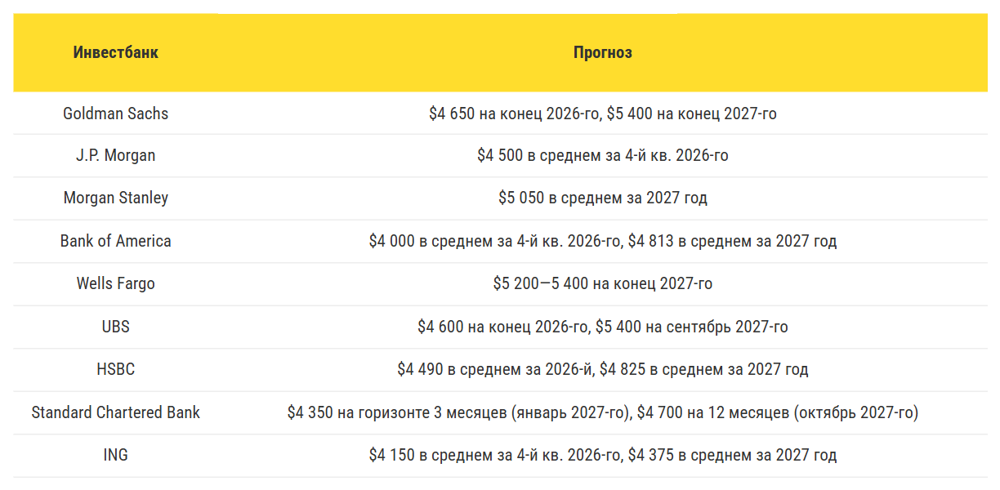

*График 30771457 — «Прогнозы инвестиционных домов». Интерактив: https://flo.uri.sh/visualisation/30771457/embed. Данные: [CSV](../charts/30771457.rows.csv), [JSON](../charts/30771457.json)*

| Инвестбанк | Прогноз |
|---|---|
| Goldman Sachs | $4 650 на конец 2026-го, $5 400 на конец 2027-го |
| J.P. Morgan | $4 500 в среднем за 4-й кв. 2026-го |
| Morgan Stanley | $5 050 в среднем за 2027 год |
| Bank of America | $4 000 в среднем за 4-й кв. 2026-го, $4 813 в среднем за 2027 год |
| Wells Fargo | $5 200—5 400 на конец 2027-го |
| UBS | $4 600 на конец 2026-го, $5 400 на сентябрь 2027-го |
| HSBC | $4 490 в среднем за 2026-й, $4 825 в среднем за 2027 год |
| Standard Chartered Bank | $4 350 на горизонте 3 месяцев (январь 2027-го), $4 700 на 12 месяцев (октябрь 2027-го) |
| ING | $4 150 в среднем за 4-й кв. 2026-го, $4 375 в среднем за 2027 год |

Срочный рынок: продовольственные контракты в эпоху Эль-Ниньо

Мировые рынки сосредоточены на геополитике Ближнего Востока и ажиотаже вокруг искусственного интеллекта. При этом они не забывают и о продовольственной безопасности, которая зависит от объемов урожая сельхозкультур и их экспорта.

Рекордный за последние десятилетия по интенсивности эффект Эль-Ниньо отразился на ожиданиях урожая и ценовых настроениях во многих регионах мира. Пик эффекта ожидается на рубеже 2026–2027 годов. Поэтому, по нашей оценке, простая ставка на рост цен по продовольственным контрактам может оказаться преждевременной.

Эль-Ниньо

Периодическое потепление поверхностных вод в экваториальной части Тихого океана. Меняет режим температур и осадков во многих регионах мира: где-то вызывает засуху, где-то — избыточные дожди. Поэтому Эль-Ниньо влияет на урожаи и цены сельхозсырья

Мнение аналитика Т-Инвестиций

«На ближайшие три-шесть месяцев мы рекомендуем дополнить портфели срочными контрактами на продовольствие, которые торгуются на Мосбирже: какао, кофе, пшеницу и сахар. У каждого контракта есть особенности, которые важно учитывать при добавлении в портфель».

Евгений Кошелев, аналитик Т-Инвестиций по срочному рынку

**Сырьевые контракты срочной секции Мосбиржи**

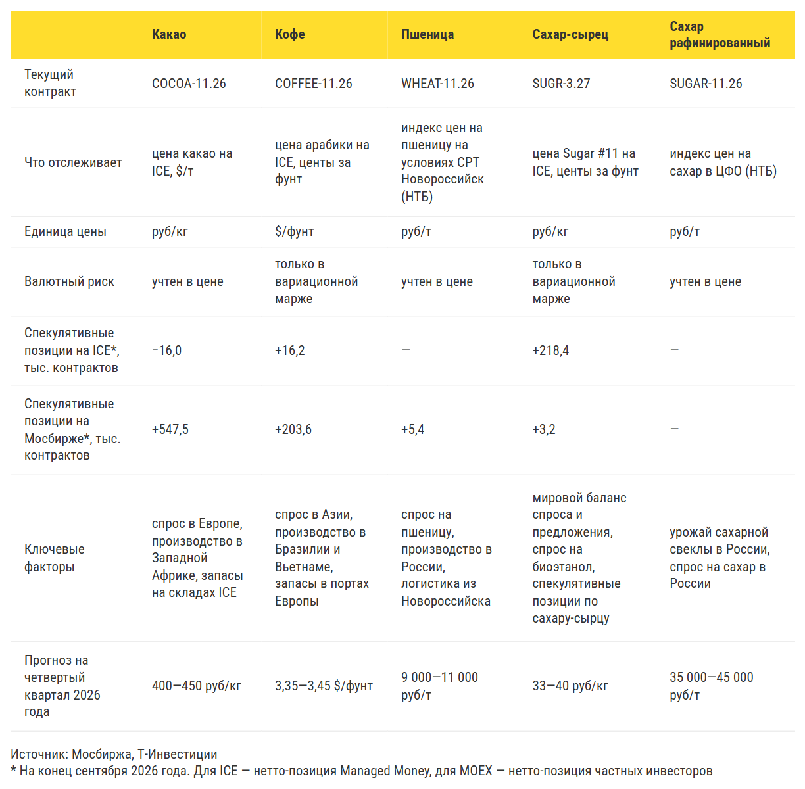

*График 30745509 — «Сырьевые контракты срочной секции Мосбиржи». Интерактив: https://flo.uri.sh/visualisation/30745509/embed. Данные: [CSV](../charts/30745509.rows.csv), [JSON](../charts/30745509.json)*

Подписи и настройки графика: layout.footer_note_secondary: * На конец сентября 2026 года. Для ICE — нетто-позиция Managed Money, для MOEX — нетто-позиция частных инвесторов; layout.source_name: Мосбиржа, Т-Инвестиции

| columns_0 | Какао | Кофе | Пшеница | Сахар-сырец | Сахар рафинированный |
|---|---|---|---|---|---|
| Текущий контракт | COCOA-11.26 | COFFEE-11.26 | WHEAT-11.26 | SUGR-3.27 | SUGAR-11.26 |
| Что отслеживает | цена какао на ICE, $/т | цена арабики на ICE, центы за фунт | индекс цен на пшеницу на условиях CPT Новороссийск (НТБ) | цена Sugar #11 на ICE, центы за фунт | индекс цен на сахар в ЦФО (НТБ) |
| Единица цены | руб/кг | $/фунт | руб/т | руб/кг | руб/т |
| Валютный риск | учтен в цене | только в вариационной марже | учтен в цене | только в вариационной марже | учтен в цене |
| Спекулятивные позиции на ICE*, тыс. контрактов | −16,0 | +16,2 | — | +218,4 | — |
| Спекулятивные позиции на Мосбирже*, тыс. контрактов | +547,5 | +203,6 | +5,4 | +3,2 | — |
| Ключевые факторы | спрос в Европе, производство в Западной Африке, запасы на складах ICE | спрос в Азии, производство в Бразилии и Вьетнаме, запасы в портах Европы | спрос на пшеницу, производство в России, логистика из Новороссийска | мировой баланс спроса и предложения, спрос на биоэтанол, спекулятивные позиции по сахару-сырцу | урожай сахарной свеклы в России, спрос на сахар в России |
| Прогноз на четвертый квартал 2026 года | 400—450 руб/кг | 3,35—3,45 $/фунт | 9 000—11 000 руб/т | 33—40 руб/кг | 35 000—45 000 руб/т |

Какао: фундаментальные факторы на стороне продавцов

Какао на слуху с 2024 года. Тогда биржевые цены выросли в пять раз относительно средних уровней 2022–2023 года на фоне череды неурожайных сезонов и истощения складских запасов.

К сентябрю 2026 года товар вновь оказался в центре внимания: котировки выросли в 2,5 раза от февральского годового минимума.

- **4,6—5,1 млн тонн** — Среднее ежегодное мировое потребление какао

- **4,3—5,3 млн тонн** — Диапазон ежегодного мирового производства

Оценки итогов сезона 2025—2026 (с октября по сентябрь) сильно расходятся: профицит может составить от 100 тысяч до 440 тысяч тонн. При этом сохраняются неплохие шансы на профицит и в сезоне 2026—2027. К началу октября цены на основной торговой площадке, бирже ICE, выросли вдвое от минимальных уровней 2024–2025 годов, но все еще на 30% ниже пиковых значений 2022–2023 годов.

Мнение аналитика Т-Инвестиций

«Перспективы хорошего урожая в следующем сезоне говорят о том, что рост цен в ответ на климатические и отраслевые риски был избыточным. Фундаментальные аргументы складываются в пользу усиления коррекции цен. Это отражается и в устойчивых коротких позициях спекулятивных игроков на мировом рынке».

Евгений Кошелев, аналитик Т-Инвестиций по срочному рынку

**Баланс спроса и предложения**

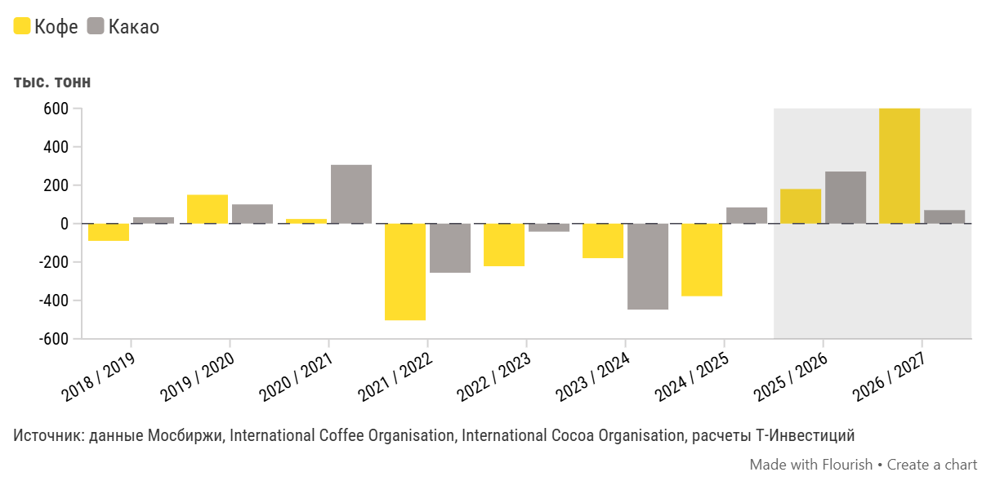

*График 30748841 — «Баланс спроса и предложения». Интерактив: https://flo.uri.sh/visualisation/30748841/embed. Данные: [CSV](../charts/30748841.csv), [JSON](../charts/30748841.json)*

Подписи и настройки графика: axes_highlights.x_areas: ::2025 / 2026>>2026 / 2027; axes_highlights.y_lines: 0::; layout.source_name: данные Мосбиржи, International Coffee Organisation, International Cocoa Organisation, расчеты Т-Инвестиций; y.title: тыс. тонн; chart_type: column_grouped

| Период | Кофе | Какао |
|---|---|---|
| 2018 / 2019 | -90 | 33 |
| 2019 / 2020 | 150 | 100 |
| 2020 / 2021 | 24 | 306 |
| 2021 / 2022 | -504 | -256 |
| 2022 / 2023 | -222 | -42 |
| 2023 / 2024 | -180 | -448 |
| 2024 / 2025 | -378 | 84 |
| 2025 / 2026 | 180 | 271 |
| 2026 / 2027 | 600 | 70 |

**Динамика цен и биржевых позиций**

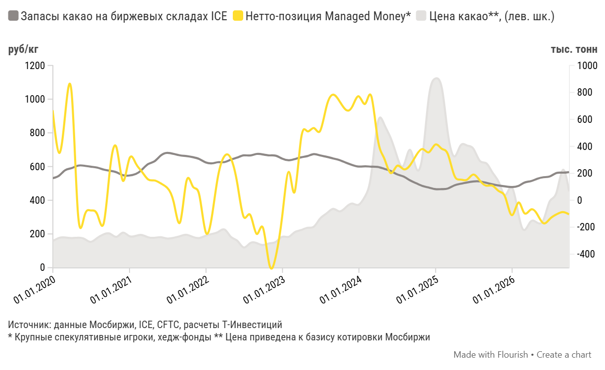

*График 30748910 — «Динамика цен и биржевых позиций». Интерактив: https://flo.uri.sh/visualisation/30748910/embed. Данные: [CSV](../charts/30748910.csv), [JSON](../charts/30748910.json)*

Подписи и настройки графика: axes_highlights.x_areas: ::2026*>>2028*; layout.footer_note_secondary: * Крупные спекулятивные игроки, хедж-фонды ** Цена приведена к базису котировки Мосбиржи; layout.source_name: данные Мосбиржи, ICE, CFTC, расчеты Т-Инвестиций; y.title: руб/кг; chart_type: area_stacked_line

| Период | Запасы какао на биржевых складах ICE | Нетто-позиция Managed Money* | Цена какао**, (лев. шк.) |
|---|---|---|---|
| 2019-12-31 | 163.6 | 667.72 | 157.3 |
| 2020-01-31 | 182.89 | 351.13 | 176.6 |
| 2020-02-29 | 222.99 | 638.97 | 179 |
| 2020-03-31 | 238.43 | 791.49 | 175.6 |
| 2020-04-30 | 256.86 | -100.11 | 177.9 |
| 2020-05-31 | 255.77 | -114.91 | 170.4 |
| 2020-06-30 | 248.78 | -75.71 | 152.9 |
| 2020-07-31 | 242.22 | -104.69 | 176 |
| 2020-08-31 | 227.19 | -169.81 | 198.1 |
| 2020-09-30 | 218.8 | 234.43 | 201.4 |
| 2020-10-31 | 207.33 | 389.9 | 182.9 |
| 2020-11-30 | 186.6 | 144.84 | 207.8 |
| 2020-12-31 | 183.61 | 307.5 | 187.3 |
| 2021-01-31 | 195.14 | 272.72 | 188.6 |
| 2021-02-28 | 225.08 | 213.98 | 193.8 |
| 2021-03-31 | 268.46 | 154.29 | 180.5 |
| 2021-04-30 | 288.74 | 146.9 | 177.2 |
| 2021-05-31 | 332.9 | 124.45 | 180.7 |
| 2021-06-30 | 351.57 | 92.4 | 172.9 |
| 2021-07-31 | 343.63 | -15.18 | 177.1 |
| 2021-08-31 | 332.67 | -160.88 | 186.9 |
| 2021-09-30 | 327.57 | 143.53 | 194.8 |
| 2021-10-31 | 319.45 | 99.75 | 181.9 |
| 2021-11-30 | 305.52 | 39.37 | 175.9 |
| 2021-12-31 | 280.55 | -237.88 | 189.7 |
| 2022-01-31 | 274.1 | -102.15 | 200.5 |
| 2022-02-28 | 282.33 | 183.1 | 211.3 |
| 2022-03-31 | 283.32 | 328.98 | 225.9 |
| 2022-04-30 | 301.57 | 309.37 | 182.3 |
| 2022-05-31 | 316.99 | 119.43 | 158.7 |
| … | … | … | … |
| 2025-07-31 | 139.74 | 146.21 | 633.5 |
| 2025-08-31 | 129.62 | 107.98 | 619.4 |
| 2025-09-30 | 118.33 | 107.53 | 563.2 |
| 2025-10-31 | 108.94 | 66.22 | 503.1 |
| 2025-11-30 | 102.66 | 19.81 | 430.6 |
| 2025-12-31 | 97.87 | -110.88 | 477.3 |
| 2026-01-31 | 106.19 | -17.16 | 320 |
| 2026-02-28 | 130.49 | -95.03 | 223.2 |
| 2026-03-31 | 141.76 | -69.16 | 273.7 |
| 2026-04-30 | 158.79 | -101.32 | 267.2 |
| 2026-05-31 | 170.82 | -171.06 | 284 |
| 2026-06-30 | 176.87 | -138.16 | 394.8 |
| 2026-07-31 | 201.94 | -105.25 | 442.1 |
| 2026-08-31 | 204.66 | -87.73 | 579.6 |
| 2026-09-30 | 208.89 | -104.58 | 453.1 |

*Показано 45 из 82 строк, полный ряд: [CSV](../charts/30748910.csv), [JSON](../charts/30748910.json)*

Риски

Открывая короткие спекулятивные позиции в какао, стоит учитывать отраслевые риски.

Высокая концентрация производства. На Кот-д‘Ивуар приходится 40% мирового производства, на Гану и Эквадор — еще 10—15%. Это повышает чувствительность цен к локальным климатическим рискам. В сезоне 2026—2027 особое внимание будет приковано к Западной Африке (Кот-д’Ивуар, Гана) из-за риска засухи на фоне Эль-Ниньо.

Уязвимость фермеров. В Западной Африке фермеры плохо защищены от ценовых колебаний: у них небольшие земельные наделы, а центральные регуляторы рынка работают неэффективно. Поэтому рост издержек из-за кризиса логистики и подорожания удобрений может ухудшать распределение капитала. В том числе из-за этого деревья какао (биологический капитал региона) реже обновляются, а риск их заболеваний выше, чем в других странах-производителях.

Новое регулирование ЕС. С 2027 года для западноафриканских производителей появится дополнительный риск — экологический регламент ЕС (EUDR), который требует сертификации участков для сохранения лесов. В этом контексте преимущество имеет Эквадор и ряд других южноамериканских стран благодаря большей концентрации хозяйств.

Рублевый номинал. Контракт на Мосбирже номинирован в рублях, что ослабляет его связь с мировыми ценами и добавляет в котировку валютный риск.

Кофе: потенциал в арабике, но с настораживающими сигналами

В отличие от какао на рынке кофе торгуется несколько сортов. Помимо арабики, на бирже ICE активно представлена робуста. Она формирует около 43% мирового производства, в среднем на 45—50% дешевле арабики и расширяет географию поставок за счет Азии и Африки. Поэтому хороший урожай робусты может сглаживать дефицит арабики, а одновременный дефицит или профицит обоих сортов — резко менять ценовые пропорции между ними.

10,8 млн тонн

Мировое потребление кофе в сезоне 2025–2026 года, по предварительным оценкам. С сезона 2019—2020 оно растет в среднем на 0,6% год к году

Спрос растет за счет Юго-Восточной Азии, в Америке и Европе он близок к насыщению. Производство же сильно колеблется из-за климатических шоков. В 2022–2025 годах Бразилия и Вьетнам теряли часть урожая, а ежегодный дефицит составлял 0,2—0,5 млн тонн при среднем производстве 10,3 млн тонн. Первые оценки профицита в 0,2 млн тонн в сезоне 2025—2026 дают надежду на стабилизацию запасов.

Кто производит кофе

#### Арабика

64% предложения обеспечивают три крупнейших производителя:

- 40—43% рынка Бразилия,
- 11—12% рынка Колумбия и Эфиопия

#### Робуста

- 38—40% приходится на Вьетнам,
- 30% на Бразилию,
- 23% вместе дают Уганда, Индонезия и Индия

В Бразилии до конца 2026 года в фокусе последствия засушливой фазы Эль-Ниньо для следующего урожая. Поэтому прогноз Министерства сельского хозяйства США (USDA), связанный с ростом профицита до 0,6 млн тонн в сезоне 2026—2027, выглядит излишне оптимистичным. Во Вьетнаме при этом ждут хорошего урожая робусты в ноябре — январе.

**Динамика мировых запасов**

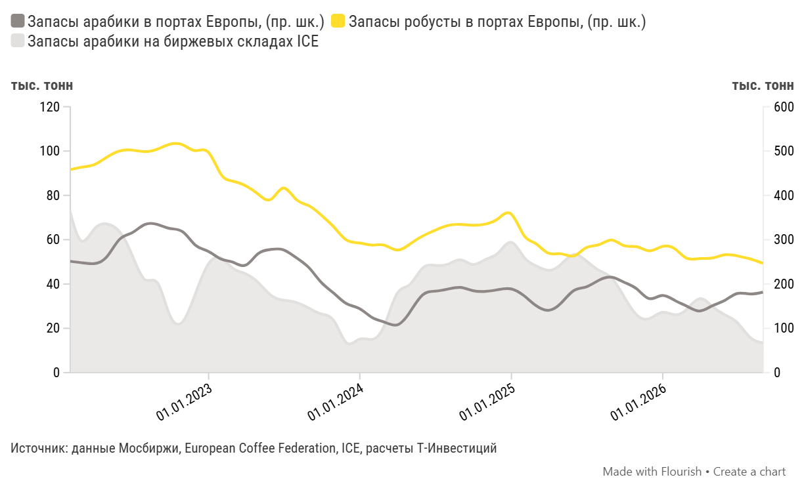

*График 30749325 — «Динамика мировых запасов». Интерактив: https://flo.uri.sh/visualisation/30749325/embed. Данные: [CSV](../charts/30749325.csv), [JSON](../charts/30749325.json)*

Подписи и настройки графика: axes_highlights.x_areas: ::2026*>>2028*; layout.source_name: данные Мосбиржи, European Coffee Federation, ICE, расчеты Т-Инвестиций; y.title: тыс. тонн; chart_type: area_stacked_line

| Период | Запасы арабики в портах Европы, (пр. шк.) | Запасы робусты в портах Европы, (пр. шк.) | Запасы арабики на биржевых складах ICE |
|---|---|---|---|
| 2022-01-31 | 251.3 | 457.7 | 73.1 |
| 2022-02-28 | 248 | 463.4 | 59.4 |
| 2022-03-31 | 245.9 | 469.2 | 64.8 |
| 2022-04-30 | 261 | 485.9 | 67.1 |
| 2022-05-31 | 300.7 | 500 | 63.6 |
| 2022-06-30 | 315.6 | 502.2 | 53.2 |
| 2022-07-31 | 334.2 | 498.6 | 42 |
| 2022-08-31 | 334.3 | 504.5 | 40.4 |
| 2022-09-30 | 325.2 | 515.4 | 25.6 |
| 2022-10-31 | 317.6 | 513.9 | 23.1 |
| 2022-11-30 | 287.7 | 500.8 | 35.5 |
| 2022-12-31 | 273.8 | 497.6 | 48.9 |
| 2023-01-31 | 256.2 | 447.3 | 51.7 |
| 2023-02-28 | 249.4 | 432.1 | 47.2 |
| 2023-03-31 | 242.3 | 421.7 | 44.6 |
| 2023-04-30 | 268.2 | 403.2 | 40.8 |
| 2023-05-31 | 278 | 390.8 | 35 |
| 2023-06-30 | 277.3 | 416.6 | 32.7 |
| 2023-07-31 | 259.8 | 391.1 | 31.7 |
| 2023-08-31 | 237.1 | 376.5 | 29.1 |
| 2023-09-30 | 203.6 | 355.3 | 26.5 |
| 2023-10-31 | 178.5 | 327.9 | 23.3 |
| 2023-11-30 | 155.6 | 299 | 13.4 |
| 2023-12-31 | 144.6 | 292.5 | 15.1 |
| 2024-01-31 | 124.2 | 287.8 | 15 |
| 2024-02-29 | 114.1 | 287.7 | 21.2 |
| 2024-03-31 | 107.7 | 276.6 | 35.7 |
| 2024-04-30 | 135.4 | 289.5 | 39.6 |
| 2024-05-31 | 175 | 307.9 | 47.1 |
| 2024-06-30 | 183.8 | 320.9 | 48.4 |
| 2024-07-31 | 188.4 | 332 | 48.9 |
| 2024-08-31 | 192.2 | 334.4 | 50.9 |
| 2024-09-30 | 184.9 | 332.6 | 48.8 |
| 2024-10-31 | 183.3 | 335.4 | 51.1 |
| 2024-11-30 | 187.3 | 347.5 | 54 |
| 2024-12-31 | 189 | 358.1 | 58.8 |
| 2025-01-31 | 173.7 | 309.7 | 52.1 |
| 2025-02-28 | 152.1 | 291.5 | 48.3 |
| 2025-03-31 | 140.6 | 269.6 | 46.2 |
| 2025-04-30 | 156.1 | 268.3 | 48.8 |
| 2025-05-31 | 184.9 | 263.2 | 53.3 |
| 2025-06-30 | 193.3 | 281.7 | 50.5 |
| 2025-07-31 | 208.4 | 288.7 | 46.2 |
| 2025-08-31 | 215.3 | 299.3 | 42.6 |
| 2025-09-30 | 203.9 | 286.3 | 34.2 |
| 2025-10-31 | 188.5 | 284.1 | 25.9 |
| 2025-11-30 | 166.9 | 274.8 | 24.4 |
| 2025-12-31 | 174.1 | 284.7 | 27.2 |
| 2026-01-31 | 162.5 | 278.9 | 26.1 |
| 2026-02-28 | 150.1 | 258 | 28.6 |
| 2026-03-31 | 139.1 | 257.4 | 33.4 |
| 2026-04-30 | 150.6 | 258.5 | 30 |
| 2026-05-31 | 163 | 265.9 | 26.1 |
| 2026-06-30 | 178.6 | 263.4 | 22.6 |
| 2026-07-31 | 177.5 | 256.7 | 15.9 |
| 2026-08-31 | 181.6 | 246.7 | 13.4 |
|  |  |  | 15.6 |

**Динамика цен и биржевых позиций**

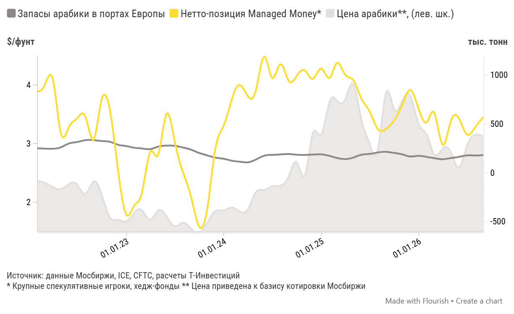

*График 30749457 — «Динамика цен и биржевых позиций». Интерактив: https://flo.uri.sh/visualisation/30749457/embed. Данные: [CSV](../charts/30749457.csv), [JSON](../charts/30749457.json)*

Подписи и настройки графика: axes_highlights.x_areas: ::2026*>>2028*; layout.footer_note_secondary: * Крупные спекулятивные игроки, хедж-фонды ** Цена приведена к базису котировки Мосбиржи; layout.source_name: данные Мосбиржи, ICE, CFTC, расчеты Т-Инвестиций; y.title: $/фунт; chart_type: area_stacked_line

| Период | Запасы арабики в портах Европы | Нетто-позиция Managed Money* | Цена арабики**, (лев. шк.) |
|---|---|---|---|
| 2022-01-31 | 251.3 | 829.7 | 2.36 |
| 2022-02-28 | 248 | 895.9 | 2.33 |
| 2022-03-31 | 245.9 | 957.7 | 2.26 |
| 2022-04-30 | 261 | 405.5 | 2.22 |
| 2022-05-31 | 300.7 | 472.6 | 2.31 |
| 2022-06-30 | 315.6 | 556.8 | 2.3 |
| 2022-07-31 | 334.2 | 575.9 | 2.14 |
| 2022-08-31 | 334.3 | 340.3 | 2.35 |
| 2022-09-30 | 325.2 | 750.3 | 2.13 |
| 2022-10-31 | 317.6 | 639.7 | 1.74 |
| 2022-11-30 | 287.7 | 37.1 | 1.7 |
| 2022-12-31 | 273.8 | -426.4 | 1.67 |
| 2023-01-31 | 256.2 | -330 | 1.82 |
| 2023-02-28 | 249.4 | -203.4 | 1.86 |
| 2023-03-31 | 242.3 | 214.1 | 1.7 |
| 2023-04-30 | 268.2 | 187.7 | 1.86 |
| 2023-05-31 | 278 | 600.6 | 1.76 |
| 2023-06-30 | 277.3 | 333.4 | 1.59 |
| 2023-07-31 | 259.8 | 13.2 | 1.65 |
| 2023-08-31 | 237.1 | -243.1 | 1.55 |
| 2023-09-30 | 203.6 | -548.5 | 1.47 |
| 2023-10-31 | 178.5 | -366.5 | 1.65 |
| 2023-11-30 | 155.6 | 244 | 1.85 |
| 2023-12-31 | 144.6 | 481.9 | 1.86 |
| 2024-01-31 | 124.2 | 752.9 | 1.91 |
| 2024-02-29 | 114.1 | 899 | 1.84 |
| 2024-03-31 | 107.7 | 785.6 | 1.88 |
| 2024-04-30 | 135.4 | 843.8 | 2.17 |
| 2024-05-31 | 175 | 1187.2 | 2.21 |
| 2024-06-30 | 183.8 | 971.8 | 2.27 |
| 2024-07-31 | 188.4 | 1110.6 | 2.28 |
| 2024-08-31 | 192.2 | 942.2 | 2.44 |
| 2024-09-30 | 184.9 | 991.3 | 2.68 |
| 2024-10-31 | 183.3 | 1047.8 | 2.46 |
| 2024-11-30 | 187.3 | 962 | 3.18 |
| 2024-12-31 | 189 | 1065.3 | 3.15 |
| 2025-01-31 | 173.7 | 970 | 3.71 |
| 2025-02-28 | 152.1 | 1125.1 | 3.73 |
| 2025-03-31 | 140.6 | 1003.2 | 3.75 |
| 2025-04-30 | 156.1 | 949.5 | 4.01 |
| 2025-05-31 | 184.9 | 756.9 | 3.4 |
| 2025-06-30 | 193.3 | 629.9 | 3 |
| 2025-07-31 | 208.4 | 449.6 | 2.89 |
| 2025-08-31 | 215.3 | 448.7 | 3.86 |
| 2025-09-30 | 203.9 | 535.9 | 3.59 |
| 2025-10-31 | 188.5 | 698.4 | 3.72 |
| 2025-11-30 | 166.9 | 847.5 | 3.81 |
| 2025-12-31 | 174.1 | 656.1 | 3.33 |
| 2026-01-31 | 162.5 | 518.2 | 3.15 |
| 2026-02-28 | 150.1 | 612.7 | 2.81 |
| 2026-03-31 | 139.1 | 287.3 | 2.91 |
| 2026-04-30 | 150.6 | 523.5 | 2.86 |
| 2026-05-31 | 163 | 557.9 | 2.59 |
| 2026-06-30 | 178.6 | 391.6 | 2.96 |
| 2026-07-31 | 177.5 | 466.7 | 3.15 |
| 2026-08-31 | 181.6 | 571 | 3.12 |

Мнение аналитика Т-Инвестиций

«В целом это может указывать на потенциал для наращивания длинных позиций по арабике в срочных контрактах на Мосбирже. Однако нас настораживает динамика складских остатков и спекулятивных позиций».

Евгений Кошелев, аналитик Т-Инвестиций по срочному рынку

Запасы меняются разнонаправленно. Арабики на биржевых складах США и Европы рекордно мало, и новый бразильский урожай туда пока не поступает. Запасы робусты растут в ожидании урожая во Вьетнаме.

Оборачиваемость арабики снижается. В портах Европы, ключевого региона торговли кофе, доля биржевых запасов арабики в совокупных остатках упала до 7—10% при среднем с 2022 года уровне 19%. Это может говорить о слабом физическом спросе при высокой доле спекуляций и об уходе торгов во внебиржевой сектор.

Позиции спекулянтов расходятся. По арабике у них нетто-лонг, по робусте — нетто-шорт. Причины могут быть и нерыночными: бразильская арабика с ноября 2025 года исключена из тарифов Белого дома, но из-за напряженности между США и Бразилией остается в зоне неопределенности. Поэтому американский ценовой базис может включать премию на случай ужесточения тарифов.

Пшеница: внутренние цены оторвались от мировых

Баланс спроса и предложения на мировом рынке пшеницы оценивают разные источники, и их методики могут различаться. Эталонным считается отчет USDA — он выходит ежемесячно и оперативно учитывает корректировки региональных прогнозов. Поэтому для срочного рынка этот отчет важнее, чем данные о запасах в портах или другие показатели.

21,1 млн тонн

Профицит урожая пшеницы в сезоне 2025–2026 года, по данным USDA, — 2,6% от совокупного глобального спроса в 822 млн тонн

Предыдущий сопоставимый профицит был зафиксирован в 2019–2020 году. С тех пор на рынке преобладал дефицит, который покрывался за счет переходящих запасов. Их объем находится в диапазоне 259—296 млн тонн, или 33—39% от годового спроса, и в последние годы тяготеет к нижней границе.

**Динамика мировых запасов пшеницы**

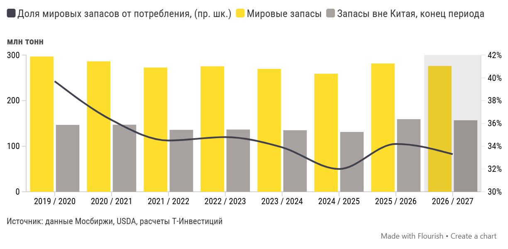

*График 30749653 — «Динамика мировых запасов пшеницы». Интерактив: https://flo.uri.sh/visualisation/30749653/embed. Данные: [CSV](../charts/30749653.csv), [JSON](../charts/30749653.json)*

Подписи и настройки графика: axes_highlights.x_areas: ::2026 / 2027>>2026 / 2027; axes_highlights.y_lines: 0::; layout.source_name: данные Мосбиржи, USDA, расчеты Т-Инвестиций; y.title: млн тонн; chart_type: column_grouped_line

| Период | Доля мировых запасов от потребления, (пр. шк.) | Мировые запасы | Запасы вне Китая, конец периода |
|---|---|---|---|
| 2019 / 2020 | 39.7 | 296.83 | 146.82 |
| 2020 / 2021 | 36.3 | 286.33 | 147.21 |
| 2021 / 2022 | 34.5 | 272.69 | 135.93 |
| 2022 / 2023 | 34.8 | 275.42 | 136.6 |
| 2023 / 2024 | 33.9 | 269.65 | 135.12 |
| 2024 / 2025 | 32 | 259.09 | 131.32 |
| 2025 / 2026 | 34.2 | 281.55 | 159.35 |
| 2026 / 2027 | 33.3 | 276.04 | 156.83 |

**Динамика цен и биржевых позиций**

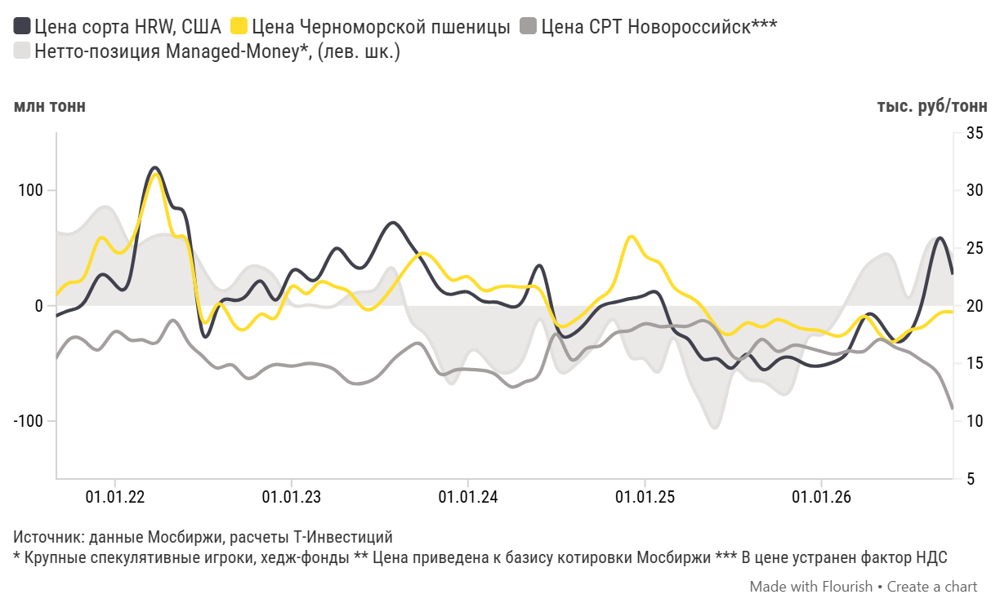

*График 30750175 — «Динамика цен и биржевых позиций». Интерактив: https://flo.uri.sh/visualisation/30750175/embed. Данные: [CSV](../charts/30750175.csv), [JSON](../charts/30750175.json)*

Подписи и настройки графика: axes_highlights.x_areas: ::2026*>>2028*; layout.footer_note_secondary: * Крупные спекулятивные игроки, хедж-фонды ** Цена приведена к базису котировки Мосбиржи *** В цене устранен фактор НДС; layout.source_name: данные Мосбиржи, расчеты Т-Инвестиций; y.title: млн тонн; chart_type: area_stacked_line

| Период | Цена сорта HRW, США | Цена Черноморской пшеницы | Цена СРТ Новороссийск*** | Нетто-позиция Managed-Money*, (лев. шк.) |
|---|---|---|---|---|
| 2021-08-31 | 19.1 | 20.88 | 15.4 | 63.8 |
| 2021-09-30 | 19.6 | 22.01 | 17.13 | 62.01 |
| 2021-10-31 | 20.4 | 22.65 | 16.9 | 70.47 |
| 2021-11-30 | 22.6 | 25.81 | 16.23 | 84.16 |
| 2021-12-31 | 21.9 | 24.74 | 17.74 | 79.63 |
| 2022-01-31 | 22.3 | 25.31 | 17.05 | 53.53 |
| 2022-02-28 | 29.3 | 28.52 | 17.03 | 54.87 |
| 2022-03-31 | 31.8 | 31.25 | 16.9 | 61.12 |
| 2022-04-30 | 28.6 | 26.31 | 18.73 | 61.01 |
| 2022-05-31 | 27 | 25.43 | 16.92 | 53.92 |
| 2022-06-30 | 17.8 | 18.84 | 15.67 | 33.57 |
| 2022-07-31 | 19.7 | 20.09 | 14.6 | 14.81 |
| 2022-08-31 | 20.5 | 18.64 | 14.87 | 16.87 |
| 2022-09-30 | 20.9 | 18.04 | 13.73 | 32.22 |
| 2022-10-31 | 22.1 | 19.27 | 14.32 | 33.26 |
| 2022-11-30 | 20.5 | 19.02 | 14.91 | 22.91 |
| 2022-12-31 | 22.9 | 21.61 | 14.76 | 1.82 |
| 2023-01-31 | 22.5 | 21.05 | 14.98 | 0.6 |
| 2023-02-28 | 22.6 | 22.03 | 14.9 | -0.73 |
| 2023-03-31 | 24.9 | 21.68 | 14.46 | -0.19 |
| 2023-04-30 | 23.9 | 21.19 | 13.38 | 8.95 |
| 2023-05-31 | 23.4 | 19.75 | 13.3 | 11.98 |
| 2023-06-30 | 25.6 | 20.14 | 13.93 | 17.73 |
| 2023-07-31 | 27.2 | 21.73 | 15.35 | 31.87 |
| 2023-08-31 | 25.6 | 23.53 | 16.38 | -7.78 |
| 2023-09-30 | 23.8 | 24.55 | 16.49 | -22.55 |
| 2023-10-31 | 21.6 | 23.61 | 14.24 | -45.31 |
| 2023-11-30 | 21 | 22.21 | 14.34 | -67.51 |
| 2023-12-31 | 21.2 | 22.52 | 14.49 | -41.81 |
| 2024-01-31 | 20.4 | 21.38 | 14.4 | -43.33 |
| … | … | … | … | … |
| 2025-07-31 | 15.8 | 18.51 | 15.69 | -62.68 |
| 2025-08-31 | 14.5 | 18.16 | 17.09 | -65.22 |
| 2025-09-30 | 15.2 | 18.79 | 16.08 | -73.58 |
| 2025-10-31 | 15.5 | 18.36 | 16.53 | -70.97 |
| 2025-11-30 | 14.9 | 17.95 | 16.41 | -30.76 |
| 2025-12-31 | 14.8 | 17.8 | 16.05 | -25.33 |
| 2026-01-31 | 15.2 | 17.37 | 15.79 | -12.09 |
| 2026-02-28 | 16.3 | 17.9 | 16.07 | 8.56 |
| 2026-03-31 | 19 | 19.08 | 16.08 | 32.35 |
| 2026-04-30 | 18.7 | 17.6 | 17.07 | 42.48 |
| 2026-05-31 | 17 | 16.88 | 16.46 | 38.24 |
| 2026-06-30 | 17.5 | 17.81 | 15.98 | 6.74 |
| 2026-07-31 | 20.8 | 18.2 | 15.15 | 42.7 |
| 2026-08-31 | 25.8 | 19.29 | 14.05 | 57.79 |
| 2026-09-30 | 22.7 | 19.45 | 11 | 41.7 |

*Показано 45 из 62 строк, полный ряд: [CSV](../charts/30750175.csv), [JSON](../charts/30750175.json)*

Прогнозы на сезон 2026–2027 года пока не вызывают опасений, несмотря на риск ухудшения урожая в ряде регионов из-за Эль-Ниньо.

Мнение аналитика Т-Инвестиций

«Тем не менее мировой рынок пшеницы находится в состоянии стресса из-за геополитических событий на Ближнем Востоке и блокировки черноморского логистического маршрута. На рынке наблюдается сильный ценовой арбитраж: внешняя цена значительно превышает внутреннюю. Нивелировать его рыночными механизмами и длинной позицией в контракте на Мосбирже не удастся».

Евгений Кошелев, аналитик Т-Инвестиций по срочному рынку

По содержанию протеина (белка) в зерне контракт на пшеницу на Мосбирже близок к американской твердой красной пшенице (HRW, торгуется на CBOT) и европейской мукомольной пшенице (Milling Wheat, торгуется на Euronext).

Расчетная цена зависит от остановленных торгов. Контракт на Мосбирже исполняется по расчетной цене Национальной товарной биржи (НТБ). Ее базис — серия поставочных аукционов пшеницы на терминалы Новороссийска на условиях CPT (carriage paid to), то есть с доставкой до терминала. В отличие от мирового стандарта биржевых котировок FOB (free on board) такая цена не включает расходы на отгрузку покупателю и экспортную пошлину. Однако из-за прекращения работы терминалов в Новороссийске торги пшеницей приостановлены, а избыток зерна у поставщиков сильно давит на внутреннюю цену.

Альтернативные маршруты ограничены. Поэтому зарубежные сорта дорожают опережающими темпами. Во-первых, ограничения затрагивают не только российские, но и украинские поставки. Во-вторых, вывоз через альтернативные порты упирается в ограничения железных дорог. В-третьих, удлинение морских маршрутов и ближневосточный конфликт повышают стоимость фрахта. Это усиливает ценовые диспропорции и подталкивает спекулятивных игроков наращивать длинные позиции.

Сахар: аргументы за коррекцию есть, но спешить не стоит

В контрактах на сахар, которые торгуются на Мосбирже, важно учитывать особенности спецификаций:

- основной контракт — производный контракт на цены сахара-сырца, торгуемого на бирже ICE (Sugar #11);
- дополнительный контракт — на рафинированный сахар, рассчитывается по индексу цен поставочных аукционов в ЦФО на НТБ.

Устранить «треугольный» арбитраж (сырье — курс — конечная продукция) может быть сложно из-за особенностей производства рафинированного сахара в России. Основное сырье — сахарная свекла отечественного производства, а тростниковый сахар-сырец используется лишь в периоды низкого урожая свеклы. Внутреннее производство опирается на одну фазу, а заготовка свекловичного сахара-сырца лишь входит в практику. Однако эти обстоятельства не мешают формированию спекулятивной или инвестиционной позиции по риску сахара-сырца с привязкой к контракту Sugar #11 на бирже ICE.

Мировое производство сахара умеренно концентрировано. На пять крупнейших экономик приходится 60% ежегодного выпуска. В сезоне 2025–2026 года это Бразилия (23%), Индия (16%), ЕС (8,3%), Китай (6,8%) и Таиланд (6,1%). Еще пять стран, включая Россию (3,8%), увеличивают долю до 78%.

Рафинированный сахар получают из двух видов сырья: тростника (80%) и сахарной свеклы (20%). Свойства конечного продукта от типа сырья не зависят, различается только технологический процесс. Сахар-сырец — промежуточный продукт переработки тростника, его удобно транспортировать и хранить.

**Баланс рынка и мировые запасы сахара-сырца**

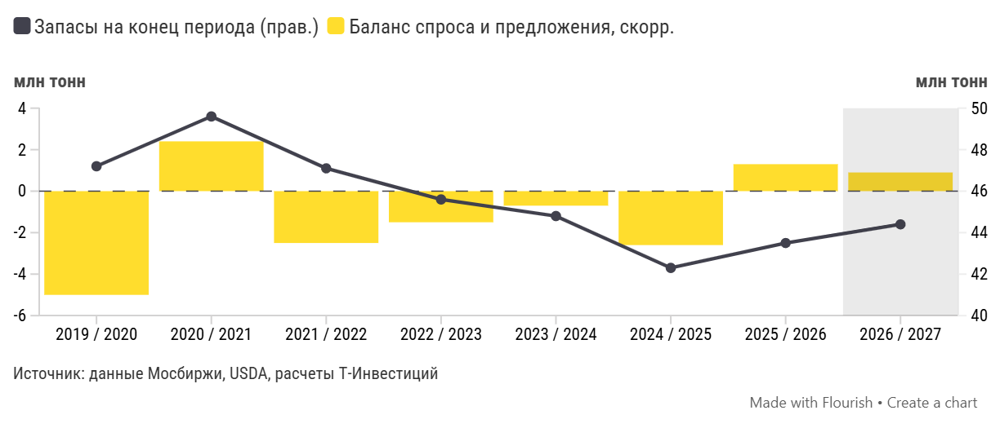

*График 30749722 — «Баланс рынка и мировые запасы сахара-сырца». Интерактив: https://flo.uri.sh/visualisation/30749722/embed. Данные: [CSV](../charts/30749722.csv), [JSON](../charts/30749722.json)*

Подписи и настройки графика: axes_highlights.x_areas: ::2026 / 2027>>2026 / 2027; axes_highlights.y_lines: 0::; layout.source_name: данные Мосбиржи, USDA, расчеты Т-Инвестиций; y.title: млн тонн; chart_type: column_grouped_line

| label | Запасы на конец периода (прав.) | Баланс спроса и предложения, скорр. |
|---|---|---|
| 2019 / 2020 | 47.2 | -5 |
| 2020 / 2021 | 49.6 | 2.4 |
| 2021 / 2022 | 47.1 | -2.5 |
| 2022 / 2023 | 45.6 | -1.5 |
| 2023 / 2024 | 44.8 | -0.7 |
| 2024 / 2025 | 42.3 | -2.6 |
| 2025 / 2026 | 43.5 | 1.3 |
| 2026 / 2027 | 44.4 | 0.9 |

**Динамика цен и биржевых позиций**

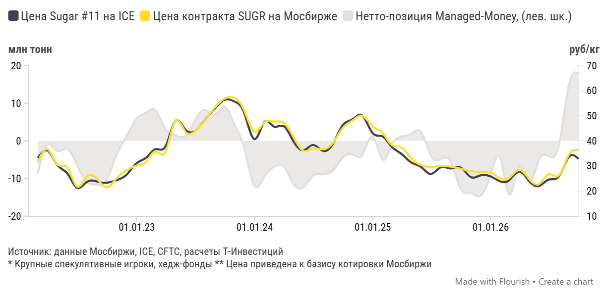

*График 30749785 — «Динамика цен и биржевых позиций». Интерактив: https://flo.uri.sh/visualisation/30749785/embed. Данные: [CSV](../charts/30749785.csv), [JSON](../charts/30749785.json)*

Подписи и настройки графика: axes_highlights.x_areas: ::2026*>>2028*; layout.footer_note_secondary: * Крупные спекулятивные игроки, хедж-фонды ** Цена приведена к базису котировки Мосбиржи; layout.source_name: данные Мосбиржи, ICE, CFTC, расчеты Т-Инвестиций; y.title: млн тонн; chart_type: area_stacked_line

| Период | Цена Sugar #11 на ICE | Цена контракта SUGR на Мосбирже | Нетто-позиция Managed-Money, (лев. шк.) |
|---|---|---|---|
| 2022-02-28 | 33.16 | 31.58 | -8.53 |
| 2022-03-31 | 36.14 | 36.67 | -1.01 |
| 2022-04-30 | 30.3 | 30.55 | -2.69 |
| 2022-05-31 | 26.99 | 29.37 | -2.13 |
| 2022-06-30 | 21.24 | 21.77 | -6.45 |
| 2022-07-31 | 23.71 | 25.83 | -10.89 |
| 2022-08-31 | 23.81 | 24.95 | -11.7 |
| 2022-09-30 | 23.32 | 21.51 | -10.23 |
| 2022-10-31 | 24.38 | 25.24 | -3.58 |
| 2022-11-30 | 26.44 | 28.27 | 1.24 |
| 2022-12-31 | 31.08 | 30.1 | 5.92 |
| 2023-01-31 | 33.39 | 31.79 | 7.58 |
| 2023-02-28 | 36.73 | 35.75 | 8.11 |
| 2023-03-31 | 37.82 | 35.67 | 3.1 |
| 2023-04-30 | 47.91 | 47.89 | 1.55 |
| 2023-05-31 | 44.59 | 43.74 | 1.25 |
| 2023-06-30 | 43.93 | 43.87 | 5.46 |
| 2023-07-31 | 48.37 | 48.25 | 8.23 |
| 2023-08-31 | 53.01 | 53.4 | 6.91 |
| 2023-09-30 | 56.43 | 56.89 | 9.1 |
| 2023-10-31 | 55.7 | 57.15 | 4.29 |
| 2023-11-30 | 51.04 | 52.08 | -1.92 |
| 2023-12-31 | 40.7 | 43.7 | -11.87 |
| 2024-01-31 | 47.51 | 47.4 | -9.54 |
| 2024-02-29 | 45.74 | 47.71 | -6.98 |
| 2024-03-31 | 45.87 | 47.28 | -6.8 |
| 2024-04-30 | 39.89 | 41.64 | -11.37 |
| 2024-05-31 | 36.23 | 36.01 | -12.36 |
| 2024-06-30 | 38.4 | 37 | -9.27 |
| 2024-07-31 | 36.05 | 36.66 | -8.91 |
| 2024-08-31 | 38.97 | 39.28 | -7.77 |
| 2024-09-30 | 46.34 | 45.23 | -4.48 |
| 2024-10-31 | 48.66 | 48.19 | -3.62 |
| 2024-11-30 | 50.08 | 49.99 | -3.63 |
| 2024-12-31 | 43.18 | 45.89 | 1.15 |
| 2025-01-31 | 41.82 | 43.25 | -4.89 |
| 2025-02-28 | 37.73 | 38.48 | -1.1 |
| 2025-03-31 | 34.8 | 37.39 | 1.13 |
| 2025-04-30 | 31.4 | 33.02 | 1.9 |
| 2025-05-31 | 29.56 | 30.35 | 2.31 |
| 2025-06-30 | 26.78 | 29.6 | -3.89 |
| 2025-07-31 | 29.5 | 30.02 | -4.89 |
| 2025-08-31 | 29 | 29.72 | -5.47 |
| 2025-09-30 | 29.42 | 28.9 | -12.72 |
| 2025-10-31 | 25.61 | 27.96 | -13.82 |
| 2025-11-30 | 26.24 | 27.57 | -14.59 |
| 2025-12-31 | 25.89 | 27.31 | -9.19 |
| 2026-01-31 | 23.83 | 24.99 | -4.4 |
| 2026-02-28 | 24.37 | 25.25 | -14.3 |
| 2026-03-31 | 27.82 | 28.49 | -6.78 |
| 2026-04-30 | 24.07 | 24.83 | -11.09 |
| 2026-05-31 | 22.02 | 22.79 | -5.05 |
| 2026-06-30 | 24.59 | 26.73 | -4.05 |
| 2026-07-31 | 25.81 | 26.17 | -1.22 |
| 2026-08-31 | 33.62 | 34.47 | 14.74 |
| 2026-09-30 | 32.82 | 36.4 | 18 |

7,4 млн тонн

Совокупный дефицит предложения сахара с 2021—2022 по 2024/25

Дефицит привел к существенному снижению мировых запасов, усилил ценовые шоки и волатильность спекулятивных позиций. Лишь в сезоне 2025–2026 года предварительные оценки зафиксировали профицит, а перспективы урожая 2026–2027 года остаются хорошими.

Мнение аналитика Т-Инвестиций

«Это повышает шансы на коррекцию цен сахара-сырца на глобальном рынке и усиливает аргументы в пользу короткой позиции. Однако мы не рекомендуем спешить и советуем дождаться смягчения отраслевых рисков».

Евгений Кошелев, аналитик Т-Инвестиций по срочному рынку

Тарифные барьеры и климат. Сахар-сырец и рафинированный сахар часто подпадают под локальные тарифные барьеры, которые страны вводят в рамках программ продовольственной безопасности. При этом из-за Эль-Ниньо в 2027 году под угрозой могут оказаться урожаи тростника (Бразилия, Индия) и свеклы (США, ЕС, Турция).

Конкуренция со стороны биотоплива. При резком росте цен на нефть усиливается спрос на сахар-сырец за пределами пищевой промышленности. Около 60 стран, включая Бразилию, Индию, Канаду и США, производят из него биоэтанол. По местным экологическим нормам его добавляют в бензин, а в периоды дефицита бензина его доля растет.

Срочные контракты на сырьевые товары — высокорискованные инструменты, их цена может существенно колебаться. Приемлемый уровень риска каждый инвестор определяет самостоятельно.

Доходности активов и результаты стратегий Т-Банка

Осторожность сейчас, выборочный риск на длинном горизонте

Что происходило с начала года

2026 год пока складывается непросто для большинства инвесторов на российском рынке. С начала года лучшие результаты показывает денежный рынок: высокая ключевая ставка продолжает поддерживать доходность инструментов с короткой дюрацией. При этом снижение ставки с 16 до 14% не привело к полноценному ралли в облигациях: доходности к погашению в рублевом и валютном сегментах остаются выше уровней начала года, а цены облигаций, особенно длинных ОФЗ, находятся под давлением.

Ключевая причина — рынок переоценил потенциал снижения ставки. Ожидания смягчения политики ЦБ сдвинулись на более поздний срок: инвесторы все больше закладывают сценарий, при котором ставка остается высокой дольше, чем предполагалось в начале года.

Это важно для всех классов активов: высокая ставка ограничивает потенциал роста оценки акций, поддерживает денежный рынок и повышает волатильность длинных облигаций.

Дополнительное давление создают бюджетные изменения, инфляционные ожидания и ситуация на топливном рынке, в том числе на фоне геополитической неопределенности. Эти факторы повышают требуемую премию за риск, что особенно заметно на рынке ОФЗ. Доходности длинных выпусков остаются существенно выше ключевой ставки: инвесторы требуют дополнительной компенсации за длительный срок вложений и макроэкономические риски.

Мнение аналитика Т-Инвестиций

«Главный вывод из динамики с начала года: лучшую доходность инвесторы получали в инструментах с короткой дюрацией и высокой текущей доходностью. Ослабление рубля остается умеренным. Акции находятся под давлением высокой ставки и слабого аппетита к риску, ОФЗ отстают из-за роста доходностей, а золото после сильного роста прошлых лет перешло к консолидации».

Евгений Митюков, директор по инвестициям, УК Т-Капитал

Результаты стратегий Т-Инвестиций

За прошедшие 12 месяцев все портфели на основе стратегии опередили инфляцию: их доходность составила от чуть более 7% до более 10% годовых. Лидером остался консервативный портфель, что отражает специфику текущего цикла.

При этом модельные портфели стратегии в нынешнем году по-прежнему показывали более устойчивые результаты, чем медианные клиентские портфели. Особенно заметным преимущество было в сбалансированном и агрессивном риск-профилях, где профессиональное управление риском обеспечивало более высокую дополнительную доходность. В этих профилях преимущество стратегий составило 3—6 п. п.

Мнение аналитика Т-Инвестиций

«Распределение активов в рамках стратегии Т-Инвестиций реализуется через фонды Т-Капитала. Это позволяет не только задавать доли классов активов, но и управлять портфелем внутри каждого сегмента, а также оптимизировать комиссионные расходы. Фонды решают задачи ежедневного управления ликвидностью, поддержания целевых весов и ротации инструментов внутри каждого класса активов».

Евгений Митюков, директор по инвестициям, УК Т-Капитал

Макросреда: почему мы сохраняем осторожность

1. Ставка остается высокой дольше, чем ожидал рынок

Для портфелей это означает следующее:

Денежный рынок остается привлекательным защитным активом. Среди биржевых инструментов в этом сегменте мы выделяем фонды TMON и TSAV.

Длинные ОФЗ сохраняют повышенную чувствительность к изменению ожиданий по ставке.

Акции получают поддержку при появлении более явных признаков будущего смягчения политики ЦБ.

Корпоративные облигации выглядят устойчивее ОФЗ за счет высокого купонного дохода и более коротких сроков до погашения. При этом важно внимательно оценивать кредитные риски. Здесь мы отдаем предпочтение секьюритизированным облигациям. Инвестировать в них можно через фонд корпоративных облигаций TBRU, портфель которого сформирован с учетом этого подхода.

2. Инфляция и бюджет остаются ключевыми источниками неопределенности

Эти факторы поддерживают высокие доходности ОФЗ и не позволяют рынку заранее закладывать быстрое снижение ставки. На более длинном горизонте также сохраняется риск дальнейшего роста налогов, который может негативно повлиять на акции отдельных эмитентов.

Пока инвесторы ожидают медленного снижения ставки, а инфляционные и бюджетные риски сохраняются, премия за длинную дюрацию остается высокой. Наклон кривой доходностей и превышение доходностей ОФЗ к погашению над инфляцией сейчас находятся на максимальных уровнях за последние годы.

Мнение аналитика Т-Инвестиций

«Мы продолжаем сокращать долю ОФЗ во всех модельных портфелях после ее снижения летом. Мы не отказываемся от этого класса активов полностью, но считаем, что агрессивное наращивание позиций в длинных ОФЗ стоит отложить».

Евгений Митюков, директор по инвестициям, УК Т-Капитал

Наш взгляд на разные классы активов

Денежный рынок: сохраняем высокий вес в защитных портфелях

Денежный рынок остается главным бенефициаром высокой ключевой ставки. Доходность с начала года — около 12%, что выше результата большинства других классов активов. Пока ставка остается высокой, инструменты денежного рынка продолжают давать привлекательную доходность при низкой волатильности.

Увеличиваем долю денежного рынка в консервативном портфеле до 18%

ОФЗ: снижаем долю из-за риска дюрации

ОФЗ остаются привлекательными по номинальной доходности, но их риск-профиль ухудшился. Высокие доходности длинных выпусков показывают, что рынок требует повышенной премии за риск.

Снижаем долю ОФЗ во всех портфелях. Вернуться к ее увеличению можно будет при появлении более уверенных сигналов о скором снижении ставки и при стабилизации инфляционных ожиданий

Рублевые корпоративные облигации: сохраняем как основу доходной части портфеля

Корпоративные облигации показали один из лучших результатов года — около 11%. Высокие купоны и более короткая дюрация помогают этому классу активов выглядеть устойчивее ОФЗ. При этом важно выбирать качественных эмитентов: высокая ставка ухудшает условия рефинансирования для компаний с повышенной долговой нагрузкой. Секьюритизированные выпуски в этих условиях позволяют сочетать высокое кредитное качество с привлекательным купонным доходом.

Сохраняем высокую долю рублевых корпоративных облигаций в консервативном и сбалансированном портфелях

Валютные облигации и золото: смещаем фокус на первые

Валютные облигации показали умеренную доходность — около 5% с начала года, но их роль в портфеле шире краткосрочного результата. Они помогают диверсифицировать риски, дают возможность инвестировать в валютные активы и могут быть полезны при росте волатильности курса.

Золото остается стратегическим защитным активом. Однако после сильного роста цен в прошлые годы и консолидации в диапазоне $4 000—4 500 за унцию потенциал краткосрочного роста выглядит менее очевидным, особенно на фоне повышения ставок в США. В рублевом выражении доходность золота с начала года составляет около 2%.

Сокращаем долю золота во всех портфелях, смещая фокус на валютные облигации, доходность которых достигает около 10% в долларах и юанях

Российские акции: увеличиваем долю выборочно, с фокусом на долгий горизонт

Российские акции в 2026 году пока остаются под давлением: индекс Мосбиржи снизился на 4%, индекс средней и малой капитализации — на 10%. Высокая ставка ограничивает мультипликаторы, а неопределенность снижает аппетит к риску.

Но именно в такие периоды формируются привлекательные точки входа для инвесторов с длинным горизонтом. Если в 2027 году появятся более устойчивые признаки смягчения денежно-кредитной политики и геополитика преподнесет меньше негативных сюрпризов, акции могут стать одним из главных бенефициаров переоценки.

Увеличиваем долю российских акций в сбалансированном портфеле и портфеле роста

Альтернативные инвестиции: сохраняем нейтральную долю

Альтернативные инвестиции обеспечивают дополнительную диверсификацию и снижают зависимость портфеля от традиционных рыночных факторов.

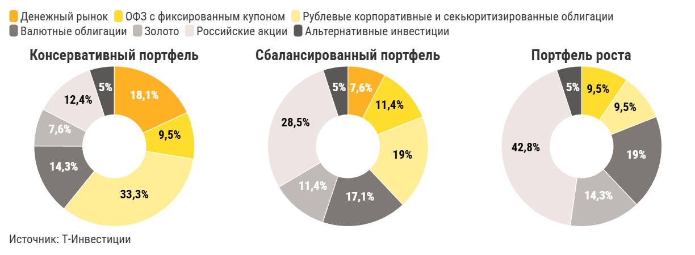

*График 30696265 — «Без заголовка». Интерактив: https://flo.uri.sh/visualisation/30696265/embed. Данные: [CSV](../charts/30696265.csv), [JSON](../charts/30696265.json)*

Подписи и настройки графика: layout.source_name: Т-Инвестиции; chart_type: donut

| Класс активов | Консервативный портфель | Сбалансированный портфель | Портфель роста |
|---|---|---|---|
| Денежный рынок | 18,1% | 7,6% |  |
| ОФЗ с фиксированным купоном | 9,5% | 11,4% | 9,5% |
| Рублевые корпоративные и секьюритизированные облигации | 33,3% | 19,0% | 9,5% |
| Валютные облигации | 14,3% | 17,1% | 19,0% |
| Золото | 7,6% | 11,4% | 14,3% |
| Российские акции | 12,4% | 28,5% | 42,8% |
| Альтернативные инвестиции | 5,0% | 5,0% | 5,0% |

Портфели с учетом изменений

Консервативный портфель

Для консервативных инвесторов приоритет — сохранение капитала и контроль волатильности.

Поэтому мы:

- увеличиваем долю денежного рынка до 18,1%;
- сокращаем долю ОФЗ из-за риска дюрации;
- сохраняем высокую долю качественных корпоративных облигаций;
- уменьшаем долю золота после периода высокой волатильности;
- умеренно увеличиваем доли акций и валютных облигаций для диверсификации.

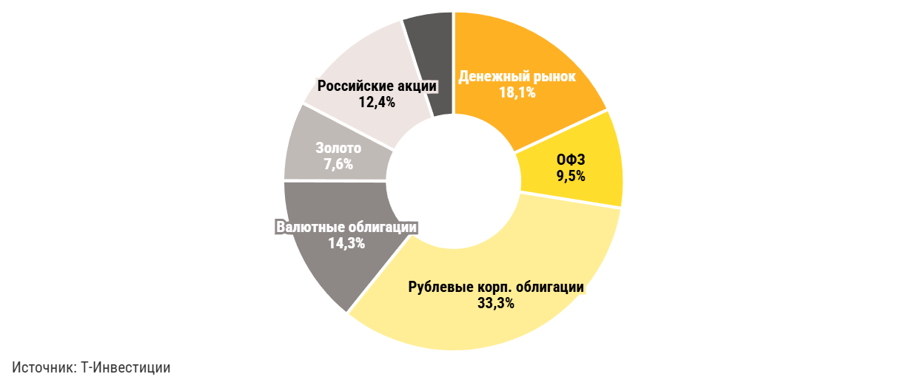

*График 30696146 — «Консервативный портфель». Интерактив: https://flo.uri.sh/visualisation/30696146/embed. Данные: [CSV](../charts/30696146.csv), [JSON](../charts/30696146.json)*

Подписи и настройки графика: layout.source_name: Т-Инвестиции; chart_type: donut

| Класс активов | Т-Консервативный портфель |
|---|---|
| Денежный рынок | 18,1% |
| ОФЗ | 9,5% |
| Рублевые корп. облигации | 33,3% |
| Валютные облигации | 14,3% |
| Золото | 7,6% |
| Российские акции | 12,4% |
| Альтернативные инвестиций | 5,0% |

Сбалансированный портфель

Для инвесторов, ориентированных на диверсификацию, мы сокращаем долю чувствительных к ставке ОФЗ в пользу более широкого набора источников высокой доходности:

- снижаем долю ОФЗ до 11,4%;
- увеличиваем долю валютных облигаций до 17,1%;
- повышаем долю российских акций до 28,5%;
- сокращаем долю золота до 11,4%;
- сохраняем корпоративные облигации как стабильную доходную часть портфеля.

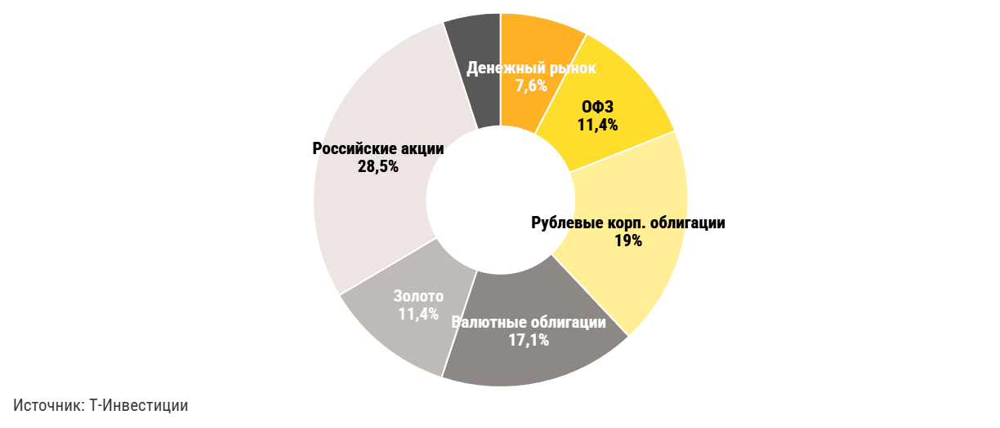

*График 30696201 — «Сбалансированный портфель». Интерактив: https://flo.uri.sh/visualisation/30696201/embed. Данные: [CSV](../charts/30696201.csv), [JSON](../charts/30696201.json)*

Подписи и настройки графика: layout.source_name: Т-Инвестиции; chart_type: donut

| Класс активов | Сбалансированный портфель |
|---|---|
| Денежный рынок | 7,6% |
| ОФЗ | 11,4% |
| Рублевые корп. облигации | 19,0% |
| Валютные облигации | 17,1% |
| Золото | 11,4% |
| Российские акции | 28,5% |
| Альтернативные инвестиций | 5,0% |

Портфель роста

Для инвесторов с высокой готовностью к риску и длинным горизонтом текущая слабость рынка может стать возможностью для постепенного наращивания позиций в рисковых активах.

Поэтому мы:

- сокращаем доли ОФЗ и рублевых корпоративных облигаций;
- увеличиваем долю валютных облигаций до 19,0%;
- повышаем долю российских акций до 42,8%;
- снижаем долю золота, сохраняя его как защитный элемент;
- оставляем альтернативные инвестиции на уровне 5%.

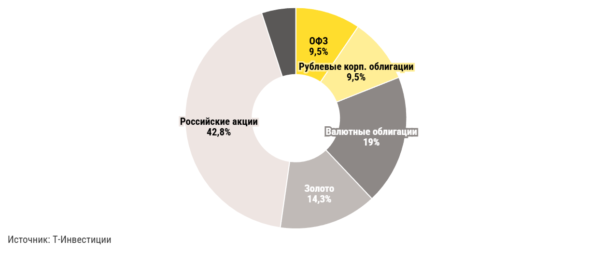

*График 30696231 — «Портфель роста». Интерактив: https://flo.uri.sh/visualisation/30696231/embed. Данные: [CSV](../charts/30696231.csv), [JSON](../charts/30696231.json)*

Подписи и настройки графика: layout.source_name: Т-Инвестиции; chart_type: donut

| Класс активов | Портфель роста |
|---|---|
| ОФЗ | 9,5% |
| Рублевые корп. облигации | 9,5% |
| Валютные облигации | 19,0% |
| Золото | 14,3% |
| Российские акции | 42,8% |
| Альтернативные инвестиций | 5,0% |

Недвижимость: быстрый рост остается в прошлом

Жилая недвижимость: восстановление спроса откладывается

**Прогнозы показателей первичного рынка России**

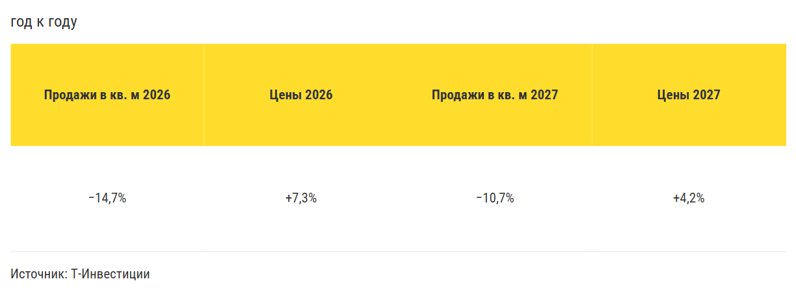

*График 30658498 — «Прогнозы показателей первичного рынка России». Интерактив: https://flo.uri.sh/visualisation/30658498/embed. Данные: [CSV](../charts/30658498.rows.csv), [JSON](../charts/30658498.json)*

Подписи и настройки графика: layout.source_name: Т-Инвестиции

| Продажи в кв. м 2026 | Цены 2026 | Продажи в кв. м 2027 | Цены 2027 |
|---|---|---|---|
| −14,7% | +7,3% | −10,7% | +4,2% |

Рынок лишился главного драйвера

В период высоких ставок семейная ипотека остается одним из главных драйверов спроса на новостройки. С начала года программа семейной ипотеки обеспечила 54,9% выдач ипотечных жилищных кредитов и 56,6% в общих продажах новостроек

**Доля семейной ипотеки в продажах новостроек**

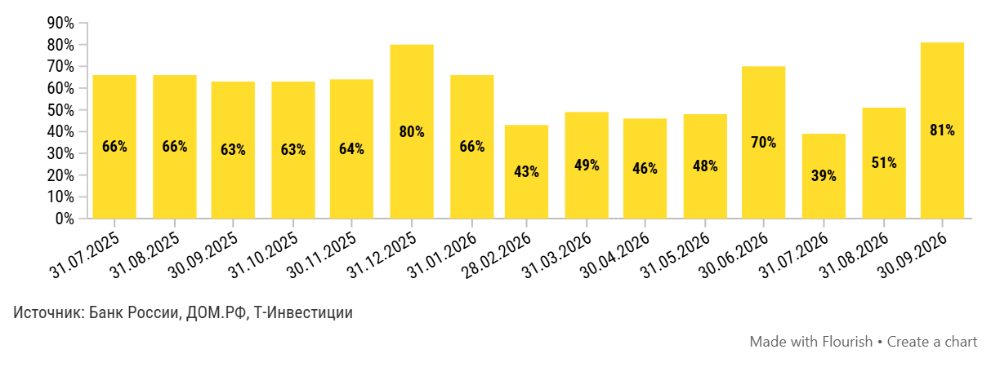

*График 30658554 — «Доля семейной ипотеки в продажах новостроек». Интерактив: https://flo.uri.sh/visualisation/30658554/embed. Данные: [CSV](../charts/30658554.csv), [JSON](../charts/30658554.json)*

Подписи и настройки графика: axes_highlights.x_areas: ::2026*>>2028*; axes_highlights.y_lines: Индекс Мосбиржи = −15% :: -15; layout.source_name: Банк России, ДОМ.РФ, Т-Инвестиции; chart_type: column_grouped

| Месяц | Доля семейной ипотеки в продажах новостроек |
|---|---|
| 2025-07-31 | 66 |
| 2025-08-31 | 66 |
| 2025-09-30 | 63 |
| 2025-10-31 | 63 |
| 2025-11-30 | 64 |
| 2025-12-31 | 80 |
| 2026-01-31 | 66 |
| 2026-02-28 | 43 |
| 2026-03-31 | 49 |
| 2026-04-30 | 46 |
| 2026-05-31 | 48 |
| 2026-06-30 | 70 |
| 2026-07-31 | 39 |
| 2026-08-31 | 51 |
| 2026-09-30 | 81 |

С 1 октября 2026 года условия программы стали жестче. Вместо единой ставки 6% ввели дифференцированные:

- 10% для семей с одним ребенком;
- 8% — с двумя;
- 6% — с тремя детьми.

А в четырех столичных регионах ставки дополнительно повысили на 2 п. п. Кроме того, действие льготной ставки теперь ограничено 15 годами вместо прежних 30 лет.

Основное давление пришлось на семьи с одним ребенком. Это до 70% всех заемщиков, пользующихся семейной ипотекой. Поэтому ухудшение условий для таких семей может заметно повлиять на спрос на новостройки.

Мнение аналитика Т-Инвестиций

«По нашим расчетам, для семей с одним ребенком младше семи лет при прежнем ежемесячном платеже и сроке ипотеки доступная сумма кредита в регионах сокращается на 32%, в Москве и Санкт-Петербурге, а также в Московской и Ленинградской областях — на 41%».

Марта Харченко, аналитик Т-Инвестиций

Сентябрьский всплеск усилит охлаждение спроса

В сентябре 2026 года российские банки выдали максимальный с начала года объем ипотечных кредитов.

**Ипотечные выдачи**

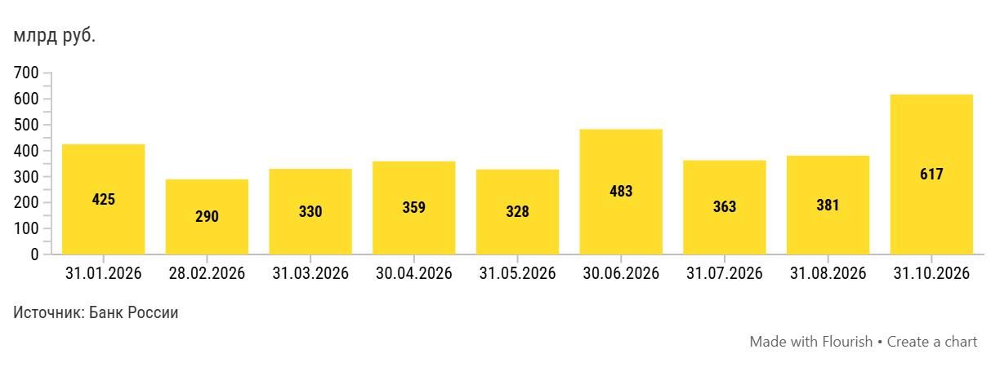

*График 30658584 — «Ипотечные выдачи». Интерактив: https://flo.uri.sh/visualisation/30658584/embed. Данные: [CSV](../charts/30658584.csv), [JSON](../charts/30658584.json)*

Подписи и настройки графика: axes_highlights.x_areas: ::2026*>>2028*; axes_highlights.y_lines: Индекс Мосбиржи = −15% :: -15; layout.source_name: Банк России; chart_type: column_grouped

| Месяц | Вся ипотека, млрд руб. |
|---|---|
| 31.01.2026 | 425 |
| 28.02.2026 | 290 |
| 31.03.2026 | 330 |
| 30.04.2026 | 359 |
| 31.05.2026 | 328 |
| 30.06.2026 | 483 |
| 31.07.2026 | 363 |
| 31.08.2026 | 381 |
| 31.10.2026 | 617 |

Всплеск был связан с ажиотажем перед изменением условий семейной ипотеки. Такой перенос спроса может дополнительно ослабить продажи в конце 2026-го — начале 2027-го.

Подобный ажиотаж произошел и перед завершением массовой льготной ипотеки летом 2024-го и введением правила «один льготный кредит на семью» в феврале 2026-го. В течение трех месяцев после изменений средний уровень продаж снизился на 35 и 8% соответственно.

Ценовой разрыв между новостройками и готовым жильем снижается с максимумов

За годы действия льготной ипотеки новостройки подорожали значительно сильнее, чем потребительская корзина.

- **172%** — Таким был рост цен на первичное жилье с начала 2018 года

- **78%** — На столько за этот же период суммарно выросли цены на товары и услуги

Однако постепенно темпы роста цен первичного жилья и инфляции сближаются. Одновременно сокращается и ценовой разрыв между новостройками и готовым жильем. По данным Росстата, премия первичного рынка сократилась примерно с исторических 65% на конец 2025 года до 51,8% в третьем квартале 2026 года.

**Ценовой разрыв между новостройками и готовым жильем**

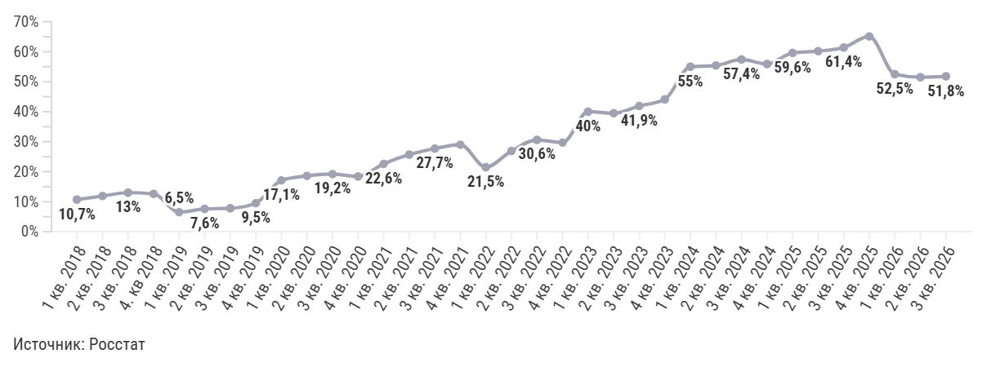

*График 30658637 — «Ценовой разрыв между новостройками и готовым жильем ». Интерактив: https://flo.uri.sh/visualisation/30658637/embed. Данные: [CSV](../charts/30658637.csv), [JSON](../charts/30658637.json)*

Подписи и настройки графика: axes_highlights.x_areas: Начало года :: 05.01.2026; axes_highlights.y_lines: Начало года::05.01.2026; layout.source_name: Росстат; chart_type: line_line

| Дата | Спред |
|---|---|
| 1 кв. 2018 | 10,7% |
| 2 кв. 2018 | 11,9% |
| 3 кв. 2018 | 13,0% |
| 4. кв 2018 | 12,6% |
| 1 кв. 2019 | 6,5% |
| 2 кв. 2019 | 7,6% |
| 3 кв. 2019 | 7,8% |
| 4 кв. 2019 | 9,5% |
| 1 кв. 2020 | 17,1% |
| 2 кв. 2020 | 18,6% |
| 3 кв. 2020 | 19,2% |
| 4 кв. 2020 | 18,4% |
| 1 кв. 2021 | 22,6% |
| 2 кв. 2021 | 25,7% |
| 3 кв. 2021 | 27,7% |
| 4 кв. 2021 | 29,0% |
| 1 кв. 2022 | 21,5% |
| 2 кв. 2022 | 26,9% |
| 3 кв. 2022 | 30,6% |
| 4 кв. 2022 | 29,7% |
| 1 кв. 2023 | 40,0% |
| 2 кв. 2023 | 39,5% |
| 3 кв. 2023 | 41,9% |
| 4 кв. 2023 | 44,1% |
| 1 кв. 2024 | 55,0% |
| 2 кв. 2024 | 55,4% |
| 3 кв. 2024 | 57,4% |
| 4 кв. 2024 | 55,9% |
| 1 кв. 2025 | 59,6% |
| 2 кв. 2025 | 60,2% |
| 3 кв. 2025 | 61,4% |
| 4 кв. 2025 | 65,1% |
| 1 кв. 2026 | 52,5% |
| 2 кв. 2026 | 51,5% |
| 3 кв. 2026 | 51,8% |

Такой широкий разрыв сформировался на фоне неоднородных условий кредитования. Меры государственной поддержки подталкивали вверх цены на новостройки, в то время как дорогая рыночная ипотека ограничивала спрос на вторичное жилье.

Мнение аналитика Т-Инвестиций

«С учетом последствий ужесточения семейной ипотеки тренд на сближение цен может продолжиться и в 2027 году. Для части заемщиков преимущество льготного кредитования может уменьшиться. Тогда готовое жилье станет хорошей альтернативой при текущих кредитных условиях».

Марта Харченко, аналитик Т-Инвестиций

Однако полного сближения цен ожидать не стоит, так как часть премии может сохраниться из-за различий в географии и качестве жилья. По оценкам Банка России, за 2025 год ценовой разрыв между первичным и вторичным жильем при сравнении объектов с одинаковыми характеристиками составил 9%.

Ключевые тренды 2027 года

Рынок новостроек может столкнуться с непростыми условиями, которые будут проявляться вплоть до конца 2027 года. Причем ближайшие кварталы, вероятно, станут периодом наибольшего спада.

Продажи будет сдерживать ужесточение условий семейной ипотеки, к которому добавится естественное снижение спроса после сентябрьского всплеска выдач.

Ожидаемое в базовом сценарии снижение ключевой ставки будет частично смягчать ситуацию, однако рыночная ипотека останется малодоступной для большинства покупателей, рост доходов замедлится. В результате удешевление кредитования не сможет полностью заместить выпадающий льготный спрос, и по итогам года продажи могут оказаться ниже уровня 2026 года.

Цены продолжат расти, но в темпе, близком к инфляции. Слабый спрос не позволит застройщикам заметно повышать стоимость квадратного метра, но и издержки исключат возможность снижения цен.

Складская недвижимость: рынок на пути к стабилизации

В Московском регионе появились признаки восстановления спроса

После слабого первого полугодия активность рынка заметно выросла.

- **1,26 млн кв. м** — Объем сделок в третьем квартале 2026-го

- **0,78 млн кв. м** — Объем сделок за все первое полугодие

Оживление спроса связано в том числе с потребностью компаний в готовых складских площадях и перераспределением логистических потоков.

Однако рост спроса пока лишь частично сократил избыток свободных площадей: за девять месяцев в Московском регионе ввели 2,35 млн кв. м складских площадей. Высокий темп нового строительства продолжает оказывать поддержку предложению и ограничивать повышение арендных ставок.

Арендный рынок в Москве приближается к стабилизации. За третий квартал вакантность с учетом субаренды сократилась с 6,5 до 6%. Темпы снижения ставок замедлились до 1,5% квартал к кварталу. Сейчас аренда составляет в среднем 10,1 тысячи рублей за квадратный метр в год.

**Доля свободных площадей в Московском регионе**

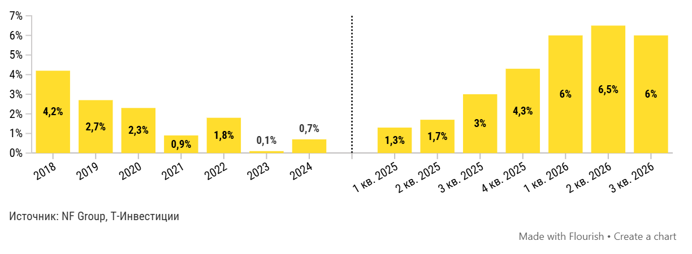

*График 30658844 — «Доля свободных площадей в Московском регионе». Интерактив: https://flo.uri.sh/visualisation/30658844/embed. Данные: [CSV](../charts/30658844.csv), [JSON](../charts/30658844.json)*

Подписи и настройки графика: axes_highlights.x_lines: ::; layout.source_name: NF Group, Т-Инвестиции; chart_type: column_grouped

| Период | Доля свободных площадей в Московском регионе, % |
|---|---|
| 2018 | 4.2 |
| 2019 | 2.7 |
| 2020 | 2.3 |
| 2021 | 0.9 |
| 2022 | 1.8 |
| 2023 | 0.1 |
| 2024 | 0.7 |
|  |  |
| 1 кв. 2025 | 1.3 |
| 2 кв. 2025 | 1.7 |
| 3 кв. 2025 | 3 |
| 4 кв. 2025 | 4.3 |
| 1 кв. 2026 | 6 |
| 2 кв. 2026 | 6.5 |
| 3 кв. 2026 | 6 |

**Арендные ставки в Московском регионе**

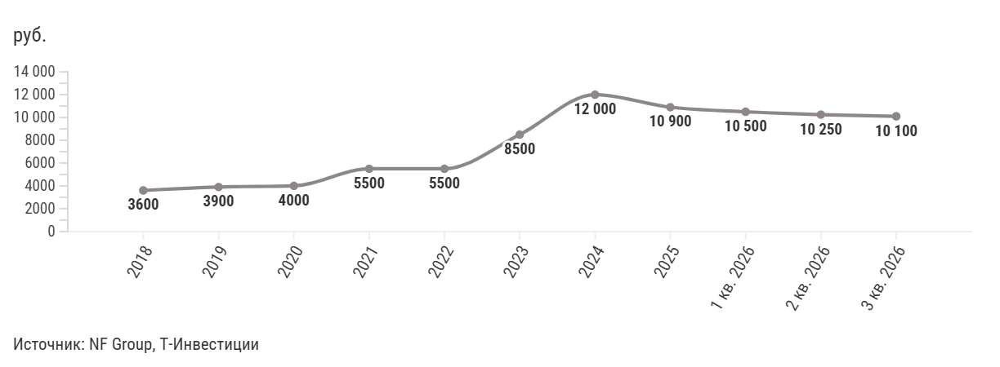

*График 30658901 — «Арендные ставки в Московском регионе». Интерактив: https://flo.uri.sh/visualisation/30658901/embed. Данные: [CSV](../charts/30658901.csv), [JSON](../charts/30658901.json)*

Подписи и настройки графика: axes_highlights.x_areas: ::; axes_highlights.x_lines: ::; axes_highlights.y_areas: ::; axes_highlights.y_lines: ::; layout.source_name: NF Group, Т-Инвестиции; chart_type: line_line

| Период | Арендные ставки Московского региона, руб. |
|---|---|
| 2018 | 3 600 |
| 2019 | 3 900 |
| 2020 | 4 000 |
| 2021 | 5 500 |
| 2022 | 5 500 |
| 2023 | 8 500 |
| 2024 | 12 000 |
| 2025 | 10 900 |
|  |  |
| 1 кв. 2026 | 10 500 |
| 2 кв. 2026 | 10 250 |
| 3 кв. 2026 | 10 100 |

Повреждение складов маркетплейсов поддерживает спрос на резервные мощности

Атаки на инфраструктуру Wildberries и Озона стали дополнительным фактором повышения спроса на готовые помещения.

С 18 июля по 24 сентября из эксплуатации выбыло около 1,5 млн кв. м складских площадей. Компании вынуждены искать резервные мощности и развивать более распределенные логистические сети. Это может поддержать спрос на отдельные объекты, но не означает, что выбывшие площади полностью конвертируются в сделки. Компании будут стремиться использовать действующую инфраструктуру более эффективно

Ключевые тренды 2027 года

Несмотря на выбытие площадей, накопленный объем свободных складов продолжит ограничивать рост аренды.

Ожидаемое в базовом сценарии снижение ключевой ставки приведет к сдержанному восстановлению инвестиционной активности и спроса на складскую недвижимость. В результате этого по итогам года мы ожидаем умеренного роста арендных ставок — ниже или на уровне инфляции.

Неоактивы: точечный доступ к глобальным рынкам

В 2026 году СПБ Биржа запустила неоактивы, новый инструмент для участия в торговле мировыми активами. Это фьючерсные контракты на акции американских компаний и криптовалюты.

65 инструментов

60 акций компаний разных секторов и капитализации и 5 наиболее значимых криптоактивов

Российский контур

Неоактивы полностью находятся в российской инфраструктуре и не несут риска блокировки. Этим они отличаются от заблокированных иностранных бумаг и инструментов удаленного доступа к брокерам США

В отличие от покупки акции на спотовом рынке, позиция по неоактиву при переносе на следующий торговый день облагается платой: 4,5% годовых для срочных контрактов и ключевая ставка плюс 4,5% годовых для бессрочных. Срочный контракт имеет дату исполнения, бессрочный действует без ограничения срока

Глобальные рынки в 2026 году: ИИ-ралли на фоне всеобщей турбулентности

В этом году на мировые рынки давит сразу несколько пересекающихся факторов:

- обострение геополитики вокруг Ирана;
- рост инфляции и процентных ставок в крупнейших экономиках;
- неустойчивость ИИ-бума.

Тем не менее американский рынок продолжает уверенно расти, во многом за счет высокого интереса инвесторов к искусственному интеллекту и связанной с ним инфраструктуре. Акции часто не реагируют на изменения макроэкономической картины. Это усиливает опасения, что технологическим компаниям будет все сложнее подтверждать отчетностью высокие оценки.

Для криптовалютного рынка 2026 год сложно назвать успешным: большую часть времени он находился в нисходящем (медвежьем) тренде. Однако в третьем квартале 2026 года рост ускорился на фоне увеличения выкупа казначейских облигаций Минфином США и возобновления притоков в спотовые ETF. По нашей оценке, это все больше указывает на начало нового цикла роста.

**Изменение цены ключевых активов с начала года**

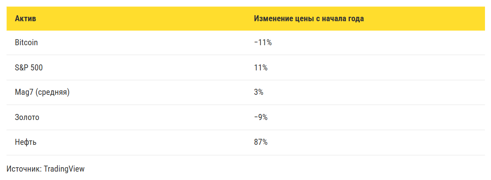

*График 30736084 — «Изменение цены ключевых активов с начала года». Интерактив: https://flo.uri.sh/visualisation/30736084/embed. Данные: [CSV](../charts/30736084.rows.csv), [JSON](../charts/30736084.json)*

Подписи и настройки графика: layout.source_name: TradingView

| Актив | Изменение цены с начала года |
|---|---|
| Bitcoin | −11% |
| S&P 500 | 11% |
| Mag7 (средняя) | 3% |
| Золото | −9% |
| Нефть | 87% |

**Лидеры и аутсайдеры среди неоактивов с начала года**

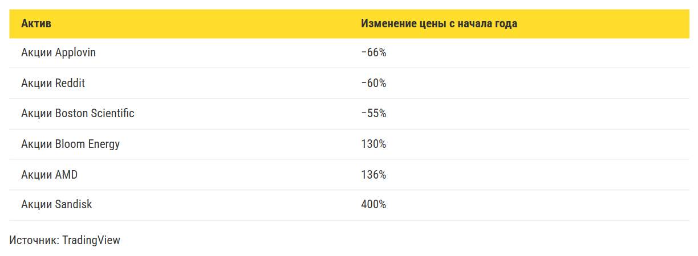

*График 30736511 — «Лидеры и аутсайдеры среди неоактивов с начала года». Интерактив: https://flo.uri.sh/visualisation/30736511/embed. Данные: [CSV](../charts/30736511.rows.csv), [JSON](../charts/30736511.json)*

Подписи и настройки графика: layout.source_name: TradingView

| Актив | Изменение цены с начала года |
|---|---|
| Акции Applovin | −66% |
| Акции Reddit | −60% |
| Акции Boston Scientific | −55% |
| Акции Bloom Energy | 130% |
| Акции AMD | 136% |
| Акции Sandisk | 400% |

Шесть факторов волатильности: что повлияет на мировые активы до конца года

Период до конца года выглядит неоднозначно. Сочетание нескольких значимых факторов, по нашим ожиданиям, будет поддерживать повышенную волатильность мировых активов.

**Календарь ключевых событий**

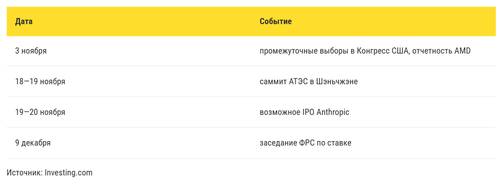

*График 30736567 — «Календарь ключевых событий». Интерактив: https://flo.uri.sh/visualisation/30736567/embed. Данные: [CSV](../charts/30736567.rows.csv), [JSON](../charts/30736567.json)*

Подписи и настройки графика: layout.source_name: Investing.com

| Дата | Событие |
|---|---|
| 3 ноября | промежуточные выборы в Конгресс США, отчетность AMD |
| 18—19 ноября | саммит АТЭС в Шэньчжэне |
| 19—20 ноября | возможное IPO Anthropic |
| 9 декабря | заседание ФРС по ставке |

Сезон отчетности: сильные результаты против высоких ожиданий

Компаниям из ИИ-цепочки все сложнее превосходить ожидания инвесторов. Распродажи нередко начинаются даже при незначительном расхождении результатов с прогнозами. Однако темпы роста показателей в технологическом секторе остаются высокими, а эффект подорожания денег проявится в отчетности с заметным запаздыванием.

Летом и в середине октября перекупленность в ряде звеньев ИИ-цепочки снизилась. Поэтому мы допускаем продолжение роста при сильных результатах.

Около 30% год к году

Ожидаемый рост прибыли компаний S&P 500 за третий квартал, по данным FactSet. Это может стать третьим кварталом подряд с ростом выше 25%

Мы также выделяем отчетности тех компаний, которые способны повлиять на настроения в технологическом секторе:

#### AMD

3 ноября

#### ARM

4 ноября

#### Palo Alto Networks

12 ноября

#### CoreWeave

16 ноября

#### Nvidia

25 ноября

Если в конце октября — начале ноября компании отчитаются сильно, этот сценарий может подкрепить запланированное на ноябрь IPO Anthropic. Размещение способно дополнительно усилить интерес инвесторов к сектору.

Промежуточные выборы в Конгресс США: период повышенной волатильности

Исторически рынок после выборов проходит через период волатильности, а затем, по мере снятия неопределенности, демонстрирует рост. Так происходит даже в тех случаях, когда действующая партия (партия президента) теряет большинство в Конгрессе.

Сейчас рыночные ожидания склоняются к тому, что республиканцы потеряют позиции в обеих палатах. Это может отчасти сдержать агрессивную политику Трампа. При этом нельзя исключать и обратного эффекта: перераспределение сил способно усилить турбулентность в политической повестке и повысить риск-премию в активах.

**Динамика индекса S&P 500 за три месяца после потери партией президента большинства в Конгрессе**

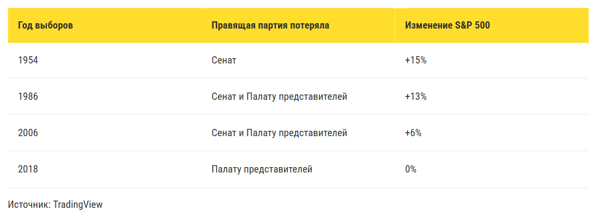

*График 30736587 — «Динамика индекса S&P 500 за три месяца после потери партией президента большинства в Конгрессе». Интерактив: https://flo.uri.sh/visualisation/30736587/embed. Данные: [CSV](../charts/30736587.rows.csv), [JSON](../charts/30736587.json)*

Подписи и настройки графика: layout.source_name: TradingView

| Год выборов | Правящая партия потеряла | Изменение S&P 500 |
|---|---|---|
| 1954 | Сенат | +15% |
| 1986 | Сенат и Палату представителей | +13% |
| 2006 | Сенат и Палату представителей | +6% |
| 2018 | Палату представителей | 0% |

7,6%

Средний рост S&P 500 за три месяца после любых выборов с 1970 года

ФРС сохраняет ястребиный настрой

28 октября ФРС сохранила ставку без изменений на уровне 3,75—4,00%. При этом готовность двух членов FOMC повысить ставку уже сейчас вновь подтвердила общий ястребиный настрой в комитете. При новом председателе Кевине Уорше регулятор сосредоточен на борьбе с инфляцией, а в сентябре уже продемонстрировал готовность действовать вопреки политическому давлению.

На фоне сохраняющихся проинфляционных рисков слабый рынок труда и нестабильные данные по росту американской экономики сдерживают ястребиные настроения инвесторов касаемо ФРС. Тем не менее единство позиций внутри FOMC делает дальнейшие повышения более вероятными.

4,25%

До такого уровня (по верхней границе диапазона) рынки ожидают повышения ставки ФРС 9 декабря. В первом полугодии 2027-го закладывается повышение еще на 50 б. п., по данным CME FedWatch Tool

Сохранение ставки в октябре смягчает макроэкономический фон на период отчетности и выборов. Однако в более длительной перспективе жесткая денежно-кредитная политика продолжит оказывать давление на рисковые активы.

Ближний Восток: главный сдерживающий фактор для аппетита к риску

Предпосылок для компромисса между США и Ираном пока нет. Перераспределение сил в Конгрессе теоретически может вызвать разногласия по военным бюджетам и подтолкнуть Дональда Трампа к более быстрым действиям в отношении КСИР.

Вторичные эффекты конфликта формируют цепочку факторов, снижающих риск к аппетиту: рост цен на энергоносители, ускорение инфляции, ужесточение политики центральных банков и рост реальных ставок.

Долговой рынок США сохраняет напряженность

В последние месяцы ситуация на долговых рынках, и не только в США, обострилась.

5,35%

Выше этого уровня поднималась доходность 10-летних казначейских облигаций США. Доходности гособлигаций достигли максимумов за 25 лет

Мы не ожидаем быстрой разрядки. Этому препятствуют сомнения рынка в эффективности решений ФРС и Минфина США, сокращение вложений пенсионных фондов в госбумаги и ожидания дальнейшего роста ставок. Все это будет сдерживать аппетит к риску.

Торговый мир между США и Китаем выглядит хрупким

Лидеры двух стран продлили действие Пусанского соглашения до января 2027 года. Однако неопределенность в сотрудничестве по металлам и чипам сохраняет риск-премию, прежде всего из-за влияния на ИИ-сектор, занимающий значительный вес в индексах. Кроме того, китайские компании все активнее конкурируют в технологическом сегменте, и рынку приходится пересматривать оценки действующих игроков.

Изменения в торговых отношениях возможны в рамках саммитов с участием первых лиц:

18—19 ноября

#### АТЭС

В Шэньчжэне

14—15 декабря

#### G20

В Майами

Наш взгляд

Мнение аналитика Т-Инвестиций

«Американский рынок поддерживают сильные ожидания по прибылям технологических компаний, однако набор рисков до конца года значителен: выборы в Конгресс, жесткая денежно-кредитная политика ФРС, напряженность на долговом рынке и нестабильные перспективы на Ближнем Востоке. Такой сентимент не располагает к излишнему оптимизму в отношении длинных позиций. И учитывая большой набор неоднозначных событий мы считаем рациональнее не делать единую ставку на рынок, а точечно отыгрывать новостной поток».

Максим Стаханов, аналитик Т-Инвестиций

Все цены, доходности и мультипликаторы указаны на закрытие торгов 29.10.2026

## Стратегию подготовили

- Софья Донец Главный экономист
- Юрий Тулинов Глава аналитики по рынку облигаций
- Марьяна Лазаричева Глава аналитики по рынку акций
- Егор Дахтлер Главный аналитик
- Александр Самуйлов Главный аналитик
- Ахмед Алиев Ведущий аналитик
- Александр Потехин Ведущий аналитик
- Александр Мартынов Инвестиционный аналитик
- Сергей Колбанов Старший аналитик
- Никита Степанов Старший аналитик
- Маргарита Боярко Старший аналитик
- Евгений Кошелев Аналитик по срочному рынку
- Евгений Митюков Директор по инвестициям, УК Т-Капитал
- Максим Стаханов Аналитик Т-Инвестиций
- Марта Харченко Аналитик Т-Инвестиций
- Анастасия Тушнолобова Руководитель аналитической редакции
- Анастасия Корочкина Аналитический редактор
- Илья Марченко Аналитический редактор

Аналитический отчет составлен в соответствии с Методикой оценки ценных бумаг Т-Банка. Обзор также содержит информацию о ценных бумагах, которые предназначены только для квалифицированных инвесторов в соответствии со ст. 51.2 Федерального закона №39-ФЗ «О рынке ценных бумаг».

АО «ТБанк», лицензия на осуществление брокерской деятельности № 045-14050-100000, лицензия на осуществление депозитарной деятельности № 045-14051-000100, выданы Банком России 06.03.2018 г. (без ограничения срока действия).

АО «ТБанк» не гарантирует получение доходности на рынке ценных бумаг. Клиент самостоятельно принимает решения по инвестированию и несет ответственность за полученный результат. Предлагаемые ценные бумаги иностранных эмитентов допущены к обращению на российском рынке.
