> Копия публичной страницы Т-Инвестиций для внутреннего анализа. Источник: https://www.tbank.ru/invest/research/strategy/2026-autumn-update/bonds/ · снято 2026-11-09
> Разделы: [Главная: макро, портфели, сценарии](main.md) · **Рынок облигаций** · [Рынок акций](stocks.md) · [Альтернативные инвестиции](alternative.md)

## Рынок облигаций

Добро пожаловать в новую реальность

ОФЗ: доходность есть, как и вопросы

Высокая доходность — высокая цена риска

Рублевые гособлигации пока не находят драйверов, способных вывести рынок из состояния стратегической неопределенности, в котором он пребывает уже несколько кварталов.

Наиболее устойчивую положительную доходность инвестиций в ОФЗ в 2026 году обеспечивают флоатеры (облигации с плавающим купоном) — благодаря сочетанию умеренно высокого купонного дохода и низкой ценовой волатильности. Еще более высокий результат с начала года продемонстрировали ОФЗ-ИН (с индексацией номинала на инфляцию). Однако длинные выпуски этого типа после существенного роста котировок уже выглядят перекупленными.

Мнение аналитика Т-Инвестиций

«Доходности к погашению длинных ОФЗ-ПД (с постоянным купонным доходом) по-прежнему превышают 16% годовых и не спешат снижаться. На длительном горизонте такие вложения выглядят привлекательными практически во всех сценариях, кроме наиболее неблагоприятных. Однако сейчас лишь немногие инвесторы готовы принять на себя риск значительных ценовых колебаний, характерный для бумаг с высокой чувствительностью к изменению процентных ставок».

Юрий Тулинов, глава аналитики по рынку облигаций

Инвестиции в ОФЗ приносят положительную доходность с начала 2026 года. Исключение — наиболее длинные выпуски ОФЗ-ПД, отличающиеся высокой ценовой волатильностью

**Структура совокупной доходности облигаций**

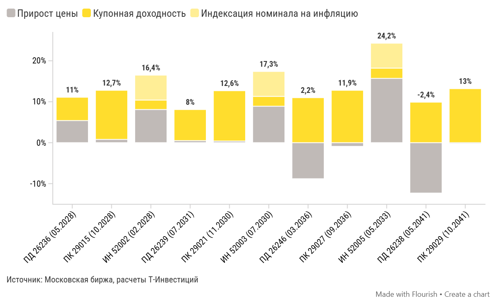

*График 30646337 — «Структура совокупной доходности облигаций». Интерактив: https://flo.uri.sh/visualisation/30646337/embed. Данные: [CSV](../charts/30646337.csv), [JSON](../charts/30646337.json)*

Подписи и настройки графика: axes_highlights.x_areas: ::2026*>>2028*; axes_highlights.y_lines: Индекс Мосбиржи = −15% :: -15; layout.source_name: Московская биржа, расчеты Т-Инвестиций; chart_type: column_stacked_line

| label | Совокупная доходность | Прирост цены | Купонная доходность | Индексация номинала на инфляцию |
|---|---|---|---|---|
| ПД 26236 (05.2028) | 11 | 5.4 | 5.6 | 0 |
| ПК 29015 (10.2028) | 12.6 | 0.8 | 11.9 | 0 |
| ИН 52002 (02.2028) | 16.5 | 8.1 | 2.3 | 6 |
| ПД 26239 (07.2031) | 8.1 | 0.5 | 7.5 | 0 |
| ПК 29021 (11.2030) | 12.6 | 0.4 | 12.2 | 0 |
| ИН 52003 (07.2030) | 17.2 | 8.9 | 2.4 | 6 |
| ПД 26246 (03.2036) | 2.2 | -8.7 | 10.9 | 0 |
| ПК 29027 (09.2036) | 11.9 | -0.8 | 12.7 | 0 |
| ИН 52005 (05.2033) | 24.2 | 15.7 | 2.5 | 6 |
| ПД 26238 (05.2041) | -2.3 | -12.2 | 9.8 | 0 |
| ПК 29029 (10.2041) | 13 | -0.1 | 13.1 | 0 |

Что сдерживает рынок ОФЗ

Тактические опасения инвесторов сосредоточены на действиях Банка России (какими темпами будет смягчаться денежно-кредитная политика) и Минфина (как будет реализован остаток программы заимствований на 2026 год — 1,85 трлн рублей по номиналу на 29 октября). При этом, на наш взгляд, большинство участников рынка сходятся в ответах на эти вопросы: «небыстрыми темпами» и «за счет комбинации бумаг с фиксированными и плавающими купонами».

Однако гораздо сильнее на рынок давит груз стратегических вопросов и долгосрочной неопределенности. Еще квартал назад в центре внимания находились геополитические риски («Насколько вероятна реализация негативных сценариев?») и инфляция («Насколько реалистично устойчивое возвращение к целевым 4%?»).

После публикации проекта федерального бюджета на 2027–2029 годы фокус сместился на архитектуру государственных финансов. В частности, на вопросы «Насколько успешно внутренние инвесторы смогут регулярно поглощать более 7 трлн рублей нового долга ежегодно и какой уровень доходности для этого потребуется?» и «Как корректировать бюджетные прогнозы с учетом регулярного пересмотра расходов и потребностей в заимствованиях в сторону повышения?»

**Потребность Минфина размещать новый долг устойчиво растет**

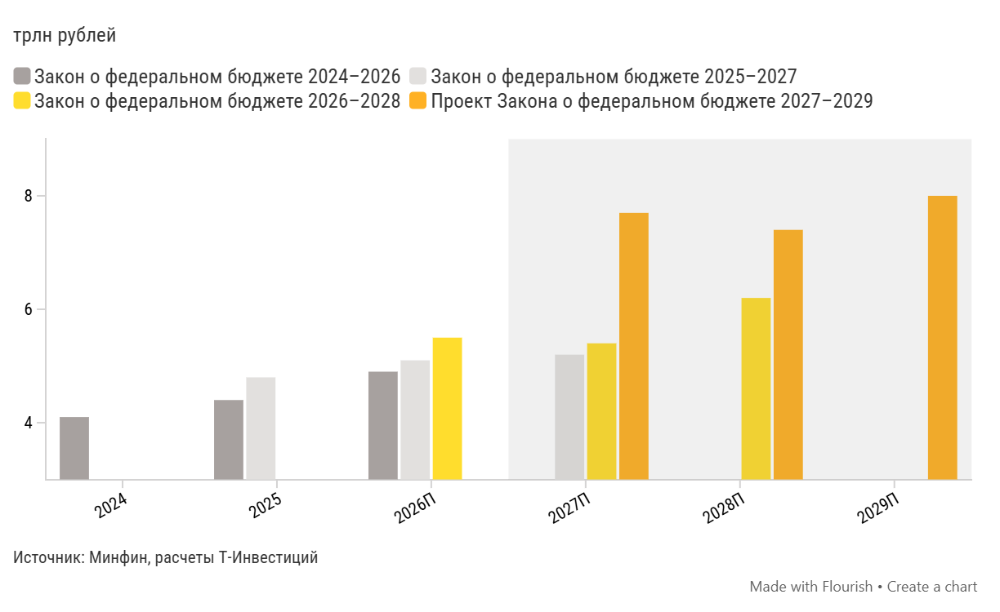

*График 30647020 — «Целевой объем программы внутренних заимствований Минфина». Интерактив: https://flo.uri.sh/visualisation/30647020/embed. Данные: [CSV](../charts/30647020.csv), [JSON](../charts/30647020.json)*

Подписи и настройки графика: axes_highlights.x_areas: ::2027П>>2029П; axes_highlights.y_lines: Индекс Мосбиржи = −15% :: -15; layout.source_name: Минфин, расчеты Т-Инвестиций; chart_type: column_grouped

| label | Закон о федеральном бюджете 2024–2026 | Закон о федеральном бюджете 2025–2027 | Закон о федеральном бюджете 2026–2028 | Проект Закона о федеральном бюджете 2027–2029 |
|---|---|---|---|---|
| 2024 | 4.1 |  |  |  |
| 2025 | 4.4 | 4.8 |  |  |
| 2026П | 4.9 | 5.1 | 5.5 |  |
| 2027П |  | 5.2 | 5.4 | 7.7 |
| 2028П |  |  | 6.2 | 7.4 |
| 2029П |  |  |  | 8 |

Разумеется, ответы на долгосрочные вопросы появятся лишь со временем. Развернуть динамику рынка ОФЗ в сторону роста котировок могли бы более краткосрочные драйверы. Например, ощутимые и однозначно позитивные изменения в геополитике или регистрация и размещение Минфином новых ОФЗ с плавающим купоном (ОФЗ-ПК), что позволило бы снизить давление на сегмент бумаг с постоянным купоном (ОФЗ-ПД).

Еще один важный вопрос на перспективу — насколько активно Минфин продолжит размещать длинный долг с фиксированным купоном (со сроком погашения от 10 лет), учитывая недостаточный спрос на подобные бумаги в последние кварталы. Мы предполагаем, что со времен ведомство будет все чаще предлагать на аукционах более короткие выпуски. При прочих равных это будет способствовать формированию более плоской кривой доходности на участке свыше пяти лет.

Как формировать портфель ОФЗ

Устойчивость инвестиционной стратегии проверяется временем (а заодно избавляет ее авторов от необходимости лишний раз пересматривать рекомендации). Несмотря на изменения рыночной конъюнктуры, наш подход к формированию портфеля ОФЗ остается неизменным с июльской версии стратегии. Мы по-прежнему не видим оснований для пересмотра ключевых рекомендаций.

Мнение аналитика Т-Инвестиций

«Покупать самые длинные ОФЗ-ПД мы по-прежнему рекомендуем лишь инвесторам с высокой склонностью к риску. Для большинства инвесторов оптимальным решением остается комбинация умеренно длинных ОФЗ-ПД, более коротких выпусков ОФЗ-ПК и ОФЗ-ИН»

Юрий Тулинов, глава аналитики по рынку облигаций

Наш выбор на рынке ОФЗ

- **ОФЗ 26252 Фиксированный купон Доходность к погашению — 16,36% (2033 год)** — `SU26252RMFS5` ([карточка](https://www.tbank.ru/invest/bonds/SU26252RMFS5/))

- **ОФЗ 29008 Плавающий купон Погашение в 2029 году** — `SU29008RMFS8` ([карточка](https://www.tbank.ru/invest/bonds/SU29008RMFS8/))

- **ОФЗ 29018 Плавающий купон Погашение в 2031 году** — `SU29018RMFS7` ([карточка](https://www.tbank.ru/invest/bonds/SU29018RMFS7/))

**Прогноз доходностей выпусков ОФЗ-ПД в базовом сценарии, %**

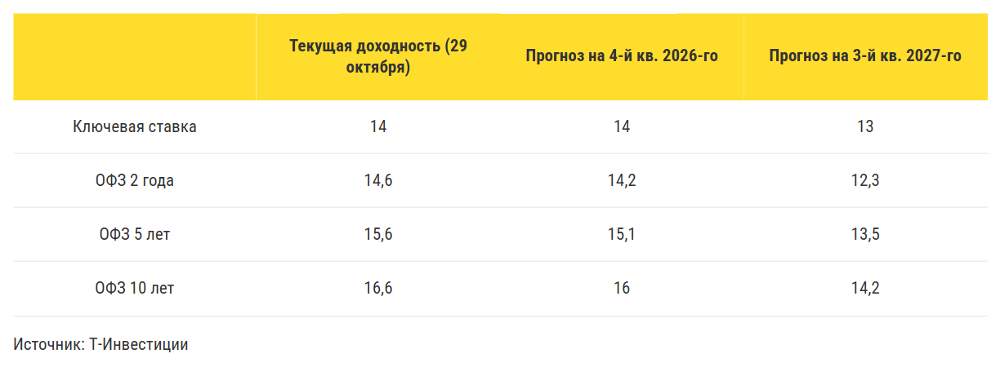

*График 30736058 — «Прогноз доходностей выпусков ОФЗ-ПД в базовом сценарии, %». Интерактив: https://flo.uri.sh/visualisation/30736058/embed. Данные: [CSV](../charts/30736058.rows.csv), [JSON](../charts/30736058.json)*

Подписи и настройки графика: layout.source_name: Т-Инвестиции

| columns_0 | Текущая доходность (29 октября) | Прогноз на 4-й кв. 2026-го | Прогноз на 3-й кв. 2027-го |
|---|---|---|---|
| Ключевая ставка | 14 | 14 | 13 |
| ОФЗ 2 года | 14,6 | 14,2 | 12,3 |
| ОФЗ 5 лет | 15,6 | 15,1 | 13,5 |
| ОФЗ 10 лет | 16,6 | 16 | 14,2 |

Корпоративные облигации: время рекордов еще впереди

Пауза в цикле снижения ключевой ставки, ухудшение глобальной конъюнктуры, рост опасений относительно кредитоспособности эмитентов и неоднозначная макроэкономика — с такими вводными мы приближаемся к последним месяцам года.

Число дефолтов бьет рекорды

Затянувшийся период высоких ставок отразился на количестве дефолтов уникальных эмитентов на долговом рынке. Так, за неполный 2026 год дефолт допустили уже 22 уникальных эмитента. Это рекорд с 2009 года, когда рынок тонул в последствиях мирового финансового кризиса.

Уникальные эмитенты — компании, которые не допускали дефолт в предшествующие годы

**Число эмитентов, допустивших дефолт**

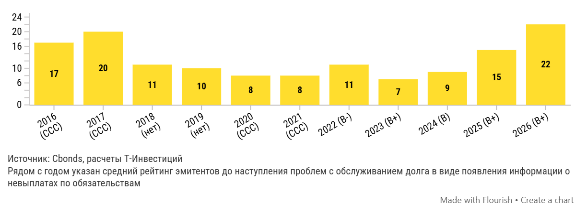

*График 30670731 — «Число эмитентов, допустивших дефолт». Интерактив: https://flo.uri.sh/visualisation/30670731/embed. Данные: [CSV](../charts/30670731.csv), [JSON](../charts/30670731.json)*

Подписи и настройки графика: axes_highlights.x_areas: ::2026*>>2028*; axes_highlights.y_lines: Индекс Мосбиржи = −15% :: -15; layout.footer_note_secondary: Рядом с годом указан средний рейтинг эмитентов до наступления проблем с обслуживанием долга в виде появления информации о невыплатах по обязательствам; layout.source_name: Cbonds, расчеты Т-Инвестиций; chart_type: column_grouped

| Год | Число эмитентов, допустивших дефолт |
|---|---|
| 2026 (B+) | 22 |
| 2025 (B+) | 15 |
| 2024 (B) | 9 |
| 2023 (B+) | 7 |
| 2022 (B-) | 11 |
| 2021 (ССС) | 8 |
| 2020 (ССС) | 8 |
| 2019 (нет) | 10 |
| 2018 (нет) | 11 |
| 2017 (ССС) | 20 |
| 2016 (ССС) | 17 |

На наш взгляд, ситуация для эмитентов остается напряженной из-за:

прогнозируемой динамики макроэкономических показателей;

сохраняющихся высоких ставок для компаний гражданского сектора;

давления со стороны очередных фискальных нововведений.

Рынок готовится к жестким сигналам

В последние месяцы на фоне напряженности инвесторы активно перераспределяли портфели в пользу более надежных эмитентов.

#### А и ВВВ

Кредитные спреды в этих группах были очень волатильными, а рост с середины лета превышал 300 и 600 б.п. соответственно.

#### ААА и АА

В этих группах волатильность спредов была минимальной, за исключением аномалий

Такая тактика инвесторов выглядит обоснованной с учетом обновленного бюджета, неоднозначной макроэкономики и растущего числа дефолтов.

Под аномалией подразумевается резкий рост доходностей в облигациях Балтийского лизинга

**G-spread по рейтинговым группам**

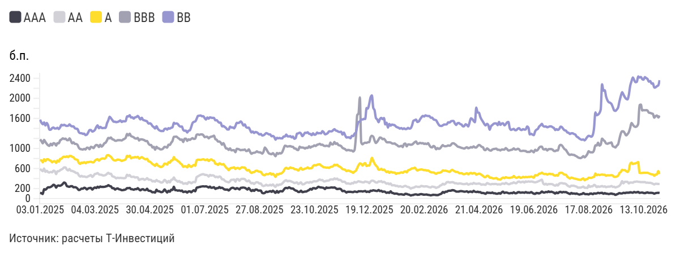

*График 30671681 — «G-spread по рейтинговым группам». Интерактив: https://flo.uri.sh/visualisation/30671681/embed. Данные: [CSV](../charts/30671681.csv), [JSON](../charts/30671681.json)*

Подписи и настройки графика: axes_highlights.x_areas: рецессия доткомов:: 28.02.2001 >> 30.11.2001; axes_highlights.x_lines: :: Прогноз; axes_highlights.y_lines: ::0; layout.source_name: расчеты Т-Инвестиций; y.title: б.п.; chart_type: line

| label | AAA | AA | A | BBB | BB |
|---|---|---|---|---|---|
| 03.01.2025 | 113,06 | 594,19 | 765,05 | 1 180,52 | 1 575,04 |
| 06.01.2025 | 108,59 | 566,87 | 764,29 | 1 147,73 | 1 517,46 |
| 08.01.2025 | 91,91 | 546,97 | 724,16 | 1 101,96 | 1 483,54 |
| 09.01.2025 | 188,31 | 600,08 | 785,64 | 1 171,24 | 1 519,03 |
| 10.01.2025 | 178,24 | 533,83 | 748,25 | 1 129,82 | 1 459,21 |
| 13.01.2025 | 199,79 | 555,27 | 784,48 | 1 093,17 | 1 510,32 |
| 14.01.2025 | 226,31 | 528,55 | 785,11 | 1 064,37 | 1 461,00 |
| 15.01.2025 | 224,27 | 521,37 | 763,84 | 1 051,68 | 1 373,26 |
| 16.01.2025 | 232,93 | 532,30 | 753,90 | 1 096,52 | 1 376,64 |
| 17.01.2025 | 250,50 | 521,86 | 723,37 | 1 063,91 | 1 405,89 |
| 20.01.2025 | 275,35 | 557,25 | 744,78 | 1 106,62 | 1 417,93 |
| 21.01.2025 | 265,14 | 548,07 | 747,09 | 1 097,95 | 1 398,59 |
| 22.01.2025 | 219,95 | 490,23 | 712,07 | 1 058,03 | 1 398,36 |
| 23.01.2025 | 255,08 | 545,71 | 759,75 | 1 106,24 | 1 412,32 |
| 24.01.2025 | 261,55 | 544,83 | 737,53 | 1 103,24 | 1 388,43 |
| 27.01.2025 | 256,01 | 567,28 | 791,57 | 1 160,50 | 1 422,40 |
| 28.01.2025 | 268,40 | 581,96 | 796,90 | 1 178,78 | 1 471,28 |
| 29.01.2025 | 293,17 | 596,40 | 825,45 | 1 202,88 | 1 461,48 |
| 30.01.2025 | 319,99 | 622,03 | 835,79 | 1 188,31 | 1 472,27 |
| 31.01.2025 | 305,43 | 622,26 | 830,03 | 1 197,23 | 1 458,12 |
| 03.02.2025 | 251,70 | 580,04 | 840,62 | 1 169,88 | 1 450,51 |
| 04.02.2025 | 241,55 | 561,91 | 827,51 | 1 164,20 | 1 453,31 |
| 05.02.2025 | 236,16 | 590,73 | 849,03 | 1 201,05 | 1 480,63 |
| 06.02.2025 | 246,59 | 557,14 | 850,21 | 1 156,48 | 1 453,38 |
| 07.02.2025 | 246,63 | 553,65 | 832,80 | 1 103,42 | 1 440,42 |
| 10.02.2025 | 225,31 | 539,79 | 823,20 | 1 122,74 | 1 440,20 |
| 11.02.2025 | 226,96 | 528,70 | 788,55 | 1 090,41 | 1 404,03 |
| 12.02.2025 | 222,04 | 510,51 | 780,35 | 1 090,79 | 1 395,81 |
| 13.02.2025 | 199,43 | 508,84 | 771,53 | 1 071,39 | 1 388,13 |
| 14.02.2025 | 170,62 | 463,67 | 708,79 | 1 013,93 | 1 326,42 |
| … | … | … | … | … | … |
| 09.10.2026 | 119,29 | 329,92 | 509,72 | 1 875,16 | 2 427,63 |
| 12.10.2026 | 120,37 | 328,52 | 512,27 | 1 758,91 | 2 384,65 |
| 13.10.2026 | 112,99 | 329,20 | 514,35 | 1 764,04 | 2 372,72 |
| 14.10.2026 | 109,29 | 330,89 | 514,79 | 1 762,33 | 2 423,44 |
| 15.10.2026 | 118,36 | 316,69 | 513,88 | 1 764,62 | 2 403,36 |
| 16.10.2026 | 123,35 | 319,35 | 515,42 | 1 754,78 | 2 384,31 |
| 19.10.2026 | 113,85 | 313,84 | 503,48 | 1 712,41 | 2 333,76 |
| 20.10.2026 | 114,80 | 314,40 | 493,81 | 1 710,18 | 2 344,40 |
| 21.10.2026 | 116,02 | 307,46 | 484,08 | 1 698,09 | 2 294,75 |
| 22.10.2026 | 110,38 | 295,95 | 480,83 | 1 689,16 | 2 299,45 |
| 23.10.2026 | 97,71 | 281,30 | 454,79 | 1 614,79 | 2 215,02 |
| 26.10.2026 | 108,22 | 295,87 | 478,99 | 1 646,54 | 2 219,88 |
| 27.10.2026 | 113,54 | 294,67 | 483,31 | 1 658,73 | 2 242,37 |
| 28.10.2026 | 116,37 | 291,72 | 548,17 | 1 619,38 | 2 257,57 |
| 29.10.2026 | 113,92 | 291,06 | 488,86 | 1 656,65 | 2 361,40 |

*Показано 45 из 464 строк, полный ряд: [CSV](../charts/30671681.csv), [JSON](../charts/30671681.json)*

Мнение аналитика Т-Инвестиций

«Ранее мы отмечали, что спокойствие в спредах, сформировавшееся к середине лета, выглядит обманчивым. Поэтому мы рекомендовали учитывать накопившиеся риски. Сейчас же, на наш взгляд, ситуация лишь ухудшилась и требует повышенного внимания к качеству эмитентов. Мы продолжаем отдавать предпочтение устойчивым компаниям, кредитные метрики которых остаются как минимум умеренными».

Сергей Колбанов, старший аналитик долговых рынков Т-Инвестиций

Для будущей оценки кредитоспособности эмитентов облигаций наиболее значимым фактором остается динамика ключевой ставки. После анонса бюджетных изменений оценка будущей траектории ставок стала более сдержанной. В совокупности с инфляционными принтами, которые обогнали ожидания, это привело к росту числа тех, кто ожидает ужесточения денежно-кредитной политики.

Такие настроения отражаются в спреде доходностей облигаций разной срочности, который в последние месяцы находится в отрицательной зоне — это можно считать постепенной подстройкой под кривую ОФЗ.

**Сравнение доходностей корпоративных облигаций разных временных групп**

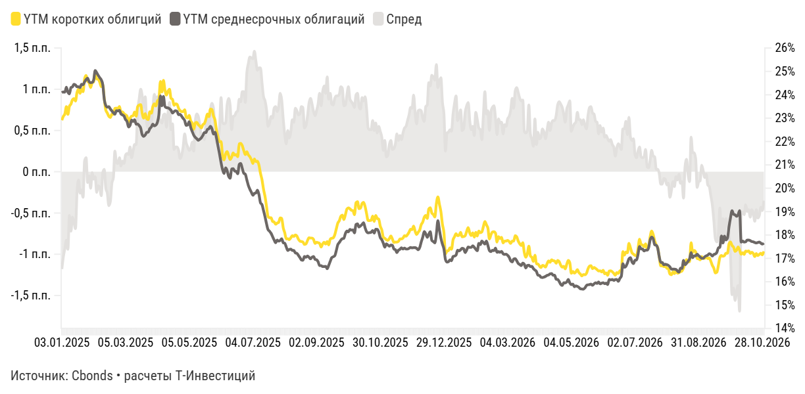

*График 30671747 — «Сравнение доходностей корпоративных облигаций разных временных групп». Интерактив: https://flo.uri.sh/visualisation/30671747/embed. Данные: [CSV](../charts/30671747.csv), [JSON](../charts/30671747.json)*

Подписи и настройки графика: axes_highlights.x_areas: беспрецедентная волатильность флоатеров:: 16.09.2024 >> 25.11.2024; axes_highlights.x_lines: :: Прогноз; axes_highlights.y_lines: ::0; layout.footer_note: расчеты Т-Инвестиций; layout.source_name: Cbonds; chart_type: area_stacked_line

| Дата | YTM коротких облигций | YTM среднесрочных облигаций | Спред |
|---|---|---|---|
| 29.10.2026 | 17,30 | 17,65 | -0,35 |
| 28.10.2026 | 17,15 | 17,61 | -0,47 |
| 27.10.2026 | 17,22 | 17,65 | -0,43 |
| 26.10.2026 | 17,17 | 17,70 | -0,53 |
| 23.10.2026 | 17,12 | 17,68 | -0,56 |
| 22.10.2026 | 17,21 | 17,66 | -0,46 |
| 21.10.2026 | 17,08 | 17,68 | -0,60 |
| 20.10.2026 | 17,21 | 17,71 | -0,50 |
| 19.10.2026 | 17,26 | 17,72 | -0,46 |
| 16.10.2026 | 17,21 | 17,76 | -0,55 |
| 15.10.2026 | 17,32 | 17,78 | -0,46 |
| 14.10.2026 | 17,30 | 17,78 | -0,48 |
| 13.10.2026 | 17,31 | 17,71 | -0,40 |
| 12.10.2026 | 17,17 | 17,70 | -0,52 |
| 09.10.2026 | 17,24 | 17,74 | -0,49 |
| 08.10.2026 | 17,18 | 17,70 | -0,52 |
| 07.10.2026 | 17,35 | 19,04 | -1,69 |
| 06.10.2026 | 17,49 | 18,87 | -1,38 |
| 05.10.2026 | 17,35 | 18,80 | -1,45 |
| 02.10.2026 | 17,30 | 18,86 | -1,56 |
| 01.10.2026 | 17,48 | 18,89 | -1,41 |
| 30.09.2026 | 17,55 | 19,04 | -1,49 |
| 29.09.2026 | 17,70 | 18,74 | -1,03 |
| 28.09.2026 | 17,62 | 18,35 | -0,74 |
| 25.09.2026 | 17,22 | 17,87 | -0,64 |
| 24.09.2026 | 17,22 | 17,79 | -0,57 |
| 23.09.2026 | 17,12 | 17,95 | -0,83 |
| 22.09.2026 | 17,09 | 17,66 | -0,57 |
| 21.09.2026 | 17,12 | 17,96 | -0,84 |
| 18.09.2026 | 17,04 | 17,48 | -0,44 |
| … | … | … | … |
| 24.01.2025 | 24,13 | 24,43 | -0,31 |
| 23.01.2025 | 24,24 | 24,45 | -0,22 |
| 22.01.2025 | 24,06 | 24,31 | -0,26 |
| 21.01.2025 | 24,24 | 24,34 | -0,10 |
| 20.01.2025 | 24,10 | 24,34 | -0,25 |
| 17.01.2025 | 23,73 | 24,42 | -0,69 |
| 16.01.2025 | 23,84 | 24,45 | -0,61 |
| 15.01.2025 | 23,79 | 24,34 | -0,55 |
| 14.01.2025 | 23,60 | 24,31 | -0,72 |
| 13.01.2025 | 23,51 | 24,04 | -0,53 |
| 10.01.2025 | 23,16 | 24,11 | -0,94 |
| 09.01.2025 | 23,49 | 24,32 | -0,83 |
| 08.01.2025 | 23,18 | 24,11 | -0,93 |
| 06.01.2025 | 23,08 | 24,12 | -1,03 |
| 03.01.2025 | 22,91 | 24,09 | -1,18 |

*Показано 45 из 464 строк, полный ряд: [CSV](../charts/30671747.csv), [JSON](../charts/30671747.json)*

Несмотря на это, форма кривой доходности корпоративного долга все еще подразумевает продолжение цикла снижения ставок в обозримой перспективе. Однако пауза в нем может растянуться.

На что ориентироваться инвесторам

Облигации с фиксированным купоном

Сейчас наиболее привлекательными для облигационных портфелей остаются:

- рублевые выпуски с фиксированным купоном короткой и средней срочности;
- более длинные выпуски — для инвесторов, готовых к повышенной волатильности;
- короткие флоатеры, с привязкой не только к КС, но и к RUONIA.

Сейчас важно сохранять особую избирательность при выборе эмитентов, обращая внимание на их фундаментальные показатели. Учитывая давление высоких ставок и замедление экономической активности вместе с фискальными нововведениями следующего года, предпочтение стоит отдавать понятным бизнесам с прогнозируемыми источниками дохода и устойчивыми кредитными метриками

Среди бумаг с фиксированным купоном мы рекомендуем добавлять в портфель выпуски с ежемесячными выплатами, которые обеспечивают ротацию капитала в условиях быстро меняющихся реалий.

**Наш выбор облигаций с фиксированным купоном**

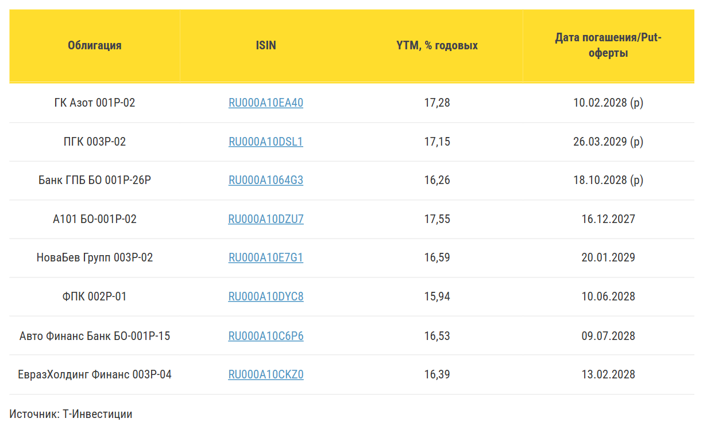

*График 30671931 — «Надежные облигации с фиксированным купоном ». Интерактив: https://flo.uri.sh/visualisation/30671931/embed. Данные: [CSV](../charts/30671931.rows.csv), [JSON](../charts/30671931.json)*

Подписи и настройки графика: layout.source_name: Т-Инвестиции

| Облигация | ISIN | YTM, % годовых | Дата погашения/Put-оферты |
|---|---|---|---|
| ГК Азот 001Р-02 | <a href="https://www.tbank.ru/invest/bonds/RU000A10EA40">RU000A10EA40</a> | 17,28 | 10.02.2028 (p) |
| ПГК 003Р-02 | <a href="https://www.tbank.ru/invest/bonds/RU000A10DSL1">RU000A10DSL1</a> | 17,15 | 26.03.2029 (p) |
| Банк ГПБ БО 001Р-26Р | <a href="https://www.tbank.ru/invest/bonds/RU000A1064G3">RU000A1064G3</a> | 16,26 | 18.10.2028 (p) |
| А101 БО-001Р-02 | <a href="https://www.tbank.ru/invest/bonds/RU000A10DZU7">RU000A10DZU7</a> | 17,55 | 16.12.2027 |
| НоваБев Групп 003Р-02 | <a href="https://www.tbank.ru/invest/bonds/RU000A10E7G1">RU000A10E7G1</a> | 16,59 | 20.01.2029 |
| ФПК 002Р-01 | <a href="https://www.tbank.ru/invest/bonds/RU000A10DYC8">RU000A10DYC8</a> | 15,94 | 10.06.2028 |
| Авто Финанс Банк БО-001Р-15 | <a href="https://www.tbank.ru/invest/bonds/RU000A10C6P6">RU000A10C6P6</a> | 16,53 | 09.07.2028 |
| ЕвразХолдинг Финанс 003P-04 | <a href="https://www.tbank.ru/invest/bonds/RU000A10CKZ0">RU000A10CKZ0</a> | 16,39 | 13.02.2028 |

Облигации с плавающим купоном

Ставка на флоатеры в более ранней стратегии показала свою ценность. Спрос на этот класс облигаций вырос за последние месяцы, что отразилось в сужении эффективных премий в старших рейтинговых группах.

Эффективная премия отражает аннуализированную (приведенную в годовое выражение) величину надбавки к референсной ставке с учетом базовой премии, текущей стоимости бумаги, срока до погашения и частоты выплаты купонов

**Эффективная премия флоатеров по рейтинговым группам**

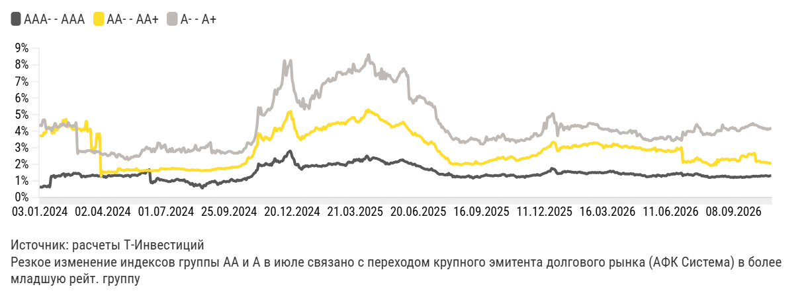

*График 30671868 — «Эффективная премия флоатеров по рейтинговым группам». Интерактив: https://flo.uri.sh/visualisation/30671868/embed. Данные: [CSV](../charts/30671868.csv), [JSON](../charts/30671868.json)*

Подписи и настройки графика: axes_highlights.x_areas: рецессия доткомов:: 28.02.2001 >> 30.11.2001; axes_highlights.x_lines: :: Прогноз; axes_highlights.y_lines: ::0; layout.footer_note_secondary: Резкое изменение индексов группы AA и A в июле связано с переходом крупного эмитента долгового рынка (АФК Система) в более младшую рейт. группу; layout.source_name: расчеты Т-Инвестиций; chart_type: line

| date | AAA- - AAA | AA- - AA+ | A- - A+ |
|---|---|---|---|
| 03.01.2024 | 0,64% | 3,67% | 4,27% |
| 04.01.2024 | 0,63% | 3,71% | 4,38% |
| 05.01.2024 | 0,62% | 3,73% | 4,35% |
| 08.01.2024 | 0,64% | 3,73% | 4,64% |
| 09.01.2024 | 0,70% | 3,90% | 4,67% |
| 10.01.2024 | 0,68% | 3,87% | 4,65% |
| 11.01.2024 | 0,68% | 3,96% | 4,23% |
| 12.01.2024 | 0,64% | 4,16% | 4,15% |
| 15.01.2024 | 0,68% | 4,23% | 4,18% |
| 16.01.2024 | 0,70% | 4,25% | 4,21% |
| 17.01.2024 | 0,68% | 4,19% | 4,13% |
| 18.01.2024 | 1,20% | 4,17% | 4,17% |
| 19.01.2024 | 1,27% | 3,89% | 4,04% |
| 22.01.2024 | 1,29% | 3,98% | 4,23% |
| 23.01.2024 | 1,32% | 3,91% | 4,29% |
| 24.01.2024 | 1,20% | 4,12% | 4,47% |
| 25.01.2024 | 1,28% | 4,16% | 4,36% |
| 26.01.2024 | 1,28% | 4,07% | 4,23% |
| 29.01.2024 | 1,30% | 4,19% | 4,27% |
| 30.01.2024 | 1,32% | 4,25% | 4,25% |
| 31.01.2024 | 1,29% | 4,40% | 4,30% |
| 01.02.2024 | 1,32% | 4,36% | 4,41% |
| 02.02.2024 | 1,39% | 4,36% | 4,37% |
| 05.02.2024 | 1,43% | 4,64% | 4,45% |
| 06.02.2024 | 1,41% | 4,61% | 4,41% |
| 07.02.2024 | 1,26% | 4,63% | 4,33% |
| 08.02.2024 | 1,39% | 4,69% | 4,30% |
| 09.02.2024 | 1,35% | 4,27% | 4,33% |
| 12.02.2024 | 1,41% | 4,35% | 4,51% |
| 13.02.2024 | 1,38% | 4,30% | 4,40% |
| … | … | … | … |
| 09.10.2026 | 1,28% | 2,20% | 4,34% |
| 12.10.2026 | 1,27% | 2,19% | 4,31% |
| 13.10.2026 | 1,29% | 2,19% | 4,24% |
| 14.10.2026 | 1,28% | 2,18% | 4,26% |
| 15.10.2026 | 1,31% | 2,13% | 4,21% |
| 16.10.2026 | 1,30% | 2,13% | 4,22% |
| 19.10.2026 | 1,30% | 2,13% | 4,15% |
| 20.10.2026 | 1,30% | 2,14% | 4,19% |
| 21.10.2026 | 1,31% | 2,10% | 4,14% |
| 22.10.2026 | 1,32% | 2,12% | 4,16% |
| 23.10.2026 | 1,30% | 2,10% | 4,09% |
| 26.10.2026 | 1,29% | 2,08% | 4,14% |
| 27.10.2026 | 1,29% | 2,08% | 4,12% |
| 28.10.2026 | 1,31% | 2,07% | 4,16% |
| 29.10.2026 | 1,32% | 2,09% | 4,19% |

*Показано 45 из 720 строк, полный ряд: [CSV](../charts/30671868.csv), [JSON](../charts/30671868.json)*

При этом облигации с плавающим купоном по-прежнему остаются наиболее актуальным классом активов на долговом рынке на фоне очередного витка неопределенности. Портфель облигаций, в котором соблюдается баланс между надежностью эмитентов и высокой эффективной премией, может показать доходность, сопоставимую с облигациями с фиксированным купоном. Кроме того, он добавит защитный компонент в случае ужесточения денежно-кредитной политики.

Наиболее привлекательно выглядят:

- бумаги недооцененных эмитентов рейтинговой группы AA и тщательно отобранные облигации компаний группы A;
- облигации с механизмом фиксации ставки на весь купонный период, исходя из референтной на начало периода;
- отдельные бумаги с привязкой к RUONIA, которая обгоняет ключевую в периоды дефицита структурной ликвидности.

**Наш выбор облигаций с плавающим купоном**

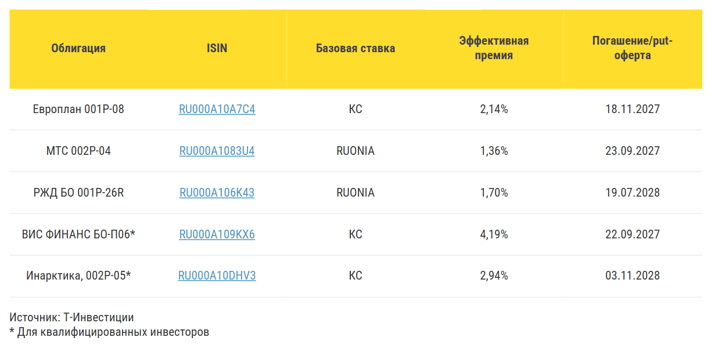

*График 30671951 — «Надежные облигации с плавающим купоном ». Интерактив: https://flo.uri.sh/visualisation/30671951/embed. Данные: [CSV](../charts/30671951.rows.csv), [JSON](../charts/30671951.json)*

Подписи и настройки графика: layout.footer_note_secondary: * Для квалифицированных инвесторов; layout.source_name: Т-Инвестиции

| Облигация | ISIN | Базовая ставка | Эффективная премия | Погашение/put-оферта |
|---|---|---|---|---|
| Европлан 001P-08 | <a href="https://www.tbank.ru/invest/bonds/RU000A10A7C4">RU000A10A7C4</a> | КС | 2,14% | 18.11.2027 |
| МТС 002Р-04 | <a href="https://www.tbank.ru/invest/bonds/RU000A1083U4">RU000A1083U4</a> | RUONIA | 1,36% | 23.09.2027 |
| РЖД БО 001Р-26R | <a href="https://www.tbank.ru/invest/bonds/RU000A106K43">RU000A106K43</a> | RUONIA | 1,70% | 19.07.2028 |
| ВИС ФИНАНС БО-П06* | <a href="https://www.tbank.ru/invest/bonds/RU000A109KX6">RU000A109KX6</a> | КС | 4,19% | 22.09.2027 |
| Инарктика, 002Р-05* | <a href="https://www.tbank.ru/invest/bonds/RU000A10DHV3">RU000A10DHV3</a> | КС | 2,94% | 03.11.2028 |

Валютные облигации: инструмент диверсификации

Прогнозируемый рынком темп девальвации рубля остается невысоким, учитывая довольно низкие ожидаемые темпы снижения ключевой ставки.

По оценкам консенсуса, курс рубля ослабнет на 13% на горизонте следующих 12 месяцев. Это не создает повышенной инвестиционной привлекательности для валютных инструментов.

**Ожидания по девальвации рубля**

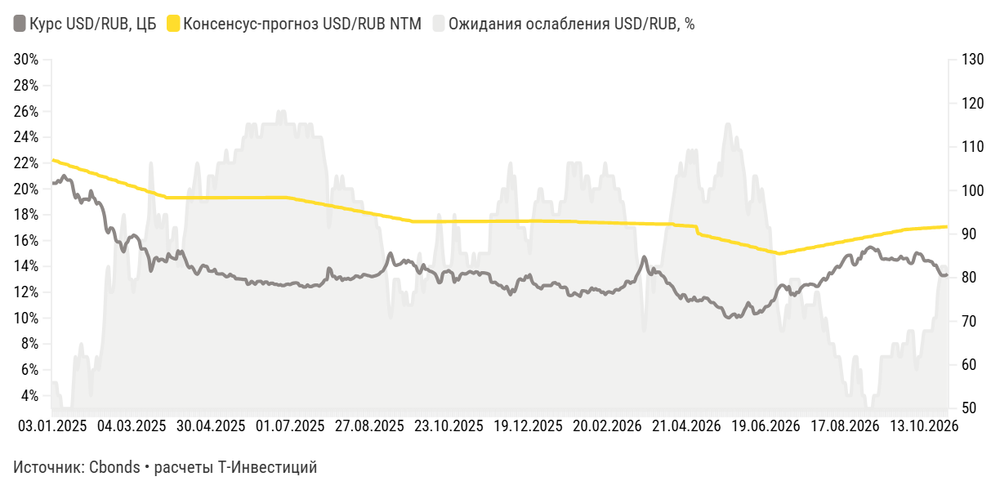

*График 30672095 — «Ожидания по девальвации рубля ». Интерактив: https://flo.uri.sh/visualisation/30672095/embed. Данные: [CSV](../charts/30672095.csv), [JSON](../charts/30672095.json)*

Подписи и настройки графика: axes_highlights.x_areas: беспрецедентная волатильность флоатеров:: 16.09.2024 >> 25.11.2024; axes_highlights.x_lines: :: Прогноз; axes_highlights.y_lines: ::0; layout.footer_note: расчеты Т-Инвестиций; layout.source_name: Cbonds; chart_type: area_stacked_line

| label | Курс USD/RUB, ЦБ | Консенсус-прогноз USD/RUB NTM | Ожидания ослабления USD/RUB, % |
|---|---|---|---|
| 29.10.2026 | 80,87 | 91,69 | 13% |
| 28.10.2026 | 80,53 | 91,67 | 14% |
| 27.10.2026 | 80,49 | 91,65 | 14% |
| 26.10.2026 | 80,54 | 91,63 | 14% |
| 23.10.2026 | 81,13 | 91,57 | 13% |
| 22.10.2026 | 81,97 | 91,55 | 12% |
| 21.10.2026 | 82,89 | 91,53 | 10% |
| 20.10.2026 | 82,85 | 91,51 | 10% |
| 19.10.2026 | 83,62 | 91,48 | 9% |
| 16.10.2026 | 83,76 | 91,42 | 9% |
| 15.10.2026 | 83,95 | 91,40 | 9% |
| 14.10.2026 | 83,87 | 91,38 | 9% |
| 13.10.2026 | 83,92 | 91,36 | 9% |
| 12.10.2026 | 84,90 | 91,34 | 8% |
| 09.10.2026 | 85,42 | 91,28 | 7% |
| 08.10.2026 | 85,48 | 91,26 | 7% |
| 07.10.2026 | 85,71 | 91,24 | 6% |
| 06.10.2026 | 84,93 | 91,21 | 7% |
| 05.10.2026 | 83,48 | 91,19 | 9% |
| 02.10.2026 | 83,25 | 91,13 | 9% |
| 01.10.2026 | 83,56 | 91,11 | 9% |
| 30.09.2026 | 84,43 | 91,09 | 8% |
| 29.09.2026 | 84,41 | 91,03 | 8% |
| 28.09.2026 | 84,34 | 90,97 | 8% |
| 25.09.2026 | 84,91 | 90,79 | 7% |
| 24.09.2026 | 84,40 | 90,73 | 7% |
| 23.09.2026 | 84,07 | 90,66 | 8% |
| 22.09.2026 | 84,10 | 90,60 | 8% |
| 21.09.2026 | 84,20 | 90,54 | 8% |
| 18.09.2026 | 84,51 | 90,36 | 7% |
| … | … | … | … |
| 24.01.2025 | 98,26 | 104,89 | 7% |
| 23.01.2025 | 99,10 | 105,20 | 6% |
| 22.01.2025 | 98,28 | 105,31 | 7% |
| 21.01.2025 | 99,93 | 105,41 | 5% |
| 20.01.2025 | 101,96 | 105,52 | 3% |
| 17.01.2025 | 102,41 | 105,62 | 3% |
| 16.01.2025 | 102,38 | 105,93 | 3% |
| 15.01.2025 | 102,81 | 106,03 | 3% |
| 14.01.2025 | 103,44 | 106,14 | 3% |
| 13.01.2025 | 102,71 | 106,24 | 3% |
| 10.01.2025 | 101,91 | 106,35 | 4% |
| 09.01.2025 | 102,29 | 106,66 | 4% |
| 08.01.2025 | 101,68 | 106,76 | 5% |
| 06.01.2025 | 101,68 | 106,87 | 5% |
| 03.01.2025 | 101,68 | 107,07 | 5% |

*Показано 45 из 464 строк, полный ряд: [CSV](../charts/30672095.csv), [JSON](../charts/30672095.json)*

С середины лета доходности облигаций с валютным номиналом начали подстраиваться под новые реалии — инвесторы требуют их роста с учетом прогнозов по медленному ослаблению рубля.

Это привело к еще большей оторванности от глобального бенчмарка для развивающихся рынков. Так, спред доходности локальных и глобальных выпусков превысили 300 б. п., хотя еще в начале лета он был вблизи 100 б. п.

**Сравнение доходностей на внутреннем и внешних рынках**

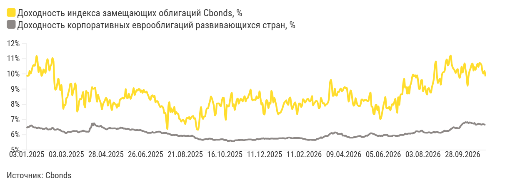

*График 30672428 — «Сравнение доходностей на внутреннем и внешних рынках ». Интерактив: https://flo.uri.sh/visualisation/30672428/embed. Данные: [CSV](../charts/30672428.csv), [JSON](../charts/30672428.json)*

Подписи и настройки графика: axes_highlights.x_areas: рецессия доткомов:: 28.02.2001 >> 30.11.2001; axes_highlights.x_lines: :: Прогноз; axes_highlights.y_lines: ::0; layout.source_name: Cbonds; chart_type: line

| label | Доходность индекса замещающих облигаций Cbonds, % | Доходность корпоративных еврооблигаций развивающихся стран, % |
|---|---|---|
| 29.10.2026 | 9,84 | 6,65 |
| 28.10.2026 | 10,19 | 6,67 |
| 27.10.2026 | 10,02 | 6,69 |
| 26.10.2026 | 10,16 | 6,69 |
| 23.10.2026 | 10,58 | 6,66 |
| 22.10.2026 | 10,68 | 6,69 |
| 21.10.2026 | 10,73 | 6,71 |
| 20.10.2026 | 10,46 | 6,72 |
| 19.10.2026 | 10,66 | 6,7 |
| 16.10.2026 | 10,48 | 6,66 |
| 15.10.2026 | 10,27 | 6,66 |
| 14.10.2026 | 10,45 | 6,77 |
| 13.10.2026 | 10,22 | 6,73 |
| 12.10.2026 | 10,68 | 6,75 |
| 09.10.2026 | 10,6 | 6,76 |
| 08.10.2026 | 10,37 | 6,8 |
| 07.10.2026 | 10,19 | 6,81 |
| 06.10.2026 | 9,87 | 6,76 |
| 05.10.2026 | 9,22 | 6,82 |
| 02.10.2026 | 9,86 | 6,8 |
| 01.10.2026 | 10,25 | 6,82 |
| 30.09.2026 | 10,69 | 6,78 |
| 29.09.2026 | 10,37 | 6,76 |
| 28.09.2026 | 10,09 | 6,72 |
| 25.09.2026 | 10,48 | 6,65 |
| 24.09.2026 | 10,01 | 6,57 |
| 23.09.2026 | 9,74 | 6,47 |
| 22.09.2026 | 9,92 | 6,42 |
| 21.09.2026 | 10,31 | 6,43 |
| 18.09.2026 | 10,23 | 6,45 |
| … | … | … |
|  |  | 6,53 |
|  |  | 6,53 |
|  |  | 6,5 |
|  |  | 6,47 |
|  |  | 6,44 |
|  |  | 6,41 |
|  |  | 6,38 |
|  |  | 6,35 |
|  |  | 6,3 |
|  |  | 6,29 |
|  |  | 6,33 |
|  |  | 6,31 |
|  |  | 6,3 |
|  |  | 6,27 |
|  |  | 6,29 |

*Показано 45 из 892 строк, полный ряд: [CSV](../charts/30672428.csv), [JSON](../charts/30672428.json)*

Даже при таком росте потенциальная рублевая доходность с учетом девальвации дает крайне скромную премию относительно обычных рублевых выпусков, где отсутствует вероятностная компонента в формировании конечного результата.

**Сравнение доходности рублевых и потенциальной доходности валютных облигаций**

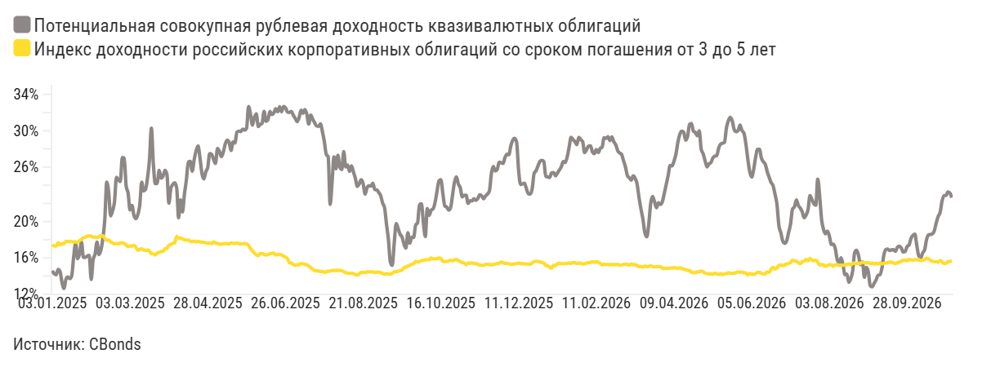

*График 30691817 — «Сравнение доходности рублевых и потенциальной доходности валютных облигаций». Интерактив: https://flo.uri.sh/visualisation/30691817/embed. Данные: [CSV](../charts/30691817.csv), [JSON](../charts/30691817.json)*

Подписи и настройки графика: axes_highlights.x_areas: рецессия доткомов:: 28.02.2001 >> 30.11.2001; axes_highlights.x_lines: :: Прогноз; axes_highlights.y_lines: ::0; layout.source_name: CBonds; chart_type: line

| label | Потенциальная совокупная рублевая доходность квазивалютных облигаций | Индекс доходности российских корпоративных облигаций со сроком погашения от 3 до 5 лет |
|---|---|---|
| 29.10.2026 | 22,62 | 15,66 |
| 28.10.2026 | 23,14 | 15,62 |
| 27.10.2026 | 23,25 | 15,57 |
| 26.10.2026 | 22,87 | 15,39 |
| 23.10.2026 | 22,86 | 15,39 |
| 22.10.2026 | 22,28 | 15,55 |
| 21.10.2026 | 21,02 | 15,72 |
| 20.10.2026 | 20,57 | 15,54 |
| 19.10.2026 | 19,87 | 15,57 |
| 16.10.2026 | 18,98 | 15,57 |
| 15.10.2026 | 18,65 | 15,63 |
| 14.10.2026 | 18,58 | 15,74 |
| 13.10.2026 | 18,54 | 15,89 |
| 12.10.2026 | 18,01 | 15,96 |
| 09.10.2026 | 16,88 | 15,8 |
| 08.10.2026 | 16,54 | 15,74 |
| 07.10.2026 | 16,01 | 15,71 |
| 06.10.2026 | 16,23 | 15,8 |
| 05.10.2026 | 17,33 | 15,76 |
| 02.10.2026 | 18,62 | 15,83 |
| 01.10.2026 | 18,48 | 15,73 |
| 30.09.2026 | 18,15 | 15,78 |
| 29.09.2026 | 17,41 | 15,83 |
| 28.09.2026 | 17,26 | 15,69 |
| 25.09.2026 | 16,71 | 15,73 |
| 24.09.2026 | 16,64 | 15,74 |
| 23.09.2026 | 17,08 | 15,63 |
| 22.09.2026 | 17,29 | 15,55 |
| 21.09.2026 | 17,17 | 15,46 |
| 18.09.2026 | 16,72 | 15,38 |
| … | … | … |
| 24.01.2025 | 16,44 | 17,91 |
| 23.01.2025 | 15,91 | 17,71 |
| 22.01.2025 | 17,63 | 17,77 |
| 21.01.2025 | 16,17 | 17,74 |
| 20.01.2025 | 14,06 | 17,79 |
| 17.01.2025 | 13,71 | 17,8 |
| 16.01.2025 | 13,89 | 17,8 |
| 15.01.2025 | 13,64 | 17,81 |
| 14.01.2025 | 12,64 | 17,57 |
| 13.01.2025 | 13,27 | 17,56 |
| 10.01.2025 | 14,48 | 17,44 |
| 09.01.2025 | 14,74 | 17,66 |
| 08.01.2025 | 14,14 | 17,31 |
| 06.01.2025 | 14,24 | 17,3 |
| 03.01.2025 | 14,59 | 17,48 |

*Показано 45 из 464 строк, полный ряд: [CSV](../charts/30691817.csv), [JSON](../charts/30691817.json)*

Мнение аналитика Т-Инвестиций

«На текущем волатильном рынке предлагаемая премия валютных облигаций не оправдывает потенциальных рисков, связанных с излишне крепким рублем. Поэтому в нынешних реалиях такие выпуски остаются прежде всего инструментом диверсификации портфеля».

Сергей Колбанов, старший аналитик долговых рынков Т-Инвестиций

Какие валютные облигации покупать сейчас

Мы рекомендуем рассматривать инвестиции в валютные облигации в первую очередь как инструмент хеджирования.

Сейчас картина доходностей на рынке квазивалютного долга выглядит так:

- **7,3% годовых** — Ликвидные замещающие облигации Минфина с дюрацией до четырех лет

- **9% годовых** — Длинные и менее ликвидные госвыпуски

- **8—9,5% годовых** — Корпоративные валютные облигации с высоким рейтингом

- **7,2% годовых** — Еврооблигации на развивающихся рынках

Как оценить эмитентов валютных облигаций

На основе базовых кредитных метрик мы разработали модель, которая позволяет сопоставлять доходность облигаций эмитента с их кредитным качеством. С ее помощью мы еженедельно обновляем карту эмитентов — инструмент, упрощающий выбор надежных валютных выпусков.

**Скоринг эмитентов валютных облигаций**

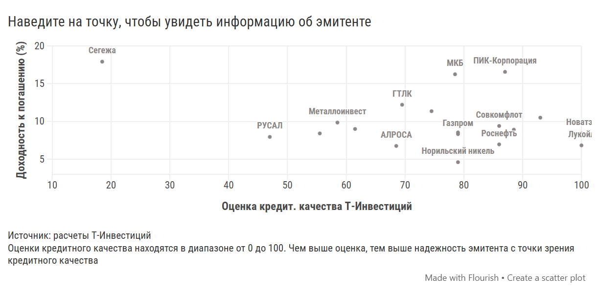

*График 30697477 — «Скоринг эмитентов валютных облигаций» — Наведите на точку, чтобы увидеть информацию об эмитенте. Интерактив: https://flo.uri.sh/visualisation/30697477/embed. Данные: [CSV](../charts/30697477.csv), [JSON](../charts/30697477.json)*

Подписи и настройки графика: layout.footer_note_secondary: Оценки кредитного качества находятся в диапазоне от 0 до 100. Чем выше оценка, тем выше надежность эмитента с точки зрения кредитного качества; layout.source_name: расчеты Т-Инвестиций

| Эмитент | Оценка кредит. качества Т-Инвестиций | Доходность к погашению (%) |
|---|---|---|
| ПИК-Корпорация | 87 | 16.56 |
| Газпром | 79 | 8.31 |
| Лукойл | 100 | 6.82 |
| Металлоинвест | 58.5 | 9.84 |
| Совкомфлот | 86 | 9.39 |
| ФосАгро | 79 | 8.53 |
| Новатэк | 100 | 8.44 |
| Норильский никель | 79 | 4.59 |
| ТМК | 40.5 | 23.09 |
| РЖД | 61.5 | 8.99 |
| Полюс | 86 | 8.46 |
| Полипласт | 52.5 | 51.99 |
| АЛРОСА | 68.5 | 6.74 |
| Домодедово Фьюэл Фасилитис | 29 | 26.26 |
| РУСАЛ | 47 | 7.94 |
| Роснефть | 86 | 6.95 |
| Газпром нефть | 93 | 10.49 |
| Акрон | 88.5 | 8.9 |
| ЕвроСибЭнерго-Гидрогенерация | 55.5 | 8.4 |
| Славянск ЭКО | 36 | 33.82 |
| Сегежа | 18.5 | 17.91 |
| Лид Капитал | 82.5 | 20.06 |
| ГТЛК | 69.5 | 12.2 |
| МКБ | 78.5 | 16.24 |
| Южуралзолото | 74.5 | 11.35 |
| Инвест КЦ | 33.5 | 22.48 |

Дальнейший значимый рост номинальных доходностей выглядит маловероятным в базовом сценарии. Однако в последние годы краткосрочный всплеск доходностей случался в основном по двум причинам:

- сокращение валютной ликвидности на внутреннем рынке на фоне погашений и put-оферт крупных эмитентов валютного долга;
- неожиданное ухудшение макроэкономической конъюнктуры, которое, с другой стороны, подразумевает и более быстрые темпы ослабления рубля.

Поэтому постепенно наращивать позицию до целевого уровня в облигациях с валютным номиналом можно уже сейчас, не дожидаясь более привлекательных условий. Портфель стоит формировать из среднесрочных и отдельных долгосрочных валютных бумаг.

**Наш выбор валютных облигаций**

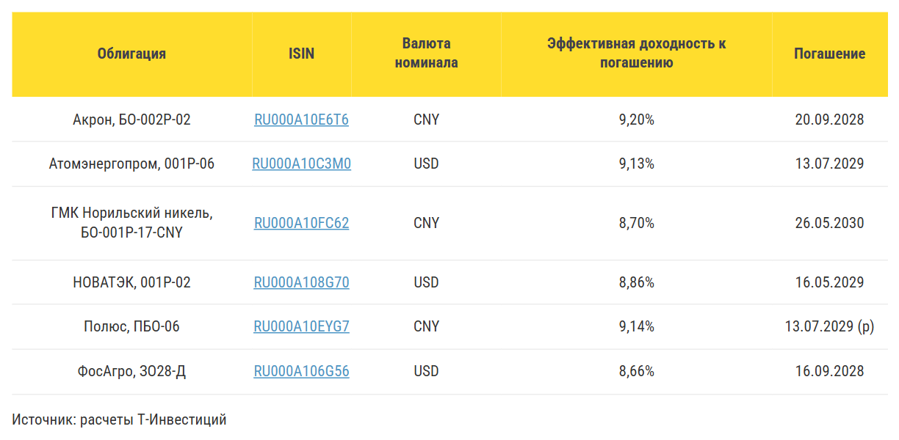

*График 30697664 — «Без названия». Интерактив: https://flo.uri.sh/visualisation/30697664/embed. Данные: [CSV](../charts/30697664.rows.csv), [JSON](../charts/30697664.json)*

Подписи и настройки графика: layout.source_name: расчеты Т-Инвестиций

| Облигация | ISIN | Валюта номинала | Эффективная доходность к погашению | Погашение |
|---|---|---|---|---|
| Акрон, БО-002Р-02 | <a href="https://www.tbank.ru/invest/bonds/RU000A10E6T6">RU000A10E6T6</a> | CNY | 9,20% | 20.09.2028 |
| Атомэнергопром, 001P-06 | <a href="https://www.tbank.ru/invest/bonds/RU000A10C3M0">RU000A10C3M0</a> | USD | 9,13% | 13.07.2029 |
| ГМК Норильский никель, БО-001Р-17-CNY | <a href="https://www.tbank.ru/invest/bonds/RU000A10FC62">RU000A10FC62</a> | CNY | 8,70% | 26.05.2030 |
| НОВАТЭК, 001Р-02 | <a href="https://www.tbank.ru/invest/bonds/RU000A108G70">RU000A108G70</a> | USD | 8,86% | 16.05.2029 |
| Полюс, ПБО-06 | <a href="https://www.tbank.ru/invest/bonds/RU000A10EYG7">RU000A10EYG7</a> | CNY | 9,14% | 13.07.2029 (p) |
| ФосАгро, ЗО28-Д | <a href="https://www.tbank.ru/invest/bonds/RU000A106G56">RU000A106G56</a> | USD | 8,66% | 16.09.2028 |

Все цены, доходности и мультипликаторы указаны на закрытие торгов 29.10.2026

## Стратегию подготовили

- Софья Донец Главный экономист
- Юрий Тулинов Глава аналитики по рынку облигаций
- Марьяна Лазаричева Глава аналитики по рынку акций
- Егор Дахтлер Главный аналитик
- Александр Самуйлов Главный аналитик
- Ахмед Алиев Ведущий аналитик
- Александр Потехин Ведущий аналитик
- Александр Мартынов Инвестиционный аналитик
- Сергей Колбанов Старший аналитик
- Никита Степанов Старший аналитик
- Маргарита Боярко Старший аналитик
- Евгений Кошелев Аналитик по срочному рынку
- Евгений Митюков Директор по инвестициям, УК Т-Капитал
- Максим Стаханов Аналитик Т-Инвестиций
- Марта Харченко Аналитик Т-Инвестиций
- Анастасия Тушнолобова Руководитель аналитической редакции
- Анастасия Корочкина Аналитический редактор
- Илья Марченко Аналитический редактор

Аналитический отчет составлен в соответствии с Методикой оценки ценных бумаг Т-Банка. Обзор также содержит информацию о ценных бумагах, которые предназначены только для квалифицированных инвесторов в соответствии со ст. 51.2 Федерального закона №39-ФЗ «О рынке ценных бумаг».

АО «ТБанк», лицензия на осуществление брокерской деятельности № 045-14050-100000, лицензия на осуществление депозитарной деятельности № 045-14051-000100, выданы Банком России 06.03.2018 г. (без ограничения срока действия).

АО «ТБанк» не гарантирует получение доходности на рынке ценных бумаг. Клиент самостоятельно принимает решения по инвестированию и несет ответственность за полученный результат. Предлагаемые ценные бумаги иностранных эмитентов допущены к обращению на российском рынке.
