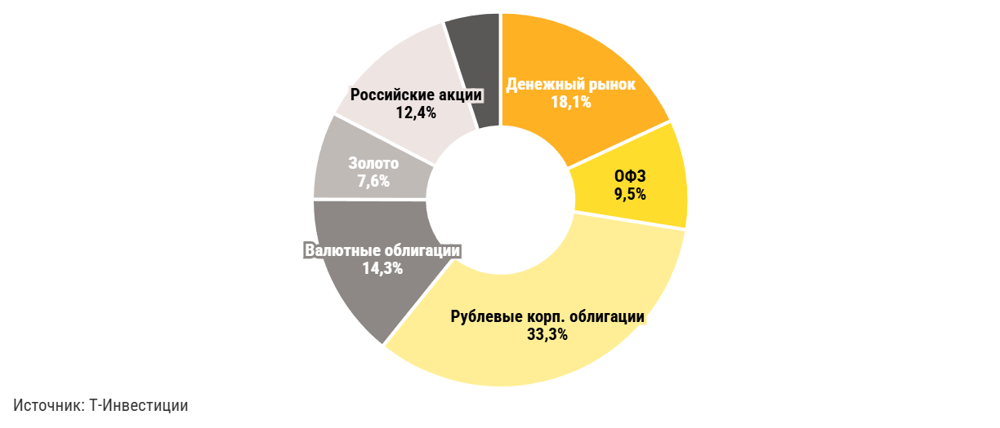
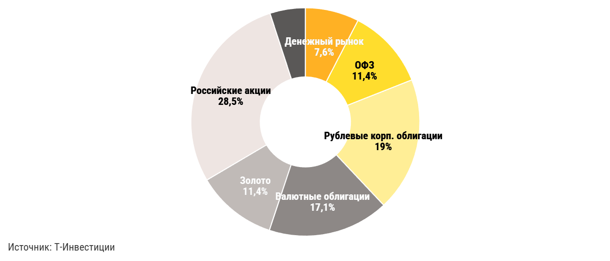
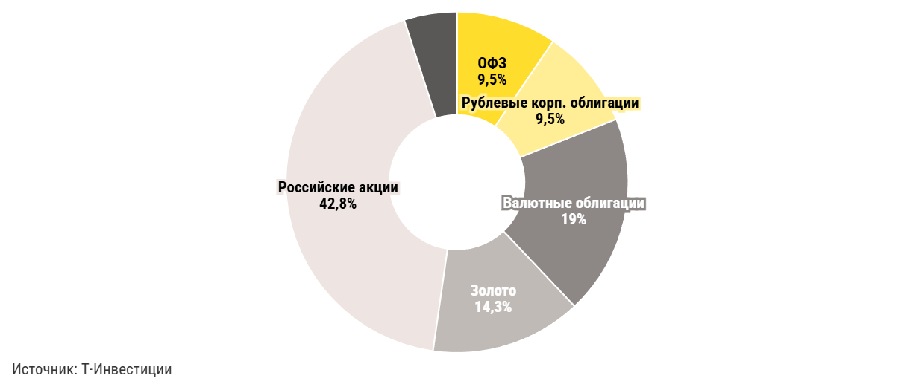
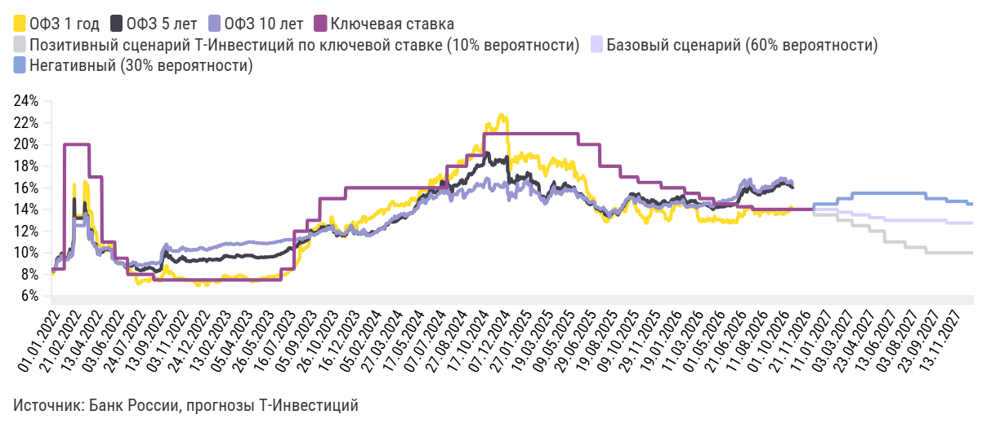
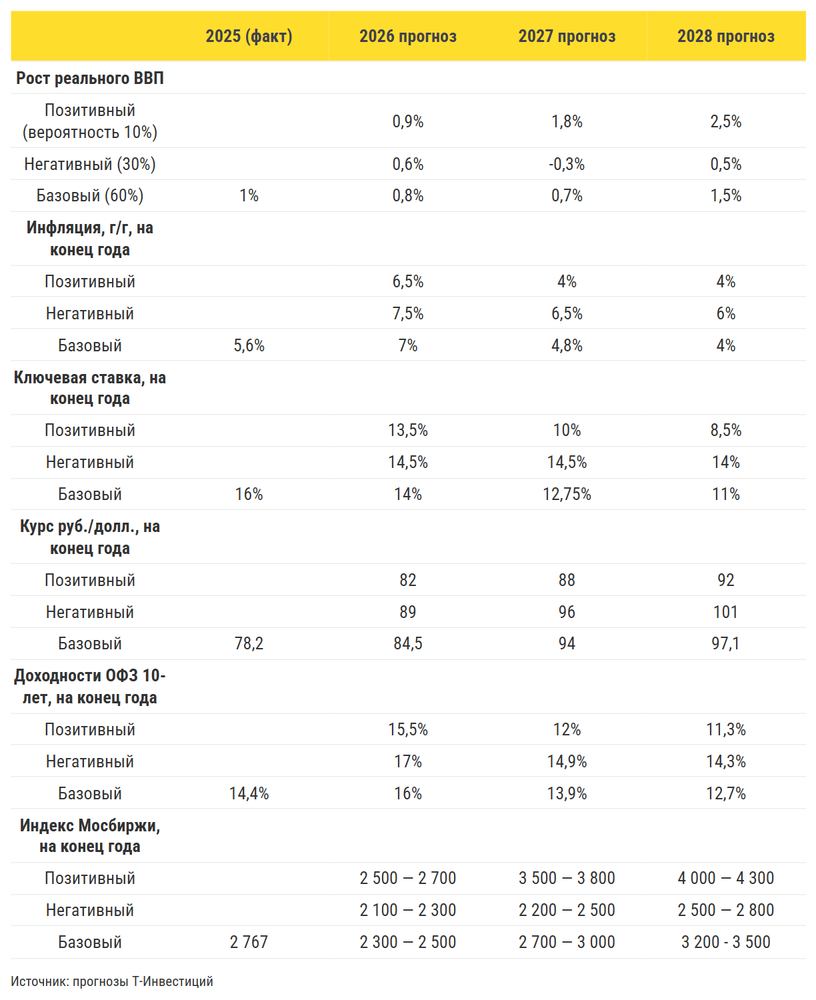

> Копия публичной страницы Т-Инвестиций для внутреннего анализа. Источник: https://www.tbank.ru/invest/research/strategy/2026-autumn-update/ · снято 2026-11-09
> Разделы: **Главная: макро, портфели, сценарии** · [Рынок облигаций](bonds.md) · [Рынок акций](stocks.md) · [Альтернативные инвестиции](alternative.md)

# Стратегия инвестирования: IV квартал 2026 года

Собираем портфель с запасом прочности

## Главное из стратегии

### Что изменилось за третий квартал

В последние месяцы российская экономика и рынок адаптировались к новому этапу геополитической эскалации. Несмотря на сохраняющееся давление и новые вызовы, худших сценариев, по-видимому, удалось избежать. Настроения и ожидания нормализовались, а основные экономические показатели менялись в целом в рамках наших прогнозов, пересмотренных в июле.

Однако рыночные тренды по-прежнему сильно зависят от труднопредсказуемых геополитических событий в России и мире. Это сокращает горизонт прогнозирования. В ближайшие месяцы экономике и рынку предстоит учитывать геополитические риски, адаптироваться к налоговым изменениям и работать в условиях достаточно жесткого кредитования. Такая среда требует избирательности при выборе эмитентов и гибкости в управлении портфелем.

Бюджетная и денежно-кредитная политика ориентированы прежде всего на сохранение стабильности и противодействие внешним рискам. Рассчитывать на значимые стимулы для роста экономики и рынка в таких условиях не приходится. При этом, судя по опыту предыдущих лет, Минфин и Банк России стремятся избегать и чрезмерного охлаждения экономики. Внутренние ресурсы для роста у нее есть.

### Мнение аналитика Т-Инвестиций

«Поэтому мы сохраняем осторожный и сбалансированный подход. В фокусе — консервативные инструменты: их доходности уверенно опережают инфляцию и помогают защитить портфель в период неопределенности. Они также позволяют зафиксировать доходность выше средних исторических уровней».

Софья Донец, главный экономист Т-Инвестиций

Сценарии резкого роста рыночных индексов, например благодаря улучшению геополитической ситуации или значительному снижению ключевой ставки, сохраняются, хотя сейчас вызывают больше скепсиса. При этом цены активов, которые могут выиграть от таких сценариев, выглядят привлекательными. Иными словами, ставка на риск стала дешевле. Поэтому мы дополняем портфель инструментами с потенциалом роста.

У активных инвесторов также есть возможности для реализации краткосрочных торговых идей благодаря повышенной волатильности как на российском, так и на глобальном рынке.

Мы продолжим обновлять прогнозы и рекомендации в рамках стратегии каждые три месяца.

## Что меняем в наших портфелях

### Сохраняем умеренный аппетит к риску

Консервативные стратегии по-прежнему особенно актуальны. Повышаем избирательность при выборе эмитентов и сохраняем диверсификацию

### Поддерживаем повышенную долю ликвидных инструментов

Фондов денежного рынка и облигаций с плавающей ставкой, или флоатеров

### Сохраняем фокус на облигациях

Концентрируемся на коротких и среднесрочных выпусках надежных эмитентов. Повышаем доходность портфеля за счет секьюритизированных облигаций

### Увеличиваем долю акций в портфелях инвесторов, готовых к риску

Динамика корпоративных прибылей дает больше оснований ожидать, что акции смогут компенсировать предыдущее снижение и опередить по доходности консервативные инструменты. При этом выбор эмитентов остается ключевым

### Сохраняем долю инструментов с валютной составляющей

Это валютные облигации российских эмитентов с привлекательной доходностью и золото, которое, несмотря на волатильность, сохраняет долгосрочный потенциал роста

## Что сейчас делать инвесторам

Сохранять ставку на облигации. С начала года этот класс активов служил надежным источником дохода и остается привлекательным на фоне неопределенности. С учетом замедления цикла снижения ключевой ставки сочетаем бумаги с фиксированным и плавающим купоном, отдавая предпочтение надежным эмитентам. Альтернативой классическим долговым инструментам могут стать секьюритизированные облигации.

Поддерживать ликвидность, чтобы сохранять устойчивость портфеля и возможность новых вложений. Фонды денежного рынка остаются одним из ключевых инструментов консервативной стратегии. Их доходность привлекательна, поскольку смягчение политики ЦБ откладывается. При этом предсказуемость дохода и быстрый доступ к средствам обеспечивают гибкость.

Избирательно увеличивать долю акций. Они по-прежнему чувствительны к геополитической повестке. После июльского падения рынок начал восстанавливаться, однако оценки большинства компаний по стандартным мультипликаторам остаются низкими. При этом в отдельных секторах уже заметно улучшаются фундаментальные показатели. Такое сочетание создает привлекательные возможности для входа. Приоритет отдаем финансово устойчивым эмитентам.

Сохранять защиту от валютных и внешних рисков. На фоне ожидаемого умеренного ослабления рубля квазивалютные инструменты остаются привлекательными. Доходности замещающих и юаневых облигаций высоки как по историческим меркам, так и в сравнении с другими рынками. Несмотря на волатильность золота, ожидания участников глобального рынка предполагают значительный потенциал роста его цены на горизонте года.

## Портфель-2026: защита, доходность и гибкость

### Облигации: основа портфеля на нестабильном рынке

#### ОФЗ

Покупать самые длинные ОФЗ-ПД мы по-прежнему рекомендуем инвесторам с высокой склонностью к риску. Для большинства подойдет сочетание ОФЗ-ПД умеренной срочности, более коротких выпусков ОФЗ-ПК и ОФЗ-ИН.

**Наш выбор на рынке ОФЗ**

- **ОФЗ 26252 Фиксированный купон Доходность к погашению — 16,36% (2033 год)** — `SU26252RMFS5` ([карточка](https://www.tbank.ru/invest/bonds/SU26252RMFS5/))

- **ОФЗ 29008 Плавающий купон Погашение в 2029 году** — `SU29008RMFS8` ([карточка](https://www.tbank.ru/invest/bonds/SU29008RMFS8/))

- **ОФЗ 29018 Плавающий купон Погашение в 2031 году** — `SU29018RMFS7` ([карточка](https://www.tbank.ru/invest/bonds/SU29018RMFS7/))

#### Рублевые облигации с фиксированным купоном

Привлекательными остаются короткие и среднесрочные корпоративные выпуски с фиксированным купоном. Более длинные бумаги подойдут инвесторам, готовым к повышенной волатильности в ближайшие месяцы.

При выборе эмитентов важна избирательность. На фоне высоких ставок, замедления экономической активности и налоговых изменений следующего года предпочтение стоит отдавать понятным бизнесам с прогнозируемыми источниками дохода и устойчивыми кредитными показателями. Помочь с выбором могут облигационные фонды, в которых оценку рисков и подбор бумаг берут на себя профессиональные управляющие.

Еще одна альтернатива классическим корпоративным облигациям — секьюритизированные бумаги, сочетающие привлекательную доходность и высокое качество активов. Ускоренная амортизация позволяет быстрее возвращать вложенные средства и перераспределять их между инструментами.

**Наш выбор на рынке облигаций**

- **ГК Азот 001Р-02 Доходность к погашению — 17,28% Дата погашения 10.02.2028** — `RU000A10EA40` ([карточка](https://www.tbank.ru/invest/bonds/RU000A10EA40/))

- **ПГК 003Р-02 Доходность к погашению — 17,15% Дата погашения 26.03.2029** — `RU000A10DSL1` ([карточка](https://www.tbank.ru/invest/bonds/RU000A10DSL1/))

- **НоваБев Групп 003Р-02 Доходность к погашению — 16,59% Дата погашения 20.01.2029** — `RU000A10E7G1` ([карточка](https://www.tbank.ru/invest/bonds/RU000A10E7G1/))

#### Флоатеры

Облигации с плавающей ставкой остаются особенно актуальными на фоне возросшей неопределенности. Выбирая бумаги с разумным соотношением надежности эмитента и эффективной премии к базовой ставке, можно сформировать портфель с доходностью, потенциально сопоставимой с доходностью облигаций с фиксированным купоном. При этом флоатеры обеспечат дополнительную защиту в случае неожиданного ужесточения денежно-кредитной политики.

**Наш выбор на рынке флоатеров**

- **Европлан 001P-08 Ключевая ставка + 2,14% Дата погашения 18.11.2027** — `RU000A10A7C4` ([карточка](https://www.tbank.ru/invest/bonds/RU000A10A7C4/))

- **МТС 002Р-04 RUONIA + 1,36% Дата погашения 23.09.2027** — `RU000A1083U4` ([карточка](https://www.tbank.ru/invest/bonds/RU000A1083U4/))

- **РЖД БО 001Р-26R RUONIA + 1,70% Дата погашения 19.07.2028** — `RU000A106K43` ([карточка](https://www.tbank.ru/invest/bonds/RU000A106K43/))

#### Валютные облигации

Доходности валютных облигаций надежных российских эмитентов поднялись до привлекательных уровней. В этом сегменте по-прежнему отдаем предпочтение экспортерам со стабильной валютной выручкой, достаточной для обслуживания долга.

С учетом прогноза плавного ослабления рубля на длинном горизонте и необходимости защиты от валютных рисков портфель стоит формировать из среднесрочных и отдельных долгосрочных валютных выпусков.

**Наш выбор на рынке валютных облигаций**

- **Акрон, БО-002Р-02 Доходность к погашению — 9,20% в юанях Дата погашения 20.09.2028** — `RU000A10E6T6_CNY` ([карточка](https://www.tbank.ru/invest/bonds/RU000A10E6T6_CNY/))

- **Атомэнергопром, 001P-06 Доходность к погашению — 9,13% в долларах Дата погашения 13.07.2029** — `RU000A10C3M0` ([карточка](https://www.tbank.ru/invest/bonds/RU000A10C3M0/))

- **ГМК Норильский никель, БО-001Р-17-CNY Доходность к погашению — 8,70% Дата погашения 26.05.2030** — `RU000A10FC62_CNY` ([карточка](https://www.tbank.ru/invest/bonds/RU000A10FC62_CNY/))

### Акции: используем возможности с осторожностью

Акции по-прежнему чувствительны к внешним рискам и экономической неопределенности. Однако их оценки остаются крайне низкими и привлекательными на длинном горизонте, а корпоративные прибыли показывают признаки восстановления. Это создает более благоприятные условия для входа.

В текущих условиях важна избирательность. В фокусе — компании с устойчивым финансовым положением, способные поддерживать рост бизнеса и рентабельность при высоких ставках и слабой экономической активности. Дивидендная доходность индекса Мосбиржи в следующие 12 месяцев может оказаться максимальной за пять лет.

**Наш выбор на рынке акций**

- **Озон Целевая цена — 5 700 ₽ Потенциал роста — 50%** — `OZON` ([карточка](https://www.tbank.ru/invest/stocks/OZON/))

- **Хэдхантер Целевая цена — 3 500 ₽ Потенциал роста — 30%** — `HEAD` ([карточка](https://www.tbank.ru/invest/stocks/HEAD/))

- **Транснефть Целевая цена — 1 560 ₽ Потенциал роста — 47%** — `TRNFP` ([карточка](https://www.tbank.ru/invest/stocks/TRNFP/))

- **ДОМ.РФ Целевая цена — 2 950 ₽ Потенциал роста — 38%** — `DOMRF` ([карточка](https://www.tbank.ru/invest/stocks/DOMRF/))

- **Сбер Целевая цена — 388 ₽ Потенциал роста — 31%** — `SBER` ([карточка](https://www.tbank.ru/invest/stocks/SBER/))

- **Озон Фармацевтика Целевая цена — 65 ₽ Потенциал роста — 37%** — `OZPH` ([карточка](https://www.tbank.ru/invest/stocks/OZPH/))

- **Промомед Целевая цена — 640 ₽ Потенциал роста — 53%** — `PRMD` ([карточка](https://www.tbank.ru/invest/stocks/PRMD/))

- **Лукойл Целевая цена — 6 800 ₽ Потенциал роста — 9%** — `LKOH` ([карточка](https://www.tbank.ru/invest/stocks/LKOH/))

- **НОВАТЭК Целевая цена — 1 390 ₽ Потенциал роста — 20%** — `NVTK` ([карточка](https://www.tbank.ru/invest/stocks/NVTK/))

### Золото: долгосрочный потенциал при краткосрочных рисках

В долгосрочной перспективе золото продолжит получать поддержку благодаря покупкам центральных банков, диверсифицирующих резервы, и защитному спросу со стороны инвесторов. Давление растущих долларовых ставок будет заметнее на коротком горизонте, но со временем, по нашим ожиданиям, ослабнет.

Золото остается важным инструментом диверсификации долгосрочного портфеля. При этом в оценке его ценовых перспектив на ближайшие месяцы мы сохраняем осторожность.

- Инструмент `TGLD@` ([карточка](https://www.tbank.ru/invest/etfs/TGLD@/))

### Фонд «Золото» от Т-Капитала

Инвестирует в физическое золото. Среднегодовая доходность — 5,8% в долларах. Начать можно с 10 ₽

### Ликвидность: доход с возможностью маневра

За последние два года фонды денежного рынка стали неотъемлемой частью портфелей, сочетая доходность на уровне все еще высоких ставок с быстрым доступом к средствам. По мере снижения ключевой ставки Банка России их доходность будет сокращаться, но, вероятно, останется выше ставок по депозитам.

- Инструмент `TMON@` ([карточка](https://www.tbank.ru/invest/etfs/TMON@/))

### Фонд «Денежный рынок» от Т-Капитала

Биржевой фонд, который всегда в плюсе. Среднегодовая доходность до 18,5%

### Портфели для разных риск-профилей

В наших стратегиях мы сохраняем приоритет рублевых облигаций, поддерживаем умеренный уровень риска и сокращаем дюрацию портфелей. Одновременно тактически увеличиваем долю акций в расчете на постепенное восстановление корпоративных прибылей и рыночных оценок. В валютной части смещаем фокус с золота на валютные облигации, предлагающие привлекательную текущую доходность. Целевой ориентир доходности портфеля на горизонте года — около 20%.

В условиях высокой неопределенности, в том числе геополитической, инвесторам важно внимательно оценивать свою готовность к риску. Для большинства сейчас могут быть более актуальны консервативная или сбалансированная стратегии.

#### Консервативный портфель

Нацелен на сохранение капитала и доходность выше денежного рынка при минимальном риске. Мы формируем его исходя из более осторожного сценария для экономики и ключевой ставки, допускающего длительное сохранение второй на высоком уровне. Поэтому сокращаем дюрацию и увеличиваем долю инструментов денежного рынка.

**Структура консервативного портфеля**

*График 30696146 — «Консервативный портфель». Интерактив: https://flo.uri.sh/visualisation/30696146/embed. Данные: [CSV](../charts/30696146.csv), [JSON](../charts/30696146.json)*

Подписи и настройки графика: layout.source_name: Т-Инвестиции; chart_type: donut

| Класс активов | Т-Консервативный портфель |
|---|---|
| Денежный рынок | 18,1% |
| ОФЗ | 9,5% |
| Рублевые корп. облигации | 33,3% |
| Валютные облигации | 14,3% |
| Золото | 7,6% |
| Российские акции | 12,4% |
| Альтернативные инвестиций | 5,0% |

#### Сбалансированный портфель

Ориентирован на широкую диверсификацию и участие в росте рынка при контролируемой волатильности. Как и портфель роста, предполагает продолжение смягчения денежно-кредитной политики в 2027 году.

В нем сближаются доли рублевых облигаций и акций, чтобы получить дополнительную доходность при снижении ставки.

**Структура сбалансированного портфеля**

*График 30696201 — «Сбалансированный портфель». Интерактив: https://flo.uri.sh/visualisation/30696201/embed. Данные: [CSV](../charts/30696201.csv), [JSON](../charts/30696201.json)*

Подписи и настройки графика: layout.source_name: Т-Инвестиции; chart_type: donut

| Класс активов | Сбалансированный портфель |
|---|---|
| Денежный рынок | 7,6% |
| ОФЗ | 11,4% |
| Рублевые корп. облигации | 19,0% |
| Валютные облигации | 17,1% |
| Золото | 11,4% |
| Российские акции | 28,5% |
| Альтернативные инвестиций | 5,0% |

#### Портфель роста

Нацелен на долгосрочный прирост капитала и допускает более высокую волатильность. В нем увеличена доля акций. Такая структура позволяет в большей степени выиграть от реализации умеренного сценария для экономики и дальнейшего снижения ставки.

**Структура портфеля роста**

*График 30696231 — «Портфель роста». Интерактив: https://flo.uri.sh/visualisation/30696231/embed. Данные: [CSV](../charts/30696231.csv), [JSON](../charts/30696231.json)*

Подписи и настройки графика: layout.source_name: Т-Инвестиции; chart_type: donut

| Класс активов | Портфель роста |
|---|---|
| ОФЗ | 9,5% |
| Рублевые корп. облигации | 9,5% |
| Валютные облигации | 19,0% |
| Золото | 14,3% |
| Российские акции | 42,8% |
| Альтернативные инвестиций | 5,0% |

#### Ключевые изменения за квартал в портфелях

Часть валютной защиты переносим из золота в валютные облигации. Дюрацию рублевой части сокращаем за счет увеличения доли инструментов денежного рынка и коротких и среднесрочных корпоративных выпусков. Эти изменения связаны с ростом неопределенности и более жестким сигналом Банка России.

Более короткая дюрация снижает чувствительность портфеля к длительному сохранению высокой ключевой ставки. При этом в портфеле роста мы дополнительно увеличили долю акций, используя привлекательные возможности для входа при текущих низких оценках рынка.

## Макро

### Рынок адаптируется к рискам, но появляются новые вызовы

**Несмотря на турбулентность, третий квартал прошел в рамках наших ожиданий**

Экономика адаптировалась к изменившимся геополитическим условиям.

Острый рыночный стресс середины лета сменился стабилизацией настроений.

Ситуацию в топливном сегменте смягчили государственные меры.

Вводные Минфина по бюджету на 2026 и 2027 годы оказались в рамках наших прогнозов.

Банк России, пересматривая ожидания, сохранил направленность на смягчение политики, хотя цикл все же замедлился.

Все вышеперечисленное оставляет пространство для осторожного оптимизма — это основа нашего базового сценария на горизонте года.

**При этом мы уточняем наши ожидания с учетом отдельных новых вводных**

Умеренно увеличился потенциал ослабления рубля в 2027 году за счет планируемого снижения базовой цены на нефть в бюджетном правиле

Инфляционное давление возросло за счет издержек (включая топливные, регулируемые и импортные цены) и дополнительных расходов бюджета 2026 года

Это отразилось в более медленном ожидаемом снижении ключевой ставки, которое будет уравновешивать указанные факторы

### Мнение аналитика Т-Инвестиций

«По экономической активности наш прогноз достаточно стабилен: рост сохраняется за счет внутреннего спроса, однако пока остается слабым. Вместе с тем геополитические риски повышены — это по-прежнему главный фактор давления на экономику и рынок. Неопределенность все еще высокая, события внутри страны и на мировой арене делают устойчивость прогнозов шаткой. Поэтому мы сохраняем осторожность как основную идею планирования в рамках стратегии».

Софья Донец, главный аналитик

### Базовый сценарий: осторожный оптимизм с учетом новых рисков

**Вероятность реализации — 60%**

Наш базовый сценарий остается осторожно оптимистичным. Адаптация к внешним вызовам требует времени и ресурсов. Однако она позволит удержать стабильную ситуацию на горизонте года. Этому будет способствовать сбалансированная политика Минфина и Банка России.

#### Экономика

**Наш прогноз роста ВВП:**

- **0,8%** — В 2026 году против 0,6% в более раннем прогнозе

- **0,7%** — В 2027 году против 1,1% ранее

Прогноз роста экономики на 2026 год немного повысился относительно июльского сценария. Сейчас население и бизнес адаптируются к последствиям летнего периода геополитической эскалации, чему в том числе помогают дополнительные бюджетные расходы. Внешние сырьевые цены остаются на высоких уровнях, поддерживая экспортные поступления.

В 2027 году рост экономики останется ниже долгосрочных средних. Экономическая ситуация будет непростой, однако внутренний спрос на фоне высокой занятости и бюджетной поддержки остается надежным драйвером, который не допустит переохлаждения.

Восстановление инвестиционного цикла может происходить плавно, по мере стабилизации прибылей бизнеса и снижения ставок. Внешняя торговля будет подвержена рискам. Однако с учетом востребованности российского сырья и товаров на глобальном рынке в базовом сценарии мы предполагаем сохранение стабильного экспорта.

#### Бюджетная политика

3,2% ВВП

До такого уровня Минфин увеличил планируемый дефицит бюджета в 2026 году после 2,6% в 2025-м. Это решение совпало с нашим июльским прогнозом

Дефицит будет профинансирован за счет рублевых резервов и дополнительного размещения ОФЗ.

При общем и структурном дефиците бюджета на уровне ожиданий расходы все же оказались выше нашего прогноза (на 1—1,5 трлн рублей). Они будут обеспечены более высокими несырьевыми доходами бюджета, включая разовые поступления.

2% ВВП

До такого уровня запланировано снижение дефицита бюджета в 2027 году

Сокращение дефицита может быть достигнуто за счет консервативного подхода к расходам — они практически не должны измениться, согласно проекту. Однако фактические потребности, в том числе по оборонным расходам, будут зависеть от внешних рисков.

Минфин показал, что может адаптировать бюджет к изменениям условий, сохраняя сбалансированный подход. Мы не видим рисков для устойчивости государственных финансов, однако подстройка бюджета может быть сопряжена с дополнительным давлением на рубль и инфляцию, а также ростом нагрузки на экономику со стороны налогов.

#### Рубль

**Наш прогноз курса рубля:**

- **84,5 руб/долл** — К концу 2026 года

- **91,2 руб/долл** — В среднем в 2027 году

- **12,6 руб/юань** — К концу 2026 года

- **13,8 руб/юань** — В среднем в 2027 году

Факторы, влияющие на динамику рубля, уравновесили друг друга. Это позволило нацвалюте стабилизироваться после летнего ослабления. По нашим прогнозам, такая ситуация может сохраниться до конца года. Однако многое зависит от труднопрогнозируемых геополитических событий.

Поддерживают рубль

Высокие цены на российскую нефть: они преодолели отметку $110 за баррель в октябре. Однако волатильность котировок остается высокой, дальнейшая динамика будет определяться развитием событий на Ближнем Востоке

Негативно влияют на рубль

Сокращение экспорта дизеля, импорт бензина, замедление вывоза зерновых, атаки на инфраструктуру. Однако с учетом мер правительства и объявленной договоренности с США о возобновлении экспорта дизеля ситуация может улучшиться до конца года, а давление на рубль — снизиться

В 2027 году, по нашим прогнозам, рубль будет плавно ослабевать. Это в том числе будет связано со снижением глобальных нефтяных котировок. Цены на российскую нефть также могут опуститься — ниже $60 за баррель. Потенциально этому будет способствовать подстройка мирового рынка топлива либо за счет роста предложения при завершении конфликта, либо из-за спада спроса при переходе на альтернативные источники.

При этом потенциал ослабления рубля увеличился, когда Минфин объявил о снижении базовой цены на нефть в бюджетном правиле с текущих $59 до $50 за баррель. Выручка нефтегазовых экспортеров более чем на 60% облагается налогами, часть из которых направляется в ФНБ и сопровождается валютными операциями регулятора. Поэтому изменение базовой цены важно для курса рубля и при прочих равных может привести к его дополнительному ослаблению на 6—7%.

#### Инфляция

**Наш прогноз инфляции:**

- **7%** — По итогам 2026 года (6,6% ранее)

- **4,8%** — По итогам 2027 года (4,5% ранее)

В последние месяцы инфляция ускорилась и превысила 7% в годовом выражении. Среди причин — резкое подорожание топлива и значительное повышение тарифов ЖКХ. Вместе эти два фактора добавили к общему росту цен более 1,7 п. п. Инфляция может ускориться за счет дополнительного роста расходов бюджета, который транслируется в доходы населения.

**На 2027 год потенциальные инфляционные риски также выросли с учетом:**

- ускоренной индексации регулируемых тарифов;
- возможных шоков от издержек (аналогичных топливному шоку);
- более слабого рубля.

Однако в большой степени эти эффекты могут быть компенсированы более жесткой денежно-кредитной политикой, которая будет сдерживать потребительский спрос и ожидания. Поэтому инфляция будет снижаться на горизонте года.

#### Ключевая ставка

**Наш прогноз ключевой ставки:**

- **14%** — К концу 2026 года

- **12,75%** — К концу 2027 года

Банк России сохраняет приверженность консервативной политике. В июле регулятор пересмотрел свои прогнозы, сократив потенциал предполагаемого снижения ключевой ставки на следующий год, а в сентябре взял паузу в цикле снижения.

Однако смягчение политики остается для ЦБ базовым сценарием. С учетом прогнозируемого замедления экономики и охлаждения спроса мы ожидаем продолжения плавного снижения ключевой ставки в следующем году.

Увеличение длительности паузы или разворот в цикле — менее вероятный сценарий для нас. В основном он связан с геополитическими рисками, которые могут существенно изменить бюджетную траекторию или значительно увеличить издержки для бизнеса.

При этом более быстрое снижение ставки может быть ответом на внешний позитив, снижающий «риск-премии» в процентных ставках. В другом сценарии это может стать реакцией на неожиданное ухудшение внутренней ситуации — например, в части реализации кредитных рисков или рисков рецессии.

**Ключевая ставка и доходности ОФЗ**

*График 30705444 — «Ключевая ставка и доходности ОФЗ». Интерактив: https://flo.uri.sh/visualisation/30705444/embed. Данные: [CSV](../charts/30705444.csv), [JSON](../charts/30705444.json)*

Подписи и настройки графика: axes_highlights.x_areas: рецессия доткомов:: 28.02.2001 >> 30.11.2001; axes_highlights.x_lines: :: Прогноз; axes_highlights.y_lines: ::0; layout.source_name: Банк России, прогнозы Т-Инвестиций; chart_type: line

| label | ОФЗ 1 год | ОФЗ 5 лет | ОФЗ 10 лет | Ключевая ставка | Позитивный сценарий Т-Инвестиций по ключевой ставке (10% вероятности) | Базовый сценарий (60% вероятности) | Негативный (30% вероятности) |
|---|---|---|---|---|---|---|---|
| 01.01.2022 | 8,18 | 8,44 | 8,44 | 8,5 |  |  |  |
| 02.01.2022 | 8,18 | 8,44 | 8,44 | 8,5 |  |  |  |
| 03.01.2022 | 8,06 | 8,33 | 8,37 | 8,5 |  |  |  |
| 04.01.2022 | 8,09 | 8,34 | 8,37 | 8,5 |  |  |  |
| 05.01.2022 | 8,06 | 8,3 | 8,34 | 8,5 |  |  |  |
| 06.01.2022 | 8,28 | 8,49 | 8,47 | 8,5 |  |  |  |
| 07.01.2022 | 8,28 | 8,49 | 8,47 | 8,5 |  |  |  |
| 08.01.2022 | 8,28 | 8,49 | 8,47 | 8,5 |  |  |  |
| 09.01.2022 | 8,28 | 8,49 | 8,47 | 8,5 |  |  |  |
| 10.01.2022 | 8,57 | 8,66 | 8,58 | 8,5 |  |  |  |
| 11.01.2022 | 8,63 | 8,83 | 8,73 | 8,5 |  |  |  |
| 12.01.2022 | 8,68 | 8,88 | 8,76 | 8,5 |  |  |  |
| 13.01.2022 | 9,07 | 9,24 | 9,04 | 8,5 |  |  |  |
| 14.01.2022 | 9,37 | 9,46 | 9,25 | 8,5 |  |  |  |
| 15.01.2022 | 9,37 | 9,46 | 9,25 | 8,5 |  |  |  |
| 16.01.2022 | 9,37 | 9,46 | 9,25 | 8,5 |  |  |  |
| 17.01.2022 | 9,55 | 9,58 | 9,44 | 8,5 |  |  |  |
| 18.01.2022 | 9,66 | 9,58 | 9,37 | 8,5 |  |  |  |
| 19.01.2022 | 9,59 | 9,42 | 9,22 | 8,5 |  |  |  |
| 20.01.2022 | 9,66 | 9,5 | 9,29 | 8,5 |  |  |  |
| 21.01.2022 | 9,76 | 9,6 | 9,35 | 8,5 |  |  |  |
| 22.01.2022 | 9,76 | 9,6 | 9,35 | 8,5 |  |  |  |
| 23.01.2022 | 9,76 | 9,6 | 9,35 | 8,5 |  |  |  |
| 24.01.2022 | 9,97 | 9,9 | 9,69 | 8,5 |  |  |  |
| 25.01.2022 | 9,98 | 9,94 | 9,75 | 8,5 |  |  |  |
| 26.01.2022 | 9,95 | 9,92 | 9,75 | 8,5 |  |  |  |
| 27.01.2022 | 9,77 | 9,65 | 9,48 | 8,5 |  |  |  |
| 28.01.2022 | 9,74 | 9,67 | 9,49 | 8,5 |  |  |  |
| 29.01.2022 | 9,74 | 9,67 | 9,49 | 8,5 |  |  |  |
| 30.01.2022 | 9,74 | 9,67 | 9,49 | 8,5 |  |  |  |
| … | … | … | … | … | … | … | … |
| 17.12.2027 |  |  |  |  | 10 | 12,75 | 14,5 |
| 18.12.2027 |  |  |  |  | 10 | 12,75 | 14,5 |
| 19.12.2027 |  |  |  |  | 10 | 12,75 | 14,5 |
| 20.12.2027 |  |  |  |  | 10 | 12,75 | 14,5 |
| 21.12.2027 |  |  |  |  | 10 | 12,75 | 14,5 |
| 22.12.2027 |  |  |  |  | 10 | 12,75 | 14,5 |
| 23.12.2027 |  |  |  |  | 10 | 12,75 | 14,5 |
| 24.12.2027 |  |  |  |  | 10 | 12,75 | 14,5 |
| 25.12.2027 |  |  |  |  | 10 | 12,75 | 14,5 |
| 26.12.2027 |  |  |  |  | 10 | 12,75 | 14,5 |
| 27.12.2027 |  |  |  |  | 10 | 12,75 | 14,5 |
| 28.12.2027 |  |  |  |  | 10 | 12,75 | 14,5 |
| 29.12.2027 |  |  |  |  | 10 | 12,75 | 14,5 |
| 30.12.2027 |  |  |  |  | 10 | 12,75 | 14,5 |
| 31.12.2027 |  |  |  |  | 10 | 12,75 | 14,5 |

*Показано 45 из 2191 строк, полный ряд: [CSV](../charts/30705444.csv), [JSON](../charts/30705444.json)*

### Альтернативные сценарии

#### Позитивный сценарий

Неопределенность возросла, поэтому вместе с базовым сценарием мы учитываем более позитивный и негативный исход.

**Вероятность реализации — 10%**

Подразумевает возможность возвращения к выраженному восстановительному росту экономики и рынка на горизонте года.

В сценарий заложены:

- более уверенное разрешение ситуации с топливом;
- полное выполнение представленных консервативных проектировок по бюджету;
- возобновление выраженного смягчения политики Банка России

В плане геополитики этот сценарий потребует если не урегулирования, то как минимум стабилизации текущих вводных на долгий срок.

Это может поддержать улучшение настроений рынка и выход из инвестиционной паузы. Рост экономики вернется к уровням выше 1,5%, а инфляция — к 4% в 2027 году.

#### Негативный сценарий

**Вероятность реализации — 30%**

В первую очередь сценарий связан с риском непрерывно растущего геополитического давления. Оно значительно увеличит нагрузку и издержки для бюджета и бизнеса.

Последствия атак на производственные и инфраструктурные мощности более негативно скажутся на экономической активности, настроениях и ожиданиях населения.

Банк России будет удерживать ключевую ставку на высоких уровнях для борьбы с растущей инфляцией, которая остается выше 7%, и для предупреждения развития паники.

Это ухудшит не только прогноз на год, но и долгосрочные перспективы экономики, что приведет к переоценке рисков и снижению стоимости активов.

**Прогноз Т-Инвестиций по макроэкономике**

*График 30705670 — «Без названия». Интерактив: https://flo.uri.sh/visualisation/30705670/embed. Данные: [CSV](../charts/30705670.rows.csv), [JSON](../charts/30705670.json)*

Подписи и настройки графика: layout.source_name: прогнозы Т-Инвестиций

| columns_0 | 2025 (факт) | 2026 прогноз | 2027 прогноз | 2028 прогноз |
|---|---|---|---|---|
| **Рост реального ВВП** |  |  |  |  |
| Позитивный (вероятность 10%) |  | 0,9% | 1,8% | 2,5% |
| Негативный (30%) |  | 0,6% | -0,3% | 0,5% |
| Базовый (60%) | 1% | 0,8% | 0,7% | 1,5% |
| **Инфляция, г/г, на конец года** |  |  |  |  |
| Позитивный |  | 6,5% | 4% | 4% |
| Негативный |  | 7,5% | 6,5% | 6% |
| Базовый | 5,6% | 7% | 4,8% | 4% |
| **Ключевая ставка, на конец года** |  |  |  |  |
| Позитивный |  | 13,5% | 10% | 8,5% |
| Негативный |  | 14,5% | 14,5% | 14% |
| Базовый | 16% | 14% | 12,75% | 11% |
| **Курс руб./долл., на конец года** |  |  |  |  |
| Позитивный |  | 82 | 88 | 92 |
| Негативный |  | 89 | 96 | 101 |
| Базовый | 78,2 | 84,5 | 94 | 97,1 |
| **Доходности ОФЗ 10-лет, на конец года** |  |  |  |  |
| Позитивный |  | 15,5% | 12% | 11,3% |
| Негативный |  | 17% | 14,9% | 14,3% |
| Базовый | 14,4% | 16% | 13,9% | 12,7% |
| **Индекс Мосбиржи, на конец года** |  |  |  |  |
| Позитивный |  | 2 500 — 2 700 | 3 500 — 3 800 | 4 000 — 4 300 |
| Негативный |  | 2 100 — 2 300 | 2 200 — 2 500 | 2 500 — 2 800 |
| Базовый | 2 767 | 2 300 — 2 500 | 2 700 — 3 000 | 3 200 - 3 500 |

Все цены, доходности и мультипликаторы указаны на закрытие торгов 29.10.2026

## Стратегию подготовили

- Софья Донец Главный экономист
- Юрий Тулинов Глава аналитики по рынку облигаций
- Марьяна Лазаричева Глава аналитики по рынку акций
- Егор Дахтлер Главный аналитик
- Александр Самуйлов Главный аналитик
- Ахмед Алиев Ведущий аналитик
- Александр Потехин Ведущий аналитик
- Александр Мартынов Инвестиционный аналитик
- Сергей Колбанов Старший аналитик
- Никита Степанов Старший аналитик
- Маргарита Боярко Старший аналитик
- Евгений Кошелев Аналитик по срочному рынку
- Евгений Митюков Директор по инвестициям, УК Т-Капитал
- Максим Стаханов Аналитик Т-Инвестиций
- Марта Харченко Аналитик Т-Инвестиций
- Анастасия Тушнолобова Руководитель аналитической редакции
- Анастасия Корочкина Аналитический редактор
- Илья Марченко Аналитический редактор

Аналитический отчет составлен в соответствии с Методикой оценки ценных бумаг Т-Банка. Обзор также содержит информацию о ценных бумагах, которые предназначены только для квалифицированных инвесторов в соответствии со ст. 51.2 Федерального закона №39-ФЗ «О рынке ценных бумаг».

АО «ТБанк», лицензия на осуществление брокерской деятельности № 045-14050-100000, лицензия на осуществление депозитарной деятельности № 045-14051-000100, выданы Банком России 06.03.2018 г. (без ограничения срока действия).

АО «ТБанк» не гарантирует получение доходности на рынке ценных бумаг. Клиент самостоятельно принимает решения по инвестированию и несет ответственность за полученный результат. Предлагаемые ценные бумаги иностранных эмитентов допущены к обращению на российском рынке.
