> Копия публичной страницы Т-Инвестиций для внутреннего анализа. Источник: https://www.tbank.ru/invest/research/strategy/2026-autumn-update/stocks/ · снято 2026-11-09
> Разделы: [Главная: макро, портфели, сценарии](main.md) · [Рынок облигаций](bonds.md) · **Рынок акций** · [Альтернативные инвестиции](alternative.md)

## Рынок акций

Формируем портфель более избирательно

Рынок сменил лидеров: как перестроить портфель

Мнение аналитика Т-Инвестиций

«Рынок акций все же сумел найти опору после летних распродаж. С минимумов июля индекс Мосбиржи прибавил уже порядка 30%, сократив минус с начала года до 10%. Полная доходность с учетом поступлений дивидендов с 1 января близка к нулю».

Александр Потехин, ведущий аналитик Т-Инвестиций

**Динамика индекса Мосбиржи**

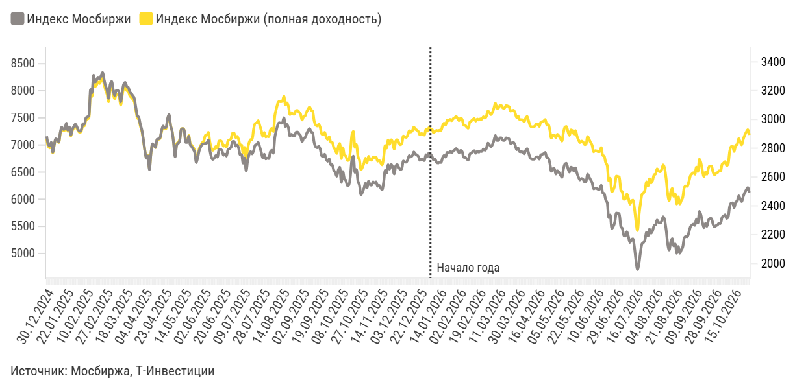

*График 30629314 — «Динамика Индекса Мосбиржи». Интерактив: https://flo.uri.sh/visualisation/30629314/embed. Данные: [CSV](../charts/30629314.csv), [JSON](../charts/30629314.json)*

Подписи и настройки графика: axes_highlights.x_areas: Начало года :: 01.01.2026; axes_highlights.x_lines: Начало года :: 05.01.2026; axes_highlights.y_lines: Начало года::05.01.2026; layout.source_name: Мосбиржа, Т-Инвестиции; chart_type: line_line

| label | Индекс Мосбиржи | Индекс Мосбиржи (полная доходность) |
|---|---|---|
| 29.10.2026 | 2492,38 | 7184,63 |
| 28.10.2026 | 2526,54 | 7283,1 |
| 27.10.2026 | 2510,38 | 7236,52 |
| 26.10.2026 | 2491,47 | 7182,01 |
| 23.10.2026 | 2464,67 | 7104,76 |
| 22.10.2026 | 2429,51 | 7003,41 |
| 21.10.2026 | 2446,87 | 7053,45 |
| 20.10.2026 | 2469,75 | 7119,4 |
| 19.10.2026 | 2432,06 | 7010,75 |
| 16.10.2026 | 2426,09 | 6992,74 |
| 15.10.2026 | 2386,81 | 6879,52 |
| 14.10.2026 | 2421,45 | 6979,36 |
| 13.10.2026 | 2418,82 | 6971,78 |
| 12.10.2026 | 2393,83 | 6875,33 |
| 09.10.2026 | 2321,31 | 6647,03 |
| 08.10.2026 | 2312,35 | 6621,37 |
| 07.10.2026 | 2337,41 | 6693,13 |
| 06.10.2026 | 2328,5 | 6667,62 |
| 05.10.2026 | 2319,57 | 6642,05 |
| 02.10.2026 | 2277,21 | 6518,73 |
| 01.10.2026 | 2279,83 | 6526,23 |
| 30.09.2026 | 2267,9 | 6492,08 |
| 29.09.2026 | 2262,8 | 6477,48 |
| 28.09.2026 | 2254,28 | 6453,09 |
| 25.09.2026 | 2273,87 | 6503,37 |
| 24.09.2026 | 2312,35 | 6613,42 |
| 23.09.2026 | 2312,27 | 6613,19 |
| 22.09.2026 | 2300,09 | 6578,35 |
| 21.09.2026 | 2257,98 | 6457,91 |
| 18.09.2026 | 2278,06 | 6502,23 |
| … | … | … |
| 23.01.2025 | 2 926 | 7 252 |
| 22.01.2025 | 2 973 | 7 367 |
| 21.01.2025 | 2 935 | 7 274 |
| 20.01.2025 | 2 930 | 7 261 |
| 17.01.2025 | 2 946 | 7 300 |
| 16.01.2025 | 2 911 | 7 215 |
| 15.01.2025 | 2 843 | 7 046 |
| 14.01.2025 | 2 860 | 7 087 |
| 13.01.2025 | 2 866 | 7 103 |
| 10.01.2025 | 2 825 | 7 000 |
| 09.01.2025 | 2 773 | 6 854 |
| 08.01.2025 | 2 841 | 7 021 |
| 06.01.2025 | 2 816 | 6 947 |
| 03.01.2025 | 2 829 | 6 978 |
| 30.12.2024 | 2 883 | 7 112 |

*Показано 45 из 466 строк, полный ряд: [CSV](../charts/30629314.csv), [JSON](../charts/30629314.json)*

Настроения рынка постепенно стабилизировались. Новые макроэкономические данные позволили инвесторам уточнить ожидания, а ключевым драйвером восстановления стал сильнейший рост цен на нефть.

Геополитическое давление остается сильным. Однако наиболее радикальные сценарии эскалации, которых рынок опасался летом, пока не реализовались. В то же время ожидания по траектории ставок стали консервативнее после публикации параметров бюджета и уточнения сигнала Банка России. На этом фоне инвесторы продолжают требовать высокую премию за риски, но не спешат продавать сильно подешевевшие бумаги.

Рост цен на энергоносители стал главным драйвером в сентябре и октябре. Так, стоимость российских сортов нефти прибавила более 30% с начала августа. Это повлекло за собой значительное улучшение ожиданий по будущим результатам нефтяных компаний и сопутствующее ралли в их акциях. Поддержку также оказал заметно ослабший за тот же период рубль.

Оценки рынка акций остаются крайне низкими, несмотря на рост в последние два месяца. Форвардный P/E индекса Мосбиржи все еще находится на уровнях около июльских минимумов — порядка 3,3х, а P/E по фактической прибыли за последние 12 месяцев — 4,1х. Во многом это следствие значительного улучшения ожиданий по прибылям нефтегазового сектора.

Смена лидеров внутри рынка

Акции нефтегазового сектора стали лидерами по доходности за последний квартал: отраслевой индекс полной доходности с конца июля прибавил около 19%. Каждая дополнительная неделя, когда котировки нефти и газа остаются на текущих высоких уровнях, будет добавлять позитива бумагам нефтегазовых компаний, по крайней мере в ближайшие месяцы. При этом текущие оценки акций сектора остаются адекватными даже в сценарии снижения цен на энергоносители в четвертом квартале.

На этом фоне позиции теряет финансовый сектор, который стабильно был в топе по доходности с середины 2022 года. Смещение ожиданий по траектории ставки и рост опасений относительно перспектив ухудшения качества активов снизили привлекательность сектора в глазах инвесторов.

Что обеспечит акциям доходность

Несмотря на более консервативный макропрогноз, наши ожидания по росту прибылей на следующие 12 месяцев заметно выросли. Этот прирост практически целиком был обусловлен улучшением прогнозов будущих результатов нефтегазовых компаний.

**Совокупная прибыль компаний индекса Мосбиржи LTM поквартально**

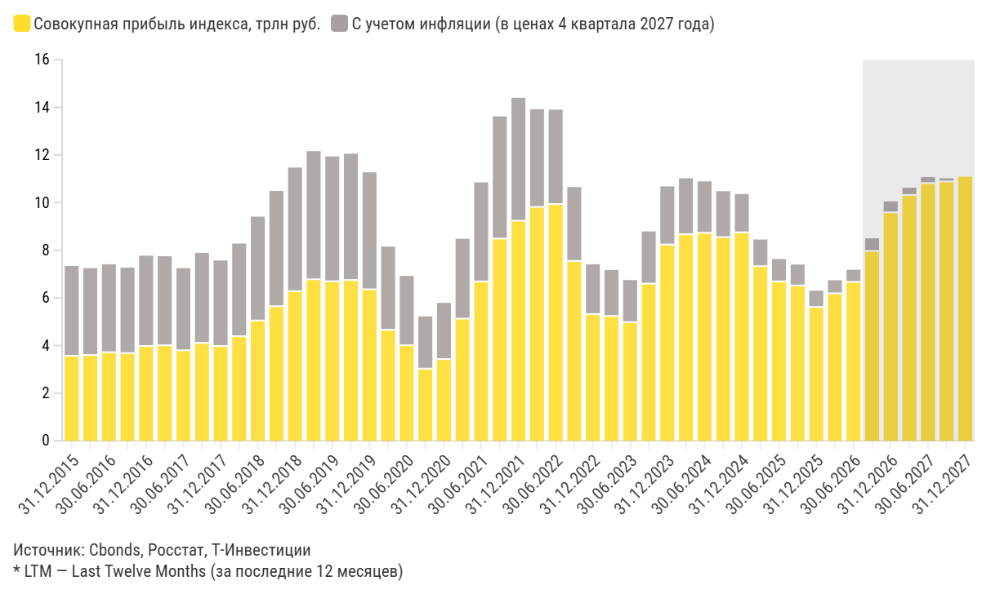

*График 30629355 — «Совокупная прибыль компаний индекса Мосбиржи LTM* поквартально ». Интерактив: https://flo.uri.sh/visualisation/30629355/embed. Данные: [CSV](../charts/30629355.csv), [JSON](../charts/30629355.json)*

Подписи и настройки графика: axes_highlights.x_areas: :: 30.09.2026 >> 31.12.2027; axes_highlights.x_lines: :: 30.09.2026 >> 31.03.2027; axes_highlights.y_lines: ::0; layout.footer_note_secondary: * LTM — Last Twelve Months (за последние 12 месяцев); layout.source_name: Cbonds, Росстат, Т-Инвестиции; chart_type: column_stacked

| Дата | Совокупная прибыль индекса, трлн руб. | С учетом инфляции (в ценах 4 квартала 2027 года) |
|---|---|---|
| 31.12.2027 | 11,09 | - |
| 30.09.2027 | 10,89 | 0,13 |
| 30.06.2027 | 10,82 | 0,25 |
| 31.03.2027 | 10,32 | 0,30 |
| 31.12.2026 | 9,59 | 0,46 |
| 30.09.2026 | 7,97 | 0,53 |
| 30.06.2026 | 6,67 | 0,51 |
| 31.03.2026 | 6,19 | 0,55 |
| 31.12.2025 | 5,62 | 0,68 |
| 30.09.2025 | 6,52 | 0,88 |
| 30.06.2025 | 6,69 | 0,94 |
| 31.03.2025 | 7,33 | 1,12 |
| 31.12.2024 | 8,75 | 1,61 |
| 30.09.2024 | 8,55 | 1,93 |
| 30.06.2024 | 8,73 | 2,16 |
| 31.03.2024 | 8,67 | 2,35 |
| 31.12.2023 | 8,24 | 2,44 |
| 30.09.2023 | 6,60 | 2,19 |
| 30.06.2023 | 4,98 | 1,77 |
| 31.03.2023 | 5,24 | 1,93 |
| 31.12.2022 | 5,32 | 2,09 |
| 30.09.2022 | 7,55 | 3,10 |
| 30.06.2022 | 9,94 | 3,96 |
| 31.03.2022 | 9,82 | 4,10 |
| 31.12.2021 | 9,24 | 5,16 |
| 30.09.2021 | 8,49 | 5,13 |
| 30.06.2021 | 6,69 | 4,16 |
| 31.03.2021 | 5,13 | 3,35 |
| 31.12.2020 | 3,43 | 2,36 |
| 30.09.2020 | 3,03 | 2,19 |
| 30.06.2020 | 4,01 | 2,91 |
| 31.03.2020 | 4,66 | 3,49 |
| 31.12.2019 | 6,36 | 4,91 |
| 30.09.2019 | 6,75 | 5,30 |
| 30.06.2019 | 6,70 | 5,24 |
| 31.03.2019 | 6,78 | 5,38 |
| 31.12.2018 | 6,28 | 5,19 |
| 30.09.2018 | 5,65 | 4,84 |
| 30.06.2018 | 5,05 | 4,36 |
| 31.03.2018 | 4,39 | 3,89 |
| 31.12.2017 | 3,98 | 3,59 |
| 30.09.2017 | 4,11 | 3,78 |
| 30.06.2017 | 3,80 | 3,45 |
| 31.03.2017 | 4,01 | 3,74 |
| 31.12.2016 | 3,98 | 3,79 |
| 30.09.2016 | 3,68 | 3,59 |
| 30.06.2016 | 3,72 | 3,69 |
| 31.03.2016 | 3,60 | 3,65 |
| 31.12.2015 | 3,57 | 3,77 |

Поэтому ожидаемый во втором полугодии текущего года рост прибыли индекса Мосбиржи — это в первую очередь история нефтегазового сектора и исключительно благоприятной ценовой конъюнктуры. Так, возобновление роста цен на энергоносители в августе — октябре на фоне очередной эскалации на Ближнем Востоке спровоцировало новую волну повышения прогнозов по будущим результатам нефтегазовых компаний. Если июльские прогнозы закладывали рост прибыли сектора около 40% за период с третьего квартала 2026-го по второй квартал 2027-го, то к концу октября ожидания уже сместились ближе к 100% г/г.

В результате из 4,2 трлн рублей ожидаемого прироста прибыли компаний индекса Мосбиржи в следующие 12 месяцев около 3 трлн рублей (72%) придется на нефтегазовый сектор.

**Вклад секторов в изменение совокупной прибыли компаний в индексе Мосбиржи за следующие 12 месяцев**

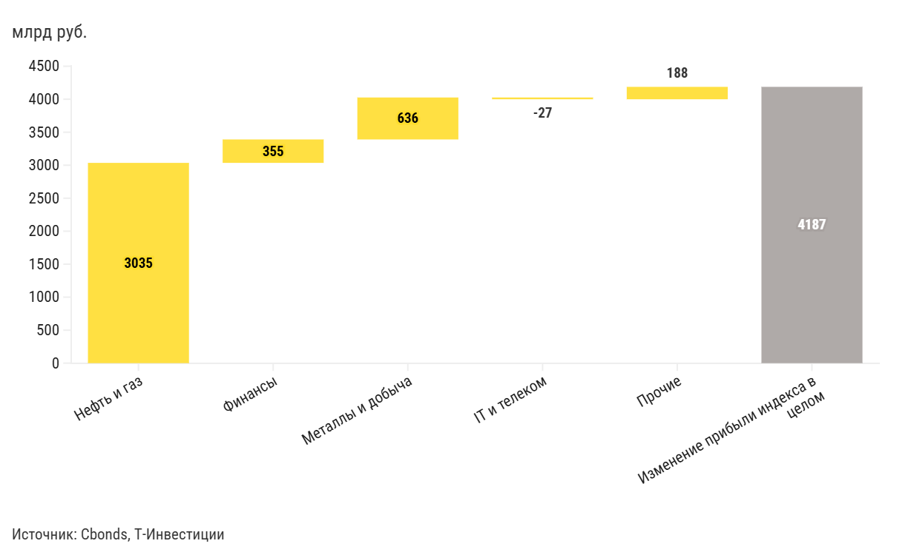

*График 30629406 — «Вклад секторов в изменение совокупной прибыли компаний в индексе Мосбиржи за следующие 12 месяцев». Интерактив: https://flo.uri.sh/visualisation/30629406/embed. Данные: [CSV](../charts/30629406.csv), [JSON](../charts/30629406.json)*

Подписи и настройки графика: layout.source_name: Cbonds, Т-Инвестиции; chart_type: column_waterfall

| label | Вклад секторов в изменение прибыли индекса Мосбиржи на следующие 12 месяцев |
|---|---|
| Нефть и газ | +3 035 |
| Финансы | +355 |
| Металлы и добыча | +636 |
| IT и телеком | -27 |
| Прочие | +188 |
| Изменение прибыли индекса в целом |  |

При этом 67% совокупного роста прибыли компаний в индексе Мосбиржи за этот период обеспечат лишь пять имен:

#### НОВАТЭК

15%

#### Лукойл

15%

#### Роснефть

14%

#### Сургутнефтегаз

13%

#### Газпром

10%

Вместе с тем уже в четвертом квартале 2026-го — первом квартале 2027-го мы ожидаем начала постепенной нормализации цен на рынках энергоносителей. Поэтому в следующем году динамика прибыли нефтегазового сектора, вероятно, будет значительно более сдержанной. Отсюда и ожидания по существенному замедлению темпов роста прибылей всего рынка в 2027 году.

По другим секторам прогнозы выглядят заметно скромнее, но остаются достаточно позитивными. По нашим оценкам, прибыли компаний, ориентированных на внутренний спрос, вырастут на 10—15% за следующие 12 месяцев, несмотря на ожидаемое сохранение непростой макроэкономической конъюнктуры.

В целом совокупная прибыль компаний в индексе Мосбиржи продолжит восстанавливаться. Прирост может составить порядка 60% в следующие четыре квартала с низкой базы второго полугодия 2025-го — первого полугодия 2026-го.

Текущая оценка российских акций

- **3,3x** — Столько сейчас составляет форвардный P/E индекса Мосбиржи, по нашим оценкам. Это близко к историческим минимумам по мультипликатору

- **4,1х** — P/E индекса по фактической прибыли за последние 12 месяцев также опустился до крайне низкого уровня

**Мультипликатор P/E индекса Мосбиржи**

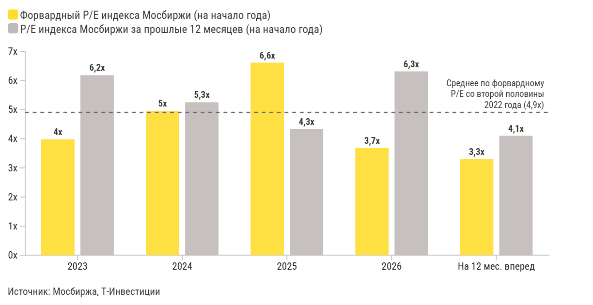

*График 30629544 — «Мультипликатор P/E индекса Мосбиржи ». Интерактив: https://flo.uri.sh/visualisation/30629544/embed. Данные: [CSV](../charts/30629544.csv), [JSON](../charts/30629544.json)*

Подписи и настройки графика: axes_highlights.y_lines: Среднее по форвардному P/E со второй половины 2022 года (4,9х) :: 4.9; layout.source_name: Мосбиржа, Т-Инвестиции; chart_type: column_grouped

| label | Форвардный P/E индекса Мосбиржи (на начало года) | P/E индекса Мосбиржи за прошлые 12 месяцев (на начало года) |
|---|---|---|
| 2023 | 3,98 | 6,18 |
| 2024 | 4,95 | 5,25 |
| 2025 | 6,61 | 4,33 |
| 2026 | 3,68 | 6,31 |
| На 12 мес. вперед | 3,30 | 4,10 |

Снижение мультипликаторов до столь низких отметок отражает значительную неопределенность: инвесторы сейчас требуют заметно более высокой доходности за взятые на себя риски.

Ключевым источником этой неопределенности остается геополитика: ее влияние на внутреннюю макроэкономическую ситуацию и, в конечном счете, на результаты компаний заметно усилилось.

Неустойчивость цен на энергоносители также становится для рынка все более весомым фактором риска с учетом радикального повышения ожиданий от нефтегазового сектора.

В таких условиях премия за риск акций остается на крайне высоких по историческим меркам уровнях: около 14—15%. И это на фоне рекордных доходностей длинных ОФЗ. В целом требуемая от рынка акций доходность сегодня — выше 30%.

**Премия за риск на рынке акций**

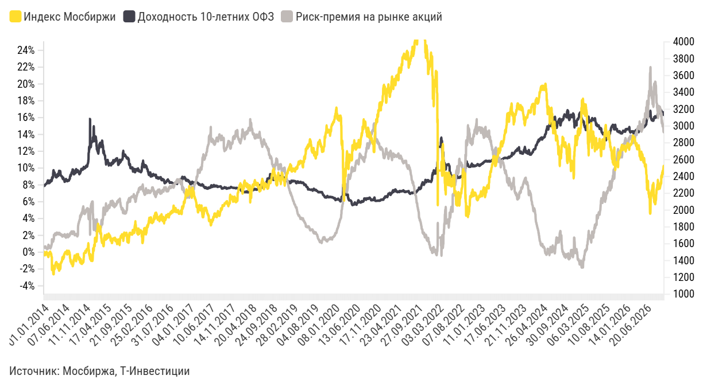

*График 30630121 — «Премия за риск на рынке акций». Интерактив: https://flo.uri.sh/visualisation/30630121/embed. Данные: [CSV](../charts/30630121.csv), [JSON](../charts/30630121.json)*

Подписи и настройки графика: axes_highlights.x_areas: рецессия доткомов:: 28.02.2001 >> 30.11.2001; axes_highlights.x_lines: :: Прогноз; layout.source_name: Мосбиржа, Т-Инвестиции; chart_type: line_line

| label | Индекс Мосбиржи | Доходность 10-летних ОФЗ | Риск-премия на рынке акций |
|---|---|---|---|
| 29.10.2026 | 2492,38 | 16,52010242 | 14,47 |
| 28.10.2026 | 2526,54 | 16,33049431 | 14,27 |
| 27.10.2026 | 2510,38 | 16,4348243 | 14,33 |
| 26.10.2026 | 2491,47 | 16,51475547 | 14,67 |
| 25.10.2026 | 2464,67 | 16,63504184 | 14,98 |
| 24.10.2026 | 2464,67 | 16,63504184 | 14,97 |
| 23.10.2026 | 2464,67 | 16,63504184 | 14,97 |
| 22.10.2026 | 2429,51 | 16,52798441 | 15,24 |
| 21.10.2026 | 2446,87 | 16,55059081 | 14,98 |
| 20.10.2026 | 2469,75 | 16,47660267 | 14,92 |
| 19.10.2026 | 2432,06 | 16,47219864 | 15,14 |
| 18.10.2026 | 2450,46 | 16,50503522 | 15,48 |
| 17.10.2026 | 2447,66 | 16,50503522 | 15,48 |
| 16.10.2026 | 2426,09 | 16,50503522 | 15,47 |
| 15.10.2026 | 2386,81 | 16,48946957 | 15,72 |
| 14.10.2026 | 2421,45 | 16,50524692 | 15,30 |
| 13.10.2026 | 2418,82 | 16,57068852 | 15,43 |
| 12.10.2026 | 2393,83 | 16,63894643 | 15,63 |
| 11.10.2026 | 2410,26 | 16,84861807 | 16,54 |
| 10.10.2026 | 2405,54 | 16,84861807 | 16,53 |
| 09.10.2026 | 2321,31 | 16,84861807 | 16,53 |
| 08.10.2026 | 2312,35 | 16,82135467 | 16,53 |
| 07.10.2026 | 2337,41 | 16,73642928 | 16,16 |
| 06.10.2026 | 2328,5 | 16,80545792 | 16,39 |
| 05.10.2026 | 2319,57 | 16,80128584 | 16,55 |
| 04.10.2026 | 2290,02 | 16,85766064 | 17,07 |
| 03.10.2026 | 2290,18 | 16,85766064 | 17,06 |
| 02.10.2026 | 2277,21 | 16,85766064 | 17,06 |
| 01.10.2026 | 2279,83 | 16,85890435 | 16,93 |
| 30.09.2026 | 2267,9 | 16,87758984 | 17,09 |
| … | … | … | … |
| 15.01.2014 | 1486,51 | 8,09 | 0,54 |
| 14.01.2014 | 1470,65 | 8,05 | 0,68 |
| 13.01.2014 | 1477,56 | 8,03 | 0,61 |
| 12.01.2014 | 1469,19 | 8,03 | 0,68 |
| 11.01.2014 | 1469,19 | 8,03 | 0,67 |
| 10.01.2014 | 1469,19 | 8,03 | 0,65 |
| 09.01.2014 | 1465,74 | 8,02 | 0,63 |
| 08.01.2014 | 1462,67 | 7,94 | 0,69 |
| 07.01.2014 | 1466,15 | 7,91 | 0,65 |
| 06.01.2014 | 1466,15 | 7,91 | 0,64 |
| 05.01.2014 | 1504,08 | 7,88 | 0,51 |
| 04.01.2014 | 1504,08 | 7,88 | 0,50 |
| 03.01.2014 | 1504,08 | 7,88 | 0,49 |
| 02.01.2014 | 1504,08 | 7,88 | 0,47 |
| 01.01.2014 | 1504,08 | 7,88 | 0,46 |

*Показано 45 из 4685 строк, полный ряд: [CSV](../charts/30630121.csv), [JSON](../charts/30630121.json)*

Мнение аналитика Т-Инвестиций

«Оценки рынка акций остаются привлекательными на длинном горизонте. Однако экстремальная дешевизна по мультипликаторам в значительной степени связана с исключительно благоприятными для российских нефтегазовых компаний ценами на сырье, которые вряд ли будут устойчивыми в долгосрочной перспективе».

Александр Потехин, ведущий аналитик Т-Инвестиций

В оценке рисков мы сохраняем разумную долю консерватизма — значительного их снижения в среднесрочной перспективе не ожидаем. На горизонте всего 2027 года мы закладываем лишь небольшое сокращение риск-премии в акциях.

При таких вводных мультипликаторы в обозримой перспективе покажут лишь сдержанное расширение.

3,5х

Целевой уровень форвардного P/E для индекса Мосбиржи на горизонте года

Дивидендная доходность рынка остается двузначной

Ухудшение макроэкономической конъюнктуры подтолкнуло корпоративный сектор к большему консерватизму при управлении капиталом. Одним из последствий такого разворота стало ощутимое снижение совокупного объема дивидендных выплат в 2025 году. Существенное снижение мы можем увидеть и по итогу 2026-го на фоне слабых результатов компаний за прошлый год. Однако 2027 год обещает сломать эту тенденцию за счет объемных выплат компаний нефтегазового сектора.

Дивидендная доходность индекса Мосбиржи останется двузначной — около 10,5%. Сегодня рынок предлагает достаточно много качественных историй с дивидендной доходностью около 15% и выше в перспективе 12 месяцев

**Общий объем дивидендных выплат по годам**

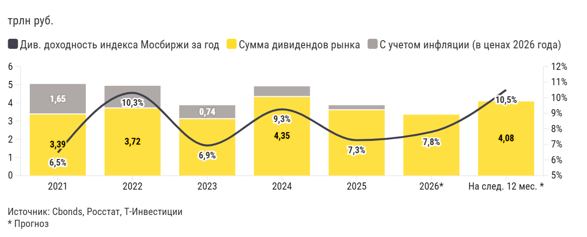

*График 30630374 — «Общий объем дивидендных выплат по годам». Интерактив: https://flo.uri.sh/visualisation/30630374/embed. Данные: [CSV](../charts/30630374.csv), [JSON](../charts/30630374.json)*

Подписи и настройки графика: axes_highlights.x_areas: рецессия доткомов:: 28.02.2001 >> 30.11.2001; axes_highlights.x_lines: :: Прогноз; axes_highlights.y_lines: ::0; layout.footer_note_secondary: * Прогноз; layout.source_name: Cbonds, Росстат, Т-Инвестиции; chart_type: column_stacked_line

| label | Див. доходность индекса Мосбиржи за год | Сумма дивидендов рынка | С учетом инфляции (в ценах 2026 года) |
|---|---|---|---|
| 2021 | 6,47% | 3,39 | 1,65 |
| 2022 | 10,31% | 3,72 | 1,22 |
| 2023 | 6,93% | 3,13 | 0,74 |
| 2024 | 9,25% | 4,35 | 0,56 |
| 2025 | 7,27% | 3,62 | 0,25 |
| 2026* | 7,80% | 3,35 |  |
| На след. 12 мес. * | 10,50% | 4,08 |  |

Наш взгляд на рынок акций

Условия для рынка акций остаются сложными. Несмотря на восстановление последних месяцев, аппетит к риску на рынке в целом по-прежнему низкий. Акциям сложно выдерживать конкуренцию за капитал с более консервативными инструментами в условиях высоких ставок, преобладания внешних рисков и неопределенности в экономике.

Текущие ожидания по траектории ставок и экономики предполагают, что на длинном горизонте нынешние оценки акций привлекательны. В то же время в среднесрочной перспективе сильнейшим драйвером для рынка, вероятно, останутся нефтяные котировки.

- **2 300 — 2 500 пунктов** — Наш прогноз индекса Мосбиржи к концу 2026 года

- **2 600 — 2 900 пунктов** — Целевой диапазон индекса Мосбиржи на 12 месяцев вперед

- **2 700 — 3 000 пунктов** — Наш прогноз индекса Мосбиржи на конец 2027 года

**Декомпозиция доходности индекса Мосбиржи**

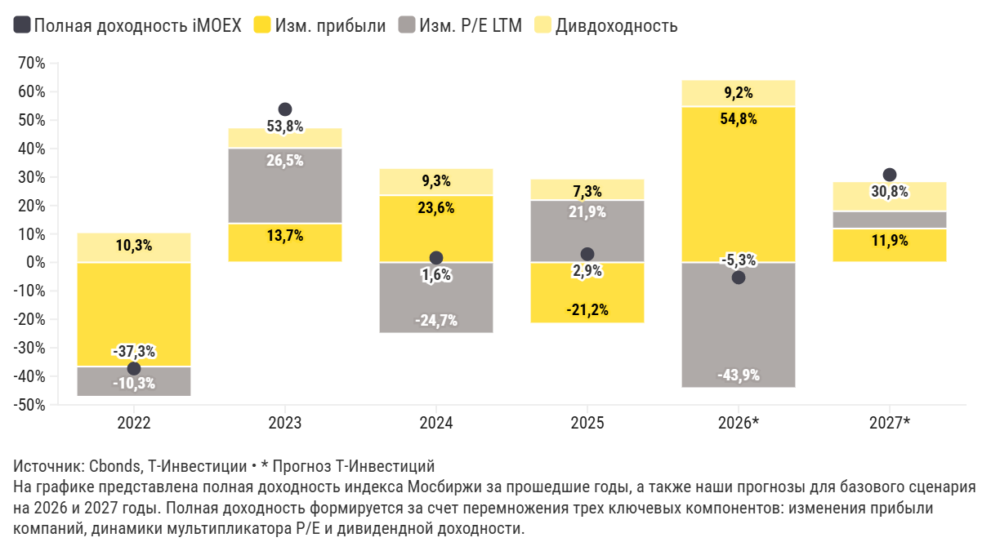

*График 30630431 — «Декомпозиция доходности индекса Мосбиржи». Интерактив: https://flo.uri.sh/visualisation/30630431/embed. Данные: [CSV](../charts/30630431.csv), [JSON](../charts/30630431.json)*

Подписи и настройки графика: axes_highlights.x_areas: :: След. 12 мес.* >> След. 12 мес.*; axes_highlights.y_lines: ::0; layout.footer_note: * Прогноз Т-Инвестиций; layout.footer_note_secondary: На графике представлена полная доходность индекса Мосбиржи за прошедшие годы, а также наши прогнозы для базового сценария на 2026 и 2027 годы. Полная доходность формируется за счет перемножения трех ключевых компонентов: изменения прибыли компаний, динамики мультипликатора P/E и дивидендной доходности.; layout.source_name: Cbonds, Т-Инвестиции; chart_type: column_stacked_line

| Период | Полная доходность iMOEX | Изм. прибыли | Изм. P/E LTM | Дивдоходность |
|---|---|---|---|---|
| 2022 | -37,3% | -36,6% | -10,3% | 10,3% |
| 2023 | 53,8% | 13,7% | 26,5% | 6,9% |
| 2024 | 1,6% | 23,6% | -24,7% | 9,3% |
| 2025 | 2,9% | -21,2% | 21,9% | 7,3% |
| 2026* | -5,3% | 54,8% | -43,9% | 9,2% |
| 2027* | 30,8% | 11,9% | 6,1% | 10,2% |

Сценарии динамики индекса Мосбиржи

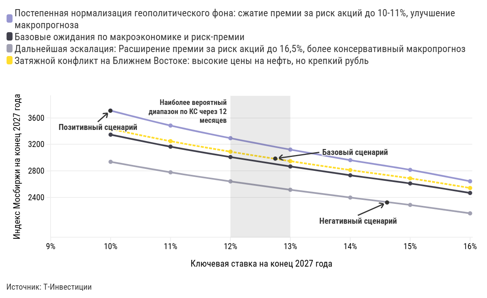

*График 30630490 — «Без названия». Интерактив: https://flo.uri.sh/story/3849199/embed. Данные: [CSV](../charts/30630490.csv), [JSON](../charts/30630490.json)*

Подписи и настройки графика: axes_highlights.x_areas: Наиболее вероятный диапазон по КС через 12 месяцев ::12>>13; layout.source_name: Т-Инвестиции; story.annotations: Негативный сценарий / Позитивный сценарий / Базовый сценарий; y.title: Индекс Мосбиржи на конец 2027 года; x.title: Ключевая ставка на конец 2027 года; chart_type: line

| Ключевая ставка | Постепенная нормализация геополитического фона: сжатие премии за риск акций до 10-11%, улучшение макропрогноза | Базовые ожидания по макроэкономике и риск-премии | Дальнейшая эскалация: Расширение премии за риск акций до 16,5%, более консервативный макропрогноз | Затяжной конфликт на Ближнем Востоке: высокие цены на нефть, но крепкий рубль |
|---|---|---|---|---|
| 10 | 3709 | 3347 | 2938 | 3433 |
| 11 | 3484 | 3166 | 2780 | 3249 |
| 12 | 3294 | 3010 | 2643 | 3091 |
| 13 | 3122 | 2868 | 2517 | 2948 |
| 14 | 2963 | 2735 | 2400 | 2814 |
| 15 | 2817 | 2612 | 2289 | 2689 |
| 16 | 2645 | 2469 | 2162 | 2544 |

Рынок акций — основной бенефициар сценариев, предполагающих более активное смягчение денежно-кредитной политики, геополитическую разрядку и длительное сохранение высоких цен на нефть. С другой стороны, развитие событий в рамках нашего консервативного сценария может привести к очередному году со слабым результатом для индекса Мосбиржи.

Что покупать

Возросший уровень рисков требует ответа: мы даем его через избирательное позиционирование внутри рынка акций и более консервативную структуру портфеля в целом. Фокус сохраняется на акциях компаний с устойчивым финансовым положением, способных удерживать рост и маржинальность в условиях высоких ставок и слабого роста экономики

Перспективы сегмента внутреннего спроса становятся более сдержанными, но инвестиционный кейс остается конструктивным. На фоне более консервативных ожиданий по ставкам и траектории восстановления экономики реализация внутренних циклических драйверов откладывается. Тем не менее у нас остаются фавориты из числа ведущих высокорентабельных банков, крупных технологических компаний и качественных защитных историй потребительского сектора. Они сохраняют достойный долгосрочный потенциал доходности за счет внутренних драйверов роста и привлекательных оценок. При этом риски атак на инфраструктуру остаются высокими и для таких компаний, поэтому важно диверсифицировать портфель по эмитентам.

В экспортном сегменте продолжают улучшаться перспективы компаний нефтегазового сектора. Несмотря на внушительный рост с конца августа, оценки остаются умеренными в рамках нашего базового сценария по нефти и курсу рубля. В сценарии продолжения конфликта на Ближнем Востоке акции сектора могут сохранять динамику сильнее индекса Мосбиржи. Однако зависимость ключевого фундаментального драйвера от труднопрогнозируемой геополитики существенно повышает риски волатильности в акциях нефтегазовых компаний и уровень неопределенности в отношении их будущих результатов. При покупке бумаг сектора важно учитывать эти риски.

Смотрим осторожно на акции компаний средней и малой капитализации, а также на эмитентов, чувствительных к динамике ставок. Ожидаем сохранения низкого аппетита к риску у инвесторов на прогнозном горизонте — этот сегмент может продолжить проигрывать широкому рынку.

Наши фавориты на рынке акций

- **Озон Целевая цена — 5 700 ₽ Потенциал роста — 50%** — `OZON` ([карточка](https://www.tbank.ru/invest/stocks/OZON/))

- **Хэдхантер Целевая цена — 3 500 ₽ Потенциал роста — 30%** — `HEAD` ([карточка](https://www.tbank.ru/invest/stocks/HEAD/))

- **Транснефть Целевая цена — 1 560 ₽ Потенциал роста — 47%** — `TRNFP` ([карточка](https://www.tbank.ru/invest/stocks/TRNFP/))

- **ДОМ.РФ Целевая цена — 2 950 ₽ Потенциал роста — 38%** — `DOMRF` ([карточка](https://www.tbank.ru/invest/stocks/DOMRF/))

- **Сбер Целевая цена — 388 ₽ Потенциал роста — 31%** — `SBER` ([карточка](https://www.tbank.ru/invest/stocks/SBER/))

- **Озон Фармацевтика Целевая цена — 65 ₽ Потенциал роста — 37%** — `OZPH` ([карточка](https://www.tbank.ru/invest/stocks/OZPH/))

- **Промомед Целевая цена — 640 ₽ Потенциал роста — 53%** — `PRMD` ([карточка](https://www.tbank.ru/invest/stocks/PRMD/))

- **Лукойл Целевая цена — 6 800 ₽ Потенциал роста — 9%** — `LKOH` ([карточка](https://www.tbank.ru/invest/stocks/LKOH/))

- **НОВАТЭК Целевая цена — 1 390 ₽ Потенциал роста — 20%** — `NVTK` ([карточка](https://www.tbank.ru/invest/stocks/NVTK/))

Нефтегазовый сектор: главный бенефициар геополитики

В конце третьего квартала 2026 года цены на энергоносители оставались высокими. Главной причиной вновь стало отсутствие прогресса в урегулировании конфликта между Ираном и США. К ней добавилось противостояние хуситов и Саудовской Аравии — крупнейшего поставщика нефти на Ближнем Востоке.

Хотя к сентябрю объемы поставок сырой нефти из стран Персидского залива приближались к уровням начала конфликта, стоимость сырья поддержали:

- истощение мировых стратегических запасов;
- глобальный дефицит топлива;
- сохранение рисков перебоев поставок в будущем.

**Стоимость сырой нефти в третьем квартале 2026 года:**

#### $96 за баррель

Brent спот (+40% год к году)

#### $73 за баррель

Urals (+25% год к году)

**Динамика цен на нефть с начала 2025 года, $/барр**

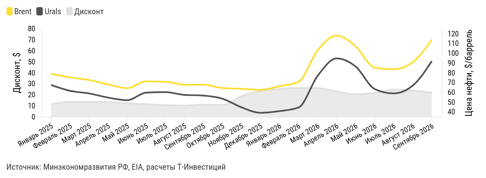

*График 30594571 — «Динамика цен на нефть с начала 2025 года, $/баррель». Интерактив: https://flo.uri.sh/visualisation/30594571/embed. Данные: [CSV](../charts/30594571.csv), [JSON](../charts/30594571.json)*

Подписи и настройки графика: axes_highlights.x_areas: беспрецедентная волатильность флоатеров:: 16.09.2024 >> 25.11.2024; axes_highlights.x_lines: :: Прогноз; axes_highlights.y_lines: ::0; layout.source_name: Минэкономразвития РФ, EIA, расчеты Т-Инвестиций; y.title: Дисконт, $  ; chart_type: area_stacked_line

| label | Brent | Urals | Дисконт |
|---|---|---|---|
| Сентябрь 2026 | 114,0757 | 92,08 | 21,99571 |
| Август 2026 | 91,076 | 67,11 | 23,966 |
| Июль 2026 | 83,7587 | 59,02 | 24,7387 |
| Июнь 2026 | 85,39909 | 63,52 | 21,87909 |
| Май 2026 | 107,1395 | 86,52 | 20,61947 |
| Апрель 2026 | 118,2259 | 94,87 | 23,35591 |
| Март 2026 | 103,1345 | 77 | 26,13455 |
| Февраль 2026 | 70,887 | 44,59 | 26,297 |
| Январь 2026 | 66,36364 | 40,95 | 25,41364 |
| Декабрь 2025 | 62,64478 | 39,18 | 23,46478 |
| Ноябрь 2025 | 63,797 | 44,87 | 18,927 |
| Октябрь 2025 | 64,54348 | 53,68 | 10,86348 |
| Сентябрь 2025 | 67,98545 | 56,82 | 11,16545 |
| Август 2025 | 67,89 | 57,55 | 10,34 |
| Июль 2025 | 71,0413 | 60,37 | 10,6713 |
| Июнь 2025 | 71,44476 | 59,84 | 11,60476 |
| Май 2025 | 64,36545 | 52,08 | 12,28545 |
| Апрель 2025 | 68,19143 | 54,76 | 13,43143 |
| Март 2025 | 72,73286 | 58,99 | 13,74286 |
| Февраль 2025 | 75,438 | 61,69 | 13,748 |
| Январь 2025 | 79,27045 | 67,66 | 11,61045 |

Другой тренд последних месяцев — увеличение цен на нефтепродукты из-за снижения поставок топлива с Ближнего Востока и из России на мировой рынок. Рост конкурирующего спроса привел к расширению крэк-спредов до максимальных с 2022 года значений.

**Стоимость нефтепродуктов в Европе в третьем квартале 2026 года:**

#### $1 302 за тонну

Дизель (+86% год к году)

#### $1 091 за тонну

Бензин (+55% год к году)

В части газового рынка дополнительную поддержку оказывают низкие уровни заполненности хранилищ в Европе на старте отопительного сезона. Это усиливает конкуренцию с азиатскими покупателями. Кроме того, страны ЕС планируют полностью отказаться от российского газа с 2027 года, который обеспечивает около 13% текущего потребления.

**Стоимость газа в третьем квартале 2026 года:**

- **64 €/МВт·ч** — Европейский газ TTF (+93% год к году)

- **75 $/МВт·ч** — Азиатский газ JKM (+87% год к году)

Наш взгляд на сектор

Основную поддержку нефтегазовые компании получают благодаря:

- отсутствию прогресса в урегулировании конфликта на Ближнем Востоке;
- постепенному снижению курса рубля;
- смягчению санкционных ограничений для операций с российскими энергоносителями.

Мнение аналитика Т-Инвестиций

«Текущие катализаторы роста мировых цен на нефть и газ нельзя назвать устойчивыми. Проявление первых признаков геополитического урегулирования способно достаточно быстро отразиться на стоимости ресурсов, как это было в июне 2026 года. В этой связи наши прогнозы не подразумевают продолжительного удержания цен на высоких уровнях. Однако по мере отсутствия прогресса в перемирии оценки повышаются».

Александр Мартынов, аналитик Т-Инвестиций

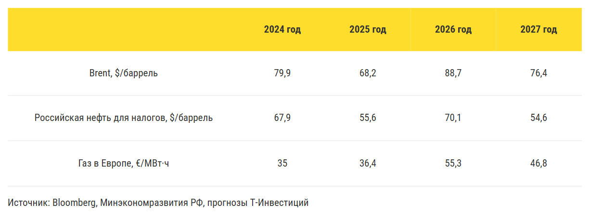

*График 30594684 — «Без заголовка». Интерактив: https://flo.uri.sh/visualisation/30594684/embed. Данные: [CSV](../charts/30594684.rows.csv), [JSON](../charts/30594684.json)*

Подписи и настройки графика: layout.source_name: Bloomberg, Минэкономразвития РФ, прогнозы Т-Инвестиций

| columns_0 | 2024 год | 2025 год | 2026 год | 2027 год |
|---|---|---|---|---|
| Brent, $/баррель | 79,9 | 68,2 | 88,7 | 76,4 |
| Российская нефть для налогов, $/баррель | 67,9 | 55,6 | 70,1 | 54,6 |
| Газ в Европе, €/МВт·ч | 35 | 36,4 | 55,3 | 46,8 |

По итогам второго полугодия 2026 года ожидаем не менее позитивных результатов компаний нефтегазового сектора после достаточно сильного первого. Ослабление курса рубля и позитивная мировая ценовая конъюнктура в полной мере компенсируют снижение операционных результатов эмитентов, вызванное атаками на нефтегазовую инфраструктуру.

В текущих условиях позитивно оцениваем положение сектора. Тем не менее в более долгосрочной перспективе, по мере стабилизации мирового энергетического баланса, санкции и нештатные приостановки производства будут более ощутимо давить на результаты компаний.

Наши фавориты

#### Лукойл

Целевая цена — 6 800 ₽ за акцию

Положительный FCF и чистая денежная позиция обеспечивают устойчивое финансовое положение и дают преимущество относительно других нефтяников в период высоких процентных ставок.

По нашим оценкам, компания может предложить одну из самых высоких дивидендных доходностей в секторе. Совокупный дивиденд за 2026 год может принести доходность около 18%.

У Лукойла наиболее низкая оценка среди конкурентов. Среди нефтяников акции выглядят самыми дешевыми по форвардному мультипликатору EV/EBITDA на 2026 год — 1,9х.

#### Транснефть

Целевая цена — 1 560 ₽ за акцию

Транснефть остается одной из самых устойчивых историй в секторе. Бизнес компании прозрачен, а ключевые финансовые показатели стабильно растут. При этом Транснефть не сильно зависит от колебаний нефтяного рынка, что делает ее защитной историей внутри сектора.

Дивидендный кейс поддерживается сильным балансом. У компании нет долговой нагрузки, а высокий уровень ликвидности позволяет зарабатывать на процентных доходах. Дивидендная доходность в ближайшие годы, по нашим оценкам, будет выше 15%.

Оценка остается привлекательной. По нашим прогнозам, форвардный мультипликатор EV/EBITDA на 2026 год составляет около 0,9x — это предполагает дисконт около 40% к средним историческим уровням.

#### НОВАТЭК

Целевая цена — 1 390 ₽ за акцию

НОВАТЭК продолжает увеличивать производственные мощности. Рост добычи жидких углеводородов и запуск третьей линии комплекса в Усть-Луге поддерживают выпуск высокомаржинальной продукции. Дополнительным драйвером остается «Арктик СПГ — 2»: первые линии уже запущены, в сентябре прошлого года начались поставки в Китай, а компания получила ледовые газовозы.

Несмотря на санкции и жесткие макроэкономические условия, НОВАТЭК планирует придерживаться дивидендной политики и делать выплаты два раза в год. Ожидаем, что совокупная дивидендная доходность в следующие 12 месяцев составит около 10%.

Оценка выглядит умеренной. Акции НОВАТЭКа торгуются с форвардным мультипликатором EV/нормализованная EBITDA на уровне около 2,6х, что по-прежнему предполагает дисконт к историческим уровням.

**Ключевые показатели компаний нефтегазового сектора**

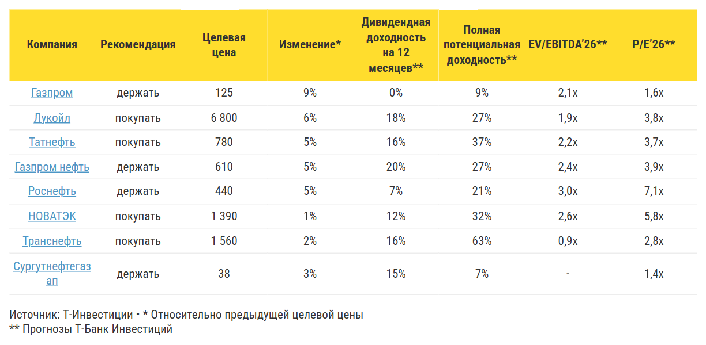

*График 30594709 — «Ключевые показатели сектора». Интерактив: https://flo.uri.sh/visualisation/30594709/embed. Данные: [CSV](../charts/30594709.rows.csv), [JSON](../charts/30594709.json)*

Подписи и настройки графика: layout.footer_note: * Относительно предыдущей целевой цены; layout.footer_note_secondary: ** Прогнозы Т-Банк Инвестиций; layout.source_name: Т-Инвестиции

| Компания | Рекомендация | Целевая цена | Изменение* | Дивидендная доходность на 12 месяцев** | Полная потенциальная доходность** | EV/EBITDA’26** | P/E’26** |
|---|---|---|---|---|---|---|---|
| <a href="https://www.tbank.ru/invest/stocks/GAZP">Газпром</a> | держать | 125 | 9% | 0% | 9% | 2,1х | 1,6х |
| <a href="https://www.tbank.ru/invest/stocks/LKOH">Лукойл</a> | покупать | 6 800 | 6% | 18% | 27% | 1,9х | 3,8х |
| <a href="https://www.tbank.ru/invest/stocks/TATN">Татнефть</a> | покупать | 780 | 5% | 16% | 37% | 2,2х | 3,7х |
| <a href="https://www.tbank.ru/invest/stocks/SIBN">Газпром нефть</a> | держать | 610 | 5% | 20% | 27% | 2,4х | 3,9х |
| <a href="https://www.tbank.ru/invest/stocks/ROSN">Роснефть</a> | держать | 440 | 5% | 7% | 21% | 3,0х | 7,1х |
| <a href="https://www.tbank.ru/invest/stocks/NVTK">НОВАТЭК</a> | покупать | 1 390 | 1% | 12% | 32% | 2,6х | 5,8х |
| <a href="https://www.tbank.ru/invest/stocks/TRNFP">Транснефть</a> | покупать | 1 560 | 2% | 16% | 63% | 0,9х | 2,8х |
| <a href="https://www.tbank.ru/invest/stocks/SNGSP">Сургутнефтегаз ап</a> | держать | 38 | 3% | 15% | 7% | - | 1,4х |

Металлургический сектор и добыча: сохраняем нейтральный взгляд

Мы по-прежнему осторожно смотрим на сектор на фоне рисков замедления мировой экономики с учетом достаточно жесткой риторики мировых центробанков.

Недавние налоговые инициативы Минфина также оказывают давление на прибыль некоторых компаний. В частности, дополнительный налог для Норникеля может составить 150–160 млрд рублей за 2026–2028 годы, что, по нашим оценкам, будет ежегодно отнимать от прибыли 10–15%. Для Полюса оцениваем дополнительный налог в 50–60 млрд рублей за 2026–2027 годы. На 2028 год выплаты не закладываем с учетом более низких прогнозных цен на золото.

Прочие компании пока не подпадают под новое налогообложение, однако риски дополнительных изъятий в будущем сохраняются при более благоприятной ценовой конъюнктуре.

#### Фосагро

Может выиграть от снижения цен на серу

Как и в прошлой стратегии, мы не выделяем фаворитов среди акций сектора, хотя тактически отдаем предпочтение бумагам ФосАгро. Считаем, что компания прошла дно цикла в первом квартале 2026-го и имеет шансы на постепенное восстановление маржинальности в течение года.

Мы делаем ставку на снижение затрат на серу из-за существенного сокращения мирового спроса на это сырье со стороны производителей фосфорных удобрений.

Мнение аналитика Т-Инвестиций

«По нашим расчетам, при нормализации рентабельности доходность акций ФосАгро по свободному денежному потоку может составить 10% в следующие 12 месяцев, что может быть направлено на снижение долговой нагрузки в следующем году».

Ахмед Алиев, аналитик Т-Инвестиций

На следующий год мы закладываем более существенное снижение цен на серу (на 30%), чем на фосфорные удобрения (на 10%). В этом случае итоговый эффект для прибыли будет положительным.

**Доходность свободного денежного потока**

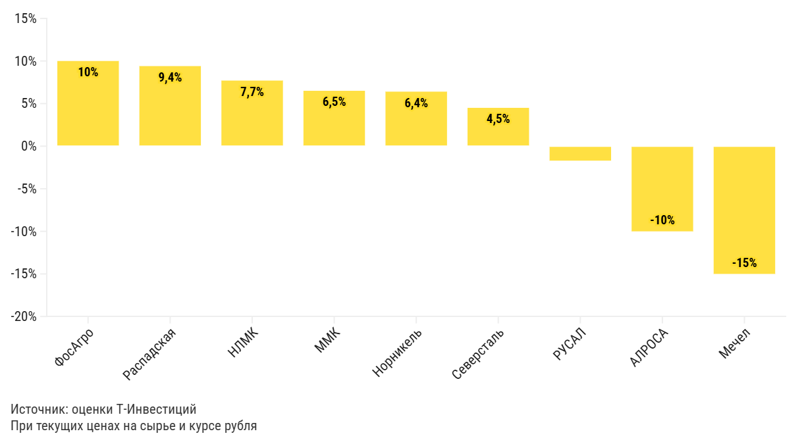

*График 30722505 — «Доходность свободного денежного потока». Интерактив: https://flo.uri.sh/visualisation/30722505/embed. Данные: [CSV](../charts/30722505.csv), [JSON](../charts/30722505.json)*

Подписи и настройки графика: axes_highlights.x_areas: рецессия доткомов:: 28.02.2001 >> 30.11.2001; axes_highlights.x_lines: :: Прогноз; axes_highlights.y_lines: ::0; layout.footer_note_secondary: При текущих ценах на сырье и курсе рубля; layout.source_name: оценки Т-Инвестиций; chart_type: column_stacked

| label | Доходность FCF |
|---|---|
| ФосАгро | 10% |
| Распадская | 9,4% |
| НЛМК | 7,7% |
| ММК | 6,5% |
| Норникель | 6,4% |
| Северсталь | 4,5% |
| РУСАЛ | -1,7% |
| АЛРОСА | -10% |
| Мечел | -15% |

**Основные показатели компаний по сырьевому сектору**

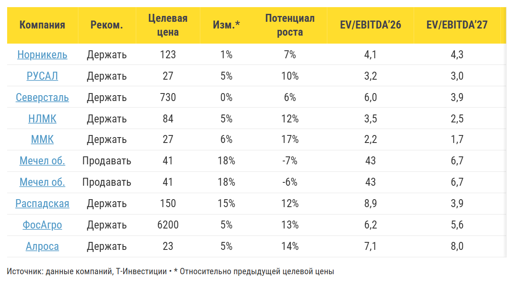

*График 30722553 — «Основные показатели компаний по сектору». Интерактив: https://flo.uri.sh/visualisation/30722553/embed. Данные: [CSV](../charts/30722553.rows.csv), [JSON](../charts/30722553.json)*

Подписи и настройки графика: layout.footer_note: * Относительно предыдущей целевой цены; layout.source_name: данные компаний, Т-Инвестиции

| Компания | Реком. | Целевая цена | Изм.* | Потенциал роста | EV/EBITDA’26 | EV/EBITDA’27 | P/E’26 | P/E’27 |
|---|---|---|---|---|---|---|---|---|
| <a href="https://www.tbank.ru/invest/stocks/GMKN">Норникель</a> | Держать | 123 | 1% | 7% | 4,1 | 4,3 | 7,3 | 7,9 |
| <a href="https://www.tbank.ru/invest/stocks/RUAL">РУСАЛ</a> | Держать | 27 | 5% | 10% | 3,2 | 3,0 | 3,0 | 2,9 |
| <a href="https://www.tbank.ru/invest/stocks/CHMF">Северсталь</a> | Держать | 730 | 0% | 6% | 6,0 | 3,9 | 17 | 7,9 |
| <a href="https://www.tbank.ru/invest/stocks/NLMK">НЛМК</a> | Держать | 84 | 5% | 12% | 3,5 | 2,5 | 11 | 6,5 |
| <a href="https://www.tbank.ru/invest/stocks/MAGN">ММК</a> | Держать | 27 | 6% | 17% | 2,2 | 1,7 | 8,3 | 6,0 |
| <a href="https://www.tbank.ru/invest/stocks/MTLR">Мечел об.</a> | Продавать | 41 | 18% | -7% | 43 | 6,7 | нег. | нег. |
| <a href="https://www.tbank.ru/invest/stocks/MTLRP">Мечел об.</a> | Продавать | 41 | 18% | -6% | 43 | 6,7 | нег. | нег. |
| <a href="https://www.tbank.ru/invest/stocks/RASP">Распадская</a> | Держать | 150 | 15% | 12% | 8,9 | 3,9 | нег. | 24 |
| <a href="https://www.tbank.ru/invest/stocks/PHOR">ФосАгро</a> | Держать | 6200 | 5% | 13% | 6,2 | 5,6 | 8,9 | 7,8 |
| <a href="https://www.tbank.ru/invest/stocks/ALRS">Алроса</a> | Держать | 23 | 5% | 14% | 7,1 | 8,0 | нег. | нег. |

ИТ-сектор: выбираем компании с устойчивым бизнесом

Как мы отмечали в предыдущей стратегии, технологический сектор остается под давлением макроэкономических факторов и осторожных настроений инвесторов.

В условиях высокой неопределенности мы снижаем риски портфелей: отдаем предпочтение более устойчивым компаниям и сокращаем вложения в наиболее волатильные бумаги компаний малой и средней капитализации.

**Динамика выручки**

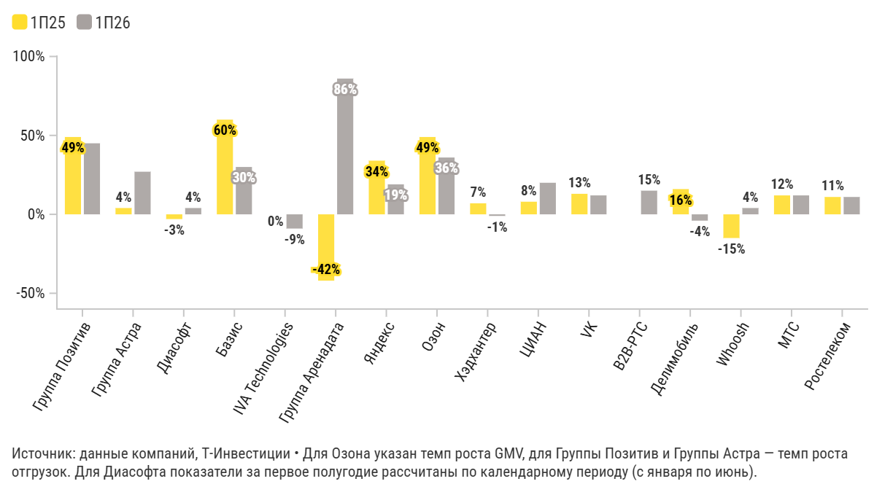

*График 30722435 — «Динамика выручки». Интерактив: https://flo.uri.sh/visualisation/30722435/embed. Данные: [CSV](../charts/30722435.csv), [JSON](../charts/30722435.json)*

Подписи и настройки графика: axes_highlights.y_lines: Среднее по форвардному P/E со второй половины 2022 года (4,9х) :: 4.9; layout.footer_note: Для Озона указан темп роста GMV, для Группы Позитив и Группы Астра — темп роста отгрузок. Для Диасофта показатели за первое полугодие рассчитаны по календарному периоду (с января по июнь).; layout.source_name: данные компаний, Т-Инвестиции; chart_type: column_grouped

| label | 1П25 | 1П26 |
|---|---|---|
| Группа Позитив | 49% | 45% |
| Группа Астра | 4% | 27% |
| Диасофт | -3% | 4% |
| Базис | 60% | 30% |
| IVA Technologies | 0% | -9% |
| Группа Аренадата | -42% | 86% |
|  |  |  |
| Яндекс | 34% | 19% |
| Озон | 49% | 36% |
| Хэдхантер | 7% | -1% |
| ЦИАН | 8% | 20% |
| VK | 13% | 12% |
| B2B-РТС |  | 15% |
|  |  |  |
| Делимобиль | 16% | -4% |
| Whoosh | -15% | 4% |
|  |  |  |
| МТС | 12% | 12% |
| Ростелеком | 11% | 11% |

**Динамика рентабельности по EBITDA**

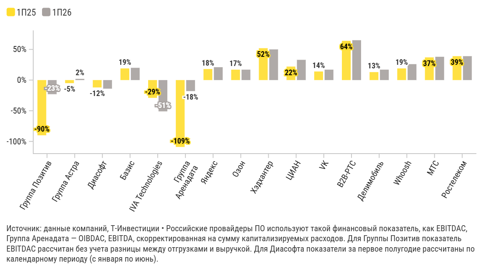

*График 30722479 — «Динамика рентабельности по EBITDA». Интерактив: https://flo.uri.sh/visualisation/30722479/embed. Данные: [CSV](../charts/30722479.csv), [JSON](../charts/30722479.json)*

Подписи и настройки графика: axes_highlights.y_lines: Среднее по форвардному P/E со второй половины 2022 года (4,9х) :: 4.9; layout.footer_note: Российские провайдеры ПО используют такой финансовый показатель, как EBITDAC, Группа Аренадата — OIBDAC, EBITDA, скорректированная на сумму капитализируемых расходов. Для Группы Позитив показатель EBITDAC рассчитан без учета разницы между отгрузками и выручкой. Для Диасофта показатели за первое полугодие рассчитаны по календарному периоду (с января по июнь).; layout.source_name: данные компаний, Т-Инвестиции; chart_type: column_grouped

| label | 1П25 | 1П26 |
|---|---|---|
| Группа Позитив | -90% | -23% |
| Группа Астра | -5% | 2% |
| Диасофт | -12% | -14% |
| Базис | 19% | 20% |
| IVA Technologies | -29% | -51% |
| Группа Аренадата | -109% | -18% |
|  |  |  |
| Яндекс | 18% | 21% |
| Озон | 17% | 17% |
| Хэдхантер | 52% | 50% |
| ЦИАН | 22% | 33% |
| VK | 14% | 17% |
| B2B-РТС | 64% | 65% |
|  |  |  |
| Делимобиль | 13% | 17% |
| Whoosh | 19% | 26% |
|  |  |  |
| МТС | 37% | 38% |
| Ростелеком | 39% | 39% |

Дополнительный риск для сектора — участившиеся атаки БПЛА на инфраструктуру ИТ-компаний, от которой зависит дальнейшее развитие отрасли в России. Масштаб и географию возможных атак сложно прогнозировать, а связанные с ними риски — количественно оценить. Это повышает неопределенность при принятии инвестиционных решений. Приемлемый уровень таких рисков каждый инвестор определяет самостоятельно.

При этом на среднесрочном горизонте мы по-прежнему позитивно оцениваем перспективы сектора. Его развитие поддерживают дальнейшая цифровизация экономики и новые технологии, прежде всего искусственный интеллект.

В ближайшее время эффект от внедрения ИИ вряд ли станет определяющим для результатов сектора, однако этот рынок формируется уже сейчас. Поэтому в текущей стратегии мы считаем важным оценить состояние российского рынка ИИ.

Российский бизнес масштабирует внедрение ИИ

Российский бизнес постепенно переходит от экспериментов к масштабному внедрению ИИ. Согласно исследованию компаний Яков и Партнеры и Яндекс, в 2025 году 71% крупных российских компаний использовали генеративный ИИ хотя бы в одной бизнес-функции — на 17 п. п. больше, чем годом ранее. Среднее число функций, в которых компании тестируют или уже внедряют технологию, выросло с 2,4 в 2023 году до 3,1 в 2025 году.

Экономический эффект уже можно измерить: 90% респондентов связывают финансовую отдачу от ИИ прежде всего со снижением операционных затрат. Рост выручки благодаря новым продуктам и сервисам пока отмечает значительно меньшая доля опрошенных компаний.

В перспективе финансовый эффект может усилиться. Согласно исследованию компании Яков и Партнеры, прирост EBITDA компаний благодаря использованию генеративного ИИ может составить в среднем 4%, а в передовых отраслях — около 8%. Совокупный вклад ИИ в российскую экономику к 2030 году оценивается в 7,9—12,8 трлн рублей, или до 5,5% ВВП.

Институт статистических исследований и экономики знаний Национального исследовательского университета «Высшая школа экономики» оценивает потенциальный эффект от ИИ для ВВП России в 11,6 трлн рублей к 2030 году и в 46,5 трлн рублей к 2035 году. Однако реализация этого потенциала потребует значительного увеличения совокупных затрат на ИИ

Генеративный искусственный интеллект (генеративный ИИ, GenAI)

Класс систем ИИ, которые создают контент: тексты, изображения, музыку, видео, программный код и данные. Для этого они используют закономерности, выявленные при обучении на больших массивах данных

При этом развитие ИИ-агентов пока не отменяет необходимости человеческого контроля. Несмотря на быстрый прогресс, они по-прежнему допускают ошибки при выполнении сложных, многоуровневых задач. Поэтому на данном этапе наиболее реалистична модель, в которой ИИ автоматизирует типовые операции, а человек контролирует критически важные решения.

Барьеры масштабирования ИИ в России

Развитие ИИ в России сдерживает ограниченный доступ к специализированным вычислительным мощностям: Nvidia приостановила поставки и закрыла бизнес в России в 2022 году, а США ввели лицензирование экспорта ИИ-чипов.

Также с мая 2026 года усилился контроль за параллельным импортом. Минпромторг сократил перечень разрешенной к ввозу продукции. За последние два года поставки серверов с мощными графическими процессорами через параллельный импорт сократились с тысяч штук до десятков, а стоимость их аренды к концу прошлого года выросла почти на 30%.

Одной из альтернатив выступают решения китайских производителей GPU, однако их внедрение требует значительных компетенций. Переход на них осложняется незрелостью технологий и неполноценной CUDA-совместимостью, необходимостью адаптации ПО, отсутствием техподдержки. На значимых объектах критической информационной инфраструктуры действуют дополнительные требования к использованию оборудования из российского реестра.

CUDA-совместимость

Способность чипа или программной среды работать с кодом, написанным под платформу CUDA (проприетарный стандарт Nvidia для вычислений на GPU) без его переписывания. Неполная CUDA-совместимость означает, что чип формально поддерживает часть команд CUDA, но не все — в результате одни программы работают корректно, другие выдают ошибки или дают неверный результат, и разработчику приходится вручную адаптировать код под конкретное «железо», вместо того чтобы просто запустить готовое решение

Энергетическая инфраструктура является еще одним ограничителем масштабирования ИИ. Темп развития ИИ-отрасли в значительной мере определяется скоростью строительства энергетических мощностей, измеряемой годами.

Помимо ограничений в вычислительной и энергетической инфраструктуре, развитие ИИ в России сдерживает высокая стоимость создания собственных языковых моделей (LLM). Поэтому рынок смещается от разработки LLM с нуля к адаптации готовых решений: крупные игроки, такие как Сбер и Яндекс, развивают собственные модели, тогда как остальные компании чаще донастраивают открытые решения, в том числе китайские Qwen и DeepSeek, под свои задачи.

Таким образом, несмотря на быстрый прогресс ИИ, в мире технология пока находится на этапе масштабирования: компании продолжают экспериментировать с ее применением, а устойчивый финансовый эффект проявляется преимущественно в снижении операционных затрат. В России реализация потенциала ИИ дополнительно ограничена доступностью вычислительных мощностей и зависимостью от зарубежных технологий

Дополнительные риски создают геополитическая неопределенность и угрозы физической безопасности инфраструктуры ЦОД, включая объекты с высокопроизводительными вычислительными мощностями. В результате потенциал ИИ остается значительным, однако темпы его монетизации будут зависеть от способности компаний преодолевать технологические и инфраструктурные ограничения.

Наши фавориты

Отдельного внимания заслуживают риски физической безопасности ИТ-инфраструктуры. Атаки на дата-центры могут вызвать цепную реакцию во всем секторе: компании без собственной инфраструктуры также зависят от бесперебойной работы сторонних операторов.

Масштаб и последствия таких событий трудно прогнозировать, поэтому приемлемый уровень риска каждый инвестор определяет самостоятельно

Несмотря на эти риски, мы сохраняем позитивный взгляд на среднесрочные перспективы отрасли и в текущей стратегии выделяем следующих фаворитов ИТ-сектора.

Озон: устойчивая бизнес-модель помогает справляться с атаками

#### Озон

Целевая цена — 5 700 ₽ за акцию, потенциал роста — 50%

Озон остается нашим фаворитом в секторе. Несмотря на операционные сложности конца августа — начала сентября, мы сохраняем позитивный взгляд на акции компании. Их текущая оценка выглядит привлекательной даже с учетом возросших инфраструктурных рисков и увеличения капитальных затрат.

Мнение аналитиков Т-Инвестиций

«Разветвленная логистическая сеть и резервные мощности помогают смягчать последствия локальных сбоев, а финтех и рекламный бизнес снижают зависимость выручки от онлайн-торговли. Уже сейчас очевидно, что компания существенно превзойдет ранее представленные прогнозы как по GMV, так и по рентабельности».

Марьяна Лазаричева, глава аналитики Т-Инвестиций по рынку акций Маргарита Боярко, старший аналитик

Хэдхантер: готовится к оживлению рынка труда

#### Хэдхантер

Целевая цена — 3 500 ₽ за акцию, потенциал роста — 30%

Рост выручки Хэдхантера продолжает замедляться на фоне охлаждения рынка труда и повышения эффективности платформы, которое сдерживает монетизацию. Однако ожидаемое оживление экономики и сильные позиции компании на рынке создают условия для ускорения роста выручки в среднесрочной перспективе.

Мнение аналитиков Т-Инвестиций

«Компания уделяет особое внимание операционной эффективности, что позволяет сохранять рентабельность около 50%, и активно инвестирует в развитие продукта. Мы ожидаем, что по мере восстановления экономической активности эти вложения помогут Хэдхантеру укрепить конкурентные преимущества и существенно ускорить рост».

Марьяна Лазаричева, глава аналитики Т-Инвестиций по рынку акций Маргарита Боярко, старший аналитик

По нашим расчетам, акции Хэдхантера торгуются с мультипликатором EV/EBITDA на 2026 год около 5,3х — на уровне среднего значения по российскому ИТ-сектору. Мы считаем такую оценку низкой с учетом:

- сильных позиций на рынке;
- устойчивой рентабельности;
- высокой доходности свободного денежного потока;
- привлекательной дивидендной истории.

Компания реализует программу обратного выкупа акций объемом до 15 млрд рублей, рассчитанную на 12 месяцев. Сокращение числа акций в обращении может поддержать рост денежного потока на акцию в последующие периоды. По нашим оценкам, к настоящему моменту компания выкупила акции примерно на 6,5 млрд рублей.

**Российские ТМТ-компании**

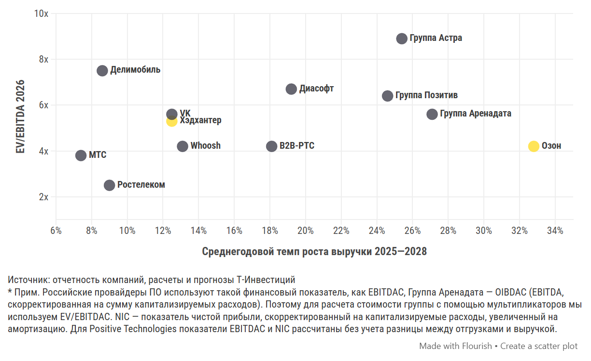

*График 30722377 — «Российские ТМТ-компании». Интерактив: https://flo.uri.sh/visualisation/30722377/embed. Данные: [CSV](../charts/30722377.csv), [JSON](../charts/30722377.json)*

Подписи и настройки графика: layout.footer_note_secondary: * Прим. Российские провайдеры ПО используют такой финансовый показатель, как EBITDAC, Группа Аренадата — OIBDAC (EBITDA, скорректированная на сумму капитализируемых расходов). Поэтому для расчета стоимости группы с помощью мультипликаторов мы используем EV/EBITDAC. NIC — показатель чистой прибыли, скорректированный на капитализируемые расходы, увеличенный на амортизацию. Для Positive Technologies показатели EBITDAC и NIC рассчитаны без учета разницы между отгрузками и выручкой.; layout.source_name: отчетность компаний, расчеты и прогнозы Т-Инвестиций

| Цвет | metadata_0 | Среднегодовой темп роста выручки 2025—2028 | EV/EBITDA 2026 | name_0 | Среднегодовой темп роста выручки 2025—2028 | EV/EBITDA 2026 |
|---|---|---|---|---|---|---|
| 1 | Группа Позитив | 24.6 | 6.4 | Группа Позитив | 24.6 | 6.4 |
| 1 | Группа Астра | 25.4 | 8.9 | Группа Астра | 25.4 | 8.9 |
| 1 | Диасофт | 19.2 | 6.7 | Диасофт | 19.2 | 6.7 |
| 1 | Группа Аренадата | 27.1 | 5.6 | Группа Аренадата | 27.1 | 5.6 |
| 2 | Озон | 32.8 | 4.2 | Озон | 32.8 | 4.2 |
| 2 | Хэдхантер | 12.5 | 5.3 | Хэдхантер | 12.5 | 5.3 |
| 1 | VK | 12.5 | 5.6 | VK | 12.5 | 5.6 |
| 1 | B2B-РТС | 18.1 | 4.2 | B2B-РТС | 18.1 | 4.2 |
| 1 | Делимобиль | 8.6 | 7.5 | Делимобиль | 8.6 | 7.5 |
| 1 | Whoosh | 13.1 | 4.2 | Whoosh | 13.1 | 4.2 |
| 1 | МТС | 7.4 | 3.8 | МТС | 7.4 | 3.8 |
| 1 | Ростелеком | 9 | 2.5 | Ростелеком | 9 | 2.5 |

Потребительский сектор: замедление доходов и рост цен сдерживают спрос

Как мы и ожидали, оживление потребительской активности на фоне отложенного спроса продлилось недолго. По нашим оценкам, в третьем квартале рост реальных заработных плат продолжил замедляться, что заставляет потребителей экономить, особенно на товарах не первой необходимости.

При этом продовольственная инфляция ускоряется: ритейлеры уже начали закладывать в цены на полках возросшие логистические издержки, связанные с последствиями топливного кризиса.

Мнение аналитиков Т-Инвестиций

«В 2027 году ожидаем дальнейшего замедления роста потребления в России. Давление будут оказывать умеренный рост реальных заработных плат, повышенная инфляция на фоне существенного увеличения тарифов ЖКХ и вторичных последствий топливного кризиса, а также более высокая прогнозная траектория ключевой ставки».

Александр Самуйлов, CFA, главный аналитик Т-Инвестиций Никита Степанов, старший аналитик Т-Инвестиций

Текущие тренды в потребительском секторе

Рост реальных заработных плат россиян в августе замедлился до 3,3% против 5,1% в апреле на фоне охлаждения экономики. Это согласуется с повышенным значением индекса Хэдхантера — 8,6 в третьем квартале, что указывает на высокую конкуренцию за рабочие места среди соискателей. По Т-Данным мы также фиксируем дальнейшее замедление роста реальных зарплат в третьем квартале. На наш взгляд, к концу года темпы роста опустятся примерно до 2% на фоне ослабления активности найма. Это соответствует нижней границе среднего исторического диапазона в 2—3%.

По нашим оценкам, рост реальных объемов потребления в третьем квартале замедлился до 3,6%. Мы связываем это с замедлением роста реальных доходов россиян. Импульс отложенного спроса, который реализовался во втором квартале в непродовольственном сегменте, исчерпался достаточно быстро. При этом в сентябре индекс потребительских настроений россиян частично восстановился после июльского падения на фоне острой фазы топливного кризиса.

Согласно Т-Данным, в третьем квартале рост среднего чека ритейлеров ускорился на фоне повышения цен на топливо. Продовольственная инфляция ускорилась до 4,9% — с 3,4% во втором квартале. Это связано со вторичными эффектами топливного кризиса: ритейлеры начали закладывать возросшие логистические издержки в цены на полках. Наиболее высокие темпы роста LFL-чека сохраняются в непродовольственном сегменте — у Магнит Косметик и Фикс Прайса. Однако рост среднего чека у них сопровождается более слабой динамикой LFL-трафика по сравнению с продуктовыми ритейлерами.

Рост реального объема платных услуг в третьем квартале замедлился до 1,9%. Основной вклад в него обеспечили расходы россиян на жилищно-коммунальные услуги, медицину, связь и туризм, тогда как расходы на отели и транспорт оказывали давление на общую динамику.

По нашим обновленным прогнозам, полноценного разворота в динамике потребления стоит ждать не ранее 2028 года. В 2027-м давление на реальные расходы россиян окажут замедление роста реальных зарплат на фоне сокращения дефицита кадров, более активная индексация тарифов ЖКХ, рост налоговой нагрузки и более медленное снижение ключевой ставки.

Индекс Хэдхантера показывает, сколько активных резюме приходится на одну вакансию. Чем выше параметр, тем сильнее конкуренция среди соискателей за рабочие места. Значение в диапазоне 4—7,9 указывает на умеренную конкуренцию и баланс на рынке труда, а 8—11,9 — на высокую конкуренцию

**Динамика реальных заработных плат и объемов потребления в России**

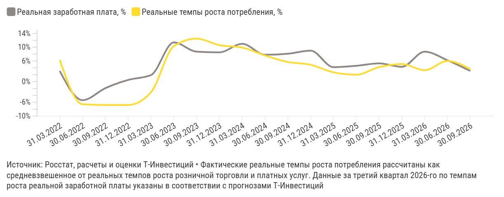

*График 30746171 — «Динамика реальных заработных плат и объемов потребления в России». Интерактив: https://flo.uri.sh/visualisation/30746171/embed. Данные: [CSV](../charts/30746171.csv), [JSON](../charts/30746171.json)*

Подписи и настройки графика: axes_highlights.x_areas: ::; axes_highlights.x_lines: ::; axes_highlights.y_areas: ::; axes_highlights.y_lines: ::; layout.footer_note: Фактические реальные темпы роста потребления рассчитаны как средневзвешенное от реальных темпов роста розничной торговли и платных услуг. Данные за третий квартал 2026-го по темпам роста реальной заработной платы указаны в соответствии с прогнозами Т-Инвестиций; layout.source_name: Росстат, расчеты и оценки Т-Инвестиций; chart_type: line

| Период | Реальная заработная плата, % | Реальные темпы роста потребления, % |
|---|---|---|
| 31.03.2022 | 3,1% | 6,3% |
| 30.06.2022 | -5,4% | -6,6% |
| 30.09.2022 | -1,9% | -6,8% |
| 31.12.2022 | 0,5% | -6,8% |
| 31.03.2023 | 1,9% | -3,1% |
| 30.06.2023 | 11,4% | 10,3% |
| 30.09.2023 | 8,7% | 12,5% |
| 31.12.2023 | 8,5% | 10,6% |
| 31.03.2024 | 11,0% | 9,9% |
| 30.06.2024 | 7,8% | 7,6% |
| 30.09.2024 | 8,1% | 5,7% |
| 31.12.2024 | 9,0% | 4,9% |
| 31.03.2025 | 4,2% | 2,7% |
| 30.06.2025 | 4,6% | 2,0% |
| 30.09.2025 | 5,3% | 4,2% |
| 31.12.2025 | 4,3% | 5,1% |
| 31.03.2026 | 8,7% | 3,3% |
| 30.06.2026 | 6,2% | 6,0% |
| 30.09.2026 | 3,1% | 3,6% |

Наши фавориты

Мнение аналитиков Т-Инвестиций

«Замедление роста реальных доходов ограничит возможности ритейлеров перекладывать издержки на покупателей и повышать рентабельность в следующем году. Большинство акций сектора оценены справедливо. Среди других отраслей выделяем фармацевтику: спрос слабо зависит от доходов населения, а долгосрочные тенденции в лечении заболеваний поддерживают рост публичных компаний».

Александр Самуйлов, CFA, главный аналитик Т-Инвестиций Никита Степанов, старший аналитик Т-Инвестиций

Озон Фармацевтика: растет благодаря устойчивому спросу

#### Озон Фармацевтика

Целевая цена — 65 ₽ за акцию, потенциал роста — 37%

Компания занимает лидирующие позиции на растущем рынке дженериков — аналогов оригинальных препаратов с теми же действующими веществами. Дженерики обычно продаются по значительно более низкой цене.

По данным аналитической компании DSM Group

По итогам девяти месяцев 2026 года Озон Фармацевтика сохраняет шестое место на фармацевтическом рынке по объему sell-out — продаж аптечных сетей конечным покупателям

За этот период продажи препаратов компании в аптечных сетях выросли на 13,5%, немного опередив рост коммерческого рынка лекарственных препаратов, который составил 12%

**Ожидаем сильных результатов по итогам 2026-го**

Мы прогнозируем рост выручки Озон Фармацевтики на 16% в этом году. Ожидаем ускорения ее роста во втором полугодии, когда аптечные сети будут пополнять запасы и расширять представленность ассортимента группы на полках.

Кроме того, по нашим оценкам, рентабельность по скорректированной EBITDA и чистой прибыли достигнет рекордных 41 и 23% соответственно. Поддержку маржинальности окажут крепкий рубль, усиление эффекта операционного рычага по мере дальнейшей загрузки производственных мощностей, а также значительное снижение чистых финансовых расходов группы благодаря более низкой ключевой ставке.

**Перспективные проекты: биосимиляры и онкопрепараты**

Оба направления будут запущены уже в 2027 году и позволят группе расширить присутствие в сегменте бюджетных закупок и значительно повысить общую маржинальность бизнеса за счет более высокой стоимости препаратов.

**Умеренная оценка и регулярные дивиденды**

Акции компании торгуются с мультипликатором EV/EBITDA 4,2х по итогам 2026 года — на 19% ниже среднего значения по сектору, несмотря на сопоставимые темпы роста выручки и более высокую рентабельность Озон Фармацевтики.

Кроме того, совет директоров недавно отменил ограничение размера дивидендов объемом свободного денежного потока. По нашим оценкам, это позволит обеспечить инвесторам дивидендную доходность около 4% на горизонте 12 месяцев.

Промомед: наращивает продажи и торгуется дешевле сектора

#### Промомед

Целевая цена — 640 ₽ за акцию, потенциал роста — 53%

Промомед — одна из ведущих российских фармацевтических компаний, представленная в крупнейших сегментах рынка, включая эндокринологию, онкологию, общую терапию и неврологию.

По данным аналитической компании DSM Group

По итогам девяти месяцев 2026 года Промомед занимает первое место по объему продаж конечным покупателям (sell-out)

Этому способствует высокий спрос на флагманский препарат для снижения веса «Тирзетта», который с начала года остается самым продаваемым брендированным препаратом в России. Подробнее о бизнесе компании и перспективах читайте в нашем большом обзоре.

**Лидер на стремительно растущем рынке**

Сохраняющийся высокий спрос на препараты для снижения веса поддерживает кратный рост выручки сегмента эндокринологии.

По нашим оценкам, в 2026 году рынок агонистов GLP-1 может вырасти в 2,4 раза в денежном выражении, а продажи Промомеда в этом сегменте — почти втрое.

Компания станет одним из основных драйверов роста рынка: по итогам года ее доля может достичь 54% (+11 п. п. год к году) благодаря активному продвижению препарата среди медицинского сообщества.

В 2027–2028 годах темпы роста рынка, вероятно, замедлятся в среднем до 20% в год, а доля Промомеда, по нашим оценкам, сохранится выше 50%.

**Амбициозные планы по диверсификации бизнеса**

Сейчас результаты Промомеда существенно зависят от сегмента эндокринологии, на который по итогам первого полугодия 2026 года приходилось около 71% общей выручки. Однако мы прогнозируем постепенное снижение этой доли по мере вывода на рынок инновационных препаратов в сегментах онкологии и иммунологии начиная с 2027 года.

**Привлекательная оценка**

Акции торгуются с мультипликатором EV/EBITDA 4,4х по итогам 2026 года — на 15% ниже среднего значения по сектору, несмотря на самые высокие темпы роста выручки и одну из самых высоких рентабельностей по EBITDA в секторе здравоохранения.

**Оценка компаний потребительского сектора в зависимости от рентабельности и темпов роста**

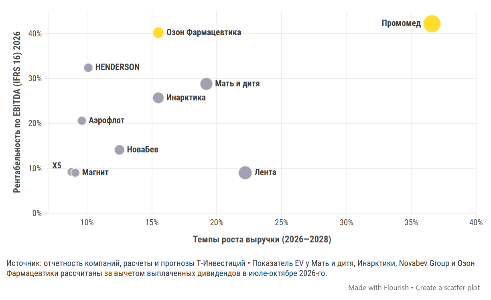

*График 30722255 — «Оценка компаний потребительского сектора в зависимости от рентабельности и темпов роста». Интерактив: https://flo.uri.sh/visualisation/30722255/embed. Данные: [CSV](../charts/30722255.csv), [JSON](../charts/30722255.json)*

Подписи и настройки графика: axes_highlights.x_areas: ; axes_highlights.y_lines: X5 :: 9; layout.footer_note: Показатель EV у Мать и дитя, Инарктики, Novabev Group и Озон Фармацевтики рассчитаны за вычетом выплаченных дивидендов в июле-октябре 2026-го.; layout.source_name: отчетность компаний, расчеты и прогнозы Т-Инвестиций

| Colour | metadata_0 | Темпы роста выручки (2026—2028) | Рентабельность по EBITDA (IFRS 16) 2026 | EV/EBITDA 2026 | name_0 | Темпы роста выручки (2026—2028) | Темпы роста выручки (2026—2028) | Рентабельность по EBITDA (IFRS 16) 2026 |
|---|---|---|---|---|---|---|---|---|
|  |  |  |  |  |  |  |  |  |
| 2 | X5 | 8.8 | 9.2 | 3,6 | X5 | 8.8 | 8.8 | 9.2 |
| 2 | Магнит | 9.1 | 9 | 3,5 | Магнит | 9.1 | 9.1 | 9 |
| 2 | Лента | 22.2 | 9 | 3,9 | Лента | 22.2 | 22.2 | 9 |
| 2 | НоваБев | 12.5 | 14.1 | 3,0 | НоваБев | 12.5 | 12.5 | 14.1 |
| 2 | HENDERSON | 10.1 | 32.4 | 3,1 | HENDERSON | 10.1 | 10.1 | 32.4 |
| 2 | Мать и дитя | 19.2 | 28.8 | 7,0 | Мать и дитя | 19.2 | 19.2 | 28.8 |
| 1 | Озон Фармацевтика | 15.5 | 40.2 | 4,2 | Озон Фармацевтика | 15.5 | 15.5 | 40.2 |
| 2 | Инарктика | 15.5 | 25.7 | 6,1 | Инарктика | 15.5 | 15.5 | 25.7 |
| 2 | Аэрофлот | 9.6 | 20.6 | 3,3 | Аэрофлот | 9.6 | 9.6 | 20.6 |
| 1 | Промомед | 36.6 | 42.2 | 4,4 | Промомед | 36.6 | 36.6 | 42.2 |

Девелопмент: проблем больше, чем продаж

Мнение аналитиков Т-Инвестиций

«Рынок жилищного строительства остается под давлением, несмотря на умеренный рост продаж за девять месяцев 2026 года. Спрос по-прежнему зависит от изменений условий льготного кредитования, а краткосрочные всплески покупательской активности не говорят об устойчивом восстановлении рынка. В четвертом квартале 2026-го мы ожидаем существенного ухудшения динамики продаж из-за эффекта высокой базы прошлого года, исчерпания ажиотажного спроса и все еще труднодоступной ставки по рыночной ипотеке».

Александр Самуйлов, CFA, главный аналитик Т-Инвестиций Никита Степанов, старший аналитик Т-Инвестиций

В 2027 году давление на сектор усилится. Ужесточение условий семейной ипотеки ограничит спрос на новостройки, а выплаты неустоек за перенос сроков сдачи проектов застройщиков создадут риски для их ликвидности. При этом региональные девелоперы находятся в относительно более выгодном положении благодаря более мягким условиям по обновленной программе семейной ипотеки

Текущие тренды в секторе девелопмента

Продажи жилья в квадратных метрах за девять месяцев 2026-го выросли на 3% год к году за счет ажиотажного спроса в январе, июне и сентябре на фоне ожиданий ужесточения условий семейной ипотеки. В остальные месяцы продажи снижались в среднем на 11% год к году. В четвертом квартале мы также прогнозируем падение продаж более чем на 40% год к году из-за высокой базы конца 2025 года, охлаждения спроса после сентябрьского всплеска и сохранения высоких ставок по рыночной ипотеке.

Цены на новостройки растут немного быстрее инфляции. За январь — сентябрь 2026 года они выросли на 5,9%, опередив накопленную инфляцию на 0,8 п. п. В сентябре ажиотажный спрос в преддверии ограничений по семейной ипотеке ускорил динамику цен до 1,1% месяц к месяцу по сравнению с 0,6% в июле — августе.

Новые условия семейной ипотеки окажут значительное давление на продажи. Для семей с одним ребенком, на которые ранее приходилось около 70% заемщиков по программе, ставки выросли до 12% в Москве и Санкт-Петербурге и до 10% в регионах. Кроме того, максимальный срок семейной ипотеки сократился вдвое — с 30 до 15 лет. В совокупности с повышением ставок для семей с одним и двумя детьми это значительно увеличит ежемесячные платежи и сократит круг потенциальных заемщиков.

Запас прочности сектора стабилизируется, однако впереди новые вызовы. Уровень покрытия проектного финансирования средствами на счетах эскроу на конец августа 2026 года составил 66% против 65% на конец второго квартала. Тем не менее уже в 2027 году показатель вновь может оказаться под давлением из-за снижения продаж на фоне ужесточения условий семейной ипотеки. Дополнительно на ликвидность застройщиков негативно повлияет возобновление до конца 2026 года выплат неустоек за перенос сроков сдачи жилых комплексов.

Текущая конъюнктура рынка жилищного строительства более благоприятна для региональных застройщиков. По итогам января — сентября 2026 года продажи в регионах за пределами топ-10 выросли на 12% год к году, тогда как в Москве и Санкт-Петербурге снизились на 28 и 2% соответственно. На наш взгляд, это связано с сокращением предложения жилья, доступного в рамках максимального лимита семейной ипотеки, на столичных рынках после роста цен в конце 2025 года. Кроме того, ставки по семейной ипотеке в регионах теперь на 2 п. п. ниже столичных при одинаковом количестве детей, а максимальный размер кредита вырос на 66% против 50% в Москве и Санкт-Петербурге. Ожидаем, что эти изменения будут способствовать дальнейшему перераспределению спроса в пользу регионов.

**Продажи новостроек в России**

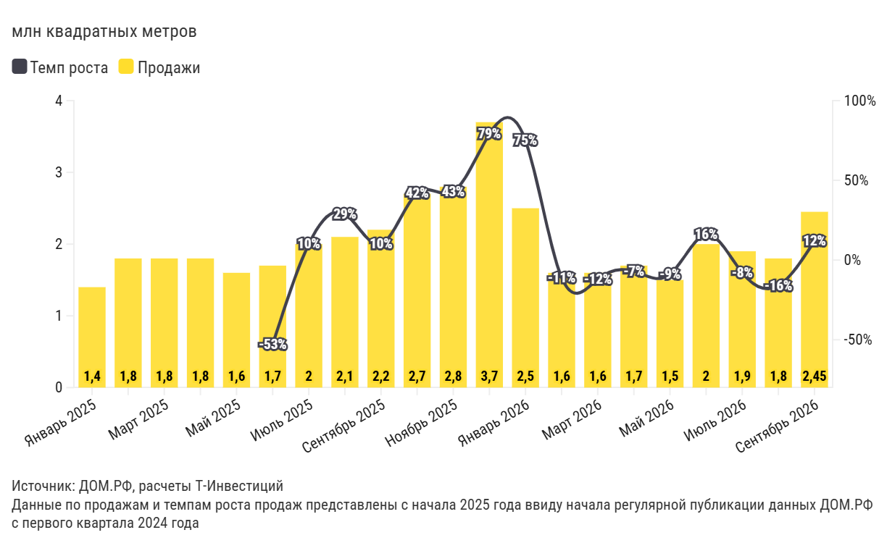

*График 30647271 — «Продажи новостроек в России». Интерактив: https://flo.uri.sh/visualisation/30647271/embed. Данные: [CSV](../charts/30647271.csv), [JSON](../charts/30647271.json)*

Подписи и настройки графика: axes_highlights.x_areas: рецессия доткомов:: 28.02.2001 >> 30.11.2001; axes_highlights.x_lines: :: Прогноз; axes_highlights.y_lines: ::0; layout.footer_note_secondary: Данные по продажам и темпам роста продаж представлены с начала 2025 года ввиду начала регулярной публикации данных ДОМ.РФ с первого квартала 2024 года; layout.source_name: ДОМ.РФ, расчеты Т-Инвестиций; chart_type: column_stacked_line

| label | Темп роста | Продажи |
|---|---|---|
| Январь 2025 |  | 1,4 |
| Февраль 2025 |  | 1,8 |
| Март 2025 |  | 1,8 |
| Апрель 2025 |  | 1,8 |
| Май 2025 |  | 1,6 |
| Июнь 2025 | -53% | 1,7 |
| Июль 2025 | 10% | 2,0 |
| Август 2025 | 29% | 2,1 |
| Сентябрь 2025 | 10% | 2,2 |
| Октябрь 2025 | 42% | 2,7 |
| Ноябрь 2025 | 43% | 2,8 |
| Декабрь 2025 | 79% | 3,7 |
| Январь 2026 | 75% | 2,5 |
| Февраль 2026 | -11% | 1,6 |
| Март 2026 | -12% | 1,6 |
| Апрель 2026 | -7% | 1,7 |
| Май 2026 | -9% | 1,5 |
| Июнь 2026 | 16% | 2,0 |
| Июль 2026 | -8% | 1,9 |
| Август 2026 | -16% | 1,8 |
| Сентябрь 2026 | 12% | 2,45 |
|  | -42,6% | 1,6 |
|  | -39,5% | 1,7 |
|  | -41,2% | 2,2 |

**Динамика цен на жилье разных классов в России**

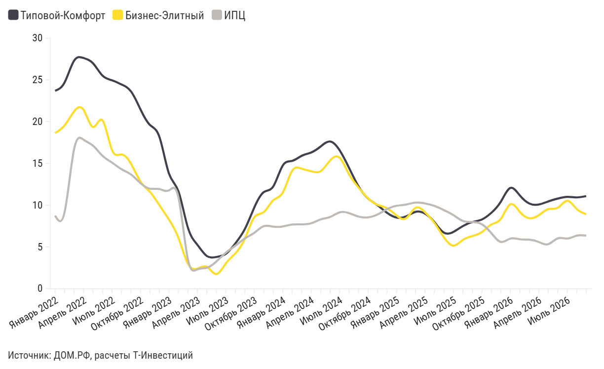

*График 30647628 — «Динамика цен на жилье разных классов в России». Интерактив: https://flo.uri.sh/visualisation/30647628/embed. Данные: [CSV](../charts/30647628.csv), [JSON](../charts/30647628.json)*

Подписи и настройки графика: axes_highlights.x_areas: рецессия доткомов:: 28.02.2001 >> 30.11.2001; axes_highlights.x_lines: :: Прогноз; axes_highlights.y_lines: ::0; layout.source_name: ДОМ.РФ, расчеты Т-Инвестиций; chart_type: line

| label | Типовой-Комфорт | Бизнес-Элитный | ИПЦ |
|---|---|---|---|
| Январь 2022 | 23,69% | 18,63% | 8,74% |
| Февраль 2022 | 24,70% | 19,55% | 9,16% |
| Март 2022 | 27,30% | 21,22% | 16,70% |
| Апрель 2022 | 27,62% | 21,41% | 17,83% |
| Май 2022 | 26,98% | 19,35% | 17,11% |
| Июнь 2022 | 25,50% | 20,14% | 15,90% |
| Июль 2022 | 24,94% | 16,59% | 15,09% |
| Август 2022 | 24,45% | 16,07% | 14,30% |
| Сентябрь 2022 | 23,62% | 14,95% | 13,67% |
| Октябрь 2022 | 21,47% | 12,83% | 12,63% |
| Ноябрь 2022 | 19,60% | 11,57% | 11,97% |
| Декабрь 2022 | 18,16% | 9,99% | 11,92% |
| Январь 2023 | 13,79% | 8,28% | 11,76% |
| Февраль 2023 | 11,66% | 6,08% | 10,97% |
| Март 2023 | 7,30% | 2,99% | 3,51% |
| Апрель 2023 | 5,25% | 2,39% | 2,30% |
| Май 2023 | 3,90% | 2,60% | 2,50% |
| Июнь 2023 | 3,79% | 1,74% | 3,24% |
| Июль 2023 | 4,16% | 3,01% | 4,30% |
| Август 2023 | 5,41% | 4,21% | 5,13% |
| Сентябрь 2023 | 7,12% | 5,96% | 6,00% |
| Октябрь 2023 | 9,71% | 8,53% | 6,68% |
| Ноябрь 2023 | 11,55% | 9,16% | 7,47% |
| Декабрь 2023 | 12,23% | 10,58% | 7,42% |
| Январь 2024 | 14,73% | 11,49% | 7,44% |
| Февраль 2024 | 15,30% | 14,12% | 7,67% |
| Март 2024 | 15,90% | 14,36% | 7,69% |
| Апрель 2024 | 16,30% | 14,06% | 7,82% |
| Май 2024 | 17,02% | 14,06% | 8,29% |
| Июнь 2024 | 17,62% | 15,35% | 8,58% |
| Июль 2024 | 16,57% | 15,67% | 9,13% |
| Август 2024 | 14,45% | 13,67% | 9,04% |
| Сентябрь 2024 | 12,23% | 12,10% | 8,62% |
| Октябрь 2024 | 10,79% | 10,81% | 8,53% |
| Ноябрь 2024 | 9,98% | 10,04% | 8,88% |
| Декабрь 2024 | 9,08% | 9,62% | 9,51% |
| Январь 2025 | 8,51% | 8,76% | 9,92% |
| Февраль 2025 | 8,64% | 8,41% | 10,06% |
| Март 2025 | 9,19% | 9,67% | 10,30% |
| Апрель 2025 | 8,98% | 9,15% | 10,20% |
| Май 2025 | 7,95% | 7,85% | 9,90% |
| Июнь 2025 | 6,70% | 6,13% | 9,40% |
| Июль 2025 | 6,79% | 5,14% | 8,80% |
| Август 2025 | 7,49% | 5,83% | 8,10% |
| Сентябрь 2025 | 7,97% | 6,30% | 7,98% |
| Октябрь 2025 | 8,28% | 6,77% | 7,70% |
| Ноябрь 2025 | 9,08% | 7,68% | 6,64% |
| Декабрь 2025 | 10,41% | 8,35% | 5,59% |
| Январь 2026 | 12,05% | 10,10% | 5,99% |
| Февраль 2026 | 11,16% | 9,19% | 5,91% |
| Март 2026 | 10,19% | 8,43% | 5,86% |
| Апрель 2026 | 10,07% | 8,78% | 5,58% |
| Май 2026 | 10,44% | 9,52% | 5,32% |
| Июнь 2026 | 10,78% | 9,68% | 6,02% |
| Июль 2026 | 10,99% | 10,51% | 5,99% |
| Август 2026 | 10,92% | 9,54% | 6,34% |
| Сентябрь 2026 | 11,08% | 8,91% | 6,35% |

Наш взгляд на сектор

Мнение аналитиков Т-Инвестиций

«Мы придерживаемся умеренно негативного взгляда на сектор девелопмента, поэтому у нас нет фаворитов в отрасли. В 2027 году ожидаем сохранения слабого спроса на первичное жилье из-за ужесточения условий семейной ипотеки. К тому же более медленное снижение ключевой ставки и сокращение коэффициента покрытия проектного финансирования средствами на счетах эскроу будут оказывать дополнительное давление на чистую прибыль застройщиков».

Александр Самуйлов, CFA, главный аналитик Т-Инвестиций Никита Степанов, старший аналитик Т-Инвестиций

При этом перспективы региональных девелоперов кажутся более благоприятными: продажи за пределами топ-10 регионов за девять месяцев 2026 года выросли на 12% год к году, а новые условия семейной ипотеки для регионов выглядят более мягкими. Поэтому из всех публичных девелоперов мы сохраняем позитивный взгляд только на бумаги GloraX с целевой ценой 62 рубля за акцию и потенциалом роста 62%

**Оценка компаний публичных застройщиков в зависимости от рентабельности и темпов роста**

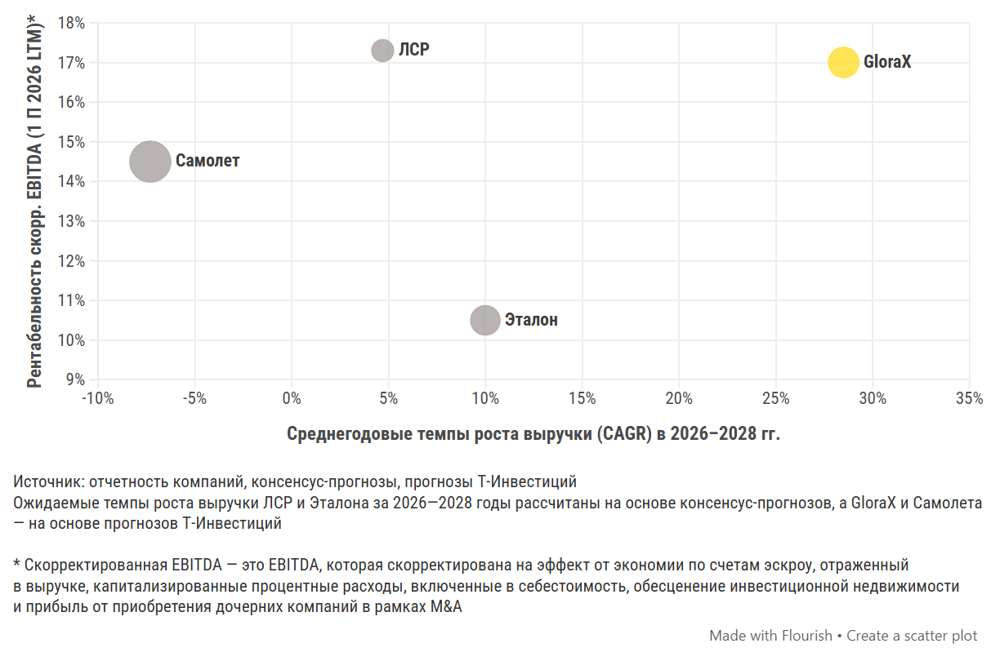

*График 30647713 — «Оценка компаний публичных застройщиков в зависимости от рентабельности и темпов роста». Интерактив: https://flo.uri.sh/visualisation/30647713/embed. Данные: [CSV](../charts/30647713.csv), [JSON](../charts/30647713.json)*

Подписи и настройки графика: layout.footer_note_secondary: Ожидаемые темпы роста выручки ЛСР и Эталона за 2026—2028 годы рассчитаны на основе консенсус-прогнозов, а GloraX и Самолета — на основе прогнозов Т-Инвестиций * Скорректированная EBITDA — это EBITDA, которая скорректирована на эффект от экономии по счетам эскроу, отраженный в выручке, капитализированные процентные расходы, включенные в себестоимость, обесценение инвестиционной недвижимости и прибыль от приобретения дочерних компаний в рамках M&A; layout.source_name: отчетность компаний, консенсус-прогнозы, прогнозы Т-Инвестиций

| color | Эмитент | Среднегодовые темпы роста выручки (CAGR) в 2026–2028 гг. | Рентабельность скорр. EBITDA (1 П 2026 LTM)* | EV/EBITDA 2026 | Эмитент | EV/EBITDA 2026 | Среднегодовые темпы роста выручки (CAGR) в 2026–2028 гг. | Рентабельность скорр. EBITDA (1 П 2026 LTM)* |
|---|---|---|---|---|---|---|---|---|
| 1 | Самолет | -7.3 | 14.5 | 10.9 | Самолет | 10.9 | -7.3 | 14.5 |
| 1 | ЛСР | 4.7 | 17.3 | 3.2 | ЛСР | 3.2 | 4.7 | 17.3 |
| 1 | Эталон | 10 | 10.5 | 5.7 | Эталон | 5.7 | 10 | 10.5 |
| 2 | GloraX | 28.5 | 17 | 6.1 | GloraX | 6.1 | 28.5 | 17 |

Финансы: сектор бьет рекорды по прибыли, но риски давят на котировки

Несмотря на высокие ставки, финансовый сектор готовится поставить рекорд по чистой прибыли в 2026 году. Кредитные портфели банков продолжают расти высокими для текущих макроусловий темпами. В совокупности с растущей процентной маржой это позволяет лидерам сектора существенно увеличивать выручку и чистую прибыль.

Мнение аналитика Т-Инвестиций

«Однако если во втором квартале сильные результаты банков способствовали опережающей динамике акций сектора, то в третьем рост цен на нефть вывел в лидеры рынка эмитентов других секторов. Кроме того, на финансовые компании давят потенциальные риски».

Егор Дахтлер, главный аналитик Т-Инвестиций

**Полная доходность компаний сектора за десять месяцев**

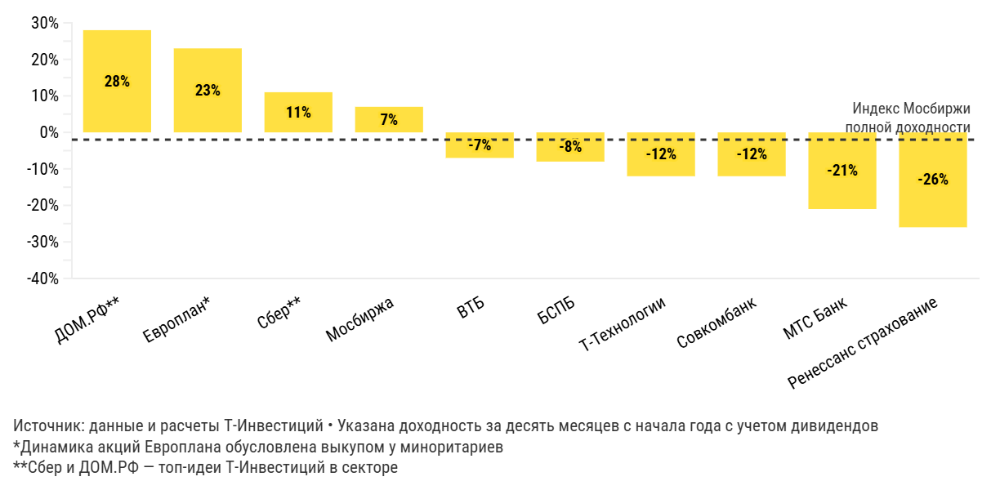

*График 30645144 — «Полная доходность компаний сектора за десять месяцев с начала года ». Интерактив: https://flo.uri.sh/visualisation/30645144/embed. Данные: [CSV](../charts/30645144.csv), [JSON](../charts/30645144.json)*

Подписи и настройки графика: axes_highlights.x_areas: рецессия доткомов:: 28.02.2001 >> 30.11.2001; axes_highlights.x_lines: :: Прогноз; axes_highlights.y_lines: Индекс Мосбиржи полной доходности :: -2; layout.footer_note: Указана доходность за десять месяцев с начала года с учетом дивидендов; layout.footer_note_secondary: *Динамика акций Европлана обусловлена выкупом у миноритариев **Сбер и ДОМ.РФ — топ-идеи Т-Инвестиций в секторе; layout.source_name: данные и расчеты Т-Инвестиций; chart_type: column_grouped

| label | Полная доходность за 10 месяцев |
|---|---|
| ДОМ.РФ** | 28% |
| Европлан* | 23% |
| Сбер** | 11% |
| Мосбиржа | 7% |
| ВТБ | -7% |
| БСПБ | -8% |
| Т-Технологии | -12% |
| Совкомбанк | -12% |
| МТС Банк | -21% |
| Ренессанс страхование | -26% |

### Ключевые риски для финансового сектора

Высокие ставки создают умеренные риски для финансовых показателей российских банков, так как могут замедлять рост кредитных портфелей или давить на качество активов. Тем не менее мы считаем банки достаточно устойчивыми к вызовам на фоне жесткого регулирования со стороны ЦБ.

В последние годы регулятор подготавливал банки к жестким экономическим сценариям:

- ужесточал требования к капиталу;
- ограничивал вложения в небанковские активы;
- корректировал нормативы ликвидности.

Высокая прибыль сектора стала предметом обсуждения дополнительных налогов на банки. Мы считаем этот сценарий маловероятным: представители Банка России и Минфина неоднократно заявляли, что такая мера нецелесообразна, учитывая, что два крупнейших госбанка в этом году и так выплатили в бюджет более 500 млрд рублей дивидендов.

### Как растет чистая прибыль банков

Чистая прибыль банковского сектора выросла почти на треть год к году и достигла 3,7 трлн рублей по итогам девяти месяцев 2026-го. ЦБ, в свою очередь, увеличил прогнозный диапазон по чистой прибыли сектора на текущий год до рекордных 3,9—4,4 трлн рублей.

**Рентабельность капитала**

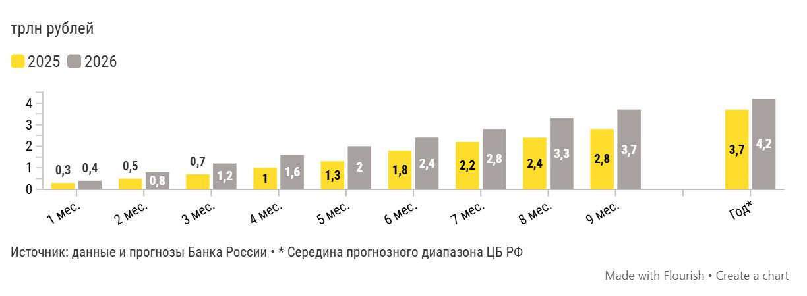

*График 30645152 — «Чистая прибыль банковского сектора». Интерактив: https://flo.uri.sh/visualisation/30645152/embed. Данные: [CSV](../charts/30645152.csv), [JSON](../charts/30645152.json)*

Подписи и настройки графика: axes_highlights.x_areas: ::2026*>>2028*; axes_highlights.y_lines: Индекс Мосбиржи = −15% :: -15; layout.footer_note: * Середина прогнозного диапазона ЦБ РФ; layout.source_name: данные и прогнозы Банка России; chart_type: column_grouped

| Чистая прибыль сектора | 2025 | 2026 |
|---|---|---|
| 1 мес. | 0.3 | 0.4 |
| 2 мес. | 0.5 | 0.8 |
| 3 мес. | 0.7 | 1.2 |
| 4 мес. | 1 | 1.6 |
| 5 мес. | 1.3 | 2 |
| 6 мес. | 1.8 | 2.4 |
| 7 мес. | 2.2 | 2.8 |
| 8 мес. | 2.4 | 3.3 |
| 9 мес. | 2.8 | 3.7 |
|  |  |  |
| Год* | 3.7 | 4.2 |

Прибыль банков стремится к рекордным значениям на фоне нескольких факторов.

Ускоряется рост кредитных портфелей. Корпоративные кредиты увеличились на 14% год к году в сентябре. Это близкий к максимальному темп роста за последние полтора года (максимум был в августе +15%). В то же время кредиты индивидуальным клиентам выросли на 6%.

Чистая процентная маржа держится на высоком уровне. Во втором квартале она составила 5,5% в целом по сектору. Этому способствовало снижению стоимости привлечения депозитов.

Стоимость риска пока остается относительно невысокой. Она продолжила снижаться и составила 2,2% по итогам второго квартала в сегменте индивидуальных кредитов. В корпоративном сегменте выросла до 1,3%.

Таким образом, высокие процентные ставки пока ограниченно сказываются на результатах сектора. Однако во втором полугодии их влияние на рост портфелей и стоимость риска банков может усилиться

**Текущее состояние публичных банков**

В отчетностях за второй квартал продолжились тенденции первого.

**Рентабельность капитала**

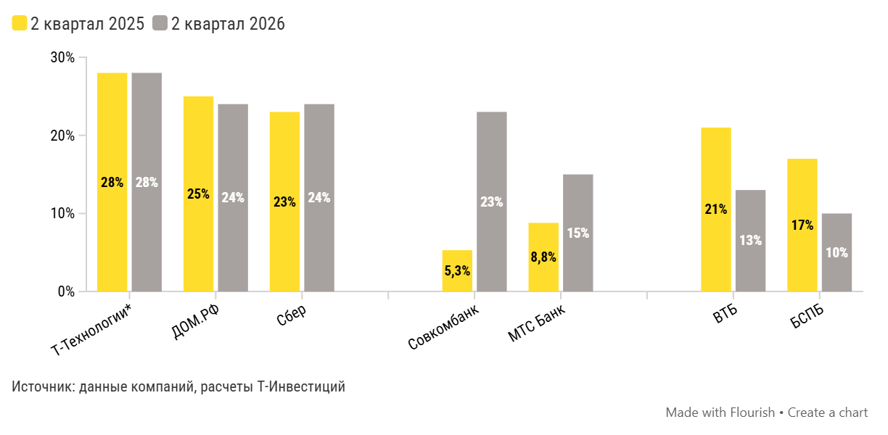

*График 30645477 — «Рентабельность капитала». Интерактив: https://flo.uri.sh/visualisation/30645477/embed. Данные: [CSV](../charts/30645477.csv), [JSON](../charts/30645477.json)*

Подписи и настройки графика: axes_highlights.x_areas: ::2026*>>2028*; axes_highlights.y_lines: Индекс Мосбиржи = −15% :: -15; layout.source_name: данные компаний, расчеты Т-Инвестиций; chart_type: column_grouped

| Банк | 2 квартал 2025 | 2 квартал 2026 |
|---|---|---|
| Т-Технологии* | 28 | 28 |
| ДОМ.РФ | 25 | 24 |
| Сбер | 23 | 24 |
|  |  |  |
| Совкомбанк | 5.3 | 23 |
| МТС Банк | 8.8 | 15 |
| ㅤ |  |  |
| ВТБ | 21 | 13 |
| БСПБ | 17 | 10 |

Т-Технологии, Сбер и ДОМ.РФ

Сохраняют лидерство в секторе по ROE

Совкомбанк и МТС Банк

Продолжили восстанавливать рентабельность

БСПБ и ВТБ

Столкнулись с заметным снижением прибыли год к году

Средний прирост чистой прибыли семи компаний сектора в первом полугодии 2026-го составил 13%. Однако без учета падающих прибылей ВТБ (−20%) и Банка Санкт-Петербург (−33%) рост достигал 23%.

В лидерах остаются Т-Технологии (+33%) и ДОМ.РФ (+41%).

В данном случае мы не учитываем Совкомбанк и МТС Банк, которые кратно нарастили прибыль с низкой базы первого полугодия 2025-года

### Что ждет банки во втором полугодии 2026-го

В нашем базовом сценарии прибыль выше упомянутых публичных банков вырастет не менее чем на 13% во втором полугодии. В результате для семи перечисленных выше банков она может приблизиться к 1,5 трлн. Это обеспечит сохранение высокой рентабельности капитала.

Риски, о которых мы писали выше, могут иметь более существенное негативное влияние на результаты в следующем году. Однако некоторые негативные тенденции могут проявиться уже во втором полугодии 2026-го.

Чистая процентная маржа банков может снизиться во втором полугодии, так как стоимость депозитов, вероятно, перестанет существенно снижаться в дальнейшем.

Стоимость риска может вырасти, прежде всего в корпоративном сегменте. Этому будет способствовать рост доли реструктурированных кредитов — по данным Эксперт РА, сейчас она превышает 31%.

Темпы роста кредитных портфелей могут замедлиться как в корпоративном, так и в розничном сегменте. У банков, которые не входят в топ-10, темпы роста кредитных портфелей гораздо ниже, чем у крупнейших игроков.

Мнение аналитика Т-Инвестиций

«Таким образом, сильные результаты сектора пока побеждают риски, но котировкам это не помогает. Мы считаем, что в текущем году у сектора высокие шансы получить рекордную прибыль. При этом влияние рисков может стать более существенным в 2027 году».

Егор Дахтлер, главный аналитик Т-Инвестиций

Сейчас оценки банков по мультипликаторам остаются низкими. Все эмитенты сектора, кроме Мосбиржи и Европлана, торгуются ниже капитала. P/E по-прежнему ниже рынка (в среднем 2.9х против 3,3х у индекса Мосбиржи), хотя показатели остаются сильными. Поэтому мы считаем, что потенциал роста котировок банков, продолжающих наращивать прибыль, сохраняется высоким.

**Оценка российских банков по мультипликаторам**

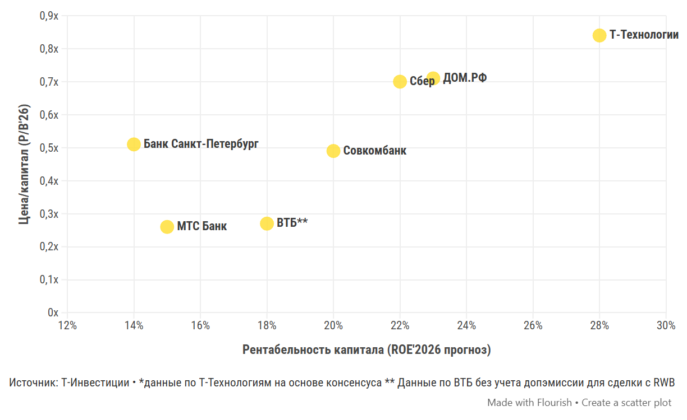

*График 30645182 — «Оценка российских банков по мультипликаторам». Интерактив: https://flo.uri.sh/visualisation/30645182/embed. Данные: [CSV](../charts/30645182.csv), [JSON](../charts/30645182.json)*

Подписи и настройки графика: layout.footer_note: *данные по Т-Технологиям на основе консенсуса ** Данные по ВТБ без учета допэмиссии для cделки с RWB; layout.source_name: Т-Инвестиции

| metadata_0 | Рентабельность капитала (ROE'2026 прогноз) | Цена/капитал (P/B'26) | name_0 | Рентабельность капитала (ROE'2026 прогноз) | Цена/капитал (P/B'26) |
|---|---|---|---|---|---|
| Т-Технологии* | 28 | 0.84 | Т-Технологии* | 28 | 0.84 |
| Сбер | 22 | 0.7 | Сбер | 22 | 0.7 |
| Совкомбанк | 20 | 0.49 | Совкомбанк | 20 | 0.49 |
| МТС Банк | 15 | 0.26 | МТС Банк | 15 | 0.26 |
| Банк Санкт-Петербург | 14 | 0.51 | Банк Санкт-Петербург | 14 | 0.51 |
| ДОМ.РФ | 23 | 0.71 | ДОМ.РФ | 23 | 0.71 |
| ВТБ** | 18 | 0.27 | ВТБ** | 18 | 0.27 |

### Наши фавориты

#### Сбер

Целевая цена — 388 ₽ за акцию, потенциал роста — 31%

Сбер по итогам девяти месяцев 2026 года увеличил чистую прибыль по МСФО на 14%, до 1,5 трлн рублей. Рентабельность капитала превысила 23%. Прибыль крупнейшего банка продолжает стабильно расти на фоне:

- значительного увеличения кредитного портфеля — на 14% год к году по итогам сентября;
- высокой чистой процентной маржи (NIM), которая поддерживает рост чистого процентного дохода: по итогам третьего квартала она составила 6,7%;
- стабильной стоимости риска, несмотря на ухудшение качества активов.

#### ДОМ.РФ

Целевая цена — 2 950 ₽ за акцию, потенциал роста — 38%

Динамика показателей одного из крупнейших финансовых институтов России обгоняет ожидания инвесторов, благодаря:

- Диверсифицированной структуре бизнеса с развитыми небанковскими направлениями, которая обеспечивает стабильный растущий комиссионный доход, не подверженный влиянию кредитных рисков.
- Одному из лучших уровней операционной эффективности в секторе. Соотношение расходов и доходов у ДОМ.РФ самое низкое среди публичных банков: 24% по итогам 9 месяцев 2026-го.
- Высоким темпам роста чистой прибыли +26% по итогам 9 месяцев.
- Высокой достаточности капитала, которая позволяет распределять 50% чистой прибыли в виде дивидендов.

### Выбор консенсуса

#### Т-Технологии

Целевая цена — 430 ₽ за акцию, потенциал роста — 56%

- Т-Технологии сохраняют устойчивый рост и высокую рентабельность даже при жесткой денежно-кредитной политике. Компания продолжает активно наращивать клиентскую базу и стремится поддерживать рентабельность капитала (ROE) на уровне около 30%. При этом такие показатели пока слабо отражены в рыночной оценке: мультипликаторы остаются ниже среднеисторических уровней.
- Экосистема высокотехнологичных решений Т остается ключевым драйвером роста. Число активных пользователей превысило 34 млн, а среднее количество продуктов на одного клиента продолжает увеличиваться, что указывает на рост вовлеченности и качества клиентской базы. Более 10 млн клиентов используют от трех продуктов экосистемы компании.
- Широкая продуктовая линейка и глубокое проникновение в лайфстайл-сегменты обеспечили существенный рост и диверсификацию бизнеса. Чистая выручка за последние 12 месяцев (на конец второго квартала 2026-го) увеличилась на 30% и достигла 630 млрд рублей.
- Экосистемная модель Т-Технологий обеспечивает рост прибыли даже при высоких ставках. Консенсус-прогноз предполагает существенный рост чистой прибыли и сохранение высокого ROE в текущем году. При этом акции компании торгуются с мультипликатором P/E ниже 3x — заметно ниже среднего уровня за последние три года (выше 5x) и ниже ближайших конкурентов с меньшим уровнем ROE.

Все цены, доходности и мультипликаторы указаны на закрытие торгов 29.10.2026

## Стратегию подготовили

- Софья Донец Главный экономист
- Юрий Тулинов Глава аналитики по рынку облигаций
- Марьяна Лазаричева Глава аналитики по рынку акций
- Егор Дахтлер Главный аналитик
- Александр Самуйлов Главный аналитик
- Ахмед Алиев Ведущий аналитик
- Александр Потехин Ведущий аналитик
- Александр Мартынов Инвестиционный аналитик
- Сергей Колбанов Старший аналитик
- Никита Степанов Старший аналитик
- Маргарита Боярко Старший аналитик
- Евгений Кошелев Аналитик по срочному рынку
- Евгений Митюков Директор по инвестициям, УК Т-Капитал
- Максим Стаханов Аналитик Т-Инвестиций
- Марта Харченко Аналитик Т-Инвестиций
- Анастасия Тушнолобова Руководитель аналитической редакции
- Анастасия Корочкина Аналитический редактор
- Илья Марченко Аналитический редактор

Аналитический отчет составлен в соответствии с Методикой оценки ценных бумаг Т-Банка. Обзор также содержит информацию о ценных бумагах, которые предназначены только для квалифицированных инвесторов в соответствии со ст. 51.2 Федерального закона №39-ФЗ «О рынке ценных бумаг».

АО «ТБанк», лицензия на осуществление брокерской деятельности № 045-14050-100000, лицензия на осуществление депозитарной деятельности № 045-14051-000100, выданы Банком России 06.03.2018 г. (без ограничения срока действия).

АО «ТБанк» не гарантирует получение доходности на рынке ценных бумаг. Клиент самостоятельно принимает решения по инвестированию и несет ответственность за полученный результат. Предлагаемые ценные бумаги иностранных эмитентов допущены к обращению на российском рынке.
