> Копия публичной страницы Т-Инвестиций для внутреннего анализа. Источник: https://www.tbank.ru/invest/research/strategy/2026/alternative/ · снято 2026-11-09
> Разделы: [Главная](main.md) · [Краткая версия](short.md) · [Рынок облигаций](bonds.md) · [Рынок акций](stocks.md) · **Альтернативные инвестиции**

## Альтернативные инвестиции

Помогут защитить портфель

## Золото: в фокусе инвесторов и центробанков

Начало 2026 года оказалось исключительно насыщенным для рынка золота. В январе произошел сильнейший за многие годы месячный рост котировок, после чего последовала резкая коррекция, глубина которой к текущему моменту составляет порядка 26% от пиковых уровней.

При этом более широкий тренд остается впечатляющим: за предыдущие три года (с 2023 по 2025 год) долларовая доходность драгметалла составила 136%, что соответствует среднегодовым темпам роста около 33%. За этот период золото стало одним из наиболее доходных активов на глобальных рынках.

Динамика золота с 2023 года

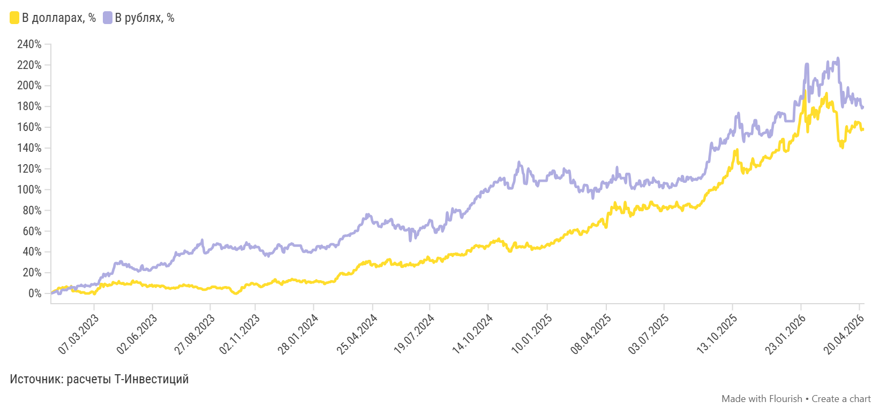

*График 28743347 — «Динамика золота с 2023 года». Интерактив: https://flo.uri.sh/visualisation/28743347/embed. Данные: [CSV](../charts/28743347.csv), [JSON](../charts/28743347.json)*

Подписи и настройки графика: layout.source_name: расчеты Т-Инвестиций

| Дата | В долларах, % | В рублях, % |
|---|---|---|
| 2026-04-27 | 156.7 | 179.4 |
| 2026-04-26 | 158.3 | 179.4 |
| 2026-04-25 | 158.3 | 179.4 |
| 2026-04-24 | 158.3 | 178.2 |
| 2026-04-23 | 157.1 | 180.8 |
| 2026-04-22 | 159.9 | 181.4 |
| 2026-04-21 | 164 | 187.2 |
| 2026-04-20 | 164 | 185.8 |
| 2026-04-19 | 164.9 | 185.8 |
| 2026-04-18 | 164.9 | 185.8 |
| 2026-04-17 | 164.9 | 187.7 |
| 2026-04-16 | 162.6 | 182.8 |
| 2026-04-15 | 162.6 | 180.8 |
| 2026-04-14 | 165.4 | 185.3 |
| 2026-04-13 | 159.9 | 187.4 |
| 2026-04-12 | 160.4 | 187.4 |
| 2026-04-11 | 160.4 | 187.4 |
| 2026-04-10 | 160.5 | 192.4 |
| 2026-04-09 | 161.5 | 183.1 |
| 2026-04-08 | 158 | 186.3 |
| 2026-04-07 | 158 | 186.3 |
| 2026-04-06 | 155 | 189.9 |
| 2026-04-05 | 156.4 | 189.9 |
| 2026-04-04 | 156.4 | 189.9 |
| 2026-04-03 | 156.4 | 198.4 |
| 2026-04-02 | 156.4 | 191.2 |
| 2026-04-01 | 160.9 | 188.5 |
| 2026-03-31 | 155.9 | 187 |
| 2026-03-30 | 147 | 183.5 |
| 2026-03-29 | 146.4 | 183.5 |
| … | … | … |
| 2023-01-25 | 6.7 | 3.2 |
| 2023-01-24 | 6.3 | 3.6 |
| 2023-01-23 | 5.9 | 3.3 |
| 2023-01-21 | 5.6 | 3.3 |
| 2023-01-20 | 5.7 | 3.7 |
| 2023-01-19 | 6 | 3.3 |
| 2023-01-18 | 4.4 | 3.2 |
| 2023-01-17 | 4.7 | 2.1 |
| 2023-01-16 | 5 | -0.3 |
| 2023-01-14 | 5.3 | -0.3 |
| 2023-01-13 | 5.3 | -0.5 |
| 2023-01-12 | 4.1 | 1.6 |
| 2023-01-11 | 2.9 | 2.5 |
| 2023-01-10 | 3 | 2.1 |
| 2023-01-02 | 0 | 0 |

*Показано 45 из 1152 строк, полный ряд: [CSV](../charts/28743347.csv), [JSON](../charts/28743347.json)*

Что поддерживает рост золота

Исторически золото демонстрирует наилучшую доходность в периоды ослабления доллара и снижения процентных ставок в США. В таких условиях сокращаются альтернативные издержки владения драгметаллом, и инвестиции в золото становятся более привлекательными с точки зрения упущенной доходности.

Одновременно спрос на золото, как правило, усиливается в периоды повышенной неопределенности и рыночного стресса — благодаря исторически закрепленному за драгметаллом статусу актива-убежища и инструмента сохранения стоимости.

#### Защитные свойства золота

Объясняются его низкой корреляцией с ключевыми классами активов: в стрессовые фазы оно способствует снижению волатильности портфеля и частично компенсирует просадки других инструментов

#### Золото способно сохранять покупательную способность

В долгосрочной перспективе при полном отсутствии кредитного риска

Центральные банки меняют правила игры

Защитные свойства золота в последние годы вышли на первый план. Рост геополитической напряженности и усиление опасений вокруг долларовых рисков, в том числе на фоне заморозки российских международных резервов, побудили многие страны активно наращивать золотые резервы.

На этом фоне многолетняя устойчивая обратная корреляция между ценами на золото и реальными доходностями десятилетних казначейских облигаций США в первой половине 2022 года заметно ослабла. С того момента ключевым фактором, определяющим динамику цен на золото, стал резко возросший спрос со стороны мировых центральных банков.

Золото vs реальная доходность 10y UST

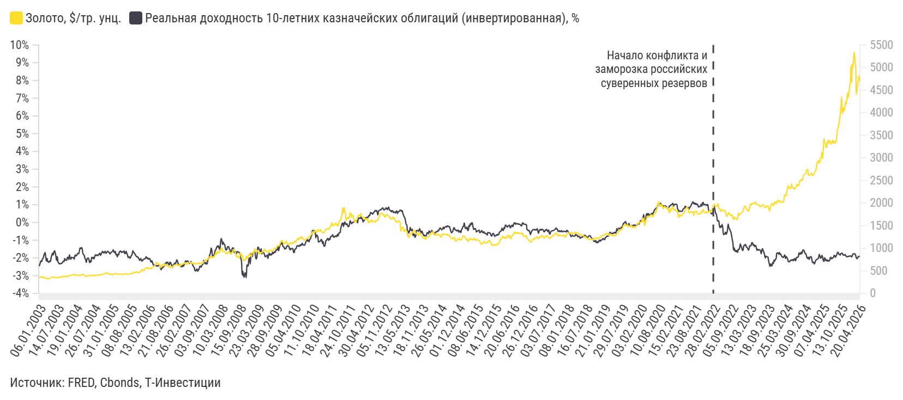

*График 28683812 — «Золото vs реальная доходность 10y UST». Интерактив: https://flo.uri.sh/visualisation/28683812/embed. Данные: [CSV](../charts/28683812.csv), [JSON](../charts/28683812.json)*

Подписи и настройки графика: axes_highlights.x_lines: Начало конфликта и заморозка российских суверенных резервов :: 28.02.2022; axes_highlights.y_lines: ::0; layout.source_name: FRED, Cbonds, Т-Инвестиции; chart_type: line_line

| Дата | Золото, $/тр. унц. | Реальная доходность 10-летних казначейских облигаций (инвертированная), % |
|---|---|---|
| 27.04.2026 | 4682,0 | -1,91% |
| 20.04.2026 | 4814,4 | -1,91% |
| 13.04.2026 | 4740,3 | -1,92% |
| 06.04.2026 | 4650,8 | -1,98% |
| 30.03.2026 | 4505,08 | -2,04% |
| 23.03.2026 | 4407,875 | -2,01% |
| 16.03.2026 | 5007,66 | -1,87% |
| 09.03.2026 | 5136,21 | -1,78% |
| 02.03.2026 | 5341,735 | -1,76% |
| 23.02.2026 | 5237,14 | -1,77% |
| 16.02.2026 | 4992,04 | -1,77% |
| 09.02.2026 | 5081,485 | -1,87% |
| 02.02.2026 | 4656,01 | -1,94% |
| 26.01.2026 | 5055,23 | -1,90% |
| 19.01.2026 | 4670,295 | -1,88% |
| 12.01.2026 | 4598,96 | -1,90% |
| 05.01.2026 | 4445,145 | -1,91% |
| 29.12.2025 | 4330,925 | -1,90% |
| 22.12.2025 | 4436,63 | -1,94% |
| 15.12.2025 | 4305,86 | -1,93% |
| 08.12.2025 | 4191,25 | -1,91% |
| 01.12.2025 | 4237,635 | -1,85% |
| 24.11.2025 | 4130,435 | -1,81% |
| 17.11.2025 | 4040,87 | -1,85% |
| 10.11.2025 | 4111,705 | -1,84% |
| 03.11.2025 | 4010,08 | -1,82% |
| 27.10.2025 | 3981,985 | -1,73% |
| 20.10.2025 | 4355,8 | -1,74% |
| 13.10.2025 | 4111,485 | -1,75% |
| 06.10.2025 | 3960,69 | -1,84% |
| … | … | … |
| 14.04.2003 | 325,1435 | -2,22% |
| 07.04.2003 | 321,862 | -2,21% |
| 31.03.2003 | 335,505 | -2,03% |
| 24.03.2003 | 329,4695 | -2,18% |
| 17.03.2003 | 336,0755 | -1,97% |
| 10.03.2003 | 354,2755 | -1,69% |
| 03.03.2003 | 347,0102 | -1,77% |
| 24.02.2003 | 356,7827 | -1,87% |
| 17.02.2003 | 345,4174 | -2,03% |
| 10.02.2003 | 368,4294 | -2,06% |
| 03.02.2003 | 370,1903 | -2,20% |
| 27.01.2003 | 372,2145 | -2,16% |
| 20.01.2003 | 355,5 | -2,25% |
| 13.01.2003 | 352,6517 | -2,38% |
| 06.01.2003 | 351 | -2,46% |

*Показано 45 из 1217 строк, полный ряд: [CSV](../charts/28683812.csv), [JSON](../charts/28683812.json)*

Этот спрос носит структурный, долгосрочный характер и в меньшей степени зависит от уровня процентных ставок, краткосрочных рыночных шоков и текущей динамики цен на драгметалл.

В период с 2022 по 2024 год мировые центробанки нарастили объемы чистых покупок до уровней выше 1 000 тонн в год, более чем в два раза превысив средние значения за десятилетний период (2012—2021). Хотя по данным за 2025 год мы увидели снижение покупок золота до 863 тонн, такие объемы все равно остаются значительно выше среднеисторических уровней.

Динамика чистых покупок золота центральными банками, тонн

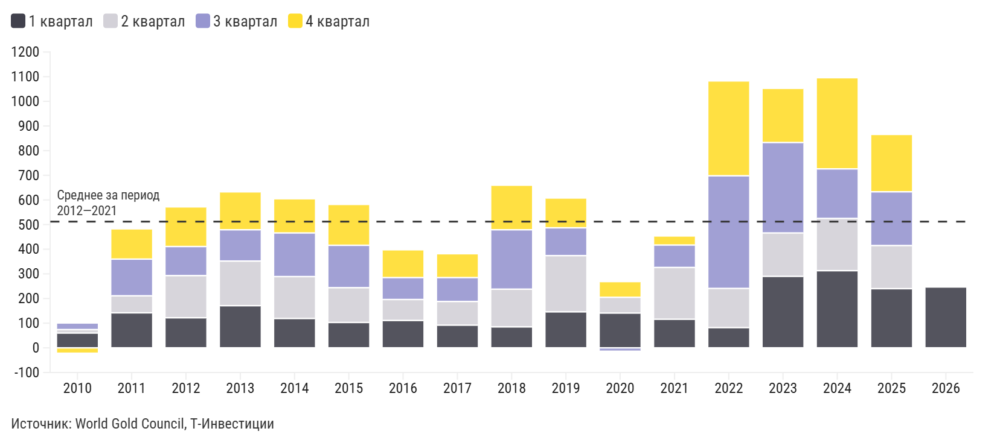

*График 28682551 — «Динамика чистых покупок золота центральными банками, тонн». Интерактив: https://flo.uri.sh/visualisation/28682551/embed. Данные: [CSV](../charts/28682551.csv), [JSON](../charts/28682551.json)*

Подписи и настройки графика: axes_highlights.y_lines: Среднее за период 2012—2021 :: 512; layout.source_name: World Gold Council, Т-Инвестиции; chart_type: column_stacked

| label | 1 квартал | 2 квартал | 3 квартал | 4 квартал |
|---|---|---|---|---|
| 2010 | 60 | 14 | 24 | -19 |
| 2011 | 142 | 69 | 149 | 120 |
| 2012 | 122 | 171 | 118 | 158 |
| 2013 | 171 | 181 | 127 | 151 |
| 2014 | 119 | 170 | 177 | 136 |
| 2015 | 103 | 141 | 172 | 163 |
| 2016 | 111 | 85 | 89 | 110 |
| 2017 | 92 | 96 | 97 | 94 |
| 2018 | 85 | 153 | 241 | 178 |
| 2019 | 146 | 228 | 113 | 118 |
| 2020 | 141 | 64 | -11 | 61 |
| 2021 | 116 | 210 | 91 | 34 |
| 2022 | 82 | 159 | 457 | 382 |
| 2023 | 290 | 176 | 367 | 217 |
| 2024 | 313 | 212 | 201 | 367 |
| 2025 | 240 | 175 | 218 | 230 |
| 2026 | 244 |  |  |  |

Даже с перспективой дальнейшего умеренного снижения объемов в рамках 2026 года покупки со стороны центральных банков с высокой вероятностью останутся фактором поддержки котировок золота, хотя и не таким мощным, как в предыдущие годы.

Инвестиционный спрос становится главным драйвером

Ожидания снижения долларовых процентных ставок и сохраняющаяся в то же время высокая неопределенность способствовали оживлению инвестиционного спроса.

Динамика цен на золото в периоды снижения ставок в США (с 2000 года)

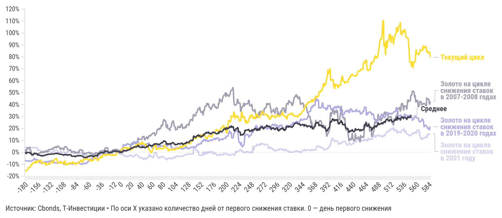

*График 28683981 — «Динамика цен на золото в периоды снижения ставок в США (с 2000 года)». Интерактив: https://flo.uri.sh/visualisation/28683981/embed. Данные: [CSV](../charts/28683981.csv), [JSON](../charts/28683981.json)*

Подписи и настройки графика: axes_highlights.x_areas: рецессия доткомов:: 28.02.2001 >> 30.11.2001; axes_highlights.x_lines: :: Прогноз; axes_highlights.y_lines: ::0; layout.footer_note: По оси Х указано количество дней от первого снижения ставки. 0 — день первого снижения; layout.source_name: Cbonds, Т-Инвестиции; chart_type: line

| label | Золото на цикле снижения ставок в 2001 году | Золото на цикле снижения ставок в 2007-2008 годах | Золото на цикле снижения ставок в 2019-2020 годах | Текущий цикл | Среднее |
|---|---|---|---|---|---|
| -180 | 3,65% | 1,69% | -6,84% | -15,39% | -0,50% |
| -179 | 4,06% | 1,94% | -6,87% | -15,39% | -0,29% |
| -178 | 3,93% | -0,07% | -7,09% | -15,39% | -1,07% |
| -177 | 4,13% | 1,33% | -7,19% | -15,14% | -0,58% |
| -176 | 3,58% | 3,09% | -7,27% | -14,87% | -0,20% |
| -175 | 3,02% | 4,07% | -7,40% | -14,24% | -0,10% |
| -174 | 2,92% | 3,67% | -7,14% | -12,74% | -0,18% |
| -173 | 2,93% | 3,62% | -7,14% | -12,75% | -0,20% |
| -172 | 2,77% | 3,97% | -7,15% | -12,75% | -0,13% |
| -171 | 2,77% | 4,24% | -7,49% | -12,75% | -0,16% |
| -170 | 3,51% | 1,30% | -7,45% | -12,02% | -0,88% |
| -169 | 3,93% | 1,75% | -7,21% | -10,89% | -0,51% |
| -168 | 3,93% | -1,59% | -7,33% | -10,14% | -1,66% |
| -167 | 3,93% | -2,42% | -7,01% | -10,48% | -1,84% |
| -166 | 3,93% | -2,36% | -6,62% | -8,97% | -1,68% |
| -165 | 3,93% | -2,84% | -6,62% | -8,95% | -1,84% |
| -164 | 3,93% | -1,85% | -6,30% | -8,95% | -1,41% |
| -163 | 3,93% | -1,38% | -5,48% | -8,61% | -0,98% |
| -162 | 3,93% | -0,85% | -4,96% | -8,09% | -0,63% |
| -161 | 3,93% | -1,08% | -5,95% | -8,82% | -1,04% |
| -160 | 3,93% | -1,47% | -5,95% | -7,30% | -1,17% |
| -159 | 3,93% | -1,32% | -6,14% | -8,40% | -1,18% |
| -158 | 3,93% | -0,82% | -6,17% | -8,40% | -1,02% |
| -157 | 3,93% | -1,32% | -6,16% | -8,40% | -1,19% |
| -156 | 2,07% | -2,46% | -6,27% | -6,88% | -2,22% |
| -155 | 1,58% | -1,46% | -6,65% | -6,89% | -2,18% |
| -154 | 1,89% | -0,99% | -7,06% | -7,73% | -2,05% |
| -153 | 1,89% | -0,59% | -8,01% | -7,05% | -2,23% |
| -152 | 1,89% | -0,59% | -8,63% | -6,53% | -2,44% |
| -151 | 1,12% | -0,65% | -8,76% | -6,53% | -2,76% |
| … | … | … | … | … | … |
| 573 | 11,99% | 40,81% | 27,29% | 89,16% |  |
| 574 | 11,80% | 41,06% | 25,80% | 87,17% |  |
| 575 | 11,72% | 40,89% | 21,41% | 87,14% |  |
| 576 | 12,35% | 40,89% | 22,57% | 88,79% |  |
| 577 | 12,72% | 40,16% | 22,58% | 88,79% |  |
| 578 | 12,72% | 39,25% | 22,40% | 88,79% |  |
| 579 | 13,37% | 35,17% | 22,48% | 88,11% |  |
| 580 | 12,24% | 45,62% | 21,50% | 84,32% |  |
| 581 | 14,91% | 45,04% | 21,19% | 85,23% |  |
| 582 | 14,19% | 44,48% | 19,92% | 83,21% |  |
| 583 | 15,38% | 44,48% | 20,19% | 84,03% |  |
| 584 | 15,37% | 44,58% | 20,20% | 84,03% |  |
| 585 | 15,36% | 40,31% | 18,72% | 84,03% |  |
| 586 | 15,41% | 41,08% | 21,25% | 82,94% |  |
| 587 | 15,51% | 42,71% | 21,46% | 79,63% |  |

*Показано 45 из 768 строк, полный ряд: [CSV](../charts/28683981.csv), [JSON](../charts/28683981.json)*

#### Александр Потехин, ведущий аналитик Т-Инвестиций

Инвестиционный спрос активно рос на протяжении последних полутора лет и в 2025 году обеспечивал около 44% совокупного мирового спроса на золото — против примерно 30% в среднем за предыдущее десятилетие.

Прирост был преимущественно обеспечен покупками высоколиквидных «золотых» ETF, доля которых в общем спросе на золото в 2025 году выросла с околонулевых значений до 16% — очень высокий уровень по историческим меркам. Несколько раз на протяжении прошлого года наблюдалась и ажиотажная активность на рынке деривативов. В целом нельзя не отметить, что спекулятивный интерес к активу сейчас крайне велик и является одним из ключевых драйверов для котировок.

Динамика инвестиционного спроса, тонн

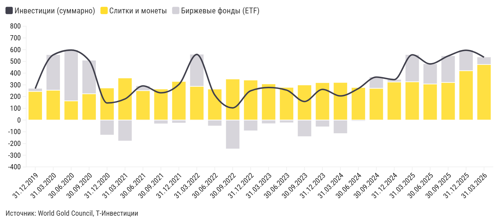

*График 28683446 — «Динамика инвестиционного спроса, тонн». Интерактив: https://flo.uri.sh/visualisation/28683446/embed. Данные: [CSV](../charts/28683446.csv), [JSON](../charts/28683446.json)*

Подписи и настройки графика: layout.source_name: World Gold Council, Т-Инвестиции; chart_type: column_stacked_line

| label | Инвестиции (суммарно) | Слитки и монеты | Биржевые фонды (ETF) |
|---|---|---|---|
| 31.12.2019 | 268,4 | 243,8 | 24,6 |
| 31.03.2020 | 555,4 | 254,5 | 300,9 |
| 30.06.2020 | 596,6 | 163,5 | 433,1 |
| 30.09.2020 | 507,8 | 223,9 | 283,9 |
| 31.12.2020 | 145,5 | 270,8 | -125,4 |
| 31.03.2021 | 179,9 | 356,1 | -176,1 |
| 30.06.2021 | 291,3 | 250,6 | 40,7 |
| 30.09.2021 | 232,4 | 262,2 | -29,8 |
| 31.12.2021 | 303,2 | 326,6 | -23,4 |
| 31.03.2022 | 559,0 | 287,1 | 271,9 |
| 30.06.2022 | 213,7 | 261,8 | -48,1 |
| 30.09.2022 | 103,8 | 347,5 | -243,7 |
| 31.12.2022 | 249,2 | 338,4 | -89,2 |
| 31.03.2023 | 277,3 | 305,8 | -28,5 |
| 30.06.2023 | 255,3 | 276,2 | -20,8 |
| 30.09.2023 | 157,9 | 296,7 | -138,7 |
| 31.12.2023 | 261,2 | 316,5 | -55,3 |
| 31.03.2024 | 205,6 | 318,1 | -112,5 |
| 30.06.2024 | 268,7 | 275,2 | -6,5 |
| 30.09.2024 | 366,3 | 270,6 | 95,7 |
| 31.12.2024 | 344,8 | 324,4 | 20,4 |
| 31.03.2025 | 556,1 | 326,1 | 229,9 |
| 30.06.2025 | 478,3 | 307,2 | 171,1 |
| 30.09.2025 | 546,0 | 320,4 | 225,6 |
| 31.12.2025 | 595,0 | 420,5 | 174,6 |
| 31.03.2026 | 535,6 | 473,6 | 62,0 |

Активизация спекулятивного спроса не только предоставляет золоту дополнительное «топливо» для роста, но и увеличивает риски волатильности. Такой спрос чаще всего крайне неустойчив и характеризуется высокой положительной эластичностью к ценам (то есть он увеличивается при росте котировок и снижается при их падении).

Так, при значительной доле «быстрых денег» в структуре глобального спроса, котировки золота становятся более чувствительными к переменчивым рыночным настроениям, а закрытие спекулятивных позиций способно запустить каскадную фиксацию прибыли и ускорить снижение цен.

При этом сводить текущую динамику инвестиционного спроса исключительно к активности «быстрых денег» не стоит. Инвесторы постепенно увеличивают и долгосрочную аллокацию в золото. Об этом отчасти можно судить по динамике спроса на менее ликвидные слитки и инвестиционные монеты — объемы покупок в данном сегменте продолжают расти. Темпы этого роста лишь ускорились в первом квартале, несмотря на рекордную волатильность котировок золота и значительные оттоки из ETF в марте.

В настоящее время доля драгметалла в глобальных инвестиционных портфелях остается низкой — около 3% (по оценке J.P. Morgan на декабрь 2025 года). Пространство для ее увеличения остается значительным.

#### Александр Потехин, ведущий аналитик Т-Инвестиций

В условиях учащающихся эпизодов геополитической нестабильности и растущей неопределенности в глобальной экономике мы ожидаем продолжения тренда на диверсификацию международных резервов и инвестиционных портфелей. На этом фоне мы прогнозируем не только сохранение высоких объемов покупок со стороны центральных банков, но и рост долгосрочного спроса со стороны широкого круга инвесторов. Неспокойное начало 2026 года выглядит многообещающим для развития этого тренда.

Ставки: из драйвера роста в фактор давления на цены

Фактор снижения долларовых ставок, который был одним из ключевых драйверов роста инвестиционного спроса со второй половины 2024-го, может потерять актуальность в 2026 году. Разгоревшийся на Ближнем Востоке масштабный конфликт спровоцировал сильнейший рост цен на нефть и газ. В сценарии затяжного кризиса цены на энергоносители могут оставаться высокими длительное время — это грозит мировой экономике подъемом уровня инфляции и процентных ставок. Уже сейчас мы видим, что рынки достаточно остро реагируют на повышение инфляционных рисков: долларовые доходности продемонстрировали существенный рост с момента начала конфликта, а фьючерсы на ставку ФРС уже не закладывают ни одного ее снижения до середины 2027 года.

Изменение ожиданий по ставкам на более консервативные и рост долларовых доходностей — фактор давления на котировки золота и, в частности, на инвестиционный спрос.

Доходности 10-летних казначейских облигаций США и котировки золота

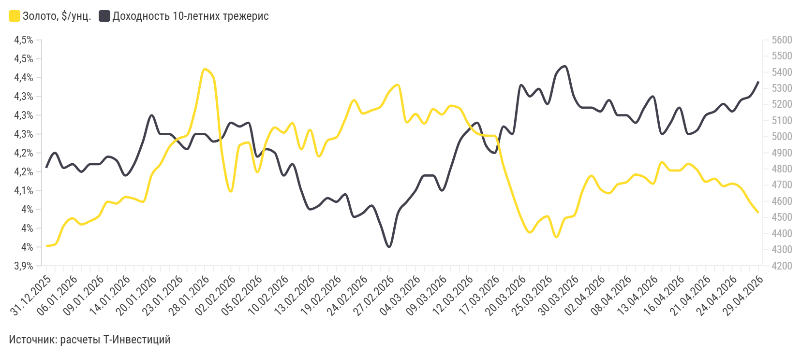

*График 28683561 — «Доходности 10-летних казначейских облигаций США и котировки золота». Интерактив: https://flo.uri.sh/visualisation/28683561/embed. Данные: [CSV](../charts/28683561.csv), [JSON](../charts/28683561.json)*

Подписи и настройки графика: axes_highlights.x_areas: рецессия доткомов:: 28.02.2001 >> 30.11.2001; axes_highlights.x_lines: :: Прогноз; axes_highlights.y_lines: ::0; layout.source_name: расчеты Т-Инвестиций; chart_type: line_line

| label | Золото, $/унц. | Доходность 10-летних трежерис |
|---|---|---|
| 29.04.2026 | 4527,77 | 4,39% |
| 28.04.2026 | 4596,8 | 4,35% |
| 27.04.2026 | 4681,955 | 4,34% |
| 24.04.2026 | 4709,75 | 4,31% |
| 23.04.2026 | 4694,09 | 4,33% |
| 22.04.2026 | 4740,455 | 4,31% |
| 21.04.2026 | 4720,685 | 4,30% |
| 20.04.2026 | 4795,4 | 4,26% |
| 17.04.2026 | 4831,61 | 4,25% |
| 16.04.2026 | 4790,66 | 4,32% |
| 15.04.2026 | 4790,94 | 4,28% |
| 14.04.2026 | 4841,76 | 4,25% |
| 13.04.2026 | 4708,67 | 4,35% |
| 10.04.2026 | 4749,685 | 4,32% |
| 09.04.2026 | 4765,405 | 4,28% |
| 08.04.2026 | 4718,96 | 4,30% |
| 07.04.2026 | 4704,81 | 4,30% |
| 06.04.2026 | 4649,995 | 4,34% |
| 02.04.2026 | 4676,745 | 4,31% |
| 01.04.2026 | 4758,2 | 4,32% |
| 31.03.2026 | 4667,875 | 4,32% |
| 30.03.2026 | 4510,65 | 4,35% |
| 27.03.2026 | 4493,685 | 4,43% |
| 26.03.2026 | 4378,2 | 4,41% |
| 25.03.2026 | 4506,845 | 4,33% |
| 24.03.2026 | 4474,275 | 4,37% |
| 23.03.2026 | 4406,505 | 4,35% |
| 20.03.2026 | 4497,48 | 4,38% |
| 19.03.2026 | 4650,72 | 4,25% |
| 18.03.2026 | 4818,415 | 4,27% |
| … | … | … |
| 22.01.2026 | 4936,075 | 4,25% |
| 21.01.2026 | 4831,38 | 4,25% |
| 20.01.2026 | 4763,37 | 4,30% |
| 16.01.2026 | 4596,32 | 4,23% |
| 15.01.2026 | 4616,04 | 4,17% |
| 14.01.2026 | 4626,575 | 4,14% |
| 13.01.2026 | 4586,005 | 4,18% |
| 12.01.2026 | 4597,65 | 4,19% |
| 09.01.2026 | 4509,66 | 4,17% |
| 08.01.2026 | 4477,565 | 4,17% |
| 07.01.2026 | 4456,65 | 4,15% |
| 06.01.2026 | 4494,635 | 4,17% |
| 05.01.2026 | 4449,17 | 4,16% |
| 02.01.2026 | 4332,065 | 4,20% |
| 31.12.2025 | 4322,61 | 4,16% |

*Показано 45 из 82 строк, полный ряд: [CSV](../charts/28683561.csv), [JSON](../charts/28683561.json)*

Дополнительную неопределенность в отношении долларовых ставок привносит ожидаемая смена действующего председателя ФРС Джерома Пауэлла на кандидата, номинированного президентом США, — Кевина Уорша. Она может произойти уже в ближайшие несколько недель.

От будущего главы ФРС рынок ждет большей солидарности со взглядами Дональда Трампа на денежно-кредитную политику и, соответственно, более мягкой позиции по ставкам. Однако даже в сценарии продолжения снижения учетной ставки ФРС динамика среднесрочных и длинных доходностей останется в значительной зависимости от ожиданий по инфляции. Кроме того, потенциальное снижение ставки на фоне преобладающих инфляционных рисков может обусловить потерю доверия рынка к политике ФРС, что дополнительно повышает риски роста длинных доходностей.

### Неопределенность в отношении траектории ставок существенно выросла

На этом фоне наши ожидания по дальнейшей их динамике в глобальном масштабе, а также динамике среднесрочных и длинных доходностей в США стали более консервативными. Это привело к умеренному снижению прогноза по величине инвестиционного спроса на 2026 год.

Что с ювелирным и технологическим сегментами спроса

Сейчас производители ювелирных изделий быстро сокращают закупки золота, отражая давление высоких цен на потребительский спрос. По итогу 2025 года объем покупок со стороны ювелирного сегмента снизился в среднем на 19%. Причем в лидерах снижения оказались два ключевых рынка, обеспечивающие более половины мирового спроса, — Индия и Китай (снижение спроса составило 23 и 22% соответственно). В первом квартале тренд продолжился — закупки снизились еще на 23% г/г.

Спрос со стороны технологического сегмента также находится под давлением, однако демонстрирует большую устойчивость из-за растущих потребностей экономики в полупроводниках и чипах памяти. За последние четыре квартала спрос в данном сегменте снизился на 1%.

Структура глобального спроса на золото

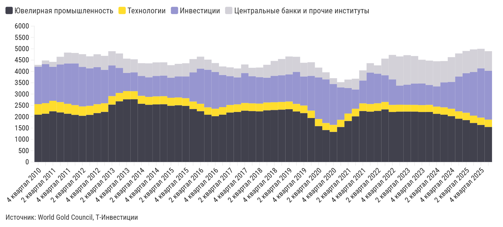

*График 28683626 — «Структура глобального спроса на золото». Интерактив: https://flo.uri.sh/visualisation/28683626/embed. Данные: [CSV](../charts/28683626.csv), [JSON](../charts/28683626.json)*

Подписи и настройки графика: axes_highlights.y_lines: Среднее за период 2012—2021 :: 512; layout.source_name: World Gold Council, Т-Инвестиции; chart_type: column_stacked

| label | Ювелирная промышленность | Технологии | Инвестиции | Центральные банки и прочие институты |
|---|---|---|---|---|
| 4 квартал 2010 | 2 088,6 | 467,0 | 1 653,0 | 79,2 |
| 1 квартал 2011 | 2 134,5 | 464,0 | 1 723,1 | 161,9 |
| 2 квартал 2011 | 2 240,8 | 462,2 | 1 502,2 | 217,1 |
| 3 квартал 2011 | 2 190,8 | 454,0 | 1 661,2 | 341,9 |
| 4 квартал 2011 | 2 133,4 | 437,8 | 1 779,7 | 480,8 |
| 1 квартал 2012 | 2 083,5 | 428,0 | 1 842,6 | 460,8 |
| 2 квартал 2012 | 2 041,6 | 412,7 | 1 744,3 | 562,0 |
| 3 квартал 2012 | 2 082,6 | 398,5 | 1 654,6 | 531,0 |
| 4 квартал 2012 | 2 162,2 | 390,4 | 1 635,9 | 569,2 |
| 1 квартал 2013 | 2 215,3 | 379,0 | 1 475,2 | 617,3 |
| 2 квартал 2013 | 2 535,5 | 374,2 | 1 355,0 | 628,0 |
| 3 квартал 2013 | 2 681,4 | 368,1 | 1 106,9 | 637,1 |
| 4 квартал 2013 | 2 768,4 | 362,7 | 803,8 | 629,5 |
| 1 квартал 2014 | 2 770,5 | 356,0 | 831,3 | 577,7 |
| 2 квартал 2014 | 2 573,0 | 349,4 | 875,7 | 565,9 |
| 3 квартал 2014 | 2 526,8 | 349,3 | 864,7 | 616,0 |
| 4 квартал 2014 | 2 543,8 | 355,1 | 898,9 | 601,1 |
| 1 квартал 2015 | 2 551,9 | 355,5 | 909,1 | 585,4 |
| 2 квартал 2015 | 2 484,4 | 352,7 | 882,0 | 557,2 |
| 3 квартал 2015 | 2 506,2 | 345,9 | 929,2 | 552,6 |
| 4 квартал 2015 | 2 479,3 | 338,0 | 963,5 | 579,6 |
| 1 квартал 2016 | 2 340,0 | 330,5 | 1 287,3 | 587,1 |
| 2 квартал 2016 | 2 244,6 | 326,7 | 1 550,2 | 530,6 |
| 3 квартал 2016 | 2 088,0 | 326,4 | 1 659,6 | 447,2 |
| 4 квартал 2016 | 2 023,2 | 329,4 | 1 622,1 | 394,9 |
| 1 квартал 2017 | 2 090,9 | 332,0 | 1 419,9 | 376,3 |
| 2 квартал 2017 | 2 185,4 | 333,4 | 1 273,1 | 387,7 |
| 3 квартал 2017 | 2 210,5 | 335,3 | 1 191,0 | 395,3 |
| 4 квартал 2017 | 2 267,3 | 339,4 | 1 321,9 | 378,6 |
| 1 квартал 2018 | 2 247,9 | 342,6 | 1 198,3 | 371,3 |
| … | … | … | … | … |
| 3 квартал 2022 | 2 324,1 | 328,6 | 1 179,7 | 732,2 |
| 4 квартал 2022 | 2 208,4 | 314,8 | 1 125,8 | 1 080,0 |
| 1 квартал 2023 | 2 225,2 | 305,0 | 844,1 | 1 288,0 |
| 2 квартал 2023 | 2 228,0 | 298,3 | 885,7 | 1 305,8 |
| 3 квартал 2023 | 2 226,6 | 296,8 | 939,8 | 1 216,1 |
| 4 квартал 2023 | 2 208,2 | 305,2 | 951,8 | 1 050,8 |
| 1 квартал 2024 | 2 211,4 | 312,5 | 880,1 | 1 073,7 |
| 2 квартал 2024 | 2 127,1 | 320,0 | 893,4 | 1 108,8 |
| 3 квартал 2024 | 2 089,0 | 325,6 | 1 101,8 | 942,6 |
| 4 квартал 2024 | 2 026,6 | 326,2 | 1 185,4 | 1 092,4 |
| 1 квартал 2025 | 1 912,4 | 326,4 | 1 535,9 | 1 019,3 |
| 2 квартал 2025 | 1 850,9 | 324,8 | 1 745,5 | 982,5 |
| 3 квартал 2025 | 1 724,4 | 323,5 | 1 925,1 | 999,6 |
| 4 квартал 2025 | 1 638,0 | 322,8 | 2 175,3 | 863,3 |
| 1 квартал 2026 | 1 548,6 | 324,0 | 2 154,9 | 866,8 |

*Показано 45 из 62 строк, полный ряд: [CSV](../charts/28683626.csv), [JSON](../charts/28683626.json)*

Дальнейшее охлаждение в ювелирном и технологическом сегментах спроса весьма вероятно на фоне роста цен. Однако на текущий момент эта слабость перекрывается возросшими объемами покупок со стороны центробанков и инвесторов: совокупный спрос на золото показывает стабильный рост со второй половины 2024 года и по итогу 2025-го впервые превысил 5 000 тонн.

Наш взгляд на золото

Спрос на золото как на защитный актив, на наш взгляд, останется ключевым драйвером для котировок драгметалла в 2026 году. В условиях, когда геополитические потрясения приобретают все более системный характер и сохраняется высокий уровень экономической неопределенности, центральные банки будут продолжать покупать золото, а инвесторы — постепенно увеличивать его долю в долгосрочных портфелях.

Выраженность рисков со стороны более высоких процентных ставок во многом зависит от развития конфликта на Ближнем Востоке. В базовом сценарии мы исходим из постепенного снижения напряженности в регионе на горизонте одного-двух месяцев и умеренного влияния на экономику:

Цены на нефть вернутся к более умеренным уровням, хотя и останутся выше доконфликтных значений за счет сохранения геополитической премии.

Инвестиционный спрос будет частично сдерживаться более высокими доходностями. В первую очередь это коснется его спекулятивного сегмента. Тем не менее общая картина все еще продолжает говорить в пользу сохранения высокого спроса со стороны инвесторов в 2026 году.

Влияние на глобальную инфляцию окажется умеренным. Причем значительная часть этого эффекта, на наш взгляд, уже учтена в текущем уровне долларовых доходностей. Вместе с тем аргументов в пользу снижения долгосрочных ставок стало еще меньше.

#### Александр Потехин, ведущий аналитик Т-Инвестиций

Несмотря на возросшие риски повышения долларовых доходностей, золото сохраняет потенциал роста с текущих уровней. Наш прогноз стоимости драгметалла на конец 2026 года — $5 000—5 300 за унцию.

Мы также сохраняем ожидания относительно ослабления курса рубля до уровня около 90 рублей за доллар к концу 2026-го. Это делает золото привлекательнее для российских инвесторов с учетом защиты от валютного риска.

Ключевые риски

**Рост инфляционных рисков и ожиданий по ставкам**

Длительная дестабилизация рынков энергоносителей из-за конфликта на Ближнем Востоке грозит мировой экономике более серьезными проблемами с инфляцией. В негативном сценарии рост инфляции может потребовать от мировых центробанков существенного ужесточения денежно-кредитной политики, что станет выраженным фактором давления на котировки золота.

**Высокая чувствительность прогноза к ожидаемой величине инвестиционного спроса**

Это предполагает повышенные риски в силу выраженной спекулятивной компоненты в рамках сегмента. Рост долларовых доходностей, если он окажется устойчивым, может стать триггером для оттока «быстрых денег» из актива.

Поэтому при инвестициях в золото мы рекомендуем исходить в первую очередь из контроля рисков. По нашей оценке, оптимальная доля золота в портфеле около 7—13%.

Самые простые и удобные способы добавить золото в свой портфель:

#### Золотые слитки

Физическое золото наивысшей пробы, бесплатное хранение в банке, бесплатная доставка по России. Покупка от 10 грамм

Подробнее

#### Биржевое золото

Быстрая покупка и продажа на бирже, обеспечено реальным золотом. Покупка от 1 грамма

Купить

#### Золотой счет

Отдельный счет в банке, для покупки нужна только дебетовая карта. Покупка от 0,1 грамма

Подробнее

Инвесторам, предпочитающим удобный и прозрачный формат, можно рассмотреть фонд на золото (TGLD): активы хранятся в России, а торговля ведется в рублях, что исключает инфраструктурные риски и защищает от инфляции.

#### Золото (TGLD)

Биржевой фонд от Т-Капитал, который поможет защитить накопления от инфляции без инфраструктурных рисков: золото хранится на территории России, валюта торгов — рубли

**Прогнозы инвестиционных домов**

- Goldman Sachs $5 400 на конец 2026-го
- J.P. Morgan $6 300 на конец 2026-го
- Morgan Stanley $5 200 во 2П26
- Bank of America $6 000 на горизонте 12 месяцев
- Wells Fargo $6 100—6 300 на конец 2026-го
- UBS $5 900 на конец 2026-го
- HSBC $4 450 на конец 2026-го
- Standard Chartered Bank $5 350 на горизонте 12 месяцев
- Deutsche Bank $6 000 в 2026-м
- Консенсус Reuters (31 аналитик) $4 916 в среднем в 2026 году

## Срочный рынок: хеджируем процентный риск в портфеле ОФЗ

Базовые предпосылки и общее направление инвестиционного цикла в рамках текущего пересмотра стратегии существенно не изменились.

#### В базовом сценарии:

Темпы снижения ключевой ставки замедлятся.

#### Тенденция на понижение сохранится:

Ориентир — в районе 11,5%

Это продолжает поддерживать привлекательность реальной доходности ОФЗ-ПД.

#### Евгений Кошелев, аналитик срочного рынка

Тем не менее консервативный сценарий по ключевой ставке и сопутствующие риски для долгосрочных ОФЗ требуют внимания. В подобной ситуации целесообразно хеджировать ценовой риск через короткую позицию по фьючерсу на индекс RGBI. Учитывая низкую ликвидность дальних контрактов, оптимальным выбором мы считаем фьючерс RGBI-9.25.

**У ОФЗ-ПД, особенно с длинным сроком до погашения, есть два структурных риска:**

**Инфляционные риски**

Ритмичное снижение ключевой ставки может быть прервано на любом из ближайших заседаний из-за растущих инфляционных рисков со стороны бюджета и внешних факторов. Значимым дополнительным драйвером выступает запланированная на 1 октября индексация тарифов ЖКХ. На фоне совокупности этих факторов повышается вероятность выхода годовой инфляции за рамки прогнозного диапазона Банка России (4,5—5,5% г/г) и перехода к консервативному сценарию снижения ключевой ставки — до 13,5% к концу 2026 года. Это, в свою очередь, может подорвать доверие к возврату к целевой инфляции в долгосрочной перспективе.

**Внеплановая разбалансировка федерального бюджета**

Структурный баланс бюджета на 2026 год был запланирован в размере 0,0% ВВП. В свете сохраняющегося запроса на увеличение расходов (на текущие нужды, стимулирование экономики и предвыборный цикл), негативного воздействия торможения экономики на доходы и особенностей размещения дополнительных нефтегазовых доходов в ФНБ в 2026 году возможен возврат к структурному дефициту. В консервативном сценарии исходим из предполагаемого расширения структурного дефицита до −1,0% от ВВП с существенным увеличением программы госзаимствований и потенциально негативным эффектом на доходности ОФЗ-ПД.

#### Вмененная инфляция до погашения в среднем за год

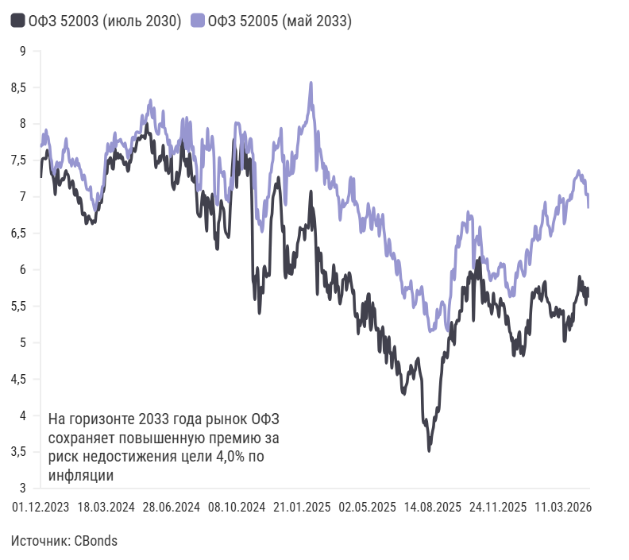

*График 28724695 — «Вмененная инфляция до погашения в среднем за год». Интерактив: https://flo.uri.sh/visualisation/28724695/embed. Данные: [CSV](../charts/28724695.csv), [JSON](../charts/28724695.json)*

Подписи и настройки графика: axes_highlights.y_lines: На горизонте 2033 года рынок ОФЗ сохраняет повышенную премию за риск недостижения цели 4,0% по инфляции :: 3; layout.source_name: CBonds; chart_type: line

| label | ОФЗ 52003 (июль 2030) | ОФЗ 52005 (май 2033) |
|---|---|---|
| 01.12.2023 | 7,26 | 7,68 |
| 04.12.2023 | 7,44 | 7,72 |
| 05.12.2023 | 7,52 | 7,71 |
| 06.12.2023 | 7,53 | 7,86 |
| 07.12.2023 | 7,53 | 7,75 |
| 08.12.2023 | 7,52 | 7,72 |
| 11.12.2023 | 7,53 | 7,92 |
| 12.12.2023 | 7,64 | 7,82 |
| 13.12.2023 | 7,58 | 7,83 |
| 14.12.2023 | 7,57 | 7,74 |
| 15.12.2023 | 7,55 | 7,69 |
| 18.12.2023 | 7,39 | 7,54 |
| 19.12.2023 | 7,31 | 7,49 |
| 20.12.2023 | 7,30 | 7,37 |
| 21.12.2023 | 7,25 | 7,36 |
| 22.12.2023 | 7,17 | 7,31 |
| 25.12.2023 | 7,03 | 7,39 |
| 26.12.2023 | 7,24 | 7,43 |
| 27.12.2023 | 7,32 | 7,48 |
| 28.12.2023 | 7,38 | 7,41 |
| 29.12.2023 | 7,17 | 7,42 |
| 03.01.2024 | 7,16 | 7,47 |
| 04.01.2024 | 7,20 | 7,40 |
| 05.01.2024 | 7,23 | 7,46 |
| 08.01.2024 | 7,25 | 7,50 |
| 09.01.2024 | 7,23 | 7,65 |
| 10.01.2024 | 7,26 | 7,61 |
| 11.01.2024 | 7,33 | 7,70 |
| 12.01.2024 | 7,36 | 7,80 |
| 15.01.2024 | 7,31 | 7,67 |
| … | … | … |
| 31.03.2026 | 5,58 | 7,26 |
| 01.04.2026 | 5,63 | 7,28 |
| 02.04.2026 | 5,67 | 7,32 |
| 03.04.2026 | 5,77 | 7,36 |
| 06.04.2026 | 5,91 | 7,30 |
| 07.04.2026 | 5,76 | 7,29 |
| 08.04.2026 | 5,71 | 7,22 |
| 09.04.2026 | 5,84 | 7,30 |
| 10.04.2026 | 5,70 | 7,20 |
| 13.04.2026 | 5,63 | 7,18 |
| 14.04.2026 | 5,76 | 7,23 |
| 15.04.2026 | 5,52 | 7,03 |
| 16.04.2026 | 5,73 | 7,03 |
| 17.04.2026 | 5,75 | 7,04 |
| 20.04.2026 | 5,62 | 6,84 |

*Показано 45 из 605 строк, полный ряд: [CSV](../charts/28724695.csv), [JSON](../charts/28724695.json)*

#### Сценарии для дефицита бюджета / ОФЗ

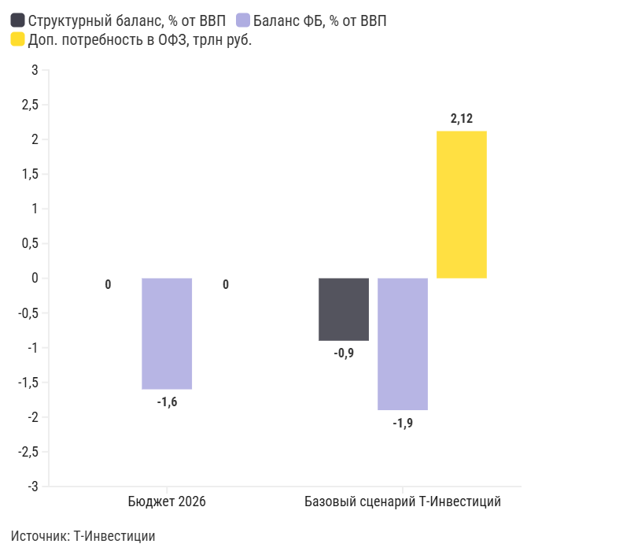

*График 28724889 — «Сценарии для дефицита бюджета / ОФЗ». Интерактив: https://flo.uri.sh/visualisation/28724889/embed. Данные: [CSV](../charts/28724889.csv), [JSON](../charts/28724889.json)*

Подписи и настройки графика: axes_highlights.y_lines: Чистая прибыль сектора :: -8; layout.source_name: Т-Инвестиции; chart_type: column_grouped

| label | Структурный баланс, % от ВВП | Баланс ФБ, % от ВВП | Доп. потребность в ОФЗ, трлн руб. |
|---|---|---|---|
| Бюджет 2026 | 0,00% | -1,6% | 0 |
| Базовый сценарий Т-Инвестиций | -0,9% | -1,9% | 2,12 |

#### Евгений Кошелев, аналитик срочного рынка

Оптимальным моментом для использования хеджирования мы считаем конец второго квартала. Горизонт хеджирования — третий и частично четвертый кварталы 2026 года, что обосновано календарной волной переоценки бюджетных рисков.

Пик бюджетной неопределенности, по нашей оценке, придется на третий квартал: к его концу будут опубликованы ключевые программные документы на 2027–2029 годы — проект бюджета и основные направления бюджетной политики, а также представлена оценка исполнения бюджета текущего года.

При использовании фьючерсов на RGBI для хеджирования портфеля госбумаг с фиксированной доходностью стоит учитывать следующие особенности:

### Короткая продажа фьючерсов на RGBI страхует риск параллельного сдвига кривой ОФЗ

Изменение формы кривой доходности ОФЗ (выпуклости или наклона) без дополнительной корректировки позиции приведет к отклонению итогового результата от целевого.

### Расчет размера хеджирующей позиции должен опираться на фактическую дюрацию портфеля

Индекс RGBI в своей структуре имеет широкий спектр бумаг, из-за чего средняя дюрация составляет 4,9 года, а средняя цена «портфеля» RGBI — 82,3 пт. Соответственно, размер стоимости хеджирующей позиции нужно корректировать на соотношение дюраций и чувствительность индекса к средней цене в составе RGBI.

Пример расчета пропорций хеджирования ОФЗ-ПД

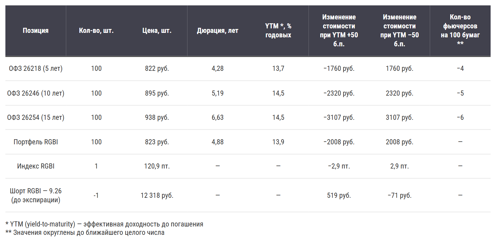

*График 28732446 — «Пример расчета пропорций хеджирования ОФЗ-ПД». Интерактив: https://flo.uri.sh/visualisation/28732446/embed. Данные: [CSV](../charts/28732446.rows.csv), [JSON](../charts/28732446.json)*

Подписи и настройки графика: layout.footer_note: * YTM (yield-to-maturity) — эффективная доходность до погашения; layout.footer_note_secondary: ** Значения округлены до ближайшего целого числа

| Позиция | Кол-во, шт. | Цена, шт. | Дюрация, лет | YTM *, % годовых | Изменение стоимости при YTM +50 б.п. | Изменение стоимости при YTM –50 б.п. | Кол-во фьючерсов на 100 бумаг ** |
|---|---|---|---|---|---|---|---|
| ОФЗ 26218 (5 лет) | 100 | 822 руб. | 4,28 | 13,7 | −1760 руб. | 1760 руб. | −4 |
| ОФЗ 26246 (10 лет) | 100 | 895 руб. | 5,19 | 14,5 | −2320 руб. | 2320 руб. | −5 |
| ОФЗ 26254 (15 лет) | 100 | 938 руб. | 6,63 | 14,5 | −3107 руб. | 3107 руб. | −6 |
| Портфель RGBI | 100 | 823 руб. | 4,88 | 13,9 | −2008 руб. | 2008 руб. | — |
| Индекс RGBI | 1 | 120,9 пт. | — | — | −2,9 пт. | 2,9 пт. | — |
| Шорт RGBI — 9.26 (до экспирации) | -1 | 12 318 руб. | — | — | 519 руб. | −71 руб. | — |

#### Евгений Кошелев, аналитик срочного рынка

Короткая продажа фьючерса на индекс RGBI де-факто фиксирует прибыль, равную величине контанго, на период до экспирации контракта. В пересчете на годовую ставку это составляет около 5,2%, что на заданном горизонте эквивалентно снижению эффективной доходности «портфеля RGBI» в среднем на 50 б. п. Таким образом, хеджирование сохраняет эффективность при снижении доходности портфеля не более чем на указанный уровень.

## Доходности активов и результаты стратегий Т-Банка

Начало 2026 года принесло российским инвесторам целый ряд неожиданных событий.

### Среди них:

- перенос эффекта повышения НДС в инфляцию;
- не определенные до конца изменения бюджетного правила;
- резкий рост цен на нефть на фоне начала военных действий в Иране;
- нестабильность валютной ликвидности в России;
- потенциальное введение новых налогов на сверхприбыль.

Все эти факторы проявились уже в первые месяцы года, хотя по масштабу их вполне хватило бы на целый год.

В таких условиях повышенная волатильность на отдельных рынках выглядела вполне естественно. В наибольшей степени это затронуло валютные облигации, акции, золото и доллар.

При этом относительная стабильность сохранялась в сегменте облигаций — как корпоративных, так и ОФЗ. Особенно после стабилизации инфляции, когда эффект от повышения НДС оказался ограниченным.

Это, в свою очередь, сформировало ожидания относительно дальнейшего снижения ключевой ставки ЦБ.

Доходности классов активов в 2026 году

#### Золото

Стало лидером по доходности, несмотря на высокую волатильность: около 6,1% с начала 2026 года

#### Корпоративные облигации и ОФЗ

Показали доходность около 5% в 2026 году (за период с 30 декабря 2025-го по 16 апреля 2026-го)

#### Денежный рынок

Прибавил за тот же период 4,6%

#### Акции с учетом дивидендов

Продемонстрировали лишь символический рост — порядка 1%

#### Доллар и валютные облигации

Показали отрицательную динамику: −2,7% и −2,2% соответственно

Динамика доходности разных классов активов с начала 2026 года

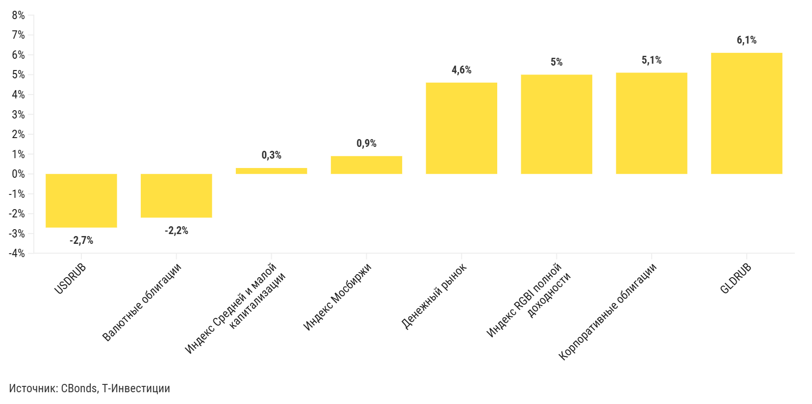

*График 28685297 — «Динамика доходности разных классов активов с начала 2026 года». Интерактив: https://flo.uri.sh/visualisation/28685297/embed. Данные: [CSV](../charts/28685297.csv), [JSON](../charts/28685297.json)*

Подписи и настройки графика: axes_highlights.x_areas: рецессия доткомов:: 28.02.2001 >> 30.11.2001; axes_highlights.x_lines: :: Прогноз; axes_highlights.y_lines: ::0; layout.source_name: CBonds, Т-Инвестиции; chart_type: column_grouped

| Класс активов | Доходность |
|---|---|
| USDRUB | -2,7% |
| Валютные облигации | -2,2% |
| Индекс Средней и малой капитализации | 0,3% |
| Индекс Мосбиржи | 0,9% |
| Денежный рынок | 4,6% |
| Индекс RGBI полной доходности | 5,0% |
| Корпоративные облигации | 5,1% |
| GLDRUB | 6,1% |

Ситуацию на рынке облигаций продолжает определять текущая динамика инфляции и монетарной политики: по мере снижения ключевой ставки их цены растут.

Доходности на денежном рынке, как ожидается, будут постепенно снижаться, что, в свою очередь, будет стимулировать переток капитала в более рискованные активы — прежде всего в облигации.

Одновременно продажи валюты экспортерами при отсутствии активных покупок со стороны Минфина укрепляет рубль, что повышает потенциальную доходность валютных инструментов при ослаблении. Однако важно учитывать, что волатильность курса рубля существенно выше, чем в сегменте рублевых долговых бумаг.

Ожидаемые доходности по классам активов в следующие 12 месяцев

### ОФЗ

В ближайшие 12 месяцев могут принести инвесторам 22—31% доходности при условии снижения ключевой ставки до 11—13%.

### Валютные облигации

Доходность может оказаться даже больше, чем по ОФЗ, в случае ослабления рубля до уровня выше 90 за доллар.

### Акции

Ситуация на рынке акций остается напряженной. С учетом дивидендов индекс может показать доходность порядка 20—30% в зависимости от темпов снижения ключевой ставки. Однако этот сегмент характеризуется существенно более высокой волатильностью и требует восстановления корпоративных прибылей до средних значений.

Ожидаемые доходности классов активов в следующие 12 месяцев

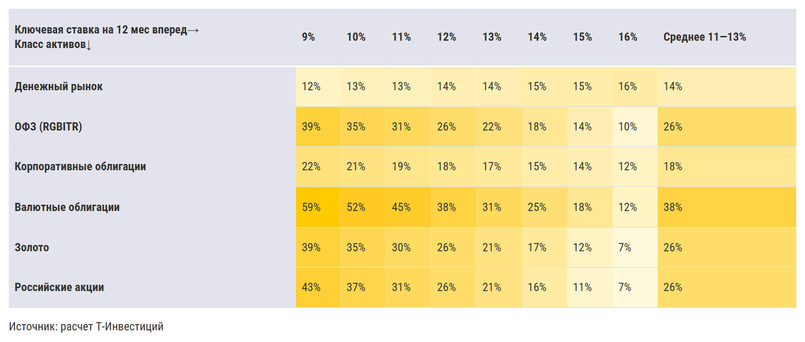

*График 28724367 — «Ожидаемые доходности классов активов в следующие 12 месяцев». Интерактив: https://flo.uri.sh/visualisation/28724367/embed. Данные: [CSV](../charts/28724367.rows.csv), [JSON](../charts/28724367.json)*

Подписи и настройки графика: layout.source_name: расчет Т-Инвестиций

| 
Ключевая ставка на 12 мес вперед→
Класс активов↓ | 9% | 10% | 11% | 12% | 13% | 14% | 15% | 16% | Среднее 11—13% |
|---|---|---|---|---|---|---|---|---|---|
| <b>Денежный рынок</b> | 12% | 13% | 13% | 14% | 14% | 15% | 15% | 16% | 14% |
| <b>ОФЗ (RGBITR)</b> | 39% | 35% | 31% | 26% | 22% | 18% | 14% | 10% | 26% |
| <b>Корпоративные облигации</b> | 22% | 21% | 19% | 18% | 17% | 15% | 14% | 12% | 18% |
| <b>Валютные облигации</b> | 59% | 52% | 45% | 38% | 31% | 25% | 18% | 12% | 38% |
| <b>Золото</b> | 39% | 35% | 30% | 26% | 21% | 17% | 12% | 7% | 26% |
| <b>Российские акции</b> | 43% | 37% | 31% | 26% | 21% | 16% | 11% | 7% | 26% |

Обновленные составы портфелей на 2026 год

#### Евгений Митюков, директор по инвестициям, УК Т-Капитал

В текущих условиях в рамках стратегий фондов Т-Капитала мы сохраняем приоритет в пользу рублевых облигаций — как ОФЗ, так и корпоративных, включая секьюритизированные выпуски.

По мере снижения доходностей на рынке ОФЗ целесообразно постепенно сокращать экспозицию в этих инструментах и перераспределять портфель в бумаги с меньшей дюрацией.

Вместе с тем увеличение доли валютных активов на текущих уровнях позволяет повысить диверсификацию портфеля и снизить риски в случае возможного ослабления рубля.

В целом оптимальные аллокации не сильно меняются по сравнению с нашей предыдущей стратегией, отражая больше тактические действия в связи с изменением цен с начала года.

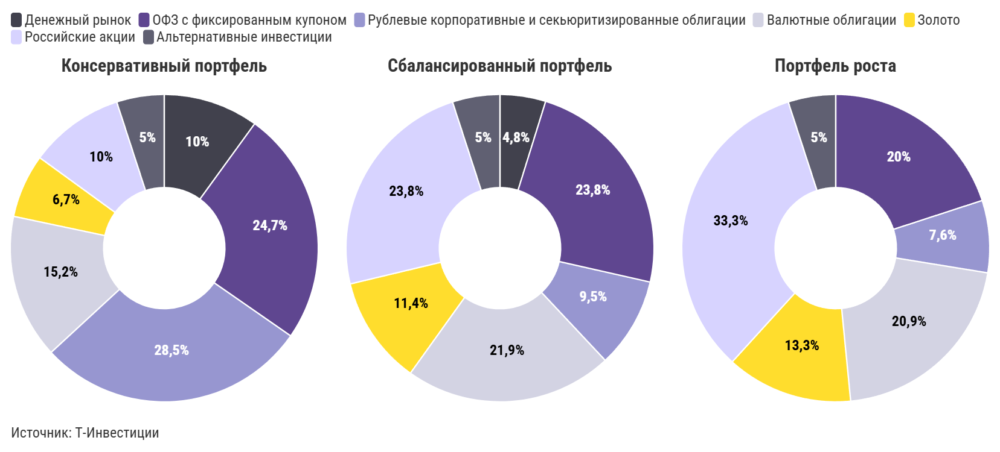

*График 28734714 — «Без заголовка». Интерактив: https://flo.uri.sh/visualisation/28734714/embed. Данные: [CSV](../charts/28734714.csv), [JSON](../charts/28734714.json)*

Подписи и настройки графика: layout.source_name: Т-Инвестиции; chart_type: donut

| Класс активов | Консервативный портфель | Сбалансированный портфель | Портфель роста |
|---|---|---|---|
| Денежный рынок | 10% | 4,8% |  |
| ОФЗ с фиксированным купоном | 24,7% | 23,8% | 20,0% |
| Рублевые корпоративные и секьюритизированные облигации | 28,5% | 9,5% | 7,6% |
| Валютные облигации | 15,2% | 21,9% | 20,9% |
| Золото | 6,7% | 11,4% | 13,3% |
| Российские акции | 10% | 23,8% | 33,3% |
| Альтернативные инвестиции | 5,0% | 5,0% | 5,0% |

Результаты стратегий Т-Инвестиций

Наши стратегии, отражающие рекомендованные аллокации по классам активов и построенные на фондах Т-Капитала, показали уверенные результаты за последние 12 месяцев (с 16 апреля 2025 года по 16 апреля 2026 года).

В условиях, когда рисковые классы активов находятся под давлением, наилучшие результаты демонстрируют портфели с большей долей облигаций.

#### Т-Консервативный портфель

Принес 19,5% за 12 месяцев и более 37% с момента запуска в конце августа 2024 года при низкой волатильности

Основная задача стратегии — сохранение капитала с доходностью выше депозитов при минимальном уровне риска

#### Следовать стратегии

#### Т-Сбалансированный портфель

Показал доходность свыше 16% за год и около 30% с момента запуска

Ориентирован на широкую диверсификацию и более высокую долю акций и валютных инструментов

#### Следовать стратегии

#### Т-Портфель роста

Принес инвесторам 13% за год

Для сравнения: индекс полной доходности российского рынка акций (MCFTR) за тот же период показал 4,2%, но при уровне риска почти в два раза выше, чем у портфеля роста. Стратегия нацелена на долгосрочное увеличение капитала

#### Следовать стратегии

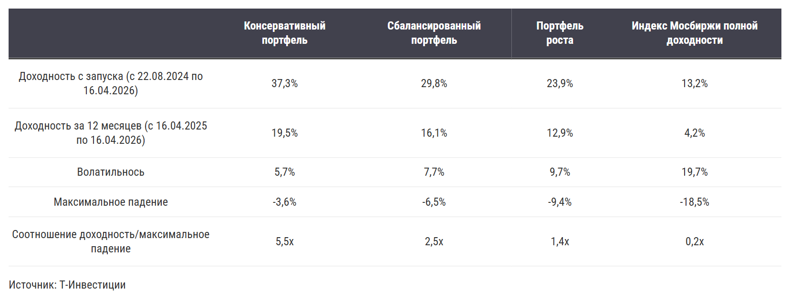

*График 28731172 — «Без названия». Интерактив: https://flo.uri.sh/visualisation/28731172/embed. Данные: [CSV](../charts/28731172.rows.csv), [JSON](../charts/28731172.json)*

Подписи и настройки графика: layout.source_name: Т-Инвестиции

| columns_0 | Консервативный портфель | Сбалансированный портфель | Портфель роста | Индекс Мосбиржи полной доходности |
|---|---|---|---|---|
| Доходность с запуска (с 22.08.2024 по 16.04.2026) | 37,3% | 29,8% | 23,9% | 13,2% |
| Доходность за 12 месяцев (с 16.04.2025 по 16.04.2026) | 19,5% | 16,1% | 12,9% | 4,2% |
| Волатильнось | 5,7% | 7,7% | 9,7% | 19,7% |
| Максимальное падение | -3,6% | -6,5% | -9,4% | -18,5% |
| Соотношение доходность/максимальное падение | 5,5x | 2,5x | 1,4x | 0,2x |

Дополнительно мы оценили, какую доходность получили клиенты с подписками Premium и Private на брокерских счетах за сопоставимый период (16 апреля 2025-го — 16 апреля 2026-го).

Медианная доходность клиентских портфелей оказалась на 4—8 п. п. ниже по сравнению с нашими рекомендованными аллокациями — в зависимости от уровня принимаемого риска.

В сегменте консервативных портфелей медианная доходность клиентов составила 15,2%, при этом 70% клиентов показали результат ниже 19%, то есть отстали от нашей консервативной стратегии, построенной на фондах.

В сегментах сбалансированных и агрессивных портфелей медианная доходность составила 10 и 4,4% соответственно. При этом около 80% клиентов в этих категориях также показали результат ниже доходности наших рекомендованных аллокаций.

### Сегмент агрессивных портфелей

Клиенты, волатильность портфелей которых сопоставима с инвестициями в индекс Мосбиржи IMOEX.

Доходности Т-Портфелей и медианная доходность клиентов по рискам портфелей

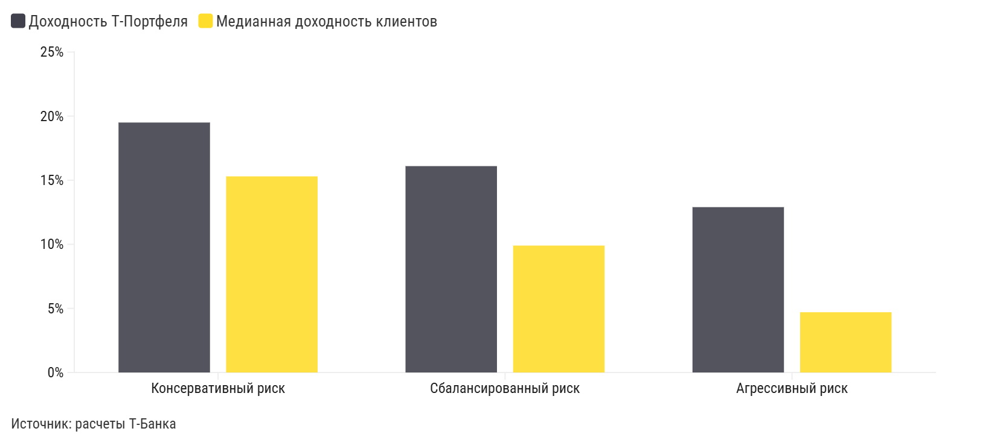

*График 28731325 — «Доходности Т-Портфелей и медианная доходность клиентов по рискам портфелей». Интерактив: https://flo.uri.sh/visualisation/28731325/embed. Данные: [CSV](../charts/28731325.csv), [JSON](../charts/28731325.json)*

Подписи и настройки графика: axes_highlights.x_areas: рецессия доткомов:: 28.02.2001 >> 30.11.2001; axes_highlights.x_lines: :: Прогноз; axes_highlights.y_lines: ::0; layout.source_name: расчеты Т-Банка; chart_type: column_grouped_line

| label | Доходность Т-Портфеля | Медианная доходность клиентов |
|---|---|---|
| Консервативный риск | 19,5% | 15,3% |
| Сбалансированный риск | 16,1% | 9,9% |
| Агрессивный риск | 12,9% | 4,7% |

## Стратегию подготовили

- Софья Донец Главный экономист
- Юрий Тулинов Глава аналитики по рынку облигаций
- Марьяна Лазаричева Глава аналитики по рынку акций
- Егор Дахтлер Главный аналитик
- Александр Самуйлов Главный аналитик
- Ахмед Алиев Ведущий аналитик
- Сергей Колбанов Старший аналитик
- Александра Прыткова Ведущий аналитик
- Александр Потехин Ведущий аналитик
- Никита Степанов Старший аналитик
- Евгений Кошелев Аналитик по срочному рынку
- Евгений Митюков Директор по инвестициям, УК Т-Капитал
- Дария Лехницкая Руководитель редакционного отдела
- Анастасия Тушнолобова Руководитель аналитической редакции
- Илья Марченко Аналитический редактор

Аналитический отчет составлен в соответствии с Методикой оценки ценных бумаг Т-Банка. Обзор также содержит информацию о ценных бумагах, которые предназначены только для квалифицированных инвесторов в соответствии со ст. 51.2 Федерального закона №39-ФЗ «О рынке ценных бумаг».

АО «ТБанк», лицензия на осуществление брокерской деятельности № 045-14050-100000, лицензия на осуществление депозитарной деятельности № 045-14051-000100, выданы Банком России 06.03.2018 г. (без ограничения срока действия).

АО «ТБанк» не гарантирует получение доходности на рынке ценных бумаг. Клиент самостоятельно принимает решения по инвестированию и несет ответственность за полученный результат. Предлагаемые ценные бумаги иностранных эмитентов допущены к обращению на российском рынке.
