> Копия публичной страницы Т-Инвестиций для внутреннего анализа. Источник: https://www.tbank.ru/invest/research/strategy/2026/bonds/ · снято 2026-11-09
> Разделы: [Главная](main.md) · [Краткая версия](short.md) · **Рынок облигаций** · [Рынок акций](stocks.md) · [Альтернативные инвестиции](alternative.md)

## Рынок облигаций

Что сейчас происходит на рынке

## ОФЗ: рынок все еще в ожидании триггера

Лидером по доходности инвестирования в первом квартале неожиданно стали ОФЗ-ИН. Малоликвидные выпуски с индексацией номинала на инфляцию показали результат в диапазоне +6—12%.

В классических ОФЗ-ПД с фиксированными купонами снижение доходностей наблюдалось только на коротком участке кривой.

#### На сроке два года

Доходности к погашению снизились на 1,5 п.п., до 12,8%

#### На сроке пять лет

Доходности к погашению снизились на 0,8 п.п., до 13,9%

Во многом это было связано с реинвестированием значительного объема ликвидности — около 750 млрд рублей купонов и 450 млрд рублей от погашения ОФЗ 29014.

#### Юрий Тулинов, глава аналитики Т-Инвестиций по рынку облигаций

Доходности длинных выпусков с погашением через 10—15 лет фактически застыли в диапазоне 14,5—15%. Так, доходность десятилетних ОФЗ на 28 апреля составляла 14,7% при ключевой ставке 14,5%. Для сравнения: на аналогичных уровнях доходности находились и в декабре 2025 года при ставке 16,5%, и даже в июле 2025 года при ставке 20%.

Почему доходности длинных ОФЗ не снижаются

### Неопределенность по бюджету

Давление на федеральный бюджет и отсутствие четкой конфигурации бюджетной политики на 2026 год и далее ограничивают снижение доходностей.

### Инфляционные риски и неопределенность по ставке

Инфляция по-прежнему не закрепляется у цели 4%, а риски для цен остаются разнонаправленными. Это усложняет понимание уровня долгосрочной ключевой ставки ЦБ.

### Рынок закладывает повышенную инфляцию

Например, на 28 апреля котировки длинных ОФЗ-ИН (серии 52004 и 52005) соответствуют «вмененной» инфляции на уровне 6,2—7,1%.

### Навес предложения со стороны Минфина

Новые рублевые заимствования остаются ключевым источником финансирования дефицита бюджета. Минфин, вероятно, продолжит делать акцент на длинных ОФЗ-ПД с погашением после 2037 года, чтобы выровнять профиль погашений.

### Объемы заимствований остаются высокими

План на 2026 год — около 5,51 трлн рублей, из которых за первые 15 аукционных дней уже привлечено 2,12 трлн рублей.

Давление со стороны размещений нового долга ощутимо

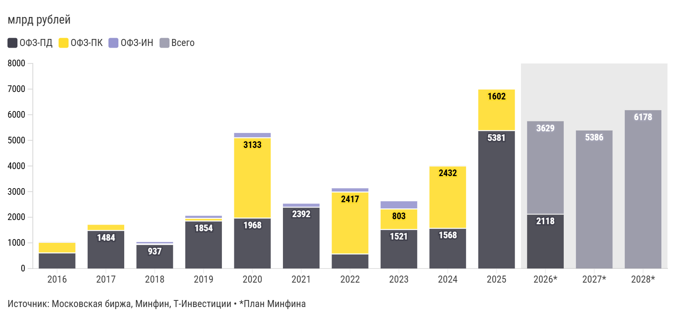

*График 28730069 — «Давление со стороны размещений нового долга ощутимо». Интерактив: https://flo.uri.sh/visualisation/28730069/embed. Данные: [CSV](../charts/28730069.csv), [JSON](../charts/28730069.json)*

Подписи и настройки графика: axes_highlights.x_areas: :: 2026*>> 2028*; axes_highlights.x_lines: :: Прогноз; axes_highlights.y_lines: ::0; layout.footer_note: *План Минфина; layout.source_name: Московская биржа, Минфин, Т-Инвестиции; chart_type: column_stacked

| label | ОФЗ-ПД | ОФЗ-ПК | ОФЗ-ИН | Всего |
|---|---|---|---|---|
| 2016 | 608 | 413 | 10 |  |
| 2017 | 1 484 | 221 | 0 |  |
| 2018 | 937 | 23 | 75 |  |
| 2019 | 1 854 | 101 | 102 |  |
| 2020 | 1 968 | 3 133 | 187 |  |
| 2021 | 2 392 | 0 | 138 |  |
| 2022 | 567 | 2 417 | 146 |  |
| 2023 | 1 521 | 803 | 300 |  |
| 2024 | 1 568 | 2 432 | 7 |  |
| 2025 | 5 381 | 1 602 | 0 |  |
| 2026* | 2 118 |  |  | 3 629 |
| 2027* |  |  |  | 5 386 |
| 2028* |  |  |  | 6 178 |

Что может «разбудить» рынок ОФЗ

### Ключевой драйвер — ускорение снижения ключевой ставки

Наиболее реалистичный сценарий — переход Банка России к более выраженному смягчению денежно-кредитной политики вместо постепенных шагов по –50 б. п. на каждом заседании.

Важно, чтобы инфляция не мешала этому процессу. Параллельно необходимо сохранение позитивной динамики по инфляции — данные должны как минимум не подрывать, а в идеале усиливать уверенность инвесторов в достижимости и устойчивости целевых 4%.

Как выстраивать портфель ОФЗ

Базовый подход — диверсификация по срокам и типам бумаг. В условиях высокой неопределенности оптимальной остается комбинация инструментов с разной дюрацией и структурой доходности.

#### Юрий Тулинов, глава аналитики Т-Инвестиций по рынку облигаций

Среди ОФЗ-ПД нам по-прежнему больше всего нравятся выпуски среднего участка кривой — с погашением через 6—10 лет. В базовом сценарии они могут обеспечить инвесторам доходность на уровне 25—28% на горизонте 12 месяцев. При этом в негативных сценариях их цены снизятся меньше, чем у более длинных бумаг.

Дополнять такие позиции разумно более короткими защитными инструментами — ОФЗ-ПК и ОФЗ-ИН.

Наш выбор на рынке ОФЗ

#### ОФЗ 26249

Фиксированный купон

Доходность к погашению — 14,21% (2032 год)

#### ОФЗ 26246

Фиксированный купон

Доходность к погашению — 14,69% (2036 год)

#### ОФЗ 29015

Плавающий купон

Погашение — 18.10.2028

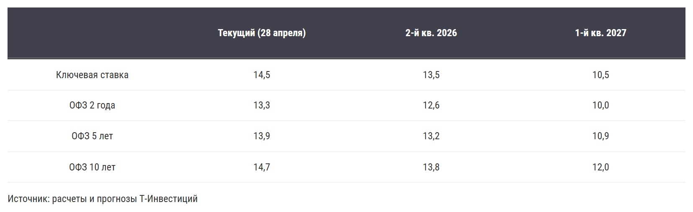

*График 28721197 — «Без названия». Интерактив: https://flo.uri.sh/visualisation/28721197/embed. Данные: [CSV](../charts/28721197.rows.csv), [JSON](../charts/28721197.json)*

Подписи и настройки графика: layout.source_name: расчеты и прогнозы Т-Инвестиций

| columns_0 | Текущий (28 апреля) | 2-й кв. 2026 | 1-й кв. 2027 |
|---|---|---|---|
| Ключевая ставка | 14,5 | 13,5 | 10,5 |
| ОФЗ 2 года | 13,3 | 12,6 | 10,0 |
| ОФЗ 5 лет | 13,9 | 13,2 | 10,9 |
| ОФЗ 10 лет | 14,7 | 13,8 | 12,0 |

## Корпоративные облигации: запрыгиваем в уходящий поезд

Первый квартал 2026 года оказался насыщенным глобальными событиями, что привело к заметной турбулентности на международных сырьевых рынках и пересмотру ожиданий по макроэкономическим показателям уже внутри страны. На этом фоне вопрос сбалансированного распределения портфеля между разными типами облигаций по-прежнему остается актуальным.

Ставки снижаются, но риски все еще высоки

Напомним, 2025 год стал антирекордным за последние несколько лет по количеству уникальных эмитентов, допустивших дефолт по облигациям. Уже в 2026 году этот список пополнили как минимум две новые компании.

Поэтому важно еще раз подчеркнуть: несмотря на снижение ставок и постепенное сужение кредитных спредов в облигациях младших рейтинговых групп в последние месяцы, кредитные риски на рынке по-прежнему остаются повышенными.

G-spread по рейтинговым группам

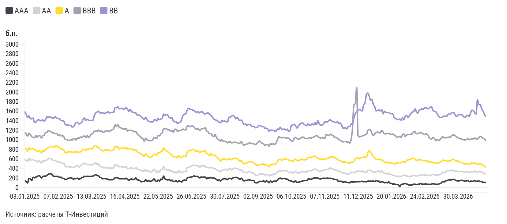

*График 28720767 — «G-spread по рейтинговым группам». Интерактив: https://flo.uri.sh/visualisation/28720767/embed. Данные: [CSV](../charts/28720767.csv), [JSON](../charts/28720767.json)*

Подписи и настройки графика: axes_highlights.x_areas: рецессия доткомов:: 28.02.2001 >> 30.11.2001; axes_highlights.x_lines: :: Прогноз; axes_highlights.y_lines: ::0; layout.source_name: расчеты Т-Инвестиций; y.title: б.п.; chart_type: line

| label | AAA | AA | A | BBB | BB |
|---|---|---|---|---|---|
| 03.01.2025 | 149,90 | 594,98 | 824,62 | 1 156,89 | 1 595,38 |
| 06.01.2025 | 128,23 | 571,16 | 808,46 | 1 127,71 | 1 536,87 |
| 08.01.2025 | 99,67 | 552,55 | 765,50 | 1 079,95 | 1 468,82 |
| 09.01.2025 | 192,72 | 618,30 | 839,55 | 1 143,59 | 1 504,34 |
| 10.01.2025 | 183,57 | 573,68 | 800,72 | 1 106,13 | 1 451,14 |
| 13.01.2025 | 149,89 | 588,90 | 817,04 | 1 068,95 | 1 441,07 |
| 14.01.2025 | 218,36 | 584,83 | 817,69 | 1 051,26 | 1 458,46 |
| 15.01.2025 | 207,66 | 571,10 | 796,71 | 1 045,72 | 1 368,41 |
| 16.01.2025 | 222,99 | 568,99 | 782,48 | 1 088,79 | 1 372,91 |
| 17.01.2025 | 231,74 | 539,17 | 751,80 | 1 058,59 | 1 410,40 |
| 20.01.2025 | 252,30 | 561,40 | 774,32 | 1 094,50 | 1 424,26 |
| 21.01.2025 | 241,70 | 550,01 | 765,54 | 1 084,47 | 1 401,17 |
| 22.01.2025 | 203,18 | 519,13 | 730,24 | 1 043,60 | 1 409,05 |
| 23.01.2025 | 238,59 | 565,20 | 775,47 | 1 087,02 | 1 418,55 |
| 24.01.2025 | 241,15 | 559,49 | 762,09 | 1 104,09 | 1 395,87 |
| 27.01.2025 | 242,71 | 569,15 | 804,18 | 1 158,27 | 1 431,21 |
| 28.01.2025 | 260,16 | 581,35 | 814,67 | 1 161,83 | 1 485,45 |
| 29.01.2025 | 282,17 | 604,94 | 840,76 | 1 196,96 | 1 475,77 |
| 30.01.2025 | 292,52 | 615,88 | 847,45 | 1 175,90 | 1 484,88 |
| 31.01.2025 | 294,33 | 607,85 | 864,99 | 1 174,17 | 1 468,98 |
| 03.02.2025 | 254,95 | 582,98 | 860,90 | 1 147,68 | 1 459,53 |
| 04.02.2025 | 240,05 | 566,07 | 841,22 | 1 142,82 | 1 459,57 |
| 05.02.2025 | 235,74 | 571,53 | 872,81 | 1 130,64 | 1 487,65 |
| 06.02.2025 | 236,37 | 546,38 | 871,87 | 1 139,94 | 1 459,35 |
| 07.02.2025 | 237,30 | 538,11 | 854,13 | 1 092,39 | 1 448,88 |
| 10.02.2025 | 216,48 | 533,90 | 838,86 | 1 112,61 | 1 446,29 |
| 11.02.2025 | 219,11 | 522,41 | 813,00 | 1 085,50 | 1 409,57 |
| 12.02.2025 | 198,66 | 508,65 | 805,78 | 1 088,17 | 1 402,86 |
| 13.02.2025 | 194,34 | 511,63 | 795,01 | 1 072,82 | 1 397,20 |
| 14.02.2025 | 175,24 | 460,81 | 741,66 | 1 014,29 | 1 332,83 |
| … | … | … | … | … | … |
| 07.04.2026 | 143,71 | 333,14 | 497,62 | 1 012,31 | 1 506,88 |
| 08.04.2026 | 148,01 | 341,42 | 505,88 | 1 024,67 | 1 518,04 |
| 09.04.2026 | 123,64 | 318,99 | 483,60 | 1 004,83 | 1 487,95 |
| 10.04.2026 | 136,98 | 323,43 | 502,67 | 1 012,45 | 1 568,39 |
| 13.04.2026 | 135,38 | 337,72 | 520,49 | 1 026,36 | 1 624,81 |
| 14.04.2026 | 130,77 | 330,38 | 506,21 | 1 018,19 | 1 608,37 |
| 15.04.2026 | 152,18 | 349,18 | 517,97 | 1 042,58 | 1 568,74 |
| 16.04.2026 | 133,56 | 332,02 | 507,76 | 1 021,13 | 1 543,16 |
| 17.04.2026 | 136,29 | 328,43 | 484,94 | 1 018,95 | 1 838,11 |
| 20.04.2026 | 137,78 | 337,15 | 496,42 | 1 049,16 | 1 738,28 |
| 21.04.2026 | 131,63 | 337,57 | 497,63 | 1 071,11 | 1 740,89 |
| 22.04.2026 | 125,67 | 328,34 | 490,26 | 1 057,95 | 1 654,62 |
| 23.04.2026 | 113,29 | 312,71 | 470,90 | 1 033,79 | 1 603,02 |
| 24.04.2026 | 112,67 | 298,80 | 453,82 | 1 023,45 | 1 534,74 |
| 27.04.2026 | 103,99 | 288,82 | 427,80 | 974,02 | 1 487,93 |

*Показано 45 из 333 строк, полный ряд: [CSV](../charts/28720767.csv), [JSON](../charts/28720767.json)*

Если смотреть на ситуацию трезво, доступность рефинансирования остается одним из ключевых факторов при оценке кредитного качества эмитентов. Кредиторы по-прежнему не готовы активно предоставлять финансирование компаниям со слабыми кредитными метриками, и это хорошо видно по сохранившемуся разрыву в кредитных спредах между младшими и старшими рейтинговыми группами.

#### Сергей Колбанов, аналитик Т-Инвестиций по долговым рынкам

Мы сохраняем рекомендацию отдавать предпочтение понятным бизнесам с крепкими показателями финансовой устойчивости. Если смотреть с прикладной точки зрения, то ориентиром может служить следующее правило: облигации инвестиционного качества в текущих условиях начинаются скорее с уровня кредитного рейтинга A+.

Внешние шоки могут повлиять на траекторию снижения ставки в среднесрочной перспективе, но на горизонте ближайших шести месяцев базовым сценарием все же остается ее дальнейшее снижение.

Внутренние макропоказатели будут с лагом отражать эффект турбулентности на глобальных рынках. При этом Банк России, вероятно, не станет брать паузу уже сейчас, поскольку понимает природу текущих всплесков в статистике, а говорить о формировании устойчивого тренда пока преждевременно — особенно в условиях, когда ситуация на Ближнем Востоке остается крайне изменчивой.

Рынок в целом разделяет этот взгляд. Об этом, в частности, говорит спред доходностей корпоративных облигаций разных срочных групп, который не оставляет попыток опуститься ниже 1 п.п.

Однако возврат кривой доходностей к более нормальной форме, вероятно, займет больше времени, чем ожидалось ранее. С начала года рынку не удалось избежать новых шоков, а значит, процесс нормализации может оказаться более растянутым.

Сравнение доходностей облигаций разных временных групп

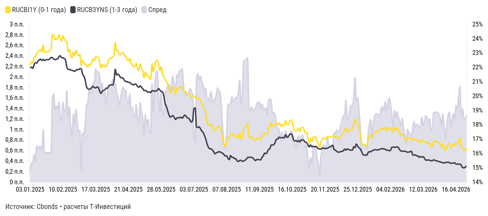

*График 28720792 — «Сравнение доходностей облигаций разных временных групп». Интерактив: https://flo.uri.sh/visualisation/28720792/embed. Данные: [CSV](../charts/28720792.csv), [JSON](../charts/28720792.json)*

Подписи и настройки графика: axes_highlights.x_areas: беспрецедентная волатильность флоатеров:: 16.09.2024 >> 25.11.2024; axes_highlights.x_lines: :: Прогноз; axes_highlights.y_lines: ::0; layout.footer_note: расчеты Т-Инвестиций; layout.source_name: Cbonds; chart_type: area_stacked_line

| Дата | RUCBI1Y (0-1 года) | RUCB3YNS (1-3 года) | Спред |
|---|---|---|---|
| 28.04.2026 | 16,38 | 15,12 | 1,26 |
| 27.04.2026 | 16,22 | 15,03 | 1,19 |
| 24.04.2026 | 16,22 | 14,99 | 1,23 |
| 23.04.2026 | 16,41 | 15,02 | 1,39 |
| 22.04.2026 | 16,47 | 15,18 | 1,29 |
| 21.04.2026 | 17,07 | 15,25 | 1,82 |
| 20.04.2026 | 16,86 | 15,24 | 1,62 |
| 17.04.2026 | 16,64 | 15,26 | 1,38 |
| 16.04.2026 | 16,7 | 15,25 | 1,45 |
| 15.04.2026 | 16,55 | 15,35 | 1,20 |
| 14.04.2026 | 16,63 | 15,33 | 1,30 |
| 13.04.2026 | 16,51 | 15,31 | 1,20 |
| 10.04.2026 | 16,37 | 15,31 | 1,06 |
| 09.04.2026 | 16,68 | 15,35 | 1,33 |
| 08.04.2026 | 16,65 | 15,39 | 1,26 |
| 07.04.2026 | 16,46 | 15,37 | 1,09 |
| 06.04.2026 | 16,2 | 15,37 | 0,83 |
| 03.04.2026 | 16,38 | 15,33 | 1,05 |
| 02.04.2026 | 16,64 | 15,35 | 1,29 |
| 01.04.2026 | 16,43 | 15,37 | 1,06 |
| 31.03.2026 | 16,64 | 15,41 | 1,23 |
| 30.03.2026 | 16,71 | 15,42 | 1,29 |
| 27.03.2026 | 16,79 | 15,46 | 1,33 |
| 26.03.2026 | 16,81 | 15,48 | 1,33 |
| 25.03.2026 | 16,82 | 15,51 | 1,31 |
| 24.03.2026 | 16,88 | 15,55 | 1,33 |
| 23.03.2026 | 16,52 | 15,49 | 1,03 |
| 20.03.2026 | 16,47 | 15,48 | 0,99 |
| 19.03.2026 | 16,72 | 15,52 | 1,20 |
| 18.03.2026 | 16,68 | 15,54 | 1,14 |
| … | … | … | … |
| 24.01.2025 | 23,09 | 22,53 | 0,56 |
| 23.01.2025 | 23,10 | 22,54 | 0,56 |
| 22.01.2025 | 23,07 | 22,51 | 0,56 |
| 21.01.2025 | 23,03 | 22,48 | 0,55 |
| 20.01.2025 | 23,55 | 22,55 | 1,00 |
| 17.01.2025 | 23,08 | 22,48 | 0,60 |
| 16.01.2025 | 23,25 | 22,57 | 0,68 |
| 15.01.2025 | 23,19 | 22,52 | 0,67 |
| 14.01.2025 | 23,04 | 22,42 | 0,62 |
| 13.01.2025 | 22,99 | 22,30 | 0,69 |
| 10.01.2025 | 22,70 | 22,32 | 0,38 |
| 09.01.2025 | 22,68 | 22,16 | 0,52 |
| 08.01.2025 | 22,29 | 21,93 | 0,36 |
| 06.01.2025 | 22,37 | 22,01 | 0,36 |
| 03.01.2025 | 22,17 | 21,96 | 0,21 |

*Показано 45 из 334 строк, полный ряд: [CSV](../charts/28720792.csv), [JSON](../charts/28720792.json)*

Наш выбор на рынке корпоративных облигаций

За последний месяц спрос на средне- и долгосрочные корпоративные облигации оказался рекордно высоким. На этом фоне рынок местами начал выглядеть перегретым: в отдельных случаях доходности корпоративных выпусков опустились даже ниже уровней ОФЗ с сопоставимым сроком погашения.

Тем не менее на рынке по-прежнему остаются интересные бумаги надежных эмитентов. Более того, уже через 12 месяцев даже текущие доходности, вероятно, будут восприниматься как редкая возможность, оставшаяся в прошлом.

#### Сергей Колбанов, аналитик Т-Инвестиций по долговым рынкам

Основной фокус при формировании портфеля, на наш взгляд, стоит сохранять на длинных корпоративных облигациях с фиксированным купоном. На текущем перегретом рынке в некоторых выпусках можно ожидать коррекционные моменты. Повышая активность покупок в такие периоды, можно максимизировать итоговую доходность портфеля.

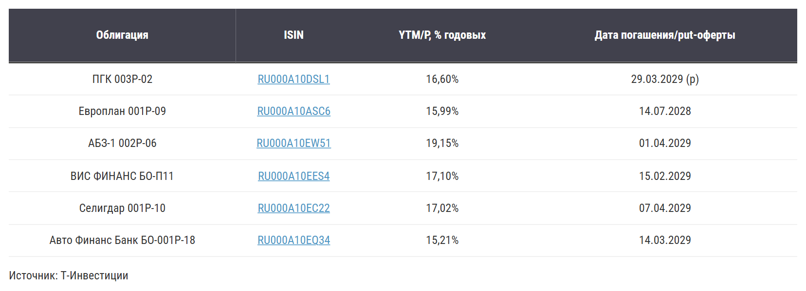

*График 28721144 — «Без названия». Интерактив: https://flo.uri.sh/visualisation/28721144/embed. Данные: [CSV](../charts/28721144.rows.csv), [JSON](../charts/28721144.json)*

Подписи и настройки графика: layout.source_name: Т-Инвестиции

| Облигация | ISIN | YTM/P, % годовых | Дата погашения/put-оферты |
|---|---|---|---|
| ПГК 003Р-02 | <a href="https://www.tbank.ru/invest/bonds/RU000A10DSL1/">RU000A10DSL1</a> | 16,60% | 29.03.2029 (р) |
| Европлан 001Р-09 | <a href="https://www.tbank.ru/invest/bonds/RU000A10ASC6/">RU000A10ASC6</a> | 15,99% | 14.07.2028 |
| АБЗ-1 002Р-06 | <a href="https://www.tbank.ru/invest/bonds/RU000A10EW51/">RU000A10EW51</a> | 19,15% | 01.04.2029 |
| ВИС ФИНАНС БО-П11 | <a href="https://www.tbank.ru/invest/bonds/RU000A10EES4/">RU000A10EES4</a> | 17,10% | 15.02.2029 |
| Селигдар 001Р-10 | <a href="https://www.tbank.ru/invest/bonds/RU000A10EC22/">RU000A10EC22</a> | 17,02% | 07.04.2029 |
| Авто Финанс Банк БО-001Р-18 | <a href="https://www.tbank.ru/invest/bonds/RU000A10EQ34/">RU000A10EQ34</a> | 15,21% | 14.03.2029 |

Облигации с плавающим купоном пока остаются на втором плане с учетом нашего прогноза по дальнейшему снижению ставок. Дополнительный сдерживающий фактор — заметное сжатие эффективных премий* по флоатерам старших рейтинговых групп, из-за чего такие бумаги сейчас выглядят менее привлекательно.

Эффективная премия флоатеров по рейтинговым группам

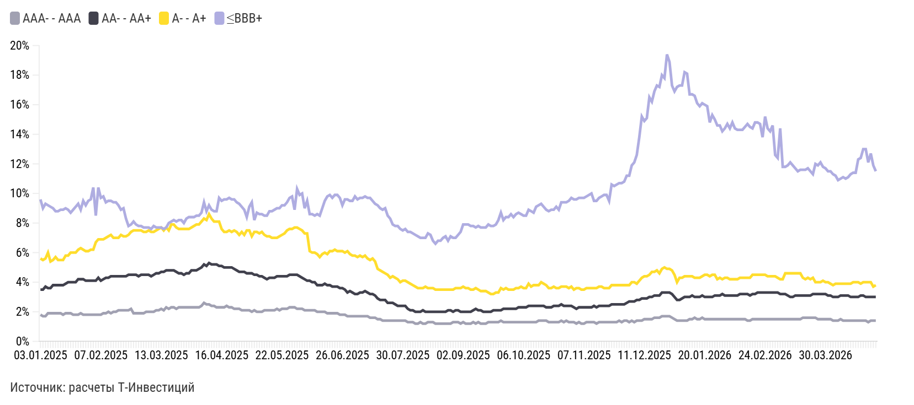

*График 28720867 — «Эффективная премия флоатеров по рейтинговым группам». Интерактив: https://flo.uri.sh/visualisation/28720867/embed. Данные: [CSV](../charts/28720867.csv), [JSON](../charts/28720867.json)*

Подписи и настройки графика: axes_highlights.x_areas: рецессия доткомов:: 28.02.2001 >> 30.11.2001; axes_highlights.x_lines: :: Прогноз; axes_highlights.y_lines: ::0; layout.source_name: расчеты Т-Инвестиций; chart_type: line

| label | AAA- - AAA | AA- - AA+ | A- - A+ | ≤BBB+ |
|---|---|---|---|---|
| 03.01.2025 | 1,8% | 3,5% | 5,6% | 9,6% |
| 06.01.2025 | 1,7% | 3,5% | 5,5% | 9,0% |
| 08.01.2025 | 1,7% | 3,7% | 5,6% | 9,3% |
| 09.01.2025 | 1,9% | 3,6% | 6,0% | 9,2% |
| 10.01.2025 | 1,9% | 3,6% | 5,4% | 9,1% |
| 13.01.2025 | 1,9% | 3,8% | 5,5% | 9,0% |
| 14.01.2025 | 1,9% | 3,8% | 5,7% | 8,8% |
| 15.01.2025 | 1,9% | 3,8% | 5,5% | 8,8% |
| 16.01.2025 | 1,9% | 3,8% | 5,5% | 8,9% |
| 17.01.2025 | 1,8% | 3,8% | 5,5% | 8,9% |
| 20.01.2025 | 1,9% | 3,9% | 5,8% | 9,0% |
| 21.01.2025 | 1,9% | 4,0% | 5,8% | 8,9% |
| 22.01.2025 | 1,9% | 4,0% | 6,0% | 8,7% |
| 23.01.2025 | 1,8% | 4,0% | 6,0% | 8,9% |
| 24.01.2025 | 1,8% | 4,0% | 6,0% | 9,1% |
| 27.01.2025 | 1,8% | 4,2% | 6,2% | 9,3% |
| 28.01.2025 | 1,9% | 4,2% | 6,3% | 8,9% |
| 29.01.2025 | 1,8% | 4,2% | 6,2% | 9,5% |
| 30.01.2025 | 1,8% | 4,1% | 6,1% | 9,2% |
| 31.01.2025 | 1,8% | 4,1% | 6,1% | 9,5% |
| 03.02.2025 | 1,8% | 4,1% | 6,2% | 9,6% |
| 04.02.2025 | 1,8% | 4,1% | 6,2% | 10,4% |
| 05.02.2025 | 1,8% | 4,1% | 6,7% | 8,5% |
| 06.02.2025 | 1,8% | 4,3% | 6,9% | 10,4% |
| 07.02.2025 | 1,8% | 4,1% | 6,9% | 9,7% |
| 10.02.2025 | 1,9% | 4,2% | 6,9% | 9,8% |
| 11.02.2025 | 1,9% | 4,3% | 7,0% | 9,4% |
| 12.02.2025 | 2,0% | 4,3% | 7,1% | 9,5% |
| 13.02.2025 | 1,9% | 4,4% | 7,2% | 9,5% |
| 14.02.2025 | 2,0% | 4,4% | 7,0% | 9,4% |
| … | … | … | … | … |
| 07.04.2026 | 1,5% | 3,1% | 3,9% | 11,0% |
| 08.04.2026 | 1,4% | 3,1% | 3,9% | 11,1% |
| 09.04.2026 | 1,4% | 3,1% | 3,9% | 11,0% |
| 10.04.2026 | 1,4% | 3,1% | 3,9% | 11,1% |
| 13.04.2026 | 1,4% | 3,0% | 3,9% | 11,3% |
| 14.04.2026 | 1,4% | 3,0% | 4,0% | 11,4% |
| 15.04.2026 | 1,4% | 3,0% | 4,0% | 11,4% |
| 16.04.2026 | 1,4% | 3,0% | 4,0% | 12,3% |
| 17.04.2026 | 1,4% | 3,1% | 3,9% | 12,4% |
| 20.04.2026 | 1,4% | 3,1% | 4,0% | 13,0% |
| 21.04.2026 | 1,4% | 3,0% | 4,0% | 13,0% |
| 22.04.2026 | 1,3% | 3,0% | 4,0% | 12,1% |
| 23.04.2026 | 1,4% | 3,0% | 4,0% | 12,7% |
| 24.04.2026 | 1,4% | 3,0% | 3,7% | 11,9% |
| 27.04.2026 | 1,4% | 3,0% | 3,8% | 11,5% |

*Показано 45 из 333 строк, полный ряд: [CSV](../charts/28720867.csv), [JSON](../charts/28720867.json)*

Тем не менее с учетом высокой неопределенности на внешних рынках облигации и ужесточившейся риторики ЦБ с плавающим купоном стоит в ограниченном объеме включать в портфель в качестве защитного элемента. Такой подход помогает повысить устойчивость стратегии в условиях возможных внешних шоков.

### Ключевой момент

Выбираем флоатеры со все еще высокими эффективными премиями. Это позволяет, с одной стороны, добавить в портфель защитный компонент, а с другой — частично компенсировать упущенную выгоду, если внешняя турбулентность в итоге не окажет заметного влияния на траекторию ставок внутри страны.

### Эффективная премия

Это приведенная к годовому выражению надбавка к референсной ставке с учетом базовой премии, текущей цены бумаги, срока до погашения и частоты купонных выплат.

Даже при реализации базового сценария по траектории ключевой ставки такие выпуски способны обеспечить доходность, сопоставимую с облигациями с фиксированным купоном аналогичного кредитного качества.

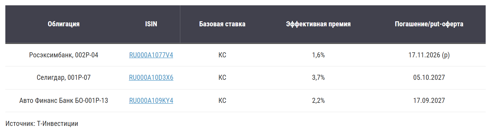

*График 28721103 — «Без названия». Интерактив: https://flo.uri.sh/visualisation/28721103/embed. Данные: [CSV](../charts/28721103.rows.csv), [JSON](../charts/28721103.json)*

Подписи и настройки графика: layout.source_name: Т-Инвестиции

| Облигация | ISIN | Базовая ставка | Эффективная премия | Погашение/put-оферта |
|---|---|---|---|---|
| Росэксимбанк, 002Р-04 | <a href="https://www.tbank.ru/invest/bonds/RU000A1077V4/">RU000A1077V4</a> | КС | 1,6% | 17.11.2026 (p) |
| Селигдар, 001Р-07 | <a href="https://www.tbank.ru/invest/bonds/RU000A10D3X6/">RU000A10D3X6</a> | КС | 3,7% | 05.10.2027 |
| Авто Финанс Банк БО-001Р-13 | <a href="https://www.tbank.ru/invest/bonds/RU000A109KY4/">RU000A109KY4</a> | КС | 2,2% | 17.09.2027 |

## Валютные облигации: почему сейчас к ним возвращается интерес

В начале 2026 года рынок валютного корпоративного долга оказался в центре внимания из-за новой волны дефицита юаневой ликвидности. В феврале — марте на ситуацию одновременно повлияло сразу несколько факторов.

Сказался сезонный эффект китайского Нового года: в этот период деловая активность в Китае традиционно снижается, что ограничивает предложение ликвидности.

В марте Минфин РФ приостановил валютные продажи из ФНБ, временно перекрыв один из ключевых каналов поступления юаней на рынок.

В марте резко вырос спрос на юани со стороны крупных корпоративных эмитентов, которым нужно было исполнить обязательства на публичном рынке в объеме около 42 млрд юаней. При этом размещения валютных облигаций в начале года проходили довольно слабо, поэтому приток новой валютной ликвидности оставался ограниченным.

На этом фоне краткосрочные ставки заимствования юаней в моменте поднимались выше 20% годовых. Это, в свою очередь, быстро отразилось и на публичном долговом рынке квазивалютных инструментов: доходности по валютным облигациям эмитентов из числа старших эшелонов поднимались до двузначных уровней.

Стоит ли покупать валютные облигации сейчас

Сочетание чрезмерно укрепившегося рубля и выросших номинальных доходностей делает добавление таких бумаг в портфель одной из наиболее интересных идей на текущий момент.

Дополнительную поддержку этой логике дает и внешний фон: турбулентность на глобальных рынках уже приводит к пересмотру ожиданий относительно траектории ставок крупнейших мировых центробанков. Это может усилить спрос на валюту и стать дополнительным фактором потенциального ослабления рубля.

#### Сергей Колбанов, аналитик Т-Инвестиций по долговым рынкам

Доходности евробондов развивающихся стран также растут, однако российские квазивалютные облигации по-прежнему выглядят привлекательно. Импульс, вызванный локальным кризисом валютной ликвидности, все еще поддерживает их инвестиционную привлекательность.

Сравнение доходностей рублевых и валютных облигаций

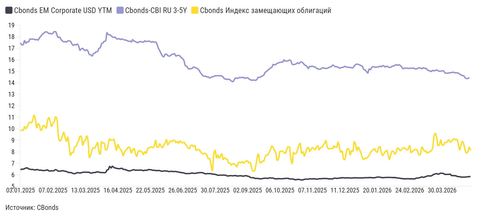

*График 28720908 — «Сравнение доходностей рублевых и валютных облигаций». Интерактив: https://flo.uri.sh/visualisation/28720908/embed. Данные: [CSV](../charts/28720908.csv), [JSON](../charts/28720908.json)*

Подписи и настройки графика: axes_highlights.x_areas: рецессия доткомов:: 28.02.2001 >> 30.11.2001; axes_highlights.x_lines: :: Прогноз; axes_highlights.y_lines: ::0; layout.source_name: CBonds; chart_type: line

| label | Cbonds EM Corporate USD YTM | Cbonds-CBI RU 3-5Y | Cbonds Индекс замещающих облигаций |
|---|---|---|---|
| 28.04.2026 | 5,87 |  | 8,14 |
| 27.04.2026 | 5,85 | 14,47 | 8,40 |
| 24.04.2026 | 5,84 | 14,37 | 7,98 |
| 23.04.2026 | 5,83 | 14,37 | 7,91 |
| 22.04.2026 | 5,81 | 14,44 | 8,17 |
| 21.04.2026 | 5,81 | 14,61 | 8,68 |
| 20.04.2026 | 5,81 | 14,63 | 8,91 |
| 17.04.2026 | 5,81 | 14,70 | 8,59 |
| 16.04.2026 | 5,85 | 14,75 | 8,18 |
| 15.04.2026 | 5,85 | 14,84 | 8,66 |
| 14.04.2026 | 5,88 | 14,88 | 9,08 |
| 13.04.2026 | 5,93 | 14,87 | 9,05 |
| 10.04.2026 | 5,93 | 14,89 | 9,14 |
| 09.04.2026 | 5,95 | 14,93 | 9,06 |
| 08.04.2026 | 5,94 | 14,88 | 8,91 |
| 07.04.2026 | 6,07 | 14,89 | 8,86 |
| 06.04.2026 | 6,05 | 14,85 | 9,04 |
| 03.04.2026 | 6,05 | 14,84 | 8,95 |
| 02.04.2026 | 6,05 | 14,84 | 8,8 |
| 01.04.2026 | 6,05 | 14,88 | 8,82 |
| 31.03.2026 | 6,13 | 15,04 | 8,56 |
| 30.03.2026 | 6,14 | 15,04 | 8,61 |
| 27.03.2026 | 6,15 | 15,02 | 9,03 |
| 26.03.2026 | 6,1 | 15,01 | 8,58 |
| 25.03.2026 | 6,07 | 15,05 | 8,55 |
| 24.03.2026 | 6,11 | 15,12 | 9,23 |
| 23.03.2026 | 6,09 | 15,07 | 9,61 |
| 20.03.2026 | 6,05 | 15,05 | 9,35 |
| 19.03.2026 | 5,99 | 15,08 | 8,35 |
| 18.03.2026 | 5,92 | 14,98 | 8,1 |
| … | … | … | … |
| 24.01.2025 | 6,41 | 17,91 | 10,32 |
| 23.01.2025 | 6,45 | 17,71 | 10,44 |
| 22.01.2025 | 6,47 | 17,77 | 10,11 |
| 21.01.2025 | 6,43 | 17,74 | 10,81 |
| 20.01.2025 | 6,44 | 17,79 | 11,18 |
| 17.01.2025 | 6,48 | 17,8 | 10,74 |
| 16.01.2025 | 6,47 | 17,8 | 10,53 |
| 15.01.2025 | 6,5 | 17,81 | 10,58 |
| 14.01.2025 | 6,53 | 17,57 | 10,47 |
| 13.01.2025 | 6,61 | 17,56 | 10,21 |
| 10.01.2025 | 6,6 | 17,44 | 10,02 |
| 09.01.2025 | 6,55 | 17,66 | 10,19 |
| 08.01.2025 | 6,5 | 17,31 | 9,88 |
| 06.01.2025 | 6,5 | 17,3 | 9,89 |
| 03.01.2025 | 6,44 | 17,48 | 9,83 |

*Показано 45 из 334 строк, полный ряд: [CSV](../charts/28720908.csv), [JSON](../charts/28720908.json)*

Важным фактором ценообразования валютных облигаций остаются ожидания относительно ослабления рубля на горизонте 12 месяцев. Именно этот фактор во многом поддерживал повышенный интерес инвесторов к таким бумагам и позволил эмитентам заметно нарастить объемы размещений в прошлом году.

Ожидания по девальвации

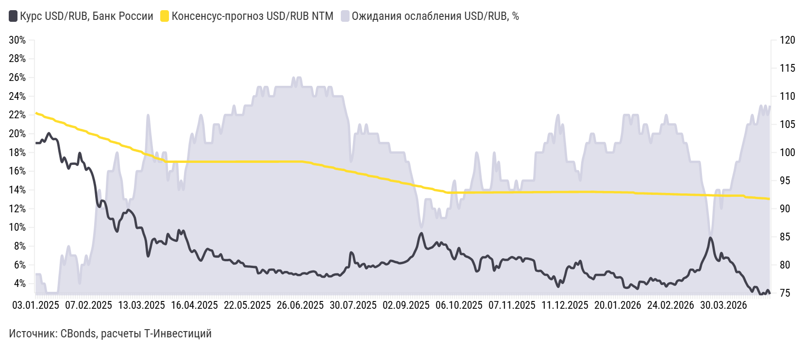

*График 28720949 — «Ожидания по девальвации». Интерактив: https://flo.uri.sh/visualisation/28720949/embed. Данные: [CSV](../charts/28720949.csv), [JSON](../charts/28720949.json)*

Подписи и настройки графика: axes_highlights.x_areas: беспрецедентная волатильность флоатеров:: 16.09.2024 >> 25.11.2024; axes_highlights.x_lines: :: Прогноз; axes_highlights.y_lines: ::0; layout.source_name: CBonds, расчеты Т-Инвестиций; chart_type: area_stacked_line

| Дата | Курс USD/RUB, Банк России | Консенсус-прогноз USD/RUB NTM | Ожидания ослабления USD/RUB, % |
|---|---|---|---|
| 28.04.2026 | 74,81 | 91,75 | 23% |
| 27.04.2026 | 75,53 | 91,77 | 22% |
| 24.04.2026 | 74,83 | 91,83 | 23% |
| 23.04.2026 | 75,00 | 91,85 | 22% |
| 22.04.2026 | 74,59 | 91,87 | 23% |
| 21.04.2026 | 75,24 | 91,89 | 22% |
| 20.04.2026 | 76,05 | 91,91 | 21% |
| 17.04.2026 | 76,09 | 91,97 | 21% |
| 16.04.2026 | 75,23 | 91,99 | 22% |
| 15.04.2026 | 75,85 | 92,01 | 21% |
| 14.04.2026 | 76,25 | 92,03 | 21% |
| 13.04.2026 | 76,97 | 92,05 | 20% |
| 10.04.2026 | 77,84 | 92,33 | 19% |
| 09.04.2026 | 78,30 | 92,33 | 18% |
| 08.04.2026 | 78,75 | 92,32 | 17% |
| 07.04.2026 | 78,73 | 92,32 | 17% |
| 06.04.2026 | 79,73 | 92,32 | 16% |
| 03.04.2026 | 80,33 | 92,32 | 15% |
| 02.04.2026 | 80,62 | 92,31 | 14% |
| 01.04.2026 | 81,25 | 92,31 | 14% |
| 31.03.2026 | 81,30 | 92,31 | 14% |
| 30.03.2026 | 81,14 | 92,32 | 14% |
| 27.03.2026 | 82,13 | 92,34 | 12% |
| 26.03.2026 | 80,72 | 92,35 | 14% |
| 25.03.2026 | 80,96 | 92,36 | 14% |
| 24.03.2026 | 81,88 | 92,36 | 13% |
| 23.03.2026 | 84,00 | 92,37 | 10% |
| 20.03.2026 | 84,84 | 92,39 | 9% |
| 19.03.2026 | 83,13 | 92,40 | 11% |
| 18.03.2026 | 81,91 | 92,41 | 13% |
| … | … | … | … |
| 24.01.2025 | 98,26 | 104,89 | 7% |
| 23.01.2025 | 99,10 | 105,20 | 6% |
| 22.01.2025 | 98,28 | 105,31 | 7% |
| 21.01.2025 | 99,93 | 105,41 | 5% |
| 20.01.2025 | 101,96 | 105,52 | 3% |
| 17.01.2025 | 102,41 | 105,62 | 3% |
| 16.01.2025 | 102,38 | 105,93 | 3% |
| 15.01.2025 | 102,81 | 106,03 | 3% |
| 14.01.2025 | 103,44 | 106,14 | 3% |
| 13.01.2025 | 102,71 | 106,24 | 3% |
| 10.01.2025 | 101,91 | 106,35 | 4% |
| 09.01.2025 | 102,29 | 106,66 | 4% |
| 08.01.2025 | 101,68 | 106,76 | 5% |
| 06.01.2025 | 101,68 | 106,87 | 5% |
| 03.01.2025 | 101,68 | 107,07 | 5% |

*Показано 45 из 334 строк, полный ряд: [CSV](../charts/28720949.csv), [JSON](../charts/28720949.json)*

Премия за потенциальное ослабление рубля по-прежнему заложена в котировки валютных выпусков, а всплеск доходностей за последний месяц создает привлекательную точку входа. Сейчас картина доходностей на рынке квазивалютного долга выглядит следующим образом.

- **5,3% годовых** — Ликвидные замещающие облигации Минфина с дюрацией до четырех лет

- **7,3% годовых** — Длинные и менее ликвидные госвыпуски

- **7,0—8,0% годовых** — Корпоративные валютные облигации с высоким рейтингом

- **6% годовых** — Еврооблигации на развивающихся рынках

Как выбирать квазивалютные облигации

На основе ключевых кредитных метрик мы разработали модель, которая позволяет соотносить доходность облигаций эмитента с уровнем его кредитного качества. С ее помощью мы еженедельно обновляем карту эмитентов — инструмент, который упрощает поиск надежных валютных выпусков.

Скоринг эмитентов валютных облигций

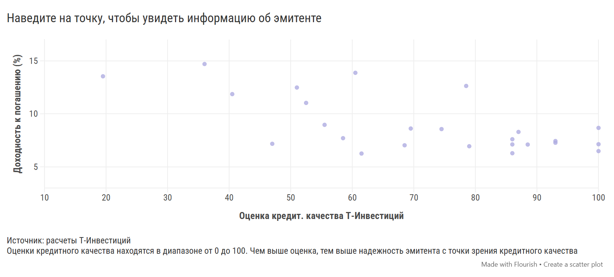

*График 28720992 — «Скоринг эмитентов валютных облигций» — Наведите на точку, чтобы увидеть информацию об эмитенте. Интерактив: https://flo.uri.sh/visualisation/28720992/embed. Данные: [CSV](../charts/28720992.csv), [JSON](../charts/28720992.json)*

Подписи и настройки графика: layout.footer_note_secondary: Оценки кредитного качества находятся в диапазоне от 0 до 100. Чем выше оценка, тем выше надежность эмитента с точки зрения кредитного качества; layout.source_name: расчеты Т-Инвестиций

| Эмитент | Оценка кредит. качества Т-Инвестиций | Доходность к погашению (%) |
|---|---|---|
| ПИК-Корпорация | 87 | 8.29 |
| Газпром | 79 | 6.94 |
| Лукойл | 100 | 6.48 |
| Металлоинвест | 58.5 | 7.7 |
| Совкомфлот | 86 | 7.6 |
| ФосАгро | 93 | 7.27 |
| Новатэк | 100 | 7.13 |
| Норильский никель | 79 | 0.21 |
| НЛМК | 100 | 8.67 |
| ТМК | 40.5 | 11.86 |
| РЖД | 61.5 | 6.25 |
| Полюс | 86 | 7.11 |
| Полипласт | 52.5 | 11.03 |
| АЛРОСА | 68.5 | 7.03 |
| Домодедово Фьюэл Фасилитис | 29 | 18.44 |
| РУСАЛ | 47 | 7.17 |
| Роснефть | 86 | 6.28 |
| Газпром нефть | 93 | 7.43 |
| Акрон | 88.5 | 7.1 |
| ЕвроСибЭнерго-Гидрогенерация | 55.5 | 8.96 |
| Славянск ЭКО | 36 | 14.7 |
| Сегежа | 18.5 | 18.23 |
| Борец Капитал | 19.5 | 13.54 |
| ГТЛК | 69.5 | 8.61 |
| МКБ | 78.5 | 12.63 |
| МФК Быстроденьги | 60.5 | 13.87 |
| Южуралзолото | 74.5 | 8.56 |
| Инвест КЦ | 51 | 12.48 |

Случаи резких колебаний доходностей квазивалютных выпусков в последние годы, как правило, были связаны с отдельными корпоративными событиями, а не со структурными изменениями на рынке. По нашему опыту, такие всплески обычно носят временный характер: спустя некоторое время рынок возвращается к более сбалансированным уровням. Поэтому подобные эпизоды могут служить хорошей точкой для более активных покупок.

#### Сергей Колбанов, аналитик Т-Инвестиций по долговым рынкам

Доходности этого сегмента облигаций сейчас предлагают премию к сопоставимым выпускам на развивающихся рынках. С учетом дополнительной премии за потенциальное ослабление рубля такие бумаги могут стать одними из самых привлекательных активов на горизонте 9—18 месяцев.

Потенциал получения привлекательной рублевой доходности по-прежнему остается высоким — прежде всего благодаря ожидаемому ослаблению рубля. По нашему прогнозу, средний курс на второй квартал 2027-го может составить около 93 рублей за доллар. На этом фоне мы считаем оправданным увеличение доли среднесрочных валютных выпусков в портфеле.

Почему мы делаем ставку именно на среднесрочные бумаги

### Длинные выпуски

Эффект валютной переоценки в них будет слишком размыт по времени, а значит, инвестиционный кейс окажется менее выраженным.

### Короткие выпуски

При ожидаемом плавном ослаблении рубля их доходность, вероятно, окажется ниже, чем у традиционных коротких рублевых облигаций.

### Среднесрочные выпуски

Добавление среднесрочных валютных облигаций в портфель выглядит наиболее рациональным решением. В целом локальные валютные облигации остаются одним из лучших инструментов для диверсификации портфеля и снижения валютных рисков в текущих рыночных условиях.

Наш выбор валютных облигаций

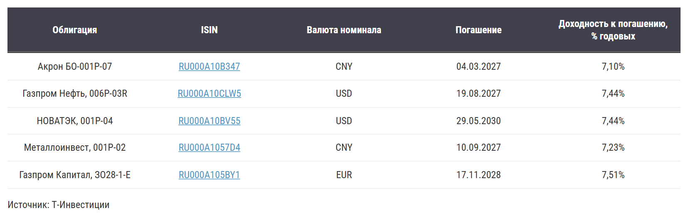

*График 28721033 — «Без названия». Интерактив: https://flo.uri.sh/visualisation/28721033/embed. Данные: [CSV](../charts/28721033.rows.csv), [JSON](../charts/28721033.json)*

Подписи и настройки графика: layout.source_name: Т-Инвестиции

| Облигация | ISIN | Валюта номинала | Погашение | Доходность к погашению, % годовых |
|---|---|---|---|---|
| Акрон БО-001P-07 | <a href="https://www.tbank.ru/invest/bonds/RU000A10B347/">RU000A10B347</a> | CNY | 04.03.2027 | 7,10% |
| Газпром Нефть, 006Р-03R | <a href="https://www.tbank.ru/invest/bonds/SIBN6P3/">RU000A10CLW5</a> | USD | 19.08.2027 | 7,44% |
| НОВАТЭК, 001P-04 | <a href="https://www.tbank.ru/invest/bonds/RU000A10BV55/">RU000A10BV55</a> | USD | 29.05.2030 | 7,44% |
| Металлоинвест, 001P-02 | <a href="https://www.tbank.ru/invest/bonds/RU000A1057D4/">RU000A1057D4</a> | CNY | 10.09.2027 | 7,23% |
| Газпром Капитал, ЗО28-1-Е | <a href="https://www.tbank.ru/invest/bonds/RU000A105BY1/">RU000A105BY1</a> | EUR | 17.11.2028 | 7,51% |

## Стратегию подготовили

- Софья Донец Главный экономист
- Юрий Тулинов Глава аналитики по рынку облигаций
- Марьяна Лазаричева Глава аналитики по рынку акций
- Егор Дахтлер Главный аналитик
- Александр Самуйлов Главный аналитик
- Ахмед Алиев Ведущий аналитик
- Сергей Колбанов Старший аналитик
- Александра Прыткова Ведущий аналитик
- Александр Потехин Ведущий аналитик
- Никита Степанов Старший аналитик
- Евгений Кошелев Аналитик по срочному рынку
- Евгений Митюков Директор по инвестициям, УК Т-Капитал
- Дария Лехницкая Руководитель редакционного отдела
- Анастасия Тушнолобова Руководитель аналитической редакции
- Илья Марченко Аналитический редактор

Аналитический отчет составлен в соответствии с Методикой оценки ценных бумаг Т-Банка. Обзор также содержит информацию о ценных бумагах, которые предназначены только для квалифицированных инвесторов в соответствии со ст. 51.2 Федерального закона №39-ФЗ «О рынке ценных бумаг».

АО «ТБанк», лицензия на осуществление брокерской деятельности № 045-14050-100000, лицензия на осуществление депозитарной деятельности № 045-14051-000100, выданы Банком России 06.03.2018 г. (без ограничения срока действия).

АО «ТБанк» не гарантирует получение доходности на рынке ценных бумаг. Клиент самостоятельно принимает решения по инвестированию и несет ответственность за полученный результат. Предлагаемые ценные бумаги иностранных эмитентов допущены к обращению на российском рынке.
