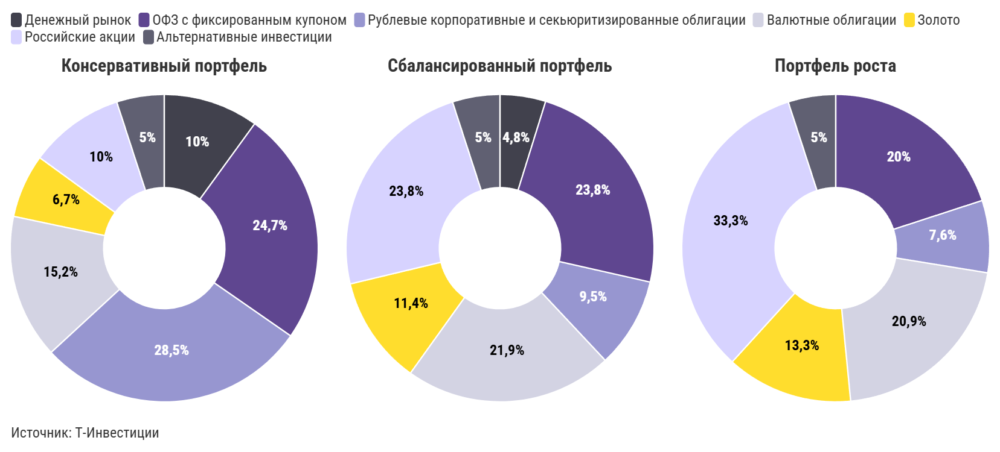
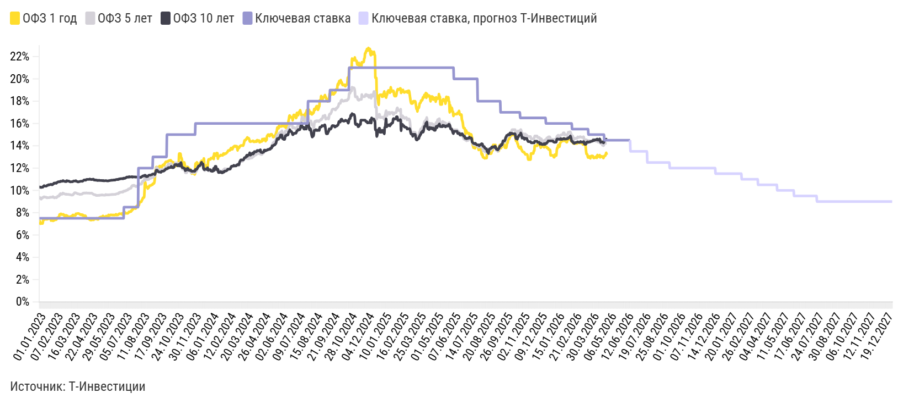
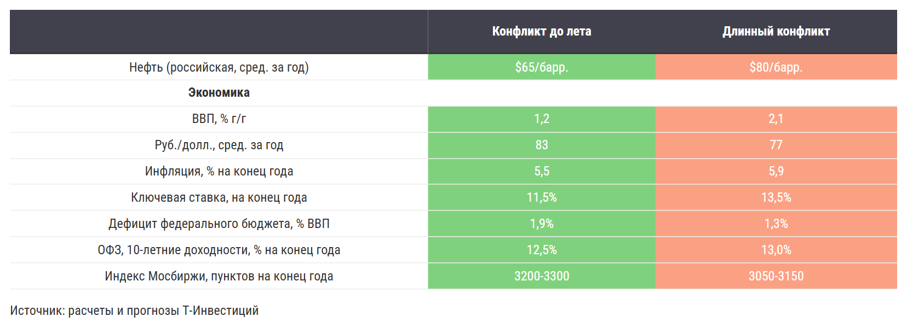

> Копия публичной страницы Т-Инвестиций для внутреннего анализа. Источник: https://www.tbank.ru/invest/research/strategy/2026/ · снято 2026-11-09
> Разделы: **Главная** · [Краткая версия](short.md) · [Рынок облигаций](bonds.md) · [Рынок акций](stocks.md) · [Альтернативные инвестиции](alternative.md)

# Стратегия на 2026 год

Геополитика, ключевая ставка, рынки: к чему готовиться инвесторам

## Главное из стратегии

Что изменилось за квартал

2026 год начался непросто для рынка. Во многом экономика продолжила следовать трендам конца прошлого года:

- торможение спроса и производства

- замедление инфляции

- крепкий рубль

Однако в глобальном контексте начало конфликта на Ближнем Востоке резко поменяло картину — предстоит понять, как станет развиваться ситуация и каковы будут финальные эффекты для рынков.

### Софья Донец, главный экономист Т-Инвестиций

На наш взгляд, российская экономика и рынок все же вынесут позитив из глобального роста сырья. Риски тоже есть, в том числе связанные с возможным стагфляционным сценарием в мире. Однако сбалансированная политика правительства и Банка России и высокая обеспеченность России собственным сырьем способны их компенсировать.

Внешняя неопределенность и внутренняя накопленная усталость от продолжительного периода высоких ставок, роста налогов и геополитической напряженности сдерживают рост рынка. Но продолжающееся снижение ключевой ставки на фоне стабилизации инфляции будет способствовать возобновлению внутреннего инвестиционного цикла во второй половине года и оживлению аппетита к риску.

**С учетом этого в целевых портфелях мы:**

### Поддерживаем диверсификацию по классам активов

Она необходима в условиях повышенной неопределенности

### Продолжаем сокращать долю инструментов денежного рынка

По мере снижения их доходности

### Сохраняем фокус на облигациях

Однако немного снижаем долю ОФЗ, частично фиксируя уже реализовавшуюся прибыль

### Увеличиваем долю валютных инструментов

Используем тактический момент укрепления рубля, чтобы умеренно повысить их долю в портфеле

### Повышаем фокус на корпоративных рублевых облигациях

Включая секьюритизированные выпуски. Они позволяют зафиксировать пока еще повышенные доходности на средний срок, предлагая выгодную альтернативу депозитам соответствующей длины

Что сейчас делать инвесторам

Ставка на облигации остается актуальной в ближайшие месяцы. ОФЗ по-прежнему являются ключевыми бенефициарами смягчения политики Банка России. В корпоративном сегменте важна избирательность из-за возросших кредитных рисков. Альтернативой классическому долгу остаются секьюритизированные облигации.

Акции получат драйверы роста во второй половине года вместе с постепенным разворотом корпоративных прибылей к росту. При восстановлении аппетита к риску быстрее могут отыгрываться инвестиционно ориентированные сектора и компании малой и средней капитализации, но сейчас отдаем предпочтение устойчивым бизнесам с проверенной корпоративной стратегией.

Ставка на защиту от валютных и внешних рисков. С учетом наших ожиданий по умеренному ослаблению рубля квазивалютные инструменты остаются привлекательными благодаря потенциальной доходности. К тому же замещающие и юаневые облигации вместе с золотом сохраняют защитную роль на случай негативных внешних сценариев.

**Как инвестору подготовить портфель под любые сценарии и всегда оказываться в выигрыше ー читайте ниже в нашей большой стратегии.**

## Портфель-2026 год: защита, доходность и гибкость

### Облигации: базовые активы для нестабильного рынка

### ОФЗ

ОФЗ остаются привлекательными на годовом горизонте на фоне ожиданий смягчения денежно-кредитной политики Банка России. Неопределенность в моменте добавляет неясность бюджетной конструкции на 2026 год и в перспективе.

Наш выбор на рынке ОФЗ

#### ОФЗ 26249

Фиксированный купон

Доходность к погашению 14,21% (2032 год)

#### ОФЗ 26246

Фиксированный купон

Доходность к погашению 14,69% (2036 год)

#### ОФЗ 29015

Плавающий купон

Погашение 18.10.2028

- Инструмент `TOFZ@` ([карточка](https://www.tbank.ru/invest/etfs/TOFZ@/))

#### Т-Капитал ОФЗ (TOFZ)

Биржевой фонд в ОФЗ, который адаптируется к изменениям ключевой ставки

### Корпоративные облигации

В корпоративных облигациях важно успеть зафиксировать высокие доходности в бумагах надежных эмитентов, но при этом не игнорировать кредитные риски и точечно добавлять защиту через флоатеры.

Наш выбор на рынке корпоративных облигаций

- ПГК 003Р-02 Годовая доходность — 16,60% Погашение: 29.03.2029
- Европлан 001Р-09 Годовая доходность — 15,99% Погашение: 14.07.2028
- АБЗ-1 002Р-06 Годовая доходность — 19,15% Погашение: 01.04.2029
- ВИС ФИНАНС БО-П11 Годовая доходность — 17,10% Погашение: 15.02.2029
- Селигдар 001Р-10 Годовая доходность — 17,02% Погашение: 07.04.2029
- Авто Финанс Банк БО-001Р-18 Годовая доходность — 15,21% Погашение: 14.03.2029

### Валютные облигации

Валютные облигации сейчас дают инвестору редкую возможность одновременно получить высокую валютную доходность, диверсифицировать портфель и заранее подготовиться к вероятному ослаблению рубля.

- Инструмент `TLCB@` ([карточка](https://www.tbank.ru/invest/etfs/TLCB@/))

#### Локальные валютные облигации (TLCB)

Биржевой фонд инвестирует в облигации российских эмитентов, доходность по которым привязана к иностранной валюте

Наш выбор валютных облигаций

- Акрон БО-001P-07 Валюта номинала: CNY Доходность к погашению: 7,10% Дата погашения: 04.03.2027
- Газпром Нефть 006Р-03R Валюта номинала: USD Доходность к погашению: 7,44% Дата погашения: 19.08.2027
- НОВАТЭК, 001P-04 Валюта номинала: USD Доходность к погашению: 7,44% Дата погашения: 29.05.2030
- Металлоинвест 001P-02 Валюта номинала: CNY Доходность к погашению: 7,23% Дата погашения: 10.09.2027
- Газпром Капитал ЗО28-1-Е Валюта номинала: EUR Доходность к погашению: 7,51% Дата погашения: 17.11.2028

Золото: классический защитный актив

### Золото

Даже при текущих высоких ценах золото сохраняет статус надежного защитного инструмента на фоне геополитической нестабильности и повышенной неопределенности.

- Инструмент `TGLD@` ([карточка](https://www.tbank.ru/invest/etfs/TGLD@/))

#### Золото (TGLD)

Биржевой фонд от Т-Капитал, который поможет защитить накопления от инфляции без инфраструктурных рисков: золото хранится на территории России, валюта торгов — рубли

Ликвидность: доход с возможностью маневра

Фонды денежного рынка за последние два года стали обязательным элементом портфелей, сочетая доходность высоких ставок с высокой ликвидностью. По мере снижения ключевой ставки их доходность будет снижаться, но, вероятно, медленнее, чем по депозитам.

- Инструмент `TMON@` ([карточка](https://www.tbank.ru/invest/etfs/TMON@/))

#### Денежный рынок (TMON)

Фонд с доходностью, близкой к ключевой ставке, формирует доход за счёт инструментов денежного рынка

Акции: ставка на качество в условиях волатильности

### Акции

Российский рынок акций в 2026 году сохраняет потенциал роста. Однако он реализуется не сразу, а ближе к третьему-четвертому кварталу, когда начнут проявляться эффекты снижения ставок, возможного оживления экономики и нормализации рубля. В ближайшие месяцы сохраняем акцент на осторожность и выборе качественных, устойчивых компаний, а не на повышении риска.

Наш выбор на рынке акций

Чтобы посмотреть все 12 акций, листайте карусель →

- Яндекс Целевая цена — 6 250 ₽ Потенциал роста: +51% без учета дивидендов +56% с учетом дивидендов
- Озон Целевая цена — 6 500 ₽ Потенциал роста: +50% без учета дивидендов +55% с учетом дивидендов
- Хэдхантер Целевая цена — 3 800 ₽ Потенциал роста: +28% без учета дивидендов +46% с учетом дивидендов
- Сбер Целевая цена — 368 ₽ Потенциал роста: +15% без учета дивидендов +27% с учетом дивидендов
- ДОМ.РФ Целевая цена — 2 720 ₽ Потенциал роста: +24% без дивидендов +35% с дивидендами
- Полюс Целевая цена — 2 900 ₽ Потенциал роста: +38% без учета дивидендов +48% с учетом дивидендов
- Озон Фармацевтика Целевая цена — 70 ₽ Потенциал роста: +47% без учета дивидендов +49% с учетом дивидендов
- Лента Целевая цена — 2 300 ₽ Потенциал роста: +33% (дивидендов не ждем)
- Мать и дитя Целевая цена — 1 680 ₽ Потенциал роста: +25% без учета дивидендов +33% c учетом дивидендов
- НОВАТЭК Целевая цена — 1 410 ₽ Потенциал роста: +20% без учета дивидендов +28% с учетом дивидендов
- Транснефть Целевая цена — 1 650 ₽ Потенциал роста: +20% без учета дивидендов +33% с учетом дивидендов
- GloraX Целевая цена — 98 ₽ Потенциал роста: +71% (дивидендов не ждем)

## Оптимальные портфели для российского инвестора по разным риск-профилям

С учетом макроэкономического прогноза мы обновили оптимальные портфели (ссылка на раздел), сформированные исходя из ожидаемой доходности различных классов активов на горизонте 12 месяцев. При их расчете используются методы оптимизации соотношения доходности и риска, а также учитывается корреляция между активами.

В рамках стратегий фондов Т-Капитала мы сохраняем приоритет в пользу рублевых облигаций — как ОФЗ, так и корпоративных, включая секьюритизированные выпуски.

По мере снижения доходностей на рынке ОФЗ целесообразно постепенно сокращать экспозицию в этих инструментах и перераспределять портфель в бумаги с меньшей дюрацией. Вместе с этим увеличение доли валютных активов на текущих уровнях позволяет повысить диверсификацию портфеля и снизить риски в случае возможного ослабления рубля.

*График 28734714 — «Без заголовка». Интерактив: https://flo.uri.sh/visualisation/28734714/embed. Данные: [CSV](../charts/28734714.csv), [JSON](../charts/28734714.json)*

Подписи и настройки графика: layout.source_name: Т-Инвестиции; chart_type: donut

| Класс активов | Консервативный портфель | Сбалансированный портфель | Портфель роста |
|---|---|---|---|
| Денежный рынок | 10% | 4,8% |  |
| ОФЗ с фиксированным купоном | 24,7% | 23,8% | 20,0% |
| Рублевые корпоративные и секьюритизированные облигации | 28,5% | 9,5% | 7,6% |
| Валютные облигации | 15,2% | 21,9% | 20,9% |
| Золото | 6,7% | 11,4% | 13,3% |
| Российские акции | 10% | 23,8% | 33,3% |
| Альтернативные инвестиции | 5,0% | 5,0% | 5,0% |

#### Макро

- Ситуация по секторам
- Бюджет
- Инфляция
- Ключевая ставка
- Рубль
- Геополитика

#### Акции

- Нефтегаз
- Металлурги
- IT-сектор
- Потребительский сектор
- Девелопмент
- Финансы

#### Облигации

- Сегмент ОФЗ
- Корпоративный долг
- Валютные бонды

#### Альтернативные

- Золото
- Срочный рынок
- Стратегии от Т-Инвестиций

## Макро

Экономика-2026: где точка разворота?

2026 год начался непросто: экономика продолжает замедляться, сохраняются опасения по кредитным рискам и высокий уровень внешней неопределенности. Глобальная турбулентность усилилась, что, с одной стороны, создало возможности для России на сырьевых рынках, а с другой — добавило рисков и потенциальных издержек.

#### Софья Донец, главный экономист Т-Инвестиций

В этих условиях мы делаем ставку на внутренние драйверы, которые со временем могут остановить замедление, запустить восстановление экономики и вернуть бизнесу интерес к инвестициям, а рынкам — аппетит к риску. В фокусе — политика Банка России и динамика потребительского спроса.

Наш базовый сценарий: рост с оглядкой на риски

Несмотря на слабое начало года, мы ожидаем постепенного перехода от «управляемой посадки» к «управляемому восстановлению» экономики. Ключевую роль в этом процессе сыграет политика Банка России, тогда как геополитика остается главным источником неопределенности.

**Улучшаем прогноз роста ВВП, но фон остается слабым**

Мы умеренно повышаем прогноз роста ВВП на 2026 год — до 1,2% против 0,9% ранее. Начало года оказалось слабее ожиданий: замедление усилилось в ряде ключевых отраслей. В то же время рост сырьевых цен улучшает среднесрочные перспективы экономики с учетом высокой доли экспортно ориентированных отраслей и структуры бюджета. Ключевые вопросы: насколько устойчивым окажется этот рост цен и как будут меняться экспортные объемы на фоне геополитических рисков и давления на инфраструктуру?

**Потребительский спрос останется главным драйвером экономики**

Как и в 2025 году, основную поддержку росту окажет потребление. Положительный вклад сохранят и государственные расходы. Мы ожидаем дальнейшего замедления в первом полугодии с переходом к восстановительному росту во втором. Важное условие для этого — снижение ключевой ставки, которое должно поддержать деловую активность и потребительские настроения. При этом риски для прогноза по-прежнему смещены вниз и связаны прежде всего с внешней конъюнктурой и возможной задержкой смягчения денежно-кредитной политики.

Ситуация по секторам в 2026 году

### Потребительский сектор, здравоохранение, электроэнергетика

Сохраняется умеренный рост в отраслях, ориентированных на внутренний спрос. Занятость остается высокой, зарплаты продолжают расти, а спрос концентрируется внутри страны. Первое полугодие — период замедления, но по мере снижения ставок возможно оживление, включая отложенный спрос на товары длительного пользования.

### Строительство, транспорт, промышленность

В инвестиционных отраслях восстановление, вероятно, начнется во второй половине года по мере удешевления кредитов.

### Нефть и газ, металлургия, добыча

Экспортные отрасли получили поддержку от роста мировых цен и перераспределения спроса на сырье. Однако часть эффекта могут нивелировать геополитические риски (давление на логистику и инфраструктуру) и потенциальное укрепление рубля.

Сдержанный бюджет снижает инфляционные риски

Бюджетная политика станет более консервативной.

#### Рост расходов

Составит не более 5% г/г против 15—20% в 2022–2024 годах. Это ослабляет поддержку экономике, но одновременно снижает инфляционное давление

#### Дефицит бюджета

Сократится примерно до 2% ВВП (с 2,6% в 2025 году) при цене нефти около $65 за баррель

Рост цен на сырье снизил давление на ФНБ и уменьшил риски масштабного увеличения заимствований и повышения налоговой нагрузки. При этом обсуждаются разовые налоги для отдельных отраслей с высокой рентабельностью. Их влияние на рынок будет зависеть от параметров, но разовый характер должен ограничить эффект на оценку компаний.

Минфин также может ужесточить бюджетное правило — в частности, снизить базовую цену нефти. Это ограничит долгосрочный рост расходов, но одновременно может ослабить поддержку рубля.

Напряжение на рынке труда снижается

Наш прогноз по рынку труда:

#### Дефицит кадров

Постепенно смягчается за счет более осторожного найма

#### Рост зарплат

Замедлится до 8—10% г/г (с ~14% в 2025 году)

#### Безработица

Останется на низком уровне — около 2,5%, с возможным ростом выше 3% только при внешнем шоке или рецессии

Инфляция под контролем, но с рисками

#### Инфляция с учетом регулярных факторов (НДС, индексация ЖКХ)

Составит около 5,5% г/г по итогам 2026 года

#### Базовая инфляция

Будет находиться в диапазоне 4—5% г/г, по нашей оценке

Сдерживающими факторами выступают слабый спрос и снижение давления со стороны зарплат. Дополнительно помогают высокая обеспеченность страны сырьем и меры регулирования (демпфер, ограничения экспорта топлива), а также относительно крепкий рубль.

В то же время рост мировых цен на сырье может усиливать инфляционные риски через внешний канал.

Банк России берет курс на смягчение

Банк России продолжает цикл снижения ставки, который может ускориться во втором — третьем кварталах.

Наш прогноз по ключевой ставке:

- **11,5% к концу года** — Базовый сценарий

- **13—14% к концу года** — Консервативный сценарий

Снижение ставок поддержит кредитование и инвестиции, но одновременно снизит привлекательность депозитов. Рост кредитования замедлится до 5—8% (с 9,4% в 2025 году) из-за регулирования и накопленное ранее долговой нагрузки в корпоративном сегменте.

Ключевая ставка и доходности ОФЗ

*График 28753262 — «Наш прогноз по ключевой ставки». Интерактив: https://flo.uri.sh/visualisation/28753262/embed. Данные: [CSV](../charts/28753262.csv), [JSON](../charts/28753262.json)*

Подписи и настройки графика: axes_highlights.x_areas: рецессия доткомов:: 28.02.2001 >> 30.11.2001; axes_highlights.x_lines: :: Прогноз; axes_highlights.y_lines: ::0; layout.source_name: Т-Инвестиции; chart_type: line

| label | ОФЗ 1 год | ОФЗ 5 лет | ОФЗ 10 лет | Ключевая ставка | Ключевая ставка, прогноз Т-Инвестиций |
|---|---|---|---|---|---|
| 01.01.2023 | 7,25 | 9,37 | 10,31 | 7,5 |  |
| 02.01.2023 | 7,25 | 9,37 | 10,31 | 7,5 |  |
| 03.01.2023 | 7,01 | 9,28 | 10,27 | 7,5 |  |
| 04.01.2023 | 7,03 | 9,25 | 10,28 | 7,5 |  |
| 05.01.2023 | 7,06 | 9,21 | 10,26 | 7,5 |  |
| 06.01.2023 | 7,03 | 9,33 | 10,28 | 7,5 |  |
| 07.01.2023 | 7,03 | 9,33 | 10,28 | 7,5 |  |
| 08.01.2023 | 7,03 | 9,33 | 10,28 | 7,5 |  |
| 09.01.2023 | 7,35 | 9,39 | 10,35 | 7,5 |  |
| 10.01.2023 | 7,43 | 9,38 | 10,37 | 7,5 |  |
| 11.01.2023 | 7,36 | 9,43 | 10,43 | 7,5 |  |
| 12.01.2023 | 7,39 | 9,41 | 10,39 | 7,5 |  |
| 13.01.2023 | 7,42 | 9,39 | 10,38 | 7,5 |  |
| 14.01.2023 | 7,42 | 9,39 | 10,38 | 7,5 |  |
| 15.01.2023 | 7,42 | 9,39 | 10,38 | 7,5 |  |
| 16.01.2023 | 7,43 | 9,37 | 10,39 | 7,5 |  |
| 17.01.2023 | 7,4 | 9,34 | 10,44 | 7,5 |  |
| 18.01.2023 | 7,41 | 9,34 | 10,45 | 7,5 |  |
| 19.01.2023 | 7,44 | 9,36 | 10,45 | 7,5 |  |
| 20.01.2023 | 7,46 | 9,35 | 10,5 | 7,5 |  |
| 21.01.2023 | 7,46 | 9,35 | 10,5 | 7,5 |  |
| 22.01.2023 | 7,46 | 9,35 | 10,5 | 7,5 |  |
| 23.01.2023 | 7,47 | 9,36 | 10,5 | 7,5 |  |
| 24.01.2023 | 7,44 | 9,39 | 10,53 | 7,5 |  |
| 25.01.2023 | 7,43 | 9,37 | 10,53 | 7,5 |  |
| 26.01.2023 | 7,29 | 9,39 | 10,56 | 7,5 |  |
| 27.01.2023 | 7,32 | 9,38 | 10,51 | 7,5 |  |
| 28.01.2023 | 7,32 | 9,38 | 10,51 | 7,5 |  |
| 29.01.2023 | 7,32 | 9,38 | 10,51 | 7,5 |  |
| 30.01.2023 | 7,27 | 9,44 | 10,56 | 7,5 |  |
| … | … | … | … | … | … |
| 17.12.2027 |  |  |  |  | 9 |
| 18.12.2027 |  |  |  |  | 9 |
| 19.12.2027 |  |  |  |  | 9 |
| 20.12.2027 |  |  |  |  | 9 |
| 21.12.2027 |  |  |  |  | 9 |
| 22.12.2027 |  |  |  |  | 9 |
| 23.12.2027 |  |  |  |  | 9 |
| 24.12.2027 |  |  |  |  | 9 |
| 25.12.2027 |  |  |  |  | 9 |
| 26.12.2027 |  |  |  |  | 9 |
| 27.12.2027 |  |  |  |  | 9 |
| 28.12.2027 |  |  |  |  | 9 |
| 29.12.2027 |  |  |  |  | 9 |
| 30.12.2027 |  |  |  |  | 9 |
| 31.12.2027 |  |  |  |  | 9 |

*Показано 45 из 1826 строк, полный ряд: [CSV](../charts/28753262.csv), [JSON](../charts/28753262.json)*

Сильный рубль сегодня — слабее завтра

Наш прогноз по рублю:

- **83 руб/долл** — В среднем за год

- **12 руб/юань** — В среднем за год

В апреле рубль укрепился до уровней ниже 75 руб/долл на фоне высоких сырьевых цен и приостановки валютных операций Минфина. Возобновление действия бюджетного правила в мае–июне должно сделать рынок более сбалансированным и вернуть рубль в интервал 76-79 руб/долл или 11-11,5 руб/юань.

Во втором полугодии ожидается разворот в сторону ослабления из-за восстановления импорта и снижения рублевых ставок. Умеренное ослабление не создаст инфляционных рисков, так как он все равно останется крепче средних уровней 2024 года.

Ближний Восток держит рынки в напряжении

Сырьевая конъюнктура остается критически важной: нефтегазовый сектор формирует более половины экспорта и свыше 20% доходов бюджета.

После эскалации конфликта в марте цены на нефть резко выросли — до уровней выше $75 за баррель в среднем и до $100 в отдельные недели.

#### Базовый сценарий: деэскалация до середины лета

→ Постепенное снижение цен, средний уровень около 65 долл/барр → Умеренно позитивный эффект для экономики и рубля

#### Альтернативный сценарий: затяжной конфликт

→ Цены около 80 долл./барр. → Ускорение роста экономики и укрепление рубля в 2026 году, сменяющееся более ощутимой коррекцией в 2027 году на фоне развития рецессионного сценария в мире. → Более высокая волатильность и рост геополитических рисков.

Сценарии конфликта на Ближнем Востоке

*График 28646399 — «Сценарии конфликта на Ближнем Востоке». Интерактив: https://flo.uri.sh/visualisation/28646399/embed. Данные: [CSV](../charts/28646399.rows.csv), [JSON](../charts/28646399.json)*

Подписи и настройки графика: layout.source_name: расчеты и прогнозы Т-Инвестиций

| columns_0 | Конфликт до лета | Длинный конфликт |
|---|---|---|
| Нефть (российская, сред. за год) | $65/барр. | $80/барр. |
| **Экономика** |  |  |
| ВВП, % г/г | 1,2 | 2,1 |
| Руб./долл., сред. за год | 83 | 77 |
| Инфляция, % на конец года | 5,5 | 5,9 |
| Ключевая ставка, на конец года | 11,5% | 13,5% |
| Дефицит федерального бюджета, % ВВП | 1,9% | 1,3% |
| ОФЗ, 10-летние доходности, % на конец года | 12,5% | 13,0% |
| Индекс Мосбиржи, пунктов на конец года | 3200-3300 | 3050-3150 |

## Стратегию подготовили

- Софья Донец Главный экономист
- Юрий Тулинов Глава аналитики по рынку облигаций
- Марьяна Лазаричева Глава аналитики по рынку акций
- Егор Дахтлер Главный аналитик
- Александр Самуйлов Главный аналитик
- Ахмед Алиев Ведущий аналитик
- Сергей Колбанов Старший аналитик
- Александра Прыткова Ведущий аналитик
- Александр Потехин Ведущий аналитик
- Никита Степанов Старший аналитик
- Евгений Кошелев Аналитик по срочному рынку
- Евгений Митюков Директор по инвестициям, УК Т-Капитал
- Дария Лехницкая Руководитель редакционного отдела
- Анастасия Тушнолобова Руководитель аналитической редакции
- Илья Марченко Аналитический редактор

Аналитический отчет составлен в соответствии с Методикой оценки ценных бумаг Т-Банка. Обзор также содержит информацию о ценных бумагах, которые предназначены только для квалифицированных инвесторов в соответствии со ст. 51.2 Федерального закона №39-ФЗ «О рынке ценных бумаг».

АО «ТБанк», лицензия на осуществление брокерской деятельности № 045-14050-100000, лицензия на осуществление депозитарной деятельности № 045-14051-000100, выданы Банком России 06.03.2018 г. (без ограничения срока действия).

АО «ТБанк» не гарантирует получение доходности на рынке ценных бумаг. Клиент самостоятельно принимает решения по инвестированию и несет ответственность за полученный результат. Предлагаемые ценные бумаги иностранных эмитентов допущены к обращению на российском рынке.
