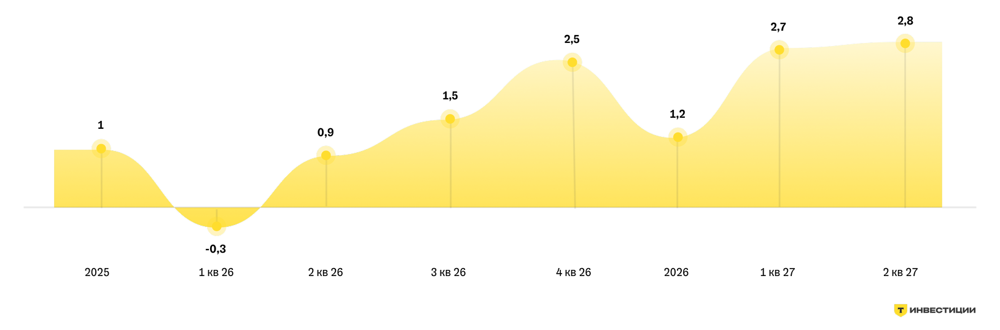
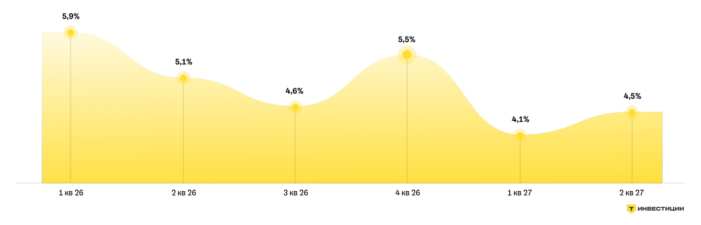
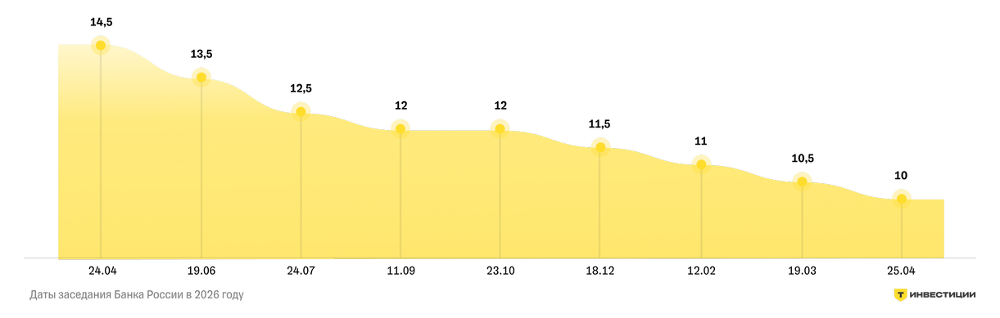
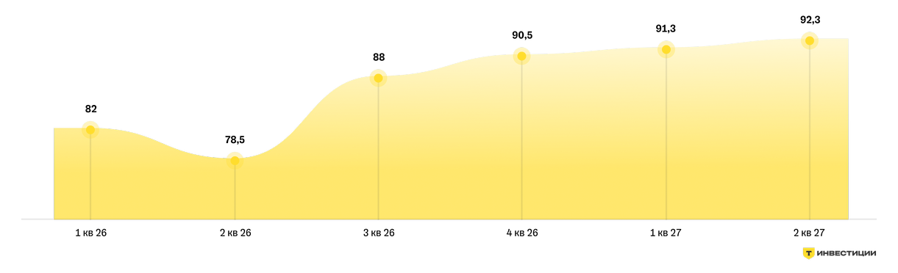
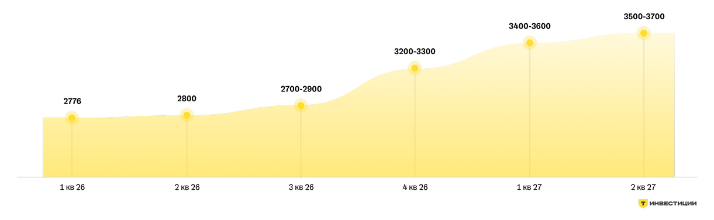

> Копия публичной страницы Т-Инвестиций для внутреннего анализа. Источник: https://www.tbank.ru/invest/research/strategy/2026/short/ · снято 2026-11-09
> Разделы: [Главная](main.md) · **Краткая версия** · [Рынок облигаций](bonds.md) · [Рынок акций](stocks.md) · [Альтернативные инвестиции](alternative.md)

## Стратегия на 2026 год

Собрали самое главное в коротком формате

## Зачем нужна стратегия

Аналитики Т-Инвестиций регулярно выпускают стратегию — большой обзор о том, что происходит с экономикой и рынками. Эксперты рассказывают, как может измениться ключевая ставка и курс рубля, что это значит для акций и облигаций и какие идеи сейчас кажутся наиболее интересными для инвестиций.

Для инвестора это важно, потому что стратегия помогает понять, чего ждать от рынка, как распределить капитал правильно и какие риски учесть заранее. Это простой способ взглянуть на свой портфель и убедиться, что он готов к любому сценарию.

## Что будет с российской экономикой?

2026 год начался с замедления экономики: бизнес осторожнее инвестирует, потребители тратят сдержаннее, а внешняя неопределенность остается высокой. Но наш базовый сценарий — постепенный переход к восстановлению экономики во второй половине года. Главные условия для этого:

- снижение ключевой ставки

- сохранение потребительского спроса

- относительно благоприятные цены на сырье

ВВП

ВВП в 2026 году может вырасти на 1,2%. Это умеренный рост: экономика не разгоняется быстро, но и не уходит в глубокое падение. Поддержку дадут расходы населения и государства. Если ставка будет снижаться, кредиты станут доступнее, бизнесу будет проще инвестировать, а людям — совершать крупные покупки.

Наш прогноз по ВВП

*Значения расшифрованы с картинки:*

| Период | ВВП, % г/г |
|---|---|
| 2025 | 1 |
| 1 кв 26 | -0,3 |
| 2 кв 26 | 0,9 |
| 3 кв 26 | 1,5 |
| 4 кв 26 | 2,5 |
| 2026 | 1,2 |
| 1 кв 27 | 2,7 |
| 2 кв 27 | 2,8 |

Ситуация по секторам

### Потребительский сектор, здравоохранение и электроэнергетика

Могут держаться лучше за счет внутреннего спроса.

### Строительство, транспорт и промышленность

Сильнее зависят от стоимости кредитов, поэтому оживление там возможно ближе ко второй половине года.

### Нефтегаз, металлургия и добыча

Выигрывают от высоких сырьевых цен, но для них важны геополитика, логистика и курс рубля.

Инфляция

Мы ожидаем, что по итогам 2026 года инфляция составит около 5,5% год к году. В этом прогнозе уже учтены регулярные факторы, которые могут подталкивать цены вверх: повышение НДС, индексация тарифов ЖКХ и другие плановые изменения.

Базовая инфляция, по нашей оценке, будет находиться в диапазоне 4—5% год к году.

Сдерживать рост цен будут слабый потребительский спрос и меньшее давление со стороны зарплат. Также инфляции помогают не разгоняться высокая обеспеченность страны сырьем, меры регулирования (например, демпфер и ограничения экспорта топлива) и относительно крепкий рубль.

Но риски сохраняются. Если мировые цены на сырье будут расти, это может усилить инфляционное давление и внутри страны.

Наш прогноз по инфляции

*Значения расшифрованы с картинки:*

| Период | Инфляция |
|---|---|
| 1 кв 26 | 5,9% |
| 2 кв 26 | 5,1% |
| 3 кв 26 | 4,6% |
| 4 кв 26 | 5,5% |
| 1 кв 27 | 4,1% |
| 2 кв 27 | 4,5% |

Ключевая ставка

Мы ожидаем, что Банк России продолжит снижать ключевую ставку. Во втором — третьем кварталах этот процесс может ускориться.

Наш прогноз по ключевой ставке к концу года:

- **11,5%** — Базовый сценарий

- **13—14%** — Консервативный сценарий

Для инвестора это значит, что доходность депозитов со временем будет снижаться, а интерес к облигациям и акциям может постепенно расти.

Наш прогноз по ключевой ставке

*Значения расшифрованы с картинки:*

| Заседание Банка России (дд.мм) | Ключевая ставка, % |
|---|---|
| 24.04 | 14,5 |
| 19.06 | 13,5 |
| 24.07 | 12,5 |
| 11.09 | 12 |
| 23.10 | 12 |
| 18.12 | 11,5 |
| 12.02 | 11 |
| 19.03 | 10,5 |
| 25.04 | 10 |

Рубль

Рубль сейчас крепкий, но во втором полугодии может ослабнуть. Причины — восстановление импорта и снижение рублевых ставок. Умеренное ослабление рубля может поддержать экспортеров, но слишком резкое — усилить инфляционные риски.

Наш прогноз по рублю

*Значения расшифрованы с картинки:*

| Период | Курс рубля (как на графике) |
|---|---|
| 1 кв 26 | 82 |
| 2 кв 26 | 78,5 |
| 3 кв 26 | 88 |
| 4 кв 26 | 90,5 |
| 1 кв 27 | 91,3 |
| 2 кв 27 | 92,3 |

## Что делать инвестору: рекомендации аналитиков Т-Инвестиций

### Для начинающего инвестора главный вывод простой:

2026 год может стать годом постепенного разворота, но входить в рискованные активы лучше не на всю сумму, а постепенно и с учетом возможных просадок.

Рынок облигаций

ОФЗ

Рынок облигаций пока ждет сильного сигнала. Ставка ЦБ уже снижается, но длинные ОФЗ, то есть облигации со сроком погашения через 10–15 лет, почти не растут в цене. Инвесторы все еще боятся инфляции, высокого объема новых заимствований Минфина и неопределенности по бюджету. Поэтому лучше не делать ставку только на один тип бумаг, а собирать портфель из разных облигаций.

**Если Банк России начнет снижать ставку быстрее, ОФЗ могут получить импульс к росту.**

Наши рекомендации по ОФЗ

#### ОФЗ 26249

Фиксированный купон

Доходность к погашению 14,21% (2032 год)

#### ОФЗ 26246

Фиксированный купон

Доходность к погашению 14,69% (2036 год)

#### ОФЗ 29015

Плавающий купон

Погашение 18.10.2028

Корпоративные облигации

Ставки снижаются, и инвесторы активнее покупают корпоративные облигации. Но риски дефолтов остаются: в 2025 году их было много, а в 2026 году уже появились новые случаи.

**Важно не гнаться за максимальной доходностью, а выбирать надежных эмитентов с сильным бизнесом и устойчивыми финансами.**

Наш выбор на рынке корпоративных облигаций

- ПГК 003Р-02 Годовая доходность — 16,43% Погашение: 29.03.2029
- Европлан 001Р-09 Годовая доходность — 14,81% Погашение: 14.07.2028
- АБЗ-1 002Р-06 Годовая доходность — 18,86% Погашение: 01.04.2029
- ВИС ФИНАНС БО-П11 Годовая доходность — 16,25% Погашение: 15.02.2029
- Селигдар 001Р-10 Годовая доходность — 16,98% Погашение: 07.04.2029
- Авто Финанс Банк БО-001Р-18 Годовая доходность — 15% Погашение: 14.03.2029

Рынок акций

2026 год пока остается непростым для рынка акций. Экономика замедляется, ставки все еще высокие, а инвесторы осторожничают. Но мы считаем, что во второй половине года ситуация может начать улучшаться.

Сейчас рынок выглядит «хрупким»: акции не падают сильно, но и уверенного роста пока нет.

Причин несколько:

#### Высокие ставки

Депозиты и облигации все еще выглядят привлекательнее акций

#### Экономика охлаждается

Компаниям становится сложнее зарабатывать

#### Крепкий рубль

Давит на экспортеров, особенно нефтегазовый сектор

#### Геополитика

Остается источником неопределенности

Наш базовый сценарий предполагает рост индекса Мосбиржи до 3 200–3 300 пунктов к концу 2026 года. Но путь к этому росту, вероятно, останется неровным: ближайшие месяцы рынок еще может двигаться нервно и без четкого тренда.

Наш прогноз по индексу Мосбиржи

*Значения расшифрованы с картинки:*

| Период | Индекс Мосбиржи, пункты |
|---|---|
| 1 кв 26 | 2776 |
| 2 кв 26 | 2800 |
| 3 кв 26 | 2700-2900 |
| 4 кв 26 | 3200-3300 |
| 1 кв 27 | 3400-3600 |
| 2 кв 27 | 3500-3700 |

Почему мы сохраняем позитивный взгляд на второе полугодие?

### Главная причина — ожидаемое снижение ставки Банка России

Если кредиты станут дешевле, это может поддержать экономику, потребительский спрос и прибыли компаний.

### Дополнительным плюсом может стать постепенное ослабление рубля

Для экспортеров это обычно хорошо, потому что они получают выручку в валюте.

По нашим оценкам, рынок уже близок к нижней точке по прибылям компаний. Если во втором полугодии экономика начнет оживать, акции могут получить новый импульс к росту. При этом важно понимать: рынок все еще чувствителен к плохим новостям. Слабые отчеты компаний, новые санкции, падение цен на нефть или слишком медленное снижение ставки могут снова усилить волатильность.

Что это значит для инвестора?

Сейчас лучше делать акцент на качественные компании с устойчивым бизнесом. В первую очередь — банки, крупные технологические компании и сильные представители потребительского сектора.

Наш выбор на рынке акций

- Яндекс Целевая цена — 6 250 ₽
- Озон Целевая цена — 6 500 ₽
- Хэдхантер Целевая цена — 3 800 ₽
- Сбер Целевая цена — 368 ₽
- ДОМ.РФ Целевая цена — 2 720 ₽
- Полюс Целевая цена — 2 900 ₽
- Озон Фармацевтика Целевая цена — 70 ₽
- Лента Целевая цена — 2 300 ₽
- Мать и дитя Целевая цена — 1 680 ₽
- НОВАТЭК Целевая цена — 1 410 ₽
- Транснефть Целевая цена — 1 650 ₽
- GloraX Целевая цена — 98 ₽

## Читайте полную версию стратегии:

- Стратегия на 2026 год Геополитика, ключевая ставка, рынки: к чему готовится инвесторам Читать
- Рынок акций На каком уровне ждать индекс Мосбиржи в 2026 году Читать
- Рынок облигаций Что сейчас происходит на рынке Читать
- Альтернативные инвестиции Помогут защитить портфель Читать

Аналитический отчет составлен в соответствии с Методикой оценки ценных бумаг Т-Банка. Обзор также содержит информацию о ценных бумагах, которые предназначены только для квалифицированных инвесторов в соответствии со ст. 51.2 Федерального закона №39-ФЗ «О рынке ценных бумаг».

АО «ТБанк», лицензия на осуществление брокерской деятельности № 045-14050-100000, лицензия на осуществление депозитарной деятельности № 045-14051-000100, выданы Банком России 06.03.2018 г. (без ограничения срока действия).

АО «ТБанк» не гарантирует получение доходности на рынке ценных бумаг. Клиент самостоятельно принимает решения по инвестированию и несет ответственность за полученный результат. Предлагаемые ценные бумаги иностранных эмитентов допущены к обращению на российском рынке.
