> Копия публичной страницы Т-Инвестиций для внутреннего анализа. Источник: https://www.tbank.ru/invest/research/strategy/2026/stocks/ · снято 2026-11-09
> Разделы: [Главная](main.md) · [Краткая версия](short.md) · [Рынок облигаций](bonds.md) · **Рынок акций** · [Альтернативные инвестиции](alternative.md)

## Рынок акций

На каком уровне ждать индекс Мосбиржи в 2026 году

## Рынок акций: когда волатильность сменится ростом

Почему 2026 год может изменить настрой инвесторов

Рынок акций сохраняет потенциал доходности в 2026 году, но его реализации мы ждем в третьем-четвертом квартале. С другой стороны, на горизонте ближайших двух-трех месяцев дефицит драйверов роста может сохраняться, а риски в отношении будущих результатов компаний, вероятно, останутся повышенными.

Наши таргеты для индекса Мосбиржи на 2026 год:

- **3 200—3 300** — На конец 2026 года

- **3 400—3 600** — На горизонте следующих 12 месяцев

### С чем связан наш позитивный взгляд на перспективы рынка акций?

- Дальнейшее снижение процентных ставок будет постепенно повышать привлекательность акций в сравнении с долговыми инструментами, способствуя притоку новых денег на рынок.
- Ожидаемое во втором полугодии оживление экономики в сочетании с постепенным ослаблением рубля будет способствовать улучшению финансовых результатов компаний.

Бенефициары под различные сценарии 2026 года

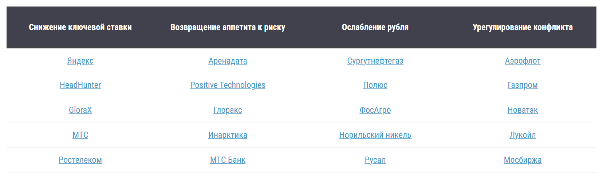

*График 28643027 — «Бенефициары под различные сценарии 2026 года». Интерактив: https://flo.uri.sh/visualisation/28643027/embed. Данные: [CSV](../charts/28643027.rows.csv), [JSON](../charts/28643027.json)*

| Снижение ключевой ставки | Возвращение аппетита к риску | Ослабление рубля | Урегулирование конфликта |
|---|---|---|---|
| <a href="https://www.tbank.ru/invest/stocks/YDEX">Яндекс</a> | <a href="https://www.tbank.ru/invest/stocks/DATA">Аренадата</a> | <a href="https://www.tbank.ru/invest/stocks/SNGSP"> Сургутнефтегаз </a> | <a href="https://www.tbank.ru/invest/stocks/AFLT">Аэрофлот</a> |
| <a href="https://www.tbank.ru/invest/stocks/HEAD">HeadHunter</a> | <a href="https://www.tbank.ru/invest/stocks/POSI">Positive Technologies</a> | <a href="https://www.tbank.ru/invest/stocks/PLZL">Полюс</a> | <a href="https://www.tbank.ru/invest/stocks/GAZP">Газпром</a> |
| <a href="https://www.tbank.ru/invest/stocks/GLRX/">GloraX</a> | <a href="https://www.tbank.ru/invest/stocks/GLRX">Глоракс</a> | <a href="https://www.tbank.ru/invest/stocks/PHOR">ФосАгро</a> | <a href="https://www.tbank.ru/invest/stocks/NVTK">Новатэк</a> |
| <a href="https://www.tbank.ru/invest/stocks/MTSS">МТС</a> | <a href="https://www.tbank.ru/invest/stocks/AQUA/">Инарктика</a> | <a href="https://www.tbank.ru/invest/stocks/GMKN">Норильский никель</a> | <a href="https://www.tbank.ru/invest/stocks/LKOH">Лукойл</a> |
| <a href="https://www.tbank.ru/invest/stocks/RTKM">Ростелеком</a> | <a href="https://www.tbank.ru/invest/stocks/MBNK">МТС Банк</a> | <a href="https://www.tbank.ru/invest/stocks/RUAL">Русал</a> | <a href="https://www.tbank.ru/invest/stocks/MOEX">Мосбиржа</a> |

Рынок остается хрупким

- Индекс Мосбиржи торгуется ниже уровней начала года. Полная доходность (с учетом дивидендов) за этот период была околонулевой.
- Импульс роста, заданный в конце 2025-го, постепенно затух на фоне нарастающего давления на корпоративные прибыли и некоторого повышения неопределенности по ставкам.
- Инвесторы все так же сохраняют низкий аппетит к риску: притоки новых средств на рынок крайне незначительны, а спрос на акции небольших компаний остается подавленным.

Индекс Мосбиржи (полная доходность)

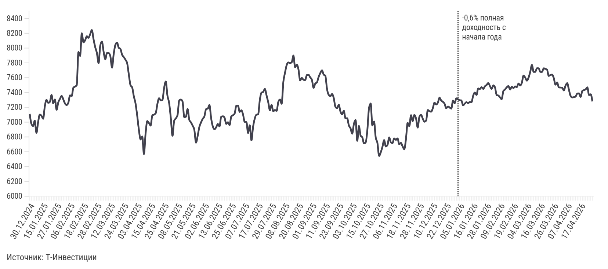

*График 28643188 — «Индекс Мосбиржи (полная доходность)». Интерактив: https://flo.uri.sh/visualisation/28643188/embed. Данные: [CSV](../charts/28643188.csv), [JSON](../charts/28643188.json)*

Подписи и настройки графика: axes_highlights.x_lines: -0,6% полная доходность с начала года :: Конец года; axes_highlights.y_lines: ::0; layout.source_name: Т-Инвестиции; chart_type: line

| label | Индекс Мосбиржи (полная доходность) |
|---|---|
| 28.04.2026 | 7279,14 |
| 27.04.2026 | 7375,86 |
| 24.04.2026 | 7365,92 |
| 23.04.2026 | 7469,58 |
| 22.04.2026 | 7443,11 |
| 21.04.2026 | 7432,49 |
| 20.04.2026 | 7421,6 |
| 17.04.2026 | 7341,5 |
| 16.04.2026 | 7387,86 |
| 15.04.2026 | 7386 |
| 14.04.2026 | 7345,73 |
| 13.04.2026 | 7338,13 |
| 10.04.2026 | 7333,09 |
| 09.04.2026 | 7354,64 |
| 08.04.2026 | 7439,83 |
| 07.04.2026 | 7526,42 |
| 06.04.2026 | 7493,14 |
| 03.04.2026 | 7428,11 |
| 02.04.2026 | 7465 |
| 01.04.2026 | 7467,23 |
| 31.03.2026 | 7470,27 |
| 30.03.2026 | 7535,71 |
| 27.03.2026 | 7505,9 |
| 26.03.2026 | 7595,31 |
| 25.03.2026 | 7641,86 |
| 24.03.2026 | 7635,83 |
| 23.03.2026 | 7623,8 |
| 20.03.2026 | 7708,45 |
| 19.03.2026 | 7719,48 |
| 18.03.2026 | 7726,83 |
| … | … |
| 23.01.2025 | 7252,16 |
| 22.01.2025 | 7367,46 |
| 21.01.2025 | 7273,5 |
| 20.01.2025 | 7260,71 |
| 17.01.2025 | 7300,29 |
| 16.01.2025 | 7215,45 |
| 15.01.2025 | 7046,01 |
| 14.01.2025 | 7087,03 |
| 13.01.2025 | 7103,39 |
| 10.01.2025 | 7000,49 |
| 09.01.2025 | 6853,85 |
| 08.01.2025 | 7021,1 |
| 06.01.2025 | 6947,47 |
| 03.01.2025 | 6977,67 |
| 30.12.2024 | 7112,22 |

*Показано 45 из 336 строк, полный ряд: [CSV](../charts/28643188.csv), [JSON](../charts/28643188.json)*

Что сдерживает рост рынка

В числе ключевых факторов давления на рынок остаются высокие процентные ставки, охлаждение экономики, крепкий рубль и геополитика.

### Высокие ставки

Ограничивают оценки акций, смещая интерес инвесторов в сторону денежных и долговых инструментов. Несмотря на то что с середины прошлого года ставка начала снижаться, ее уровень по-прежнему остается достаточно высоким, чтобы депозиты, а также инструменты денежного и долгового рынков выглядели для большинства инвесторов привлекательнее акций по соотношению доходности и риска.

### Экономика продолжает охлаждаться

Это негативно сказывается на результатах компаний из циклических отраслей и оказывает давление на прибыль закредитованных эмитентов.

### Крепкий рубль

Дополнительно ухудшает результаты экспортеров, на которых в 2025 году приходилось 42% прибыли индекса Мосбиржи против 65% в 2024-м. При этом рост нефтяных котировок с начала конфликта на Ближнем Востоке позволит существенно сгладить негативный эффект крепкого курса.

### Геополитика

Оставалась главным источником нестабильности рынка акций в прошлом году. Несмотря на то что тема переговоров между Россией, США и Украиной отошла на второй план в 2026 году, ее значимость остается крайне высокой. Так, в котировки российских акций все еще заложена значительная геополитическая премия — ее переоценка рынком на новостях все так же будет приводить к росту волатильности.

Что обеспечит рынку доходность

Прибыли снижаются, но ждем разворота

Российская экономика уже более двух лет находится под давлением высоких процентных ставок, в то время как доходы экспортного сегмента сдерживает крепкий рубль. Длительное сохранение таких условий транслировалось в поступательное ухудшение финансового положения и результатов бизнеса на протяжении прошлого года.

Совокупная прибыль компаний индекса Мосбиржи LTM поквартально

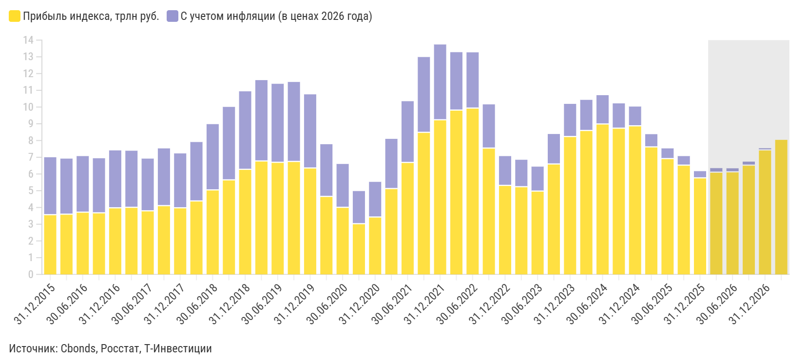

*График 28643347 — «Совокупная прибыль компаний индекса Мосбиржи LTM поквартально,». Интерактив: https://flo.uri.sh/visualisation/28643347/embed. Данные: [CSV](../charts/28643347.csv), [JSON](../charts/28643347.json)*

Подписи и настройки графика: axes_highlights.x_areas: ::31.03.2026 >> 31.03.2027; axes_highlights.x_lines: :: 31.12.2025 >> 31.03.2027; axes_highlights.y_lines: ::0; layout.source_name: Cbonds, Росстат, Т-Инвестиции; chart_type: column_stacked

| Дата | Прибыль индекса, трлн руб. | С учетом инфляции (в ценах 2026 года) |
|---|---|---|
| 31.03.2027 | 8,04 | - |
| 31.12.2026 | 7,44 | 0,10 |
| 30.09.2026 | 6,53 | 0,21 |
| 30.06.2026 | 6,13 | 0,21 |
| 31.03.2026 | 6,11 | 0,24 |
| 31.12.2025 | 5,77 | 0,40 |
| 30.09.2025 | 6,53 | 0,54 |
| 30.06.2025 | 6,92 | 0,61 |
| 31.03.2025 | 7,62 | 0,76 |
| 31.12.2024 | 8,88 | 1,15 |
| 30.09.2024 | 8,74 | 1,48 |
| 30.06.2024 | 8,99 | 1,72 |
| 31.03.2024 | 8,60 | 1,83 |
| 31.12.2023 | 8,24 | 1,95 |
| 30.09.2023 | 6,60 | 1,79 |
| 30.06.2023 | 4,98 | 1,46 |
| 31.03.2023 | 5,24 | 1,61 |
| 31.12.2022 | 5,32 | 1,75 |
| 30.09.2022 | 7,55 | 2,61 |
| 30.06.2022 | 9,94 | 3,33 |
| 31.03.2022 | 9,82 | 3,46 |
| 31.12.2021 | 9,24 | 4,50 |
| 30.09.2021 | 8,49 | 4,50 |
| 30.06.2021 | 6,69 | 3,66 |
| 31.03.2021 | 5,13 | 2,97 |
| 31.12.2020 | 3,43 | 2,10 |
| 30.09.2020 | 3,03 | 1,95 |
| 30.06.2020 | 4,01 | 2,59 |
| 31.03.2020 | 4,66 | 3,12 |
| 31.12.2019 | 6,36 | 4,40 |
| 30.09.2019 | 6,75 | 4,75 |
| 30.06.2019 | 6,70 | 4,69 |
| 31.03.2019 | 6,78 | 4,83 |
| 31.12.2018 | 6,28 | 4,66 |
| 30.09.2018 | 5,65 | 4,36 |
| 30.06.2018 | 5,05 | 3,93 |
| 31.03.2018 | 4,39 | 3,52 |
| 31.12.2017 | 3,98 | 3,25 |
| 30.09.2017 | 4,11 | 3,42 |
| 30.06.2017 | 3,80 | 3,12 |
| 31.03.2017 | 4,01 | 3,38 |
| 31.12.2016 | 3,98 | 3,43 |
| 30.09.2016 | 3,68 | 3,26 |
| 30.06.2016 | 3,72 | 3,35 |
| 31.03.2016 | 3,60 | 3,32 |
| 31.12.2015 | 3,57 | 3,43 |

Тем не менее излом этого нисходящего тренда мы ожидаем увидеть уже в ближайшем будущем. Так, по нашей оценке, в период с четвертого квартала 2025-го по второй квартал 2026-го корпоративные прибыли пройдут низшую точку в рамках текущего экономического цикла. Уже во втором полугодии мы видим потенциал для постепенного восстановления результатов компаний.

#### С одной стороны,

Мы ожидаем, что в третьем-четвертом квартале начнет проявляться стимулирующий эффект от дальнейшего снижения ставок, который запустит восстановление экономики

#### С другой стороны,

Вторая половина года обеспечит благоприятные условия для ослабления курса рубля, при том что цены на российскую нефть, вероятно, останутся существенно выше уровней 2025 года

В базовый сценарий мы закладываем:

#### Ключевая ставка

Около 11—12% к концу года

#### Ключевая ставка

10—11% на горизонте 12 месяцев

#### Курс

На уровне 83 руб./долл. в среднем в 2026 году

#### Российская нефть

Порядка 60-65 долларов за баррель в среднем в 2026 году

Стоит отметить, что вопрос будущих результатов компаний становится все более чувствительным для рынка на фоне крайне слабого последнего квартала. Усиливающееся охлаждение экономики, неопределенность по ставкам и валютному курсу, нестабильность нефтяных котировок, а также возможность принятия нового «разового» налога на прибыль повышают вероятность пересмотра рыночных ожиданий по прибылям вниз.

Как сейчас оценены российские акции

Форвардный P/E индекса Мосбиржи, по нашим оценкам, составляет около 4,2x — заметно ниже средних значений за последние годы, хотя это и не экстремально низкий уровень.

С другой стороны, слабые результаты за прошлый год спровоцировали рост P/E, рассчитанного по историческим прибылям (за последние четыре квартала), до весьма высоких по меркам современного российского рынка отметок — около 5,8х.

**Такое расхождение мультипликаторов может сигнализировать о двух вещах:**

- о вероятном повышении чувствительности рынка к негативным пересмотрам прогнозов по будущим результатам компаний;

- о том, что часть ожидаемого восстановления прибылей на горизонте года уже заложена в котировки

Ведь чтобы текущие цены акций оказались оправданными на фоне слабых отчетностей 2025 года, рынок должен сохранять ожидания по скорому восстановлению результатов компаний

Поэтому до получения явных сигналов о восстановлении экономики или начала устойчивого ослабления рубля рынок может оставаться весьма хрупким.

В целом на текущих уровнях рынок акций не выглядит дорогим с учетом наших ожиданий по восстановлению корпоративных прибылей во втором полугодии. Однако потенциал расширения мультипликаторов с текущих уровней на среднесрочном горизонте выглядит сильно ограниченным.

Дивиденды остаются фактором поддержки рынка

Ухудшение макроэкономической конъюнктуры подтолкнуло корпоративный сектор к большему консерватизму при управлении капиталом. Одним из последствий такого разворота стало ощутимое снижение совокупного объема дивидендных выплат в 2025 году. Продолжение данного негативного тренда мы можем увидеть и в 2026 году, на фоне слабых результатов компаний за прошлый год.

#### Александр Потехин, ведущий аналитик Т-Инвестиций

Тем не менее дивидендная доходность индекса Мосбиржи остается на неплохом уровне. По нашим оценкам, дивиденды могут обеспечить около 8,0% доходности индекса по итогам 2026 года. При этом на следующие двенадцать месяцев дивидендная доходность составит порядка 7,8%.

Общий объем дивидендных выплат по годам, трлн руб

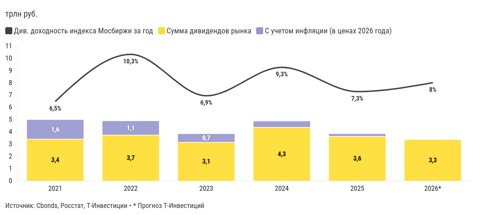

*График 28643486 — «Общий объем дивидендных выплат по годам». Интерактив: https://flo.uri.sh/visualisation/28643486/embed. Данные: [CSV](../charts/28643486.csv), [JSON](../charts/28643486.json)*

Подписи и настройки графика: axes_highlights.x_areas: рецессия доткомов:: 28.02.2001 >> 30.11.2001; axes_highlights.x_lines: :: Прогноз; axes_highlights.y_lines: ::0; layout.footer_note: * Прогноз Т-Инвестиций; layout.source_name: Cbonds, Росстат, Т-Инвестиции; chart_type: column_stacked_line

| Период | Див. доходность индекса Мосбиржи за год | Сумма дивидендов рынка | С учетом инфляции (в ценах 2026 года) |
|---|---|---|---|
| 2021 | 6,47% | 3,39 | 1,58 |
| 2022 | 10,31% | 3,72 | 1,15 |
| 2023 | 6,93% | 3,13 | 0,69 |
| 2024 | 9,25% | 4,35 | 0,50 |
| 2025 | 7,27% | 3,62 | 0,20 |
| 2026* | 8,00% | 3,34 | - |

Что может запустить рост акций

Сейчас рынок акций находится в условиях нестабильности сырьевых цен, крепкого рубля и быстро охлаждающейся экономики. Отчетности компаний продолжают слабеть, повышается неопределенность в отношении будущих результатов, из-за чего растут и риски рыночной волатильности. В то же время фактор неурегулированного конфликта с Украиной, несмотря на паузу в переговорном процессе, остается в числе ключевых источников неопределенности для рынка, поскольку в оценках бумаг сохраняется значительная геополитическая риск-премия.

В такой конъюнктуре основу для формирования устойчивого роста рынка могут создать более прогнозируемые внутренние драйверы. Так, ожидаемая нами динамика макроэкономики и денежно-кредитной политики предполагает снижение ключевой ставки в базовом сценарии до 11%, а доходностей десятилетних ОФЗ — до уровней около 11,5—12% на горизонте двенадцати месяцев.

По мере дальнейшего охлаждения экономики и приближения инфляции к целевому уровню Банка России процесс смягчения политики может ускориться, процентные ставки начнут снижаться более активно. Это окажет стимулирующее воздействие на экономику во втором полугодии, поддержит восстановление корпоративных прибылей и будет способствовать притоку новых средств на рынок акций.

Поэтому акции компаний, ориентированных на внутренний спрос, на наш взгляд, могут обеспечить более предсказуемую доходность в среднесрочной перспективе. Это прежде всего банки, крупные высокотехнологичные компании и качественные представители потребительского сектора.

С другой стороны, сильнейшими драйверами для рынка могут стать ослабление рубля и длительное сохранение текущих высоких цен на нефть. Это привело бы к существенному повышению доходов экспортного сегмента и оказало бы заметную поддержку всему рынку акций. Однако стоит отметить, что риски реализации более консервативных сценариев по нефти и рублю остаются повышенными, что увеличивает неопределенность в отношении будущих прибылей экспортеров (и в особенности компаний нефтегазового сектора).

#### Александр Потехин, ведущий аналитик Т-Инвестиций

Мы сохраняем позитивные ожидания от рынка акций на второе полугодие 2026 года. Целевой диапазон по индексу Мосбиржи на конец 2026 года видим на отметках 3200—3 300 пунктов, полная доходность с текущих уровней может составить около 30%. На горизонте следующих 12 месяцев видим потенциал для достижения индексом Мосбиржи уровней в диапазоне 3 400—3 600 пунктов.

Декомпозиция доходности индекса Мосбиржи

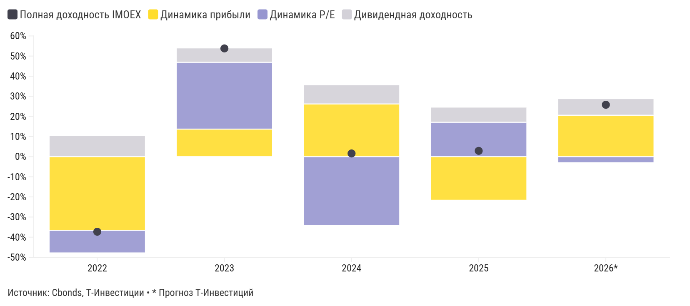

*График 28643540 — «Декомпозиция доходности индекса Мосбиржи». Интерактив: https://flo.uri.sh/visualisation/28643540/embed. Данные: [CSV](../charts/28643540.csv), [JSON](../charts/28643540.json)*

Подписи и настройки графика: axes_highlights.x_areas: рецессия доткомов:: 28.02.2001 >> 30.11.2001; axes_highlights.x_lines: :: Прогноз; axes_highlights.y_lines: ::0; layout.footer_note: * Прогноз Т-Инвестиций; layout.source_name: Cbonds, Т-Инвестиции; chart_type: column_stacked_line

| Период | Полная доходность IMOEX | Динамика прибыли | Динамика P/E | Дивидендная доходность |
|---|---|---|---|---|
| 2022 | -37,3% | -36,6% | -11,0% | 10,3% |
| 2023 | 53,8% | 13,7% | 33,2% | 6,9% |
| 2024 | 1,6% | 26,2% | -33,9% | 9,3% |
| 2025 | 2,9% | -21,4% | 17,1% | 7,3% |
| 2026* | 25,8% | 20,6% | -2,8% | 8,0% |

На графике представлена полная доходность индекса Мосбиржи за прошедшие годы, а также наш прогноз на 2026 год. Полная доходность формируется за счет трех ключевых компонентов: изменения прибыли компаний, динамики мультипликатора P/E и дивидендной доходности.

**Ключевые риски:**

**Риски волатильности остаются высокими**

Сейчас зоной риска для рынка останется вопрос корпоративных прибылей. Продолжающийся спад в экономике и значительное снижение результатов в 2025 году делают текущие оценки рынка более хрупкими, повышая чувствительность котировок акций к изменению прогнозов. Это может особенно сильно проявиться в ближайшие пару месяцев на фоне слабых отчетностей и потенциально разочаровывающей макростатистики. Кроме того, не стоит забывать про геополитику: потенциальное возобновление активных переговоров или санкционной риторики быстро оживит интерес рынка к этой теме и заставит вновь переоценить размер риск-премии в котировках бумаг.

**Риски реализации консервативных сценариев по ставкам, курсу рубля или геополитике сохраняются**

Так, в случае нормализации конъюнктуры на рынке энергоносителей, восстановления и усиления санкционного давления на российский экспорт, сохранения крепкого рубля и длительного удержания высоких ставок, целевой уровень индекса Мосбиржи на горизонте 12 месяцев смещается к отметке 2 800—2 900 пунктов, что предполагает весьма ограниченный потенциал роста с текущих уровней индекса.

Сценарии для индекса Мосбиржи

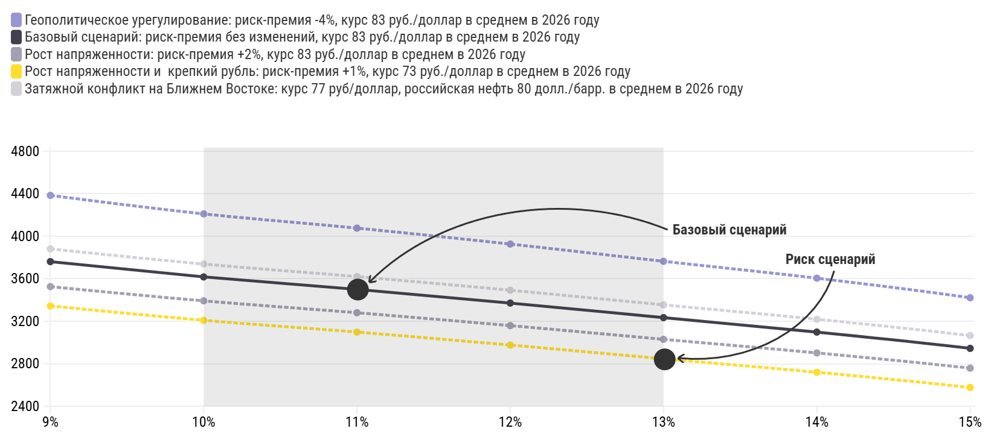

*График 28644235 — «Базовый сценарий». Интерактив: https://flo.uri.sh/story/3655534/embed. Данные: [CSV](../charts/28644235.csv), [JSON](../charts/28644235.json)*

Подписи и настройки графика: axes_highlights.x_areas: ::10>>13 Наиболее вероятный диапазон по КС через 12 месяцев; story.annotations: Риск сценарий / Базовый сценарий; chart_type: line

| Ключевая ставка | Геополитическое урегулирование: риск-премия -4%, курс 83 руб./доллар в среднем в 2026 году | Базовый сценарий: риск-премия без изменений, курс 83 руб./доллар в среднем в 2026 году | Рост напряженности: риск-премия +2%, курс 83 руб./доллар в среднем в 2026 году | Рост напряженности и  крепкий рубль: риск-премия +1%, курс 73 руб./доллар в среднем в 2026 году | Затяжной конфликт на Ближнем Востоке: курс 77 руб/доллар, российская нефть 80 долл./барр. в среднем в 2026 году |
|---|---|---|---|---|---|
| 9 | 4384 | 3761 | 3526 | 3344 | 3881 |
| 10 | 4210 | 3617 | 3392 | 3209 | 3738 |
| 11 | 4076 | 3500 | 3280 | 3098 | 3620 |
| 12 | 3926 | 3371 | 3159 | 2976 | 3492 |
| 13 | 3764 | 3234 | 3030 | 2847 | 3354 |
| 14 | 3605 | 3098 | 2902 | 2720 | 3219 |
| 15 | 3421 | 2945 | 2759 | 2577 | 3065 |
| 16 | 3192 | 2758 | 2587 | 2404 | 2878 |
| 17 | 2954 | 2562 | 2406 | 2224 | 2683 |

Что покупать в 2026 году

Мы по-прежнему отдаем предпочтение акциям качественных эмитентов с устойчивым финансовым положением, способных сохранять рост и маржинальность в условиях высоких ставок и замедления экономики.

Несмотря на ожидаемое смягчение денежно-кредитных условий и оживление экономической активности, существенно повышать уровень риска при формировании аллокации в акциях пока не стоит.

Выбор в пользу волатильных компаний малой капитализации или эмитентов, наиболее чувствительных к динамике ставок, может принести высокую доходность в следующие двенадцать месяцев, однако на текущем этапе он сопряжен с повышенным уровнем риска.

Наш выбор на рынке акций

Чтобы посмотреть все 12 акций, листайте карусель →

- Яндекс Целевая цена — 6 250 ₽ Потенциал роста: +51% без учета дивидендов +56% с учетом дивидендов
- Озон Целевая цена — 6 500 ₽ Потенциал роста: +50% без учета дивидендов +55% с учетом дивидендов
- Хэдхантер Целевая цена — 3 800 ₽ Потенциал роста: +28% без учета дивидендов +46% с учетом дивидендов
- Сбер Целевая цена — 368 ₽ Потенциал роста: +15% без учета дивидендов +27% с учетом дивидендов
- ДОМ.РФ Целевая цена — 2 720 ₽ Потенциал роста: +24% без дивидендов +35% с дивидендами
- Полюс Целевая цена — 2 900 ₽ Потенциал роста: +38% без учета дивидендов +48% с учетом дивидендов
- Озон Фармацевтика Целевая цена — 70 ₽ Потенциал роста: +47% без учета дивидендов +49% с учетом дивидендов
- Лента Целевая цена — 2 300 ₽ Потенциал роста: +33% (дивидендов не ждем)
- Мать и дитя Целевая цена — 1 680 ₽ Потенциал роста: +25% без учета дивидендов +33% c учетом дивидендов
- НОВАТЭК Целевая цена — 1 410 ₽ Потенциал роста: +20% без учета дивидендов +28% с учетом дивидендов
- Транснефть Целевая цена — 1 650 ₽ Потенциал роста: +20% без учета дивидендов +33% с учетом дивидендов
- GloraX Целевая цена — 98 ₽ Потенциал роста: +71% (дивидендов не ждем)

Наши идеи на покупку

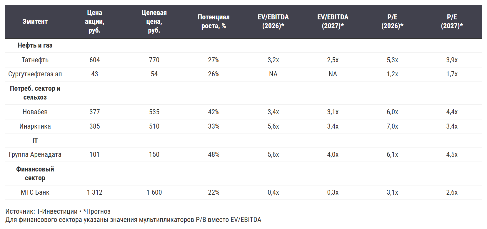

*График 28756823 — «Наши идеи на покупку». Интерактив: https://flo.uri.sh/visualisation/28756823/embed. Данные: [CSV](../charts/28756823.rows.csv), [JSON](../charts/28756823.json)*

Подписи и настройки графика: layout.footer_note: *Прогноз; layout.footer_note_secondary: Для финансового сектора указаны значения мультипликаторов P/B вместо EV/EBITDA; layout.source_name: Т-Инвестиции

| Эмитент | Цена акции, руб. | Целевая цена, руб. | Потенциал роста, % | EV/EBITDA (2026)* | EV/EBITDA (2027)* | P/E (2026)* | P/E (2027)* |
|---|---|---|---|---|---|---|---|
| **Нефть и газ** |  |  |  |  |  |  |  |
| Татнефть | 604 | 770 | 27% | 3,2x | 2,5x | 5,3x | 3,9x |
| Сургутнефтегаз ап | 43 | 54 | 26% | NA | NA | 1,2x | 1,7x |
| **Потреб. сектор и сельхоз** |  |  |  |  |  |  |  |
| Новабев | 377 | 535 | 42% | 3,4x | 3,1x | 6,0x | 4,4x |
| Инарктика | 385 | 510 | 33% | 5,6x | 3,4x | 7,0x | 3,4x |
| **IT** |  |  |  |  |  |  |  |
| Группа Аренадата | 101 | 150 | 48% | 5,6x | 4,0x | 6,1x | 4,5x |
| **Финансовый сектор** |  |  |  |  |  |  |  |
| МТС Банк | 1 312 | 1 600 | 22% | 0,4x | 0,3x | 3,1x | 2,6x |

Полная доходность наших идей за последние 12 месяцев

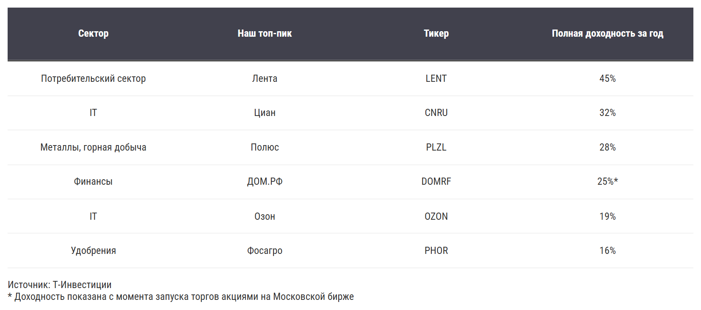

*График 28757673 — «Полная доходность наших идей за последние 12 месяцев ». Интерактив: https://flo.uri.sh/visualisation/28757673/embed. Данные: [CSV](../charts/28757673.rows.csv), [JSON](../charts/28757673.json)*

Подписи и настройки графика: layout.footer_note_secondary: * Доходность показана с момента запуска торгов акциями на Московской бирже; layout.source_name: Т-Инвестиции

| Сектор | Наш топ-пик | Тикер | Полная доходность за год |
|---|---|---|---|
| Потребительский сектор | Лента | LENT | 45% |
| IT | Циан | CNRU | 32% |
| Металлы, горная добыча | Полюс | PLZL | 28% |
| Финансы | ДОМ.РФ | DOMRF | 25%* |
| IT | Озон | OZON | 19% |
| Удобрения | Фосагро | PHOR | 16% |

## Нефтяной сектор: слабое начало года и резкий разворот в марте

В первые месяцы 2026 года нефтяной сектор оставался под давлением низких мировых цен и высоких дисконтов на российские сорта на фоне санкций против крупных нефтяных компаний.

### Январь — февраль: давление на сектор

Средний дисконт в январе — феврале достигал 30 долл/барр по Urals и 16 долл/барр по ESPO (рост на $12 и $7 кв/кв соответственно). Умеренный рост Brent (всего +4 долл/барр) не смог компенсировать это давление, что привело к снижению маржи добычи.

Маржа переработки также сократилась: ранее выросшие крэк-спреды сузились, а демпферные выплаты резко снизились. В феврале нефтяные компании впервые за пять лет стали нетто-плательщиками в рамках демпферного механизма.

### Март: резкое восстановление

В марте ситуация резко улучшилась. Эскалация конфликта на Ближнем Востоке спровоцировала скачок мировых цен на нефть. Несмотря на сохраняющиеся дисконты, средняя цена российской нефти выросла до 77 долл/барр (против $44,6 в феврале).

Тем не менее результаты за первый квартал останутся слабыми. Негативный эффект января — февраля, по нашим оценкам, будет доминировать в отчетности.

Нефть: рост цен — временный фактор

#### Александра Прыткова, ведущий аналитик Т-Инвестиций

В базовом сценарии мы считаем текущий рост цен на нефть временным. Несмотря на сохраняющуюся напряженность на Ближнем Востоке, высокие цены, вероятно, удержатся лишь во втором квартале, после чего начнется постепенное снижение на фоне деэскалации и возвращения рынка к профициту предложения.

По российским сортам мы по-прежнему ожидаем сокращения дисконтов, что частично компенсирует снижение мировых цен. Однако сроки нормализации сдвигаются: заметное сокращение дисконтов ожидается во втором — третьем кварталах 2026 года, а полное восстановление — уже в 2027 году.

В сегменте переработки мы также ожидаем сужения крэк-спредов по мере нормализации внешнего фона, что приведет маржу переработки ближе к историческим уровням.

Газ: более устойчивый позитивный сценарий

#### Александра Прыткова, ведущий аналитик Т-Инвестиций

В газовом секторе мы ожидаем более длительного эффекта от текущих событий. Потенциальные перебои в производстве СПГ в Катаре могут ускорить диверсификацию поставок и повысить интерес к российскому газу.

Дополнительную поддержку ценам оказывают низкие запасы и ограниченная гибкость предложения. В результате повышенные уровни цен могут сохраняться дольше — вплоть до четвертого квартала, когда начнется отопительный сезон.

Динамика цен на российские и мировые сорта, долл/барр

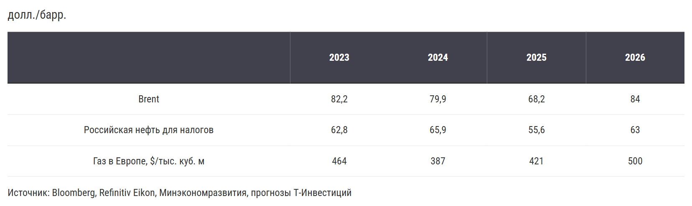

*График 28644198 — «Динамика цен на российские и мировые сорта». Интерактив: https://flo.uri.sh/visualisation/28644198/embed. Данные: [CSV](../charts/28644198.rows.csv), [JSON](../charts/28644198.json)*

Подписи и настройки графика: layout.source_name: Bloomberg, Refinitiv Eikon, Минэкономразвития, прогнозы Т-Инвестиций

| columns_0 | 2023 | 2024 | 2025 | 2026 |
|---|---|---|---|---|
| Brent | 82,2 | 79,9 | 68,2 | 84 |
| Российская нефть для налогов | 62,8 | 65,9 | 55,6 | 63 |
| Газ в Европе, $/тыс. куб. м | 464 | 387 | 421 | 500 |

Наш взгляд на сектор

Для нефтегазовых компаний курс рубля сейчас важнее цен на нефть.

По нашим моделям, финансовые результаты сектора в большей степени зависят именно от валютного курса. Во втором полугодии мы по-прежнему ожидаем ослабления рубля — до уровня около 90 руб/долл к концу года, что должно поддержать показатели компаний после завершения конфликта на Ближнем Востоке.

При этом средний курс рубля по итогам года, вероятно, останется близким к уровню прошлого года, что будет ограничивать прибыльность нефтегазовых компаний в 2026 году.

Дополнительным сдерживающим фактором остаются атаки на инфраструктуру. Регулярное давление на нефтегазовую инфраструктуру будет ограничивать рост объемов добычи и реализации в краткосрочной перспективе.

В целом мы сохраняем нейтральный взгляд на сектор. Однако внутри него по-прежнему видим отдельные истории, которые могут показать повышенную доходность.

Наши фавориты

НОВАТЭК: один из главных бенефициаров роста цен на газ и нефть

#### НОВАТЭК

Целевая цена — 1 410 рублей за акцию

НОВАТЭК выигрывает от роста и газовых, и нефтяных цен. Рост добычи жидких углеводородов и запуск третьей линии комплекса в Усть-Луге должны поддержать выпуск высокомаржинальной продукции. Дополнительным драйвером остается «Арктик СПГ — 2»: первые линии уже запущены, в сентябре начались поставки в Китай, а компания получила ледовый газовоз. По нашим оценкам, в 2026 году проект может отгрузить 7—8 млн тонн СПГ.

Перебои с поставками из Катара усиливают инвестиционный кейс компании. На этом фоне повышается привлекательность СПГ с российских проектов. Кроме того, НОВАТЭК выигрывает и от роста Brent, поскольку значительная часть долгосрочных контрактов компании, в том числе по проекту «Ямал СПГ», привязана к нефтяным котировкам.

Дивидендный профиль остается привлекательным. Несмотря на санкционные ограничения, компания, как ожидается, сохранит приверженность дивидендной политике и продолжит выплачивать дивиденды дважды в год. Совокупная дивидендная доходность на горизонте 12 месяцев, по нашим оценкам, может достичь 8%, что сопоставимо с нефтяными компаниями.

Оценка выглядит умеренной. Акции НОВАТЭКа торгуются с форвардным мультипликатором EV/нормализованная EBITDA около 3x, что соответствует уровню других компаний сектора, но по-прежнему предполагает дисконт к историческим уровням.

Транснефть: ставка на стабильность, дивиденды и низкую оценку

#### Транснефть

Целевая цена — 1 650 рублей за акцию

Транснефть остается одной из самых устойчивых историй в секторе. Бизнес компании прозрачен, а ключевые финансовые показатели стабильно растут. При этом Транснефть в ограниченной степени зависит от колебаний нефтяного рынка, что делает ее защитной историей внутри сектора.

Тарифная индексация поддерживает финансовые результаты. В 2026 году тарифы были повышены на 5,1%, и этого, по нашим оценкам, по-прежнему достаточно, чтобы перекрывать инфляцию операционных расходов.

Сильный баланс поддерживает дивидендный кейс. У компании отсутствует долговая нагрузка, а высокий уровень ликвидности позволяет зарабатывать на процентных доходах. Даже с учетом их ожидаемого снижения в этом году дивидендная доходность, по нашим оценкам, сохранится на уровне около 13%.

Оценка остается привлекательной. По нашим прогнозам форвардный мультипликатор составляет около 1,2x, что предполагает дисконт примерно 40% к средним историческим уровням.

Татнефть: крепкая финансовая позиция и недооценка

#### Татнефть

Целевая цена — 770 рублей за акцию

Татнефть сохраняет сильную финансовую позицию и высокий потенциал дивидендных выплат. У компании сейчас нет масштабных активных инвестпрограмм, что позволило сократить капитальные расходы и удерживать свободный денежный поток в уверенно положительной зоне. В 2026 году, по нашим оценкам, эта тенденция сохранится, а свободный денежный поток может превысить 150 млрд рублей.

Акции торгуются с дисконтом к истории. Форвардный мультипликатор EV/скорректированная EBITDA на 2026 год составляет около 3,2x, что предполагает дисконт более 20% к историческим уровням.

Низкая долговая нагрузка дает компании гибкость в распределении капитала. Практически полное отсутствие долга позволяет не накапливать денежные средства на балансе, а направлять их акционерам. По нашим оценкам, в 2026 году дивидендная доходность Татнефти может достичь 10%, что является одним из самых высоких уровней в секторе.

Ключевые показатели компаний нефтегазового сектора

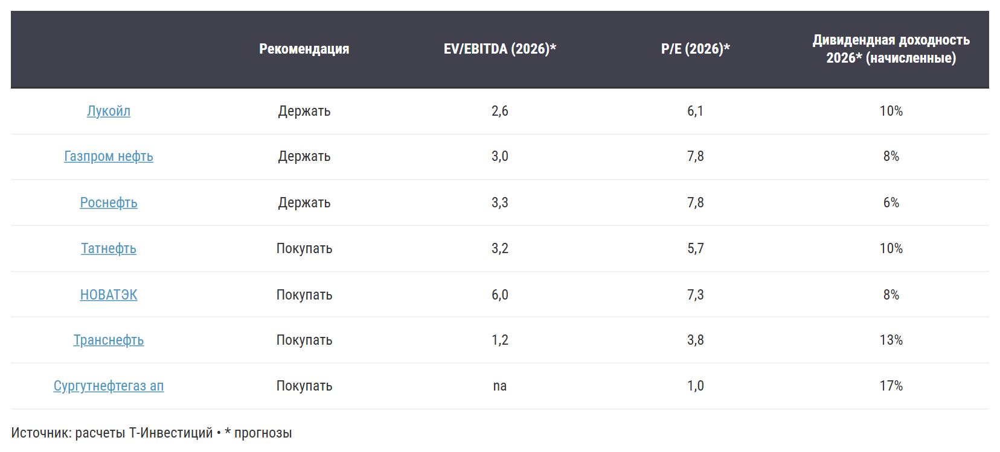

*График 28644232 — «Ключевые показатели компаний нефтегазового сектора ». Интерактив: https://flo.uri.sh/visualisation/28644232/embed. Данные: [CSV](../charts/28644232.rows.csv), [JSON](../charts/28644232.json)*

Подписи и настройки графика: layout.footer_note: * прогнозы; layout.source_name: расчеты Т-Инвестиций

| columns_0 | Рекомендация | EV/EBITDA (2026)* | P/E (2026)* | Дивидендная доходность 2026* (начисленные) |
|---|---|---|---|---|
| <a href="https://www.tbank.ru/invest/stocks/LKOH/">Лукойл</a> | Держать | 2,6 | 6,1 | 10% |
| <a href="https://www.tbank.ru/invest/stocks/SIBN/">Газпром нефть</a> | Держать | 3,0 | 7,8 | 8% |
| <a href="https://www.tbank.ru/invest/stocks/ROSN/">Роснефть</a> | Держать | 3,3 | 7,8 | 6% |
| <a href="https://www.tbank.ru/invest/stocks/TATN/">Татнефть</a> | Покупать | 3,2 | 5,7 | 10% |
| <a href="https://www.tbank.ru/invest/stocks/NVTK/">НОВАТЭК</a> | Покупать | 6,0 | 7,3 | 8% |
| <a href="https://www.tbank.ru/invest/stocks/TRNFP/">Транснефть</a> | Покупать | 1,2 | 3,8 | 13% |
| <a href="https://www.tbank.ru/invest/stocks/SNGS/">Сургутнефтегаз ап</a> | Покупать | na | 1,0 | 17% |

## Металлургический сектор и добыча: конфликт на Ближнем Востоке меняет игру

### Конфликт на Ближнем Востоке заметно изменил ситуацию на товарно-сырьевых рынках

С точки зрения глобального баланса в наиболее выигрышном положении оказались удобрения и алюминий: выпадение части объемов из региона привело к росту цен на эти товары на 10—50% с начала марта.

### В никеле и меди видим поддержку цен

Со стороны возросших издержек на фоне удорожания серной кислоты (ввиду острого дефицита серы из-за закрытия Ормузского пролива), а также налогового ужесточения в никелевой промышленности Индонезии.

### В других сегментах картина менее однозначна

Для прочих промышленных металлов и алмазов затяжная эскалация, напротив, может стать негативным фактором, поскольку она усиливает риски замедления мировой экономики и, как следствие, ослабления спроса.

Присутствие Ближнего Востока на товарно-сырьевых рынках, % от мирового выпуска

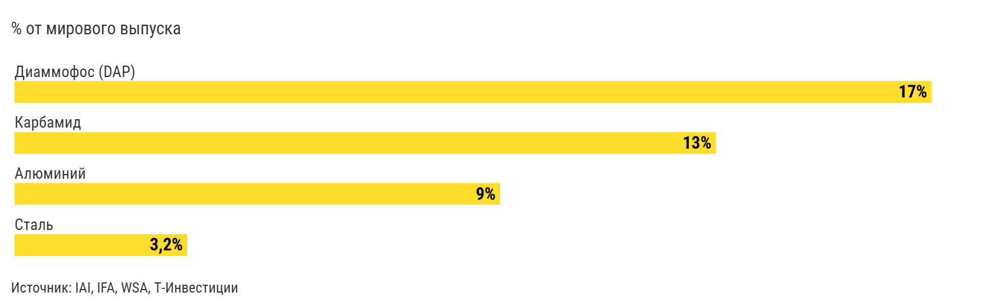

*График 28648557 — «Присутствие Ближнего Востока на товарно-сырьевых рынках». Интерактив: https://flo.uri.sh/visualisation/28648557/embed. Данные: [CSV](../charts/28648557.csv), [JSON](../charts/28648557.json)*

Подписи и настройки графика: axes_highlights.x_areas: рецессия доткомов:: 28.02.2001 >> 30.11.2001; axes_highlights.x_lines: :: Прогноз; axes_highlights.y_lines: ::0; layout.source_name: IAI, IFA, WSA, Т-Инвестиции; chart_type: bar_grouped

| label | Доля от мирового производства |
|---|---|
| Диаммофос (DAP) | 17% |
| Карбамид | 13% |
| Алюминий | 9,0% |
| Сталь | 3,2% |

Наши фавориты

Полюс

#### Полюс

Целевая цена — 2 900 рублей за акцию

С начала года акции Полюса снизились на 10%, несмотря на рост цен на золото. Во многом это связано с опасениями рынка по поводу возможного дополнительного налогообложения сектора.

Между тем параметры налога на сверхприбыль (windfall tax), обсуждавшиеся в СМИ, на наш взгляд, выглядят заметно мягче, чем ожидал рынок. Если налог будет введен именно в таком виде, его эффект для Полюса мы оцениваем в 48 млрд рублей, или 2,3% от капитализации.

Даже с учетом этого фактора оценка компании остается привлекательной. По нашим расчетам, мультипликатор P/E 2026 для Полюса по-прежнему выглядит низким и предполагает дисконт 30% к историческим уровням.

#### Ахмед Алиев, ведущий аналитик Т-Инвестиций

С учетом потенциального налога в модели мы ожидаем роста скорректированной чистой прибыли компании на 20% в этом году, что, на наш взгляд, может стать катализатором переоценки акций до конца года.

Ключевые риски — более слабая динамика цен на золото и крепкий рубль. При этом важно учитывать, что финальные параметры нового налога могут отличаться от тех, что ранее обсуждались в СМИ.

Норильский никель и РУСАЛ

#### Норильский никель

Целевая цена — 170 рублей за акцию

#### РУСАЛ

Целевая цена — 47 рублей за акцию

Ожидаем рост прибылей от роста цен на цветные металлы. На фоне растущих цен на никель, медь и алюминий финансовые результаты Норильского никеля и РУСАЛа могут значительно улучшиться в этом году. В перспективе это открывает дорогу к возврату дивидендов Норильского никеля, что также позитивно для алюминиевой компании, так как последний также является акционером Норникеля (владеет долей около 26%).

Ключевой сдерживающий фактор — крепкий рубль. Его укрепление может ограничить потенциал полноценной переоценки бумаг, несмотря на благоприятную ценовую конъюнктуру.

Ключевые показатели компаний сектора

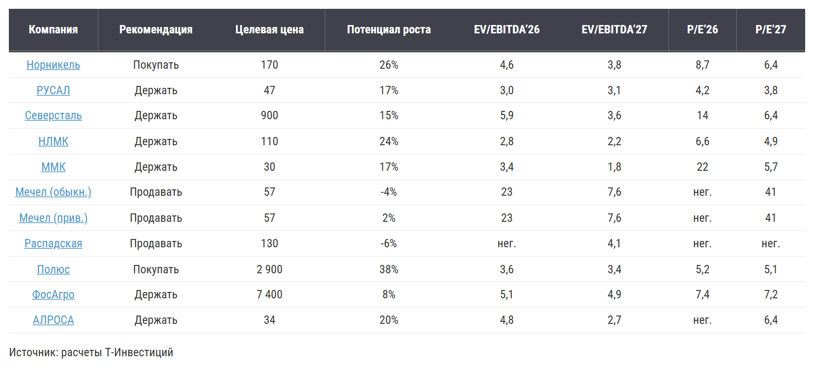

*График 28644306 — «Ключевые показатели компаний сектора ». Интерактив: https://flo.uri.sh/visualisation/28644306/embed. Данные: [CSV](../charts/28644306.rows.csv), [JSON](../charts/28644306.json)*

Подписи и настройки графика: layout.source_name: расчеты Т-Инвестиций

| Компания | Рекомендация | Целевая цена | Потенциал роста | EV/EBITDA’26 | EV/EBITDA’27 | P/E’26 | P/E’27 |
|---|---|---|---|---|---|---|---|
| <a href="https://www.tbank.ru/invest/stocks/GMKN">Норникель</a> | Покупать | 170 | 26% | 4,6 | 3,8 | 8,7 | 6,4 |
| <a href="https://www.tbank.ru/invest/stocks/RUAL">РУСАЛ</a> | Держать | 47 | 17% | 3,0 | 3,1 | 4,2 | 3,8 |
| <a href="https://www.tbank.ru/invest/stocks/CHMF">Северсталь</a> | Держать | 900 | 15% | 5,9 | 3,6 | 14 | 6,4 |
| <a href="https://www.tbank.ru/invest/stocks/NLMK">НЛМК</a> | Держать | 110 | 24% | 2,8 | 2,2 | 6,6 | 4,9 |
| <a href="https://www.tbank.ru/invest/stocks/MAGN">ММК</a> | Держать | 30 | 17% | 3,4 | 1,8 | 22 | 5,7 |
| <a href="https://www.tbank.ru/invest/stocks/MTLR/">Мечел (обыкн.)</a> | Продавать | 57 | -4% | 23 | 7,6 | нег. | 41 |
| <a href="https://www.tbank.ru/invest/stocks/MTLRP/">Мечел (прив.)</a> | Продавать | 57 | 2% | 23 | 7,6 | нег. | 41 |
| <a href="https://www.tbank.ru/invest/stocks/RASP/">Распадская</a> | Продавать | 130 | -6% | нег. | 4,1 | нег. | нег. |
| <a href="https://www.tbank.ru/invest/stocks/PLZL">Полюс</a> | Покупать | 2 900 | 38% | 3,6 | 3,4 | 5,2 | 5,1 |
| <a href="https://www.tbank.ru/invest/stocks/PHOR">ФосАгро</a> | Держать | 7 400 | 8% | 5,1 | 4,9 | 7,4 | 7,2 |
| <a href="https://www.tbank.ru/invest/stocks/ALRS">АЛРОСА</a> | Держать | 34 | 20% | 4,8 | 2,7 | нег. | 6,4 |

## ИТ-сектор: фокус на эффективности при ограниченном росте

В текущих макроэкономических условиях ИТ-рынок по-прежнему остается в зоне высокой неопределенности. Сложный макрофон продолжает оказывать давление на темпы роста выручки компаний сектора.

При этом важно учитывать, что большинство технологических компаний воспринимаются рынком как истории роста, поэтому заметное замедление выручки обычно оценивается инвесторами особенно негативно.

#### Динамика выручки

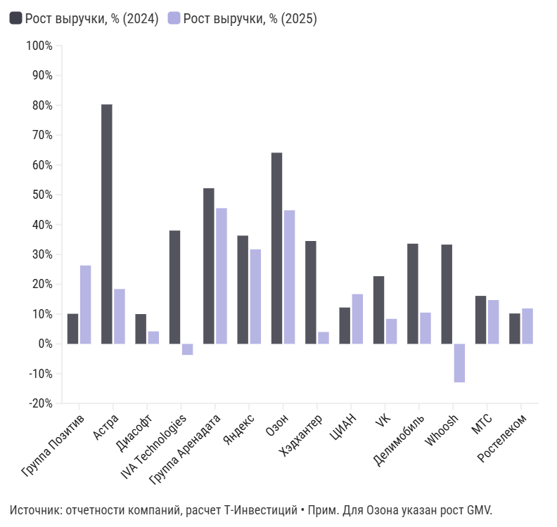

*График 28639653 — «Динамика выручуки». Интерактив: https://flo.uri.sh/visualisation/28639653/embed. Данные: [CSV](../charts/28639653.csv), [JSON](../charts/28639653.json)*

Подписи и настройки графика: axes_highlights.y_lines: Чистая прибыль сектора :: -8; layout.footer_note: Прим. Для Озона указан рост GMV.; layout.source_name: отчетности компаний, расчет Т-Инвестиций; chart_type: column_grouped

| label | Рост выручки, % (2024) | Рост выручки, % (2025) |
|---|---|---|
| Группа Позитив | 10,1% | 26,3% |
| Астра | 80,3% | 18,4% |
| Диасофт | 10,0% | 4,2% |
| IVA Technologies | 38,0% | -3,7% |
| Группа Аренадата | 52,2% | 45,5% |
| Яндекс | 36,3% | 31,7% |
| Озон | 64,1% | 44,8% |
| Хэдхантер | 34,5% | 4,0% |
| ЦИАН | 12,2% | 16,7% |
| VK | 22,7% | 8,4% |
| Делимобиль | 33,6% | 10,5% |
| Whoosh | 33,3% | -12,9% |
| МТС | 16,1% | 14,7% |
| Ростелеком | 10,2% | 11,9% |

#### Динамиа рентабельности по EBITDA

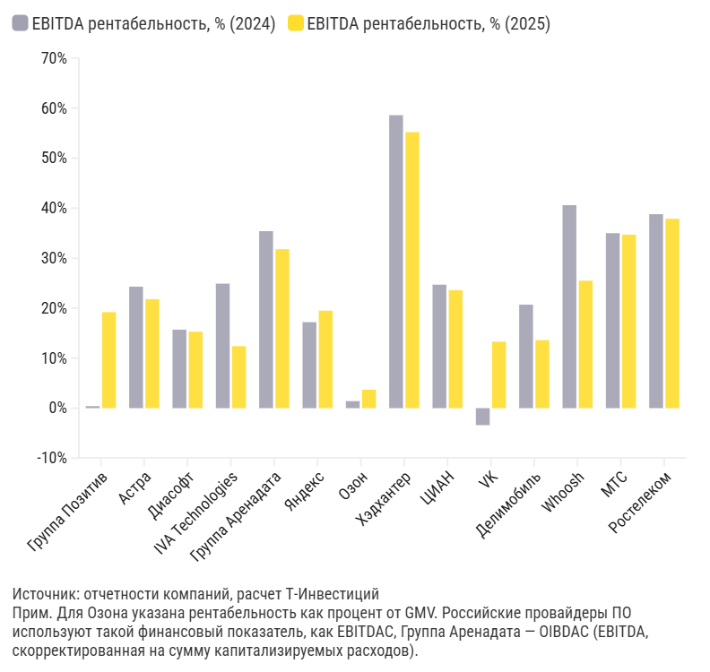

*График 28639668 — «Динамика рентабельности по EBITDA». Интерактив: https://flo.uri.sh/visualisation/28639668/embed. Данные: [CSV](../charts/28639668.csv), [JSON](../charts/28639668.json)*

Подписи и настройки графика: axes_highlights.y_lines: Чистая прибыль сектора :: -8; layout.footer_note_secondary: Прим. Для Озона указана рентабельность как процент от GMV. Российские провайдеры ПО используют такой финансовый показатель, как EBITDAC, Группа Аренадата — OIBDAC (EBITDA, скорректированная на сумму капитализируемых расходов).; layout.source_name: отчетности компаний, расчет Т-Инвестиций; chart_type: column_grouped

| label | EBITDA рентабельность, % (2024) | EBITDA рентабельность, % (2025) |
|---|---|---|
| Группа Позитив | 0,4% | 19,2% |
| Астра | 24,3% | 21,8% |
| Диасофт | 15,7% | 15,3% |
| IVA Technologies | 24,9% | 12,4% |
| Группа Аренадата | 35,4% | 31,8% |
| Яндекс | 17,2% | 19,5% |
| Озон | 1,4% | 3,7% |
| Хэдхантер | 58,6% | 55,2% |
| ЦИАН | 24,7% | 23,6% |
| VK | -3,4% | 13,3% |
| Делимобиль | 20,7% | 13,6% |
| Whoosh | 40,6% | 25,5% |
| МТС | 35,0% | 34,7% |
| Ростелеком | 38,8% | 37,9% |

Большинство компаний сектора уже обозначили ключевой приоритет на 2026 год — повышение внутренней эффективности бизнеса, тогда как возможности для масштабного роста остаются ограниченными. Бюджеты заказчиков по-прежнему лимитированы, компании отмечают удлинение циклов сделок и перенос части некритичных проектов на более поздние сроки.

### При этом фундаментальные факторы роста остаются в силе:

1. Продолжающаяся цифровизация экономики.
2. Развитие технологий искусственного интеллекта.
3. Рост популярности облачных решений.
4. Истечение сроков лицензий на зарубежное ПО и ограничения на его поддержку.
5. Государственная поддержка импортозамещения и технологического суверенитета.
6. Ужесточение регулирования использования иностранного ПО.

2026 год будет сложным для сектора

#### Марьяна Лазаричева, глава аналитики Т-Инвестиций по рынку акций

Мы по-прежнему считаем, что 2026 год будет непростым для ИТ-компаний, а эффект от снижения ключевой ставки и разворота деловой активности в полной мере проявится лишь в 2027 году.

Фискальные риски: налог на сверхприбыль

Влияние обсуждаемого налога на сверхприбыль на ИТ-сектор оцениваем как ограниченное. Это связано с короткой публичной историей ряда эмитентов, а также с тем, что даже крупные игроки лишь недавно вышли на устойчивую прибыль.

С учетом текущих параметров под потенциальное действие налога могут подпасть Хэдхантер и Яндекс, однако даже в этом случае влияние на инвестиционный кейс будет незначительным.

Более существенным риском остается возможное введение НДС, а также отмена льгот — пониженной ставки налога на прибыль и пониженных страховых взносов.

Наши фавориты

На горизонте года мы не видим выраженных драйверов роста котировок провайдеров ПО и сохраняем осторожный взгляд на сектор. Предпочтение отдаем более зрелым и диверсифицированным игрокам: Яндексу, Озону, Хэдхантеру и Циану.

Яндекс: диверсификация поддерживает устойчивый рост

#### Яндекс

Целевая цена — 6 250 рублей за акцию

Несмотря на давление макрофона на рекламный сегмент, а также на бизнесы непосредственно связанные с потребителями, компания сохраняет устойчивые темпы роста за счет диверсификации и развития других направлений

Фокус на операционной эффективности позволяет поддерживать рентабельность даже на фоне активных инвестиций. В зрелых сегментах (реклама, райдтех) ожидается замедление, однако новые направления (финтех, автономный транспорт, B2B Tech и ИИ) могут стать ключевыми драйверами в среднесрочной перспективе.

Текущая оценка выглядит заниженной с учетом сильных позиций компании, развитой экосистемы и потенциала новых сегментов, включая ИИ и автономный транспорт.

Рост капитальных затрат в 2026–2027 годах может вызывать краткосрочную настороженность рынка, однако мы считаем его позитивным фактором для будущей выручки и рентабельности.

Озон: фокус смещается с роста на качество бизнеса

#### Ozon

Целевая цена — 6 500 рублей за акцию

Замедление темпов роста выглядит естественным на фоне взросления бизнеса (доля рынка около 27%). При этом ожидаем улучшения юнит-экономики и повышения качества роста.

Менеджмент не фиксирует существенного давления макрофакторов на бизнес.

Финтех-направление остается одним из ключевым драйвером — компания демонстрирует сильную динамику выручки и прибыльности и планирует расширение продуктовой линейки и для B2C- и B2B-клиентов с акцентом на кредитование.

Постепенное улучшение экономики демонстрирует и основной сегмент компании, связанный с электронной торговлей.

Инвестиции в автоматизацию и ИИ поддержат высокий уровень капзатрат, но в долгосрочной перспективе усилят эффективность и конкурентные позиции.

Оценка компании, на наш взгляд, не в полной мере отражает потенциал роста и улучшения операционной эффективности.

Хэдхантер: замедление есть, но фундамент остается сильным

#### Хэдхантер

Целевая цена — 3 800 рублей за акцию

Рост выручки остается под давлением на фоне охлаждения рынка труда, при этом основным драйвером остается повышение цен, а клиентская база стабилизируется. Улучшение макрофона может поддержать выручку во второй половине 2026 года.

Компания сохраняет высокую рентабельность (более 50%) и продолжает инвестировать в продукт.

Сильная генерация свободного денежного потока позволяет поддерживать высокую дивидендную доходность, что остается важным элементом инвестиционной привлекательности.

Дополнительный вклад в рост дает направление HR Tech.

Оценка компании выглядит ниже среднего уровня по российскому ИТ-сектору. При этом компания остается зрелым игроком отрасли со стабильным ростом, высокой рентабельностью и потенциально сильной дивидендной историей.

Циан: ставка на эффективность и масштабирование

#### Циан

Целевая цена — 850 рублей за акцию

Компания доказала устойчивость бизнес-модели и продолжает фокусироваться на росте доли рынка, улучшении монетизации и запуске новых продуктов. Все это должно поддержать динамику выручки в среднесрочной перспективе.

Расширение бизнеса и инвестиции в развитие временно оказывают давление на маржинальность, однако в дальнейшем ожидаем ее постепенного восстановления за счет эффекта операционного рычага.

Улучшение рентабельности должно трансформироваться в рост свободного денежного потока, что позволит поддерживать привлекательный уровень дивидендных выплат.

Российские ТМТ-компании

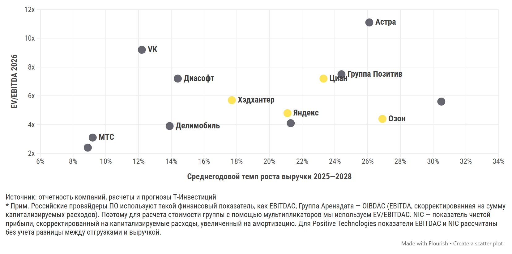

*График 28657194 — «Российские ТМТ-компании». Интерактив: https://flo.uri.sh/visualisation/28657194/embed. Данные: [CSV](../charts/28657194.csv), [JSON](../charts/28657194.json)*

Подписи и настройки графика: layout.footer_note_secondary: * Прим. Российские провайдеры ПО используют такой финансовый показатель, как EBITDAC, Группа Аренадата — OIBDAC (EBITDA, скорректированная на сумму капитализируемых расходов). Поэтому для расчета стоимости группы с помощью мультипликаторов мы используем EV/EBITDAC. NIC — показатель чистой прибыли, скорректированный на капитализируемые расходы, увеличенный на амортизацию. Для Positive Technologies показатели EBITDAC и NIC рассчитаны без учета разницы между отгрузками и выручкой.; layout.source_name: отчетность компаний, расчеты и прогнозы Т-Инвестиций

| Цвет | metadata_0 | Среднегодовой темп роста выручки 2025—2028 | EV/EBITDA 2026 | name_0 | Среднегодовой темп роста выручки 2025—2028 | EV/EBITDA 2026 |
|---|---|---|---|---|---|---|
| 1 | Группа Позитив | 24.4 | 7.5 | Группа Позитив | 24.4 | 7.5 |
| 1 | Астра | 26.1 | 11.1 | Астра | 26.1 | 11.1 |
| 1 | Диасофт | 14.4 | 7.2 | Диасофт | 14.4 | 7.2 |
| 1 | IVA Technologies | 29 | 12.4 | IVA Technologies | 29 | 12.4 |
| 1 | Группа Аренадата | 30.5 | 5.6 | Группа Аренадата | 30.5 | 5.6 |
| 2 | Яндекс | 21.1 | 4.8 | Яндекс | 21.1 | 4.8 |
| 2 | Озон | 26.9 | 4.4 | Озон | 26.9 | 4.4 |
| 2 | Хэдхантер | 17.7 | 5.7 | Хэдхантер | 17.7 | 5.7 |
| 2 | Циан | 23.3 | 7.2 | Циан | 23.3 | 7.2 |
| 1 | VK | 12.2 | 9.2 | VK | 12.2 | 9.2 |
| 1 | Делимобиль | 13.9 | 3.9 | Делимобиль | 13.9 | 3.9 |
| 1 | Whoosh | 21.3 | 4.1 | Whoosh | 21.3 | 4.1 |
| 1 | МТС | 9.2 | 3.1 | МТС | 9.2 | 3.1 |
| 1 | Ростелеком | 8.9 | 2.4 | Ростелеком | 8.9 | 2.4 |

## Потребительский сектор: переход к сберегательной модели

Начало года оказалось непростым для российских компаний, ориентированных на потребительский спрос. Несмотря на все еще высокие темпы роста реальных зарплат, население переходит к более сберегательной модели поведения на фоне охлаждения экономики.

Домохозяйства предпочитают погашать кредиты и наращивать сбережения, а не увеличивать потребление. Это уже приводит к снижению трафика и замедлению роста среднего чека даже у продуктовых ритейлеров, при этом сильнее всего давление ощущают непродовольственный и премиальный сегменты.

Текущие тренды в секторе

- Рост доходов замедляется, но остается выше нормы

Средний рост реальных заработных плат в ноябре — январе составил 5,6% на фоне сохраняющегося напряжения на рынке труда. В 2026 году мы ожидаем замедления до 3—4%, что все еще выше исторической нормы (2—3%).

- Потребление охлаждается

По нашим оценкам, в феврале рост потребления замедлился до 0,9% г/г, в основном из-за стагнации в непродовольственном сегменте. При этом услуги продолжают расти (+2,7% г/г) за счет устойчивого спроса на туризм, телеком и доставку.

- Непродовольственный сегмент под давлением ставок

Высокие рублевые ставки стимулируют сберегать накопления и откладывать крупные покупки. В результате в феврале оборот розничной торговли в непродовольственном сегменте вышел на 0% г/г после всплеска спроса в конце прошлого года.

- Ритейл сталкивается с оттоком трафика и переходом спроса в более низкие ценовые сегменты

Повышенная неопределенность усиливает склонность к экономии даже в продовольственном сегменте. В первом квартале наблюдается снижение трафика и замедление роста среднего чека. Покупатели становятся более чувствительными к ценам и смещают спрос в более дешевые категории. При этом продовольственная инфляция в марте составила 5% г/г — минимальный уровень за 2,5 года.

Возможное восстановление ближе к концу года

### Ожидаем постепенного восстановления спроса во втором полугодии

Оно будет поддержано разворотом экономической активности, сохраняющимся ростом доходов и постепенным снижением ключевой ставки.

### Кредитный цикл близок к развороту

Розничное кредитование, вероятно, уже прошло нижнюю точку: в январе — феврале портфель необеспеченных кредитов оставался ниже уровня прошлого года, однако темпы снижения замедлились по сравнению с концом 2025-го.

Динамика реальных заработных плат и объемов потребления в России

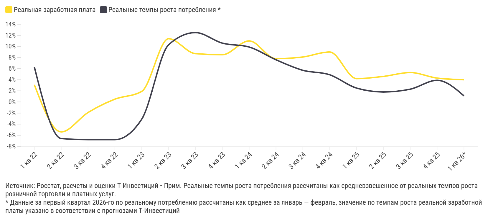

*График 28639721 — «Динамика реальных заработных плат и объемов потребления в Рос». Интерактив: https://flo.uri.sh/visualisation/28639721/embed. Данные: [CSV](../charts/28639721.csv), [JSON](../charts/28639721.json)*

Подписи и настройки графика: axes_highlights.x_areas: рецессия доткомов:: 28.02.2001 >> 30.11.2001; axes_highlights.x_lines: :: Прогноз; axes_highlights.y_lines: ::0; layout.footer_note: Прим. Реальные темпы роста потребления рассчитаны как средневзвешенное от реальных темпов роста розничной торговли и платных услуг.; layout.footer_note_secondary: * Данные за первый квартал 2026-го по реальному потреблению рассчитаны как среднее за январь — февраль, значение по темпам роста реальной заработной платы указано в соответствии с прогнозами Т-Инвестиций; layout.source_name: Росстат, расчеты и оценки Т-Инвестиций; chart_type: line

| label | Реальная заработная плата | Реальные темпы роста потребления * |
|---|---|---|
| 1 кв 22 | 3,1% | 6,3% |
| 2 кв 22 | -5,4% | -6,6% |
| 3 кв 22 | -1,9% | -6,8% |
| 4 кв 22 | 0,5% | -6,8% |
| 1 кв 23 | 1,9% | -3,1% |
| 2 кв 23 | 11,4% | 10,3% |
| 3 кв 23 | 8,7% | 12,5% |
| 4 кв 23 | 8,5% | 10,6% |
| 1 кв 24 | 11,0% | 9,9% |
| 2 кв 24 | 7,8% | 7,6% |
| 3 кв 24 | 8,1% | 5,7% |
| 4 кв 24 | 9,0% | 4,9% |
| 1 кв 25 | 4,2% | 2,5% |
| 2 кв 25 | 4,6% | 1,8% |
| 3 кв 25 | 5,3% | 2,3% |
| 4 кв 25 | 4,3% | 3,9% |
| 1 кв 26* | 4,0% | 1,1% |

Наши фавориты

#### Александр Самуйлов, CFA, главный аналитик Т-Инвестиций

На наш взгляд, в условиях охлаждения экономики при одновременном сохранении достаточно жесткой денежно-кредитной политики инвесторам стоит добавлять в портфель акции компаний, которые сохраняют устойчивый рост бизнеса даже в условиях замедления экономической активности за счет низкой чувствительности спроса на их продукцию к доходам населения.

Также нужно следить, чтобы у эмитента был низкий уровень долговой нагрузки и умеренная оценка по мультипликаторам с учетом его рентабельности и темпов роста бизнеса.

Лента: лучшая динамика в секторе

#### Лента

Целевая цена — 2 300 рублей за акцию

Лента — один из крупнейших продовольственных ритейлеров России и лидер в сегменте гипермаркетов. По данным INFOLine за 2025 год, компания занимает около 3,6% рынка и находится на четвертом месте среди российских ритейлеров по доле.

При этом Лента активно развивает сразу несколько форматов торговли, последовательно двигаясь к статусу одного из крупнейших мультиформатных игроков на рынке.

Лента демонстрирует самые сильные LFL-продажи в секторе и продолжает активно расширять сеть. По итогам первого квартала 2026 года LFL-продажи компании выросли на 6,8%, что стало лучшим результатом в секторе. Одновременно Лента ускоренно наращивает число магазинов «у дома», и именно этот формат сегодня выступает одним из ключевых драйверов роста бизнеса.

Высокие темпы роста и рентабельность сочетаются с привлекательной оценкой. По нашим оценкам, выручка Ленты в 2026 году вырастет на 23% г/г, при этом органический рост составит около 15%, что выше, чем у публичных конкурентов.

Рентабельность по EBITDA (IFRS 16) в 2026 году может составить 10,2%, что также превышает показатели большинства продуктовых ритейлеров. При этом акции компании торгуются с мультипликатором EV/EBITDA 2026 (IFRS 16) ~3,0x — ниже, чем у X5 и Магнита, что, на наш взгляд, указывает на недооценку.

Озон Фармацевтика: ставка на рынок дженериков и перспективные проекты роста

#### Озон Фармацевтика

Целевая цена — 70 рублей за акцию

### Компания занимает сильные позиции на растущем рынке дженериков

По данным DSM Group, по итогам 2025 года Озон Фармацевтика поднялась сразу на пять позиций и заняла шестое место на фармацевтическом рынке по объему sell-out-продаж. Продажи препаратов компании в аптечных сетях выросли на 38%, значительно опередив динамику коммерческого рынка лекарств, где рост составил 13%.

### Дженерики

Аналоги оригинальных препаратов с тем же действующим веществом, которые обычно продаются по более низкой цене.

### Sell-out

Продажи конечным покупателям через аптечные сети.

Сильные результаты за 2025 год. Выручка выросла на 24%, а рентабельность по скорректированной EBITDA достигла 36,6%. Помимо ускорения роста выручки, заметное улучшение маржинальности было связано с повышением валовой рентабельности благодаря прямым контрактам с поставщиками сырья и укреплению рубля. Сдерживающее влияние при этом оказывал рост административных расходов, а также затрат на исследования и разработки на фоне подготовки к запуску новых проектов.

Новые направления могут стать важным драйвером роста. Речь идет о биосимилярах и онкопрепаратах, запуск которых запланирован уже на 2027 год. Эти проекты должны усилить присутствие компании в сегменте бюджетных закупок и поддержать рост общей маржинальности бизнеса за счет более высокой стоимости препаратов.

Оценка компании остается привлекательной. Сейчас акции Озон Фармацевтики торгуются с мультипликатором EV/EBITDA 2026 на уровне 4,6x. Это примерно на 17% ниже среднего исторического уровня компании и на 13% ниже среднего значения по сектору, несмотря на сопоставимые темпы роста выручки и более высокую рентабельность.

Мать и дитя: защитный актив с ростом и дивидендами

#### Мать и дитя

Целевая цена — 1 680 рублей за акцию

MD Medical — одна из крупнейших сетей частных клиник в России с сильными позициями в репродуктивной медицине. Бизнес компании хорошо диверсифицирован как по набору услуг, так и по географии присутствия, а основную долю выручки формируют московские госпитали с высоким средним чеком. Спрос на услуги группы остается устойчивым даже в условиях замедления экономики — во многом благодаря высокой квалификации врачей и сильной репутации бренда.

Выручка, по нашим ожиданиям, сохранит высокие темпы роста. В 2026 году она может увеличиться на 20,9% г/г. Поддержку, по нашим оценкам, продолжит оказывать эффект от приобретения ГК Эксперт, которая добавит около 7,6 п.п. к общему росту выручки. Кроме того, мы рассчитываем на сохранение положительной динамики количества родов в Московском регионе. Этому должно способствовать открытие третьего родильного отделения в госпитале «Лапино-4» в конце 2025 года.

Компания сохраняет амбициозные планы по расширению бизнеса. В ближайшие годы MD Medical планирует открыть в Московском регионе три новых объекта: многопрофильный госпиталь в Зубаревом переулке, центр лучевой терапии «Лапино-3» и многопрофильный госпиталь «Лапино-Юг». Помимо этого, компания рассматривает возможности роста за счет M&A-сделок при привлекательных оценках активов.

Дивидендный профиль остается привлекательным. Прогнозная дивидендная доходность на ближайшие 12 месяцев составляет около 7%. Это достойный уровень с учетом высоких органических темпов роста бизнеса и расширенной инвестиционной программы, связанной со строительством и развитием новых госпиталей в Московском регионе.

Оценка компаний потребительского сектора в зависимости от рентабельности и темпов роста

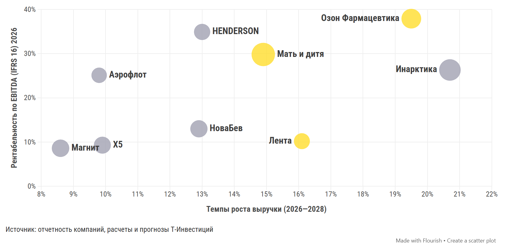

*График 28639756 — «Оценка компаний потребительского сектора в зависимости от рентабельности и темпов роста». Интерактив: https://flo.uri.sh/visualisation/28639756/embed. Данные: [CSV](../charts/28639756.csv), [JSON](../charts/28639756.json)*

Подписи и настройки графика: layout.source_name: отчетность компаний, расчеты и прогнозы Т-Инвестиций

| Colour | metadata_0 | Темпы роста выручки (2026—2028) | Рентабельность по EBITDA (IFRS 16) 2026 | EV/EBITDA 2026 | name_0 | EV/EBITDA 2026 | Темпы роста выручки (2026—2028) | Рентабельность по EBITDA (IFRS 16) 2026 |
|---|---|---|---|---|---|---|---|---|
| 1 | X5 | 9.9 | 9.3 | 3.4 | X5 | 3.4 | 9.9 | 9.3 |
| 1 | Магнит | 8.6 | 8.6 | 3.6 | Магнит | 3.6 | 8.6 | 8.6 |
| 2 | Лента | 16.1 | 10.2 | 3 | Лента | 3 | 16.1 | 10.2 |
| 1 | НоваБев | 12.9 | 13 | 3.5 | НоваБев | 3.5 | 12.9 | 13 |
| 1 | HENDERSON | 13 | 34.9 | 3.1 | HENDERSON | 3.1 | 13 | 34.9 |
| 2 | Мать и дитя | 14.9 | 29.8 | 6.5 | Мать и дитя | 6.5 | 14.9 | 29.8 |
| 2 | Озон Фармацевтика | 19.5 | 37.9 | 4.6 | Озон Фармацевтика | 4.6 | 19.5 | 37.9 |
| 1 | Инарктика | 20.7 | 26.3 | 5.5 | Инарктика | 5.5 | 20.7 | 26.3 |
| 1 | Аэрофлот | 9.8 | 25.1 | 2.8 | Аэрофлот | 2.8 | 9.8 | 25.1 |

## Девелопмент: всплеск спроса сменяется охлаждением

В четвертом квартале прошлого года рынок жилой недвижимости неожиданно столкнулся с резким увеличением спроса, несмотря на высокую ключевую ставку. Решение ввести лимит в одну льготную ипотеку на семью с 1 февраля 2026-го, а также сообщения о возможном повышении ставки для семей с одним ребенком подогрели интерес населения к покупке квартиры.

#### Александр Самуйлов, CFA, главный аналитик Т-Инвестиций

В ближайшие месяцы мы прогнозируем умеренный спрос на новостройки после резкого роста продаж на рынке первичной недвижимости в октябре — январе. При этом в случае объявления дифференциации льготных ипотечных ставок мы не исключаем очередного витка ажиотажного спроса, однако ожидаем, что он будет менее выраженным.

С учетом наших прогнозов траектории ключевой ставки в 2026 году, а также ажиотажного спроса в конце прошлого года мы ожидаем умеренного роста продаж первичной недвижимости в размере около 3,5% в квадратных метрах, а также роста цен на уровне инфляции в 5,5% в результате постепенного восстановления выдач рыночной ипотеки.

Текущие тренды в секторе девелопмента

- Продажи жилья в первом квартале 2026-го выросли на 12% на фоне сохранения ажиотажного спроса в январе в преддверии ограничения в одну семейную ипотеку на семью. При этом в феврале — марте продажи снизились на 13% на фоне исчерпания эффекта аномально высокого спроса в прошлые месяцы. Ожидаем, что со второго квартала динамика объемов реализации жилья будет определяться траекторией ключевой ставки и наличием новых условий по программе семейной ипотеки.
- Накопленный рост цен на новостройки в первом квартале 2026-го оказался ниже инфляции. В январе — марте цены на новостройки совокупно выросли на 2,2% с начала года, что ниже накопленной инфляции за данный период на 0,8 п. п. Более умеренный рост цен на новостройки обусловлен отсутствием эффекта от роста НДС при приобретении недвижимости, а также ослаблением спроса после активных продаж конца прошлого года перед ужесточением условий семейной ипотеки.
- По нашим оценкам, выдачи ипотеки в первом квартале выросли на 70% в денежном выражении. При этом по мере снижения ключевой ставки активно меняется структура выдач в пользу рыночной ипотеки. Так, за первый квартал выдачи ипотеки по рыночным условиям выросли в 3,8 раза, в то время как льготные программы показали рост только на 30% г/г.

- Покрытие проектного финансирования средствами на эскроу в первом квартале сохранилось на устойчивом уровне. Уровень покрытия проектного финансирования средствами на счетах эскроу на конец февраля 2026-го составил 73%, что превышает значение в 69% на конец третьего квартала 2025-го за счет ажиотажных продаж октября—января. Это позитивно сказывается на экономике проектов застройщиков, так как снижает процентную ставку по кредитному портфелю.
- Долговая нагрузка по публичным застройщикам находится на приемлемом уровне. Средний показатель чистый долг/скорр. EBITDA по публичным девелоперам составил 4,5x на конец 2025 года. При этом Эталон демонстрирует наиболее высокую долговую нагрузку на уровне 8,6x. ГК ПИК на конец первого полугодия обладала самой низкой долговой нагрузкой среди девелоперов с показателем −0,4x, и мы ожидаем, что компания сохранила статус наименее закредитованного застройщика по итогам 2025-го.
- Бенефициарами ожидаемого снижения ключевой ставки станут девелоперы в сегментах эконом- и комфорт-класса. Ввиду традиционно более низкой доли ипотечного финансирования в структуре спроса на первичную недвижимость бизнес- и элит-класса продажи в данном сегменте менее чувствительны к изменениям денежно-кредитной политики. Мы ожидаем, что основной прирост в продажах по мере снижения ключевой ставки могут показать Самолет, GloraX и ПИК.

Риски

**Дополнительные ограничения семейной ипотеки могут оказать давление на спрос на рынке первичного жилья**

В правительстве продолжается активное обсуждение введения ступенчатой шкалы ставки по семейной ипотеке в зависимости от количества детей (для семей с одним ребенком предполагается ставка в 10—12%).

**Более медленное смягчение денежно-кредитной политики**

Разгон глобальной инфляции из-за роста цен на энергоресурсы при затяжном конфликте в Иране могут вынудить Банк России медленнее снижать ключевую ставку, что может привести к усугублению дисбалансов спроса и предложения на рынках некоторых регионов (Краснодарский край, Красноярский край и др.)

**Отмена моратория на штрафы для застройщиков ударит по марже**

Однако это не вызовет кризиса ликвидности. Правительство разрешило девелоперам выплатить дольщикам неустойку за перенос сдачи ЖК, накопленную за период действия моратория, до конца 2026 года. По нашим оценкам, отмена моратория окажет наибольший эффект на финансовые результаты Самолета и Эталона, где доля текущего строительства с переносом сроков сдачи, по данным ЕРЗ, составляет 26 и 22% соответственно.

#### Динамика продаж застройщиков в России

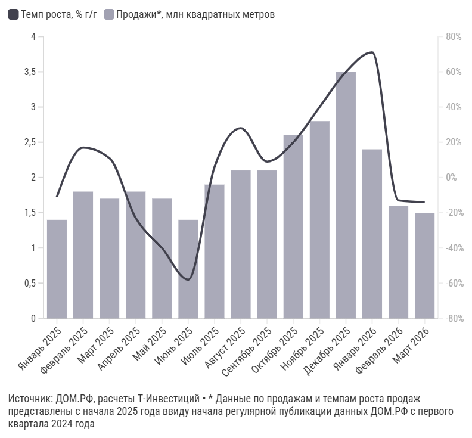

*График 28682160 — «Динамика продаж застройщиков в России». Интерактив: https://flo.uri.sh/visualisation/28682160/embed. Данные: [CSV](../charts/28682160.csv), [JSON](../charts/28682160.json)*

Подписи и настройки графика: axes_highlights.x_areas: рецессия доткомов:: 28.02.2001 >> 30.11.2001; axes_highlights.x_lines: :: Прогноз; axes_highlights.y_lines: ::0; layout.footer_note: * Данные по продажам и темпам роста продаж представлены с начала 2025 года ввиду начала регулярной публикации данных ДОМ.РФ с первого квартала 2024 года; layout.source_name: ДОМ.РФ, расчеты Т-Инвестиций; chart_type: column_grouped_line

| label | Темп роста, % г/г | Продажи*, млн квадратных метров |
|---|---|---|
| Январь 2025 | -11% | 1,4 |
| Февраль 2025 | 17% | 1,8 |
| Март 2025 | 11% | 1,7 |
| Апрель 2025 | -23% | 1,8 |
| Май 2025 | -40% | 1,7 |
| Июнь 2025 | -58% | 1,4 |
| Июль 2025 | 6% | 1,9 |
| Август 2025 | 28% | 2,1 |
| Сентябрь 2025 | 9% | 2,1 |
| Октябрь 2025 | 20% | 2,6 |
| Ноябрь 2025 | 40% | 2,8 |
| Декабрь 2025 | 60% | 3,5 |
| Январь 2026 | 71% | 2,4 |
| Февраль 2026 | -13% | 1,6 |
| Март 2026 | -14% | 1,5 |

#### Динамика цен на жилье

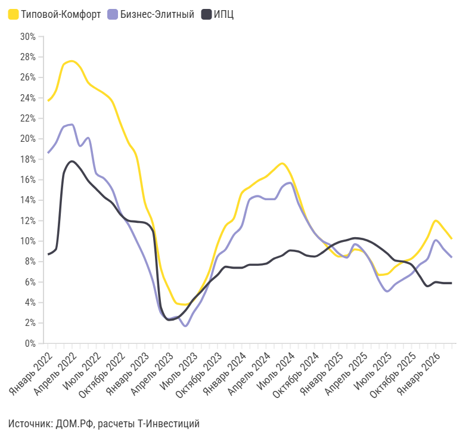

*График 28682091 — «Динамика цен на жилье». Интерактив: https://flo.uri.sh/visualisation/28682091/embed. Данные: [CSV](../charts/28682091.csv), [JSON](../charts/28682091.json)*

Подписи и настройки графика: axes_highlights.x_areas: рецессия доткомов:: 28.02.2001 >> 30.11.2001; axes_highlights.x_lines: :: Прогноз; axes_highlights.y_lines: ::0; layout.source_name: ДОМ.РФ, расчеты Т-Инвестиций; chart_type: line

| label | Типовой-Комфорт | Бизнес-Элитный | ИПЦ |
|---|---|---|---|
| Январь 2022 | 23,7% | 18,6% | 8,7% |
| Февраль 2022 | 24,7% | 19,6% | 9,2% |
| Март 2022 | 27,3% | 21,2% | 16,7% |
| Апрель 2022 | 27,6% | 21,4% | 17,8% |
| Май 2022 | 27,0% | 19,3% | 17,1% |
| Июнь 2022 | 25,5% | 20,1% | 15,9% |
| Июль 2022 | 24,9% | 16,6% | 15,1% |
| Август 2022 | 24,4% | 16,1% | 14,3% |
| Сентябрь 2022 | 23,6% | 15,0% | 13,7% |
| Октябрь 2022 | 21,5% | 12,8% | 12,6% |
| Ноябрь 2022 | 19,6% | 11,6% | 12,0% |
| Декабрь 2022 | 18,2% | 10,0% | 11,9% |
| Январь 2023 | 13,8% | 8,3% | 11,8% |
| Февраль 2023 | 11,7% | 6,1% | 11,0% |
| Март 2023 | 7,3% | 3,0% | 3,5% |
| Апрель 2023 | 5,3% | 2,4% | 2,3% |
| Май 2023 | 3,9% | 2,6% | 2,5% |
| Июнь 2023 | 3,8% | 1,7% | 3,2% |
| Июль 2023 | 4,2% | 3,0% | 4,3% |
| Август 2023 | 5,4% | 4,2% | 5,1% |
| Сентябрь 2023 | 7,1% | 6,0% | 6,0% |
| Октябрь 2023 | 9,7% | 8,5% | 6,7% |
| Ноябрь 2023 | 11,5% | 9,2% | 7,5% |
| Декабрь 2023 | 12,2% | 10,6% | 7,4% |
| Январь 2024 | 14,7% | 11,5% | 7,4% |
| Февраль 2024 | 15,3% | 14,1% | 7,7% |
| Март 2024 | 15,9% | 14,4% | 7,7% |
| Апрель 2024 | 16,3% | 14,1% | 7,8% |
| Май 2024 | 17,0% | 14,1% | 8,3% |
| Июнь 2024 | 17,6% | 15,3% | 8,6% |
| Июль 2024 | 16,6% | 15,7% | 9,1% |
| Август 2024 | 14,5% | 13,7% | 9,0% |
| Сентябрь 2024 | 12,2% | 12,1% | 8,6% |
| Октябрь 2024 | 10,8% | 10,8% | 8,5% |
| Ноябрь 2024 | 10,0% | 10,0% | 8,9% |
| Декабрь 2024 | 9,1% | 9,6% | 9,5% |
| Январь 2025 | 8,5% | 8,8% | 9,9% |
| Февраль 2025 | 8,6% | 8,4% | 10,1% |
| Март 2025 | 9,2% | 9,7% | 10,3% |
| Апрель 2025 | 9,0% | 9,1% | 10,2% |
| Май 2025 | 8,0% | 7,9% | 9,9% |
| Июнь 2025 | 6,7% | 6,1% | 9,4% |
| Июль 2025 | 6,8% | 5,1% | 8,8% |
| Август 2025 | 7,5% | 5,8% | 8,1% |
| Сентябрь 2025 | 8,0% | 6,3% | 8,0% |
| Октябрь 2025 | 8,3% | 6,8% | 7,7% |
| Ноябрь 2025 | 9,1% | 7,7% | 6,6% |
| Декабрь 2025 | 10,4% | 8,3% | 5,6% |
| Январь 2026 | 12,0% | 10,1% | 6,0% |
| Февраль 2026 | 11,2% | 9,2% | 5,9% |
| Март 2026 | 10,2% | 8,4% | 5,9% |

Наши фавориты

#### GloraX

Целевая цена — 98 рублей за акцию

### GloraX — один из самых быстрорастущих федеральных девелоперов с фокусом на регионы с высоким потенциалом роста

Экспертиза компании в ленд-девелопменте и активное взаимодействие с региональными властями в рамках механизма комплексного развития территорий позволяют ей приобретать земельные участки на выгодных условиях, что поддерживает рентабельность бизнеса.

### Ленд-девелопмент

Модель, при которой девелопер приобретает земельный участок без разрешительной документации, а затем доводит его до стадии, готовой к началу строительства.

Сильные операционные результаты за первый квартал 2026 года. Компания продолжила с отрывом опережать динамику рынка и в начале 2026 года: продажи недвижимости девелопера в первом квартале составили 12,6 млрд рублей (+94% год к году). Это значительно быстрее общей динамики российского рынка недвижимости, который в первом квартале замедлил рост до 16% г/г на фоне исчерпания эффекта ажиотажного спроса перед ограничением семейной ипотеки.

Мы ожидаем сохранения опережающих темпов роста выручки. В 2026–2027 годах, по нашим прогнозам, среднегодовой рост выручки GloraX составит 41%. Основными драйверами должны стать выход на новые региональные рынки и постепенное снижение ключевой ставки. Для сравнения: средний показатель по другим публичным девелоперам, по нашим оценкам, составляет около 6%.

Рентабельность компании остается выше средней по сектору. В 2023–2024 годах рентабельность по скорректированной EBITDA у GloraX составляла около 21%, что на 1,6 п.п. выше среднего уровня среди крупнейших публичных девелоперов. Это во многом связано с более низкой стоимостью приобретения земли. В 2025 году рентабельность по скорректированной EBITDA компании сохранилась на уровне 21,4%, что, по нашим оценкам, превышает среднее значение по остальным застройщикам на 5,9 п.п.

Оценки компаний публичных застройщиков в зависимости от рентабельности и темпов роста

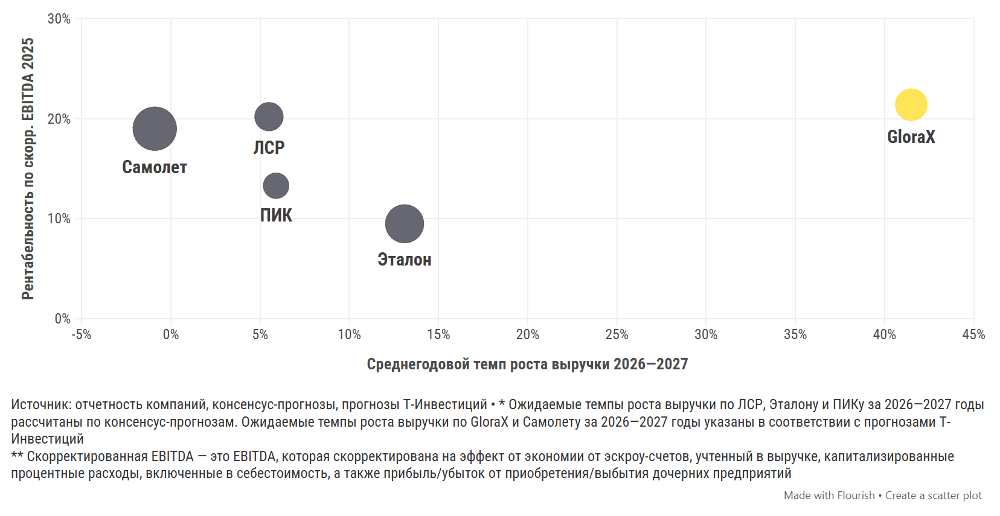

*График 28657338 — «Оценки компаний публичных застройщиков в зависимости от рентабельности и темпов роста». Интерактив: https://flo.uri.sh/visualisation/28657338/embed. Данные: [CSV](../charts/28657338.csv), [JSON](../charts/28657338.json)*

Подписи и настройки графика: layout.footer_note: * Ожидаемые темпы роста выручки по ЛСР, Эталону и ПИКу за 2026—2027 годы рассчитаны по консенсус-прогнозам. Ожидаемые темпы роста выручки по GloraX и Самолету за 2026—2027 годы указаны в соответствии с прогнозами Т-Инвестиций; layout.footer_note_secondary: ** Скорректированная EBITDA — это EBITDA, которая скорректирована на эффект от экономии от эскроу-счетов, учтенный в выручке, капитализированные процентные расходы, включенные в себестоимость, а также прибыль/убыток от приобретения/выбытия дочерних предприятий; layout.source_name: отчетность компаний, консенсус-прогнозы, прогнозы Т-Инвестиций

| Цвет | metadata_0 | Среднегодовой темп роста выручки 2026—2027 | Рентабельность по скорр. EBITDA 2025 | EV/EBITDA 2026 | name_0 | EV/EBITDA 2026 | Среднегодовой темп роста выручки 2026—2027 | Рентабельность по скорр. EBITDA 2025 |
|---|---|---|---|---|---|---|---|---|
| #41414d | Самолет | -0.9 | 19 | 7.5 | Самолет | 7.5 | -0.9 | 19 |
| #41414d | ПИК | 5.9 | 13.3 | 2.6 | ПИК | 2.6 | 5.9 | 13.3 |
| #41414d | ЛСР | 5.5 | 20.2 | 3.2 | ЛСР | 3.2 | 5.5 | 20.2 |
| #41414d | Эталон | 13.1 | 9.5 | 5.8 | Эталон | 5.8 | 13.1 | 9.5 |
| #ffdd2d | GloraX | 41.5 | 21.4 | 4 | GloraX | 4 | 41.5 | 21.4 |

## Финансовый сектор

2025 год оказался непростым для российского банковского сектора. Высокие процентные ставки, рост налоговой нагрузки и связанное с этим замедление экономической активности привели к ряду негативных тенденций, среди которых:

#### Замедление роста кредитных портфелей

Особенно в сегменте индивидуальных клиентов

#### Ухудшение качества активов

Рост доли просроченных кредитов и снижение покрытия резервами

#### Давление на процентную маржу

И на рост основной статьи доходов — чистый процентный доход

#### Опережающий рост операционных расходов

По сравнению с выручкой, оказывал дополнительное давление на рентабельность банков

Тем не менее снижение чистой прибыли в секторе было умеренным (–8% в прошлом году). Некоторые устойчивые к вышеуказанным факторам эмитенты — Сбер и ДОМ.РФ — сохранили рост финансового результата и высокую рентабельность капитала в сложное время.

Динамика прибыли на акцию (EPS) в 2025 году

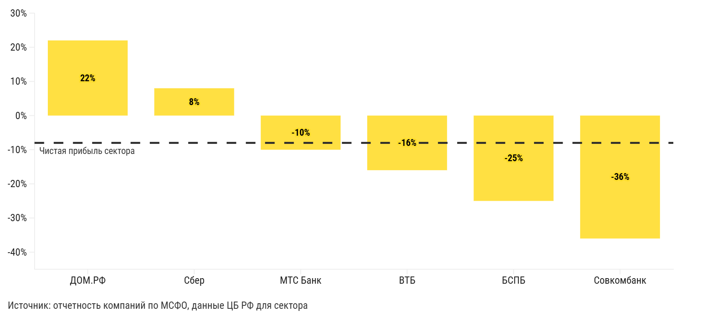

*График 28639396 — «Динамика прибыли на акцию (EPS) в 2025 году». Интерактив: https://flo.uri.sh/visualisation/28639396/embed. Данные: [CSV](../charts/28639396.csv), [JSON](../charts/28639396.json)*

Подписи и настройки графика: axes_highlights.y_lines: Чистая прибыль сектора :: -8; layout.source_name: отчетность компаний по МСФО, данные ЦБ РФ для сектора; chart_type: column_grouped

| Период | Динамика прибыли на акцию (EPS) |
|---|---|
| ДОМ.РФ | 22% |
| Сбер | 8% |
| МТС Банк | -10% |
| ВТБ | -16% |
| БСПБ | -25% |
| Совкомбанк | -36% |

2026 год: восстановление или новое обострение?

Ожидаемое снижение процентных ставок способно оказать заметно более выраженный позитивный эффект на банковский сектор во второй половине текущего года. В случае реализации нашего базового сценария по ставке российские банки получат ряд структурных драйверов улучшения финансовых показателей.

### Возможно ускорение роста кредитных портфелей

Наиболее ощутимого эффекта мы ожидаем у ВТБ после слабой динамики 2025 года, а также у МТС Банка после замедления роста розничного портфеля.

### Снижение стоимости фондирования создает предпосылки для восстановления чистой процентной маржи (NIM)

Что поддержит рост ключевой статьи доходов — чистого процентного дохода. Наибольший потенциал здесь мы видим у ВТБ и Совкомбанка. Сбер, по нашим ожиданиям, сохранит NIM на уровнях, близких к пиковым значениям 2025 года. В то же время Банк Санкт-Петербург, учитывая высокую долю корпоративных кредитов с плавающей ставкой, вероятно, столкнется со снижением маржи в 2026 году.

### Ожидается постепенное улучшение качества кредитных портфелей

Прежде всего у банков, наиболее пострадавших от жестких финансовых условий, — ВТБ, Совкомбанка и МТС Банка.

### Ускорение роста выручки на фоне снижения ставок может способствовать повышению операционной эффективности

Для банков, чьи доходы в 2025 году испытывали наиболее существенное давление от высоких ставок, это позволит частично компенсировать рост операционных расходов.

Отметим, что данные тенденции уже начали частично реализовываться в первом квартале 2026-го: темпы роста кредитного портфеля сектора оттолкнулись от минимальных значений, процентная маржа наиболее уязвимых к высоким ставкам банков восстанавливается, стоимость риска перестала расти — это способствует восстановлению рентабельности.

#### Егор Дахтлер, главный аналитик Т-Инвестиций

В итоге 2026 год, вероятно, окажется более благоприятным для значительной части эмитентов банковского сектора, прежде всего для тех, чья прибыль в наибольшей степени пострадала от высоких ставок, — Совкомбанка и МТС Банка. Вместе с тем мы сохраняем консервативный взгляд и не ожидаем возврата рентабельности капитала к высоким уровням 2024 года.

Рентабельность капитала (ROE)

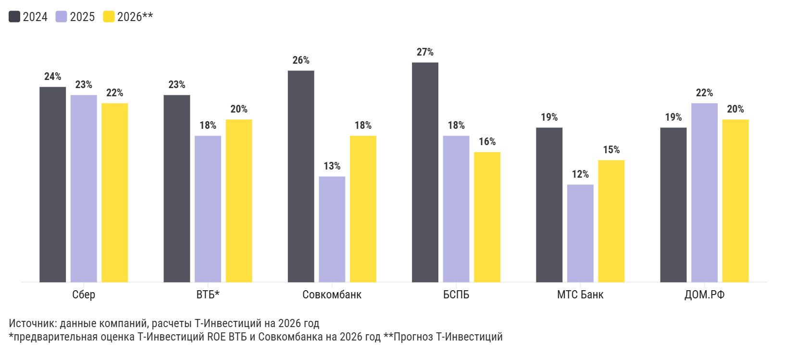

*График 28639483 — «Рентабельность капитала (ROE)». Интерактив: https://flo.uri.sh/visualisation/28639483/embed. Данные: [CSV](../charts/28639483.csv), [JSON](../charts/28639483.json)*

Подписи и настройки графика: axes_highlights.y_lines: Чистая прибыль сектора :: -8; layout.footer_note_secondary: *предварительная оценка Т-Инвестиций ROE ВТБ и Совкомбанка на 2026 год **Прогноз Т-Инвестиций; layout.source_name: данные компаний, расчеты Т-Инвестиций на 2026 год; chart_type: column_grouped

| Период | 2024 | 2025 | 2026** |
|---|---|---|---|
| Сбер | 24% | 23% | 22% |
| ВТБ* | 23% | 18% | 20% |
| Совкомбанк | 26% | 13% | 18% |
| БСПБ | 27% | 18% | 16% |
| МТС Банк | 19% | 12% | 15% |
| ДОМ.РФ | 19% | 22% | 20% |

Риски

**Низкие оценки сохранятся**

В 2025 году на фоне снижения прибыли у всех публичных эмитентов сектора мультипликаторы сократились и оставались низкими в начале текущего года. Несмотря на ожидаемый нами рост рентабельности многих эмитентов в секторе, оценки банков могут оставаться низкими в первом полугодии 2026-го, так как ставки по-прежнему на высоком уровне.

**Ухудшение качества активов**

По нашему мнению, ключевым фактором давления на оценки эмитентов, чей бизнес фундаментально не ухудшился и чья рентабельность капитала (ROE) остается высокой, является риск ухудшения качества активов. Мы ожидаем, что давление на кредитные портфели будет сохраняться до тех пор, пока процентные ставки держатся на высоком уровне, то есть, вероятно, в течение первого полугодия 2026 года.

#### Егор Дахтлер, главный аналитик Т-Инвестиций

В этих условиях мы сохраняем консервативный подход к выбору эмитентов финансового сектора и предпочитаем выжидательную позицию до начала устойчивого цикла снижения процентных ставок. В топ-идеях сохраняем Сбер и ДОМ.РФ.

Рентабельность капитала против P/B в 2026 году

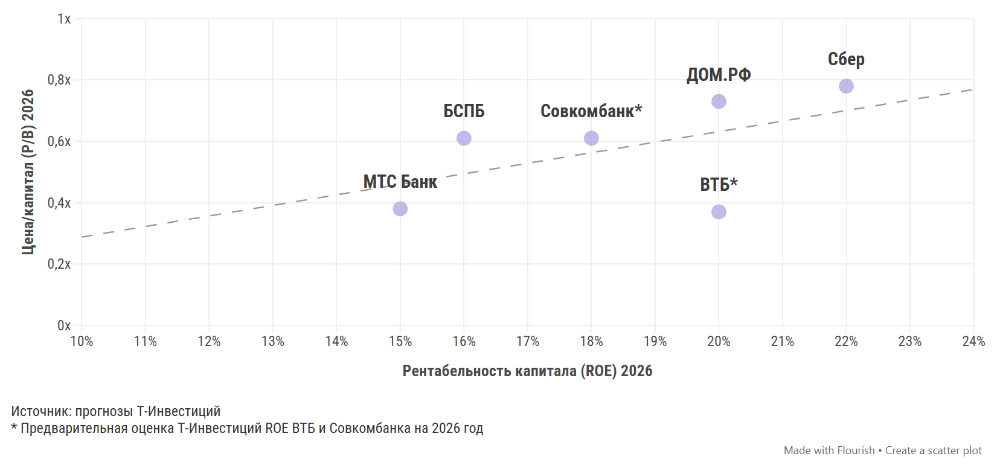

*График 28657133 — «Рентабельность капитала против P/B в 2026 году». Интерактив: https://flo.uri.sh/visualisation/28657133/embed. Данные: [CSV](../charts/28657133.csv), [JSON](../charts/28657133.json)*

Подписи и настройки графика: layout.footer_note_secondary: * Предварительная оценка Т-Инвестиций ROE ВТБ и Совкомбанка на 2026 год; layout.source_name: прогнозы Т-Инвестиций

| metadata_0 | Рентабельность капитала (ROE) 2026 | Цена/капитал (P/B) 2026 | name_0 | Рентабельность капитала (ROE) 2026 | Цена/капитал (P/B) 2026 |
|---|---|---|---|---|---|
| Сбер | 22 | 0.78 | Сбер | 22 | 0.78 |
| ВТБ* | 20 | 0.37 | ВТБ* | 20 | 0.37 |
| Совкомбанк* | 18 | 0.61 | Совкомбанк* | 18 | 0.61 |
| БСПБ | 16 | 0.61 | БСПБ | 16 | 0.61 |
| МТС Банк | 15 | 0.38 | МТС Банк | 15 | 0.38 |
| ДОМ.РФ | 20 | 0.73 | ДОМ.РФ | 20 | 0.73 |

Наши фавориты

#### Сбер

Целевая цена — 368 рублей за акцию

Сбер по итогам 2025 года увеличил чистую прибыль по МСФО на 8%, до 1,7 трлн рублей, рентабельность капитала составила 22%. Сильные финансовые результаты в условиях сложной макроэкономической среды крупнейшему банку страны обеспечили несколько ключевых факторов.

Уверенный рост кредитного портфеля, опережающий сектор как в корпоративном сегменте, так и в розничном кредитовании.

Высокая и устойчивая чистая процентная маржа (NIM) за счет широкой и диверсифицированной клиентской базы — она обеспечивает более низкую стоимость фондирования по сравнению с конкурентами.

Качество активов оставалось лучше среднерыночного уровня, что позволило наращивать отчисления в резервы ниже ожиданий рынка и удерживать стоимость риска на умеренных значениях.

Благодаря устойчивой бизнес-модели Сбер способен стабильно наращивать прибыль даже в неблагоприятных макроусловиях. Высокий уровень достаточности капитала, в свою очередь, создает основу для щедрой дивидендной политики: банк ежегодно направляет на дивиденды 50% чистой прибыли.

По нашим оценкам, дивиденд на акцию по итогам 2025 года составит 37,64 рубля, что соответствует дивидендной доходности около 11,6%.

#### ДОМ.РФ

Целевая цена — 2 720 рублей за акцию

ДОМ.РФ — один из крупнейших финансовых институтов России с уникальным позиционированием на рынке жилищного и инфраструктурного строительства, демонстрирует опережающие ожидания инвесторов финансовые показатели.

Диверсифицированная структура бизнеса с наличием небанковских направлений обеспечивает стабильный растущий комиссионный доход, не подверженный влиянию кредитных рисков.

Рост прибыли более чем на треть в прошлом году, рентабельность капитала (ROE) на уровне лучших публичных эмитентов сектора — выше 21%.

Один из лучших уровней операционной эффективности в секторе. Коэффициент расходы/доходы по итогам 2025 года составил всего 28% — один из самых низких в секторе.

Дивиденды за прошлый год могут составить около 247 рублей на акцию, что обеспечит акционерам доходность в 11% (на среднем уровне среди эмитентов финансового сектора). Полная доходность акционеров может составить 31% на горизонте года.

Целевая цена консенсуса

#### Т-Технологии

Оценка консенсуса. Целевая цена — 500 рублей за акцию

Т-Технологии сохраняют устойчивый рост и высокую рентабельность даже при жесткой денежно-кредитной политике. Компания продолжает активно наращивать клиентскую базу и сохраняет высокую рентабельность капитала (ROE около 30%). При этом, по нашему мнению, эти характеристики пока слабо отражены в рыночной оценке — мультипликаторы остаются ниже среднеисторических уровней.

Экосистема высокотехнологичных решений Т остается ключевым драйвером роста. Число активных пользователей превысило 34 млн, а среднее количество продуктов на одного клиента продолжает увеличиваться, что указывает на рост вовлеченности и качества клиентской базы.

Широкая продуктовая линейка и глубокое проникновение в лайфстайл-сегменты обеспечили существенный рост и диверсификацию бизнеса. Выручка за 2025 год увеличилась на 49% и превысила 1,4 трлн рублей. GMV лайфстайл-сервисов в 2025 году превысил 230 млрд рублей, подтверждая масштаб и потенциал экосистемных направлений.

Компания демонстрирует ориентир на максимизацию акционерной стоимости. Около 30% прибыли направляется на дивиденды, параллельно реализуется программа обратного выкупа акций.

Экосистемная модель Т-Технологий обеспечивает рост прибыли даже при высоких ставках. Даже в условиях жесткой денежно-кредитной политики консенсус-прогноз предполагает существенный рост чистой прибыли и сохранение ROE близким к целевым 30% в текущем году. При этом акции компании торгуются с мультипликатором P/E ниже 4x — заметно ниже среднего уровня за последние три года (выше 5x), что указывает на сохраняющийся потенциал переоценки.

## Стратегию подготовили

- Софья Донец Главный экономист
- Юрий Тулинов Глава аналитики по рынку облигаций
- Марьяна Лазаричева Глава аналитики по рынку акций
- Егор Дахтлер Главный аналитик
- Александр Самуйлов Главный аналитик
- Ахмед Алиев Ведущий аналитик
- Сергей Колбанов Старший аналитик
- Александра Прыткова Ведущий аналитик
- Александр Потехин Ведущий аналитик
- Никита Степанов Старший аналитик
- Евгений Кошелев Аналитик по срочному рынку
- Евгений Митюков Директор по инвестициям, УК Т-Капитал
- Дария Лехницкая Руководитель редакционного отдела
- Анастасия Тушнолобова Руководитель аналитической редакции
- Илья Марченко Аналитический редактор

Аналитический отчет составлен в соответствии с Методикой оценки ценных бумаг Т-Банка. Обзор также содержит информацию о ценных бумагах, которые предназначены только для квалифицированных инвесторов в соответствии со ст. 51.2 Федерального закона №39-ФЗ «О рынке ценных бумаг».

АО «ТБанк», лицензия на осуществление брокерской деятельности № 045-14050-100000, лицензия на осуществление депозитарной деятельности № 045-14051-000100, выданы Банком России 06.03.2018 г. (без ограничения срока действия).

АО «ТБанк» не гарантирует получение доходности на рынке ценных бумаг. Клиент самостоятельно принимает решения по инвестированию и несет ответственность за полученный результат. Предлагаемые ценные бумаги иностранных эмитентов допущены к обращению на российском рынке.
